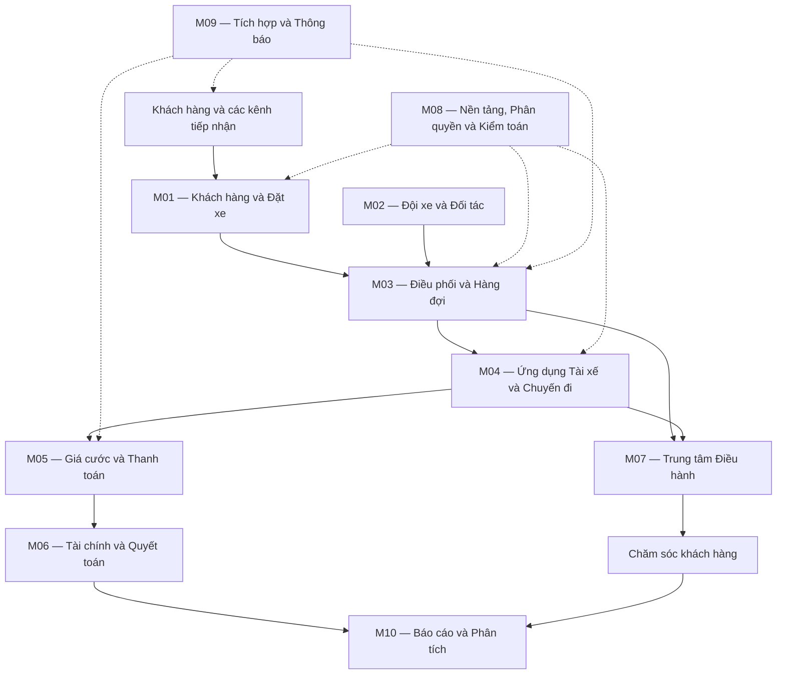

# 00 — TỔNG QUAN HỆ THỐNG ĐIỀU HÀNH TAXI

**Mã tài liệu:** TAXI-ARC-000 · **Phiên bản:** 0.2 · **Trạng thái:** DỰ THẢO  
**Quay lại mục lục trung tâm:** [README](./README.md)

## 1. Mục tiêu
Xây dựng nền tảng quản lý taxi xuyên suốt từ tiếp nhận yêu cầu, quản trị khách hàng và nguồn lực, điều phối, thực hiện chuyến, tính cước, thanh toán, tài chính, đối soát, CSKH đến báo cáo điều hành.

## 2. Mô hình khai thác
DIRECT và PARTNER dùng chung workflow vận hành và nền tảng dispatch. Tuy nhiên, quyền sở hữu nguồn lực, hợp đồng, beneficiary, doanh thu, công nợ, khấu trừ và settlement phải được phân định riêng. Không suy ra fleet type từ booking channel.

## 3. Chuỗi nghiệp vụ tổng thể
Customer/Channel → Booking → Serviceability → DispatchRun → Eligibility → Candidate Ranking → Offer → Assignment → Trip → Fare → Payment → Ledger → Settlement → CSKH/Reporting.

## 4. Các miền nghiệp vụ cốt lõi
Khách hàng; Đặt xe; Đội xe; Đối tác; Điều phối; Chuyến đi; Giá cước; Thanh toán; Tài chính; Quyết toán; Chăm sóc khách hàng; Nền tảng/Phân quyền/Kiểm toán; Tích hợp; Báo cáo.

## 5. Các ranh giới bắt buộc
- Booking là yêu cầu dịch vụ.
- DispatchRun là một lần thực hiện tìm nguồn lực.
- Offer là lời mời có thời hạn.
- Assignment là phân công có hiệu lực.
- Trip là quá trình thực hiện dịch vụ thực tế.
- FareResult là kết quả tính cước.
- PaymentTransaction là giao dịch thu/hoàn tiền.
- LedgerEntry là bút toán tài chính.
- SettlementBatch là kỳ/batch đối soát và chi trả.

## 6. Sơ đồ năng lực

## 7. Nguyên tắc dữ liệu và điều phối
Một Module sở hữu write model; Module khác dùng API/event/read projection. Eligibility là điều kiện cứng, ranking chỉ xếp hạng các candidate đã đủ điều kiện. Assignment phải được tạo atomic để tránh nhận xe trùng. Các lệnh quan trọng cần idempotency và audit.

## 8. Lộ trình thiết kế
1. Chốt bối cảnh, phạm vi và stakeholder.
2. Chốt DIRECT/PARTNER operating model.
3. Hoàn thiện E2E và exception flows.
4. Chuẩn hóa domain, Module và ownership.
5. Chuẩn hóa State Machine, data model, API/event, security, NFR.
6. Đặc tả từng Feature.
7. Phát triển, kiểm thử và nghiệm thu từng Feature; sau đó tích hợp.

## 9. Những nội dung cần Business xác nhận
Tariff/surcharge; no-show/cancellation; service zones; DIRECT/PARTNER priority; dispatch radius/scoring/offer timeout/retry; partner share/deductions; payment providers; SLA/KPI; data retention/legal; capacity/SLO/RTO/RPO.

## 10. Liên kết chi tiết
- [Danh mục Module chuẩn đề xuất](./03-MODULE-ARCHITECTURE-AND-OWNERSHIP.md)
- [Module Catalog](./README.md#2-module-catalog)
- [State Machines](./03-CROSS-CUTTING/01-state-machines-and-transition-rules.md)
- [Data Architecture](./03-CROSS-CUTTING/02-data-architecture-and-erd.md)
- [Feature Specs](./docs/05-FEATURE-SPECS/README.md)
