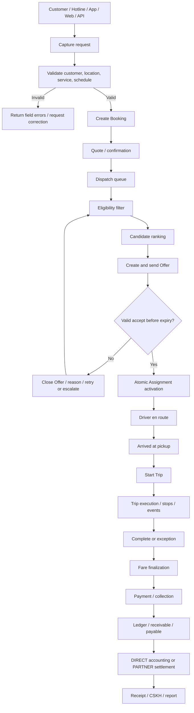

# FND-03 — QUY TRÌNH NGHIỆP VỤ ĐẦU-CUỐI

**Version:** 0.1 · **Status:** DRAFT · **Owner:** Operations (TBD)

## 1. Luồng chuẩn

## 2. Booking intake

**Actor:** Customer, Call Center Agent, App, Web, Partner/API client.  
**Input:** customer/contact, channel, pickup, destination, ordered stops, service type, passengers, luggage/accessibility, requested time, notes, consent/terms where required.

**Steps:** capture → normalize address/coordinates → validate service area and required fields → duplicate warning → quote/confirmation policy → persist booking and revision/audit → dispatch eligibility.

**Output:** booking_id/public_reference, state, price estimate/quote reference if available, customer communication event.

## 3. Dispatch and assignment

Dispatch creates a run/attempt and immutable policy/candidate snapshot. First apply hard eligibility; then rank valid candidates. Send Offer with server-side expiry. Accept operation rechecks booking state, offer expiry, driver/vehicle availability, contract and conflict conditions atomically. Only one active assignment per booking. No candidate leads to exception queue, not silent cancellation.

Manual selection cannot bypass hard eligibility. Override of soft ranking requires reason and audit; hard-rule override requires separately approved emergency policy.

## 4. Trip execution

Driver receives active assignment, proceeds to pickup, records arrival, starts trip, executes ordered stops, completes trip. All events are server-validated and contain actor, source, server/device timestamps, sequence, correlation and location evidence where available.

Offline events are queued with client UUID and reconciled on server. Device must not show a final success until acknowledged. No-show, safety incident, cancellation and dispute use separate governed flows.

## 5. Fare, payment and finance

Fare is calculated from verified trip facts and a tariff version snapshot. Payment transaction is separate from trip state; unknown provider result enters reconciliation, not false failure. Ledger entries are append-only; corrections use compensating/adjustment entries.

## 6. DIRECT/PARTNER treatment

Use the actual assigned fleet source and contract snapshot. DIRECT and PARTNER can use the same booking/dispatch/trip engine. Contract terms, gross/net allocation, receivable/payable, deductions, disputes, settlement and payout remain classifiable and independently controlled.

## 7. Mandatory exception flows

| Code | Exception | Minimum behavior |
|---|---|---|
| EX-01 | Invalid request | Reject field(s), preserve draft where possible |
| EX-02 | No eligible vehicle | Keep request visible; retry/escalate |
| EX-03 | Offer declined/expired | Close offer, record reason, retry policy |
| EX-04 | Concurrent accept | One winner; conflicts rejected |
| EX-05 | Resource becomes ineligible | Block transition; re-evaluate assignment |
| EX-06 | Pickup/destination change | Revalidate quote, eligibility, offers, assignment |
| EX-07 | GPS/network loss | Mark freshness/connectivity separately |
| EX-08 | Customer no-show | Evidence/wait threshold per approved policy |
| EX-09 | Incident/SOS | Prioritized incident case, location/time if available |
| EX-10 | Payment unknown | Reconcile provider, do not double charge |
| EX-11 | Fare dispute | Preserve evidence, review and linked adjustment |
| EX-12 | Partner settlement variance | Hold affected line/batch per policy, auditable correction |

## 8. E2E completion criteria

Booking to assignment traceable; trip tied to assignment; fare reproducible; payment/provider references reconciled; ledger balanced; partner settlement tied to contract snapshot; every exception has owner/status; no duplicate assignment, payment effect or ledger posting.
