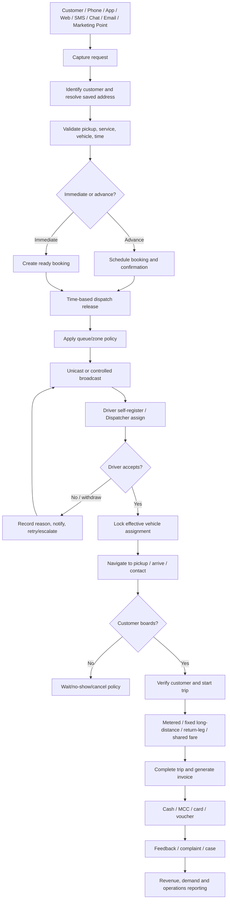

# 01 — FULL BUSINESS & SYSTEM BLUEPRINT (KPMG FUTURE TAXI BASELINE)

**Document ID:** TAXI-BIZ-001 · **Version:** 0.1 · **Status:** DRAFT FOR BUSINESS VALIDATION  
**Source baseline:** *MLG_Luu do va mo ta quy trinh & Yeu cau _Dieu hanh taxi_v3.docx*, KPMG, 2015, 90 pages.  
**Navigation:** [Repository README](../README.md) · [System Overview](../00-OVERVIEW.md)

> This document translates the KPMG future-state taxi operating processes and requirements into a system-wide business/design baseline. It is not a claim that every 2015 policy remains current. Preserve source requirements, identify gaps, and obtain business approval before implementation.

## 1. Executive understanding

The target is not merely a ride-hailing app. It is an integrated Taxi Operations Platform supporting customer demand intake through multiple channels, call-center operations, dispatch and fleet allocation, driver execution, marketing/queue stations, pre-booking, long-distance fixed fares, return-leg utilization, shared rides, billing/payment, customer feedback, operational control, management reporting and enterprise integration.

KPMG defines process documentation as narrative process descriptions with inputs/outputs, flow diagrams and step catalogues with responsible roles. The source explicitly states that these future processes should adapt to changing business needs.

## 2. KPMG source inventory and traceability

### 2.1 Future-state processes (Part A)
| Source ID | Process | Main business scope | Primary roles |
|---|---|---|---|
| TO.P1 | Customer requests taxi by Call Center | Call, missed call, new/remind/change/cancel, call-center entry, dispatch, driver response, pickup, trip, payment, feedback | Customer, Call Center Agent, Dispatcher, Driver |
| TO.P2 | Customer uses App | Login, request, route/fare estimate, long-distance choice, nearby vehicle display/selection, driver acceptance, arrival, trip, invoice/payment/feedback | Customer, System, Dispatcher, Driver |
| TO.P3 | Marketing point with station operator | Taxi request at staffed marketing/queue point and end-to-end fulfillment | Customer, Station Operator, Dispatcher, Driver |
| TO.P4 | Queue area without station operator | Geofence/queue-area handling, unicast/broadcast, taxi staging queue, dispatch by queue order, trip/payment | Customer, Dispatcher, Driver |
| TO.P5 | Customer requests by SMS | Parse defined SMS syntax, validate, booking reference, dispatch and trip | Customer, System, Dispatcher, Driver |
| TO.P6 | Customer requests by Chat | Chat intake/agent handling and end-to-end service | Customer, Agent, Dispatcher, Driver |
| TO.P7 | Customer requests by Web | Authenticated web request, booking reference, confirmation/change/cancel and service | Customer, System, Dispatcher, Driver |
| TO.P8 | Advance booking | Advance request from app/web/phone/email/chat/SMS, confirmation, scheduling, dispatch before pickup | Customer, Agent, Dispatcher, Driver |
| TO.P9 | Long-distance fare | Long-distance fixed fare, route/distance/time conditions, trip, extra charges, invoice/payment/feedback | Customer, Driver, Dispatcher |

### 2.2 Functional requirement families (Part B)
| Source IDs | Capability group | Requirement intent |
|---|---|---|
| TO.A | Customer | Multi-channel booking, request changes/cancellation, long-distance, return-leg, fare/distance estimate, shared ride, ETA, nearby cars/driver selection, account, payment, feedback |
| TO.B | Driver | Unicast/broadcast demand feed, list/map, marketing-point demand, register pickup, visibility of other requests, navigation, staging queue, long-distance/return-leg, cancellation |
| TO.C | MLG Dispatcher/Control | Search fleet/trips, manage long-distance tariffs and marketing/queue locations, waiting/reminder lists, trip data, vehicle status, assign/cancel assignment, demand forecasting, pre-booking list, service directory |
| TO.D | Call Center Agent | Enter requests, identify caller and saved addresses, change/cancel, reminder counts, waiting lists, address shortcuts, missed calls, VIP/interest customer flags, marketing-point flags, service directory |
| TO.E | Marketing-point operations | Request taxis to point, FIFO queue, configurable wait/queue distance, manual assignment, operator GPS, operating hours, performance and latent-demand capture |
| TO.F | Controls | Fare calculation and revenue recording, demand spike alerts, one-driver/one-customer assignment control, authentication, role/group permissions, event/security logs |
| TO.G | Demand reporting | Demand by phone/customer/area/street/ward/district/zone, marketing/queue point, long-distance mode, vehicle class, new callers, period and comparable period |
| TO.H | Revenue reporting | Operating/occupied km, revenue by customer/area/point/driver/long-distance mode/call, productivity and utilization |
| TO.I | Operations reporting | Trips, pickup success/failure, no assignment, dispatch/pickup time, waiting time, driver cancellations/refusals, long pickup time, lost property, accident, technical issue, complaints, internal nonconformance, security incidents |
| TO.J | Technical | 20,000 concurrent drivers, 5,000 concurrent customer requests, mobile platforms and integrations with CRM/HR/accounting systems |

The source classifies many requirements as **Phải có / Cần có / Tùy chọn**. Preserve those source priority labels in the traceability register; do not silently translate them into a new delivery priority without review.

## 3. Target business capability map

### 3.1 Demand and customer channels
- Customer App (smartphone/tablet), Web portal, hotline/voice, SMS, email, chat, marketing point/station, partner/API channels (extension proposal).
- Customer identity, caller recognition, contact points, saved addresses, VIP/interest segments, special service directory.
- New request, reminder, change, cancellation, scheduled request, request tracking/session, notifications and feedback.

### 3.2 Booking and service request
- Capture pickup (address/place/GPS), optional destination, vehicle class/model, quantity, pickup time, contact, special instructions.
- Normalize and validate address, zone/serviceability, duplicate detection, request code/reference.
- Immediate and advance bookings; amendments and cancellations with history.
- Multi-vehicle booking, subject to capacity and policy.
- Request lifecycle and channel-neutral Booking record.

### 3.3 Dispatch and fleet supply
- Unicast to available cars in configurable radius/zone; broadcast system-wide only under dispatcher-controlled conditions.
- Show requests in list/map, route distance, ETA and relevant request details.
- Driver self-selection/registration and dispatcher assignment.
- Prevent more than one car registering for the same customer request.
- Track accept/refuse/cancel reasons and repeated refusal/cancellation.
- Waiting-customer and reminder queues; demand surge alerts; manual fallback.
- Separate availability, dispatch eligibility, location freshness and connectivity.

### 3.4 Marketing points and queue areas
- Define normal/special marketing points and unmanned queue areas.
- Point master data: name, address, contacts, contract reference, characteristics, hours, queue capacity/demand and operator.
- Driver arrival and FIFO registration; max queue capacity; distance eligibility; turn timer; skip to next driver; operator intervention with audit.
- Operator location, request-to-point, point utilization, latent demand and revenue performance.
- Do not merge marketing-point queue position with ordinary dispatch candidate ranking.

### 3.5 Driver and trip execution
- Driver identity, employee/driver number, vehicle, current state, trip assignment.
- Driver app: demand list/map, register/withdraw, accept/refuse, pickup navigation, arrival, customer contact, start meter/trip, destination, route trace, completion, invoice and feedback context.
- Capture pickup/dropoff timestamps and GPS/odometer/telematics distance where available.
- Driver may cancel accepted pickup under policy; notify customer/dispatcher and return request to queue or exception handling.
- Lost property, accident/collision, technical fault, security incident (e.g. code 313 in source), customer complaint and internal nonconformance cases.

### 3.6 Pricing and commercial service types
- Metered fare based on actual distance and waiting time.
- Long-distance fixed fare by route and vehicle class; one-way and two-way; threshold and extra distance/time surcharge.
- Return-leg/vãng lai chiều về matching and pricing.
- Shared ride: match compatible customers on a common route and split fare; this is marked optional in source.
- Estimate route distance/fare; display direct long-distance vs return-leg alternatives and estimated vehicle wait.
- Invoice line items: metered/fixed fare, long-distance surcharge, toll, tip, driver/employee identifier, pickup/dropoff and trip date/time.
- Fare rules are versioned and applied consistently across channel, trip, invoice and finance.

### 3.7 Payment and customer experience
- Source payment methods: cash, MCC postpaid card, credit/debit/ATM card, voucher.
- Payment evidence/receipt and reconciliation.
- Mandatory service rating with optional written comments; feedback through app, hotline, random outbound survey, email/chat/CSKH.
- Complaint, lost property, accident, technical and security case management.

### 3.8 Control Tower and reporting
- Live vehicle state and map; demand/long-wait/reminder/no-assignment lists.
- Search by revenue, location, time, route, pickup/dropoff, vehicle color/class, driver and plate.
- Demand, revenue and operations reports with period comparisons.
- Driver refusal/cancellation, wait time, pickup time and service quality monitoring.
- Forecast demand by region/time is optional in source; do not treat forecast as mandatory until approved.

### 3.9 Platform and enterprise integration
- Authentication and role/group authorization for customers, drivers, call agents, station operators, dispatchers and administrators.
- Configurable security policy and audit/logging of security-sensitive changes.
- CRM, HR and accounting integration; integration architecture and data ownership require detailed design.
- Technical resilience, monitoring, backup, privacy and cyber controls need current requirements beyond the 2015 baseline.

## 4. End-to-end operating model

This is a synthesized target flow. Each source process TO.P1–TO.P9 retains its own channel/station/long-distance variants and must be detailed in its own swimlane.

## 5. Module architecture mapped to source requirements

| Module | Responsibilities | KPMG traceability |
|---|---|---|
| M01 Customer & Booking | Customer/contact/address, channel intake, request/change/cancel, immediate/advance booking, request session/reference | TO.P1, P2, P5, P6, P7, P8; TO.A; TO.D |
| M02 Fleet & Partner | Driver/vehicle master, driver/vehicle status, capability, availability, identity and operational attributes | TO.B; TO.C.12–13; TO.F.8 |
| M03 Dispatch & Queue | Unicast/broadcast, candidate feed, self-registration, dispatcher assignment, cancel/refusal, one-car-per-request, wait/reminder and queue rules | TO.P1–P8; TO.B.1–B.10; TO.C.8–C.15; TO.F.5–F.6 |
| M04 Driver App & Trip | Driver interaction, pickup, arrival, customer verification, trip/meter, GPS trace, completion and exceptions | TO.P1–P9; TO.B; TO.C.12–C.13 |
| M05 Pricing & Payment | Estimate, metered fare, fixed long-distance, surcharge, return-leg, shared ride, invoice, cash/MCC/card/voucher | TO.P2, P8, P9; TO.A.8–A.11, A.16; TO.F.1–F.4 |
| M06 Marketing Point & Queue Area | Marketing point master, staffed/unmanned queue, FIFO, capacity, operator, location and point performance | TO.P3–P4; TO.B.3, B.7; TO.C.5–C.7; TO.E |
| M07 Call Center & Control Tower | Agent desktop, caller recognition, saved address, shortcut, missed calls, reminder, wait list, dispatch console, overrides | TO.P1, P3–P7; TO.C; TO.D |
| M08 Customer Service & Case Management | Rating, complaint, lost property, accident, technical fault, security event, internal nonconformance | TO.P1–P9; TO.A.17; TO.I.9 |
| M09 Reporting & Analytics | Demand, revenue, productivity, fleet utilization, driver quality, operational exceptions, comparisons, optional forecasting | TO.C; TO.G; TO.H; TO.I |
| M10 Platform, Integration & Operations | Identity, role/group, audit/security logs, CRM/HR/accounting integration, capacity, resiliency and operations | TO.F.7–F.9; TO.J |

Module grouping is a proposed software boundary. KPMG process roles remain business responsibilities; final org/RACI needs MLG confirmation.

## 6. Canonical business objects and data ownership

| Object | Business meaning | Owning Module |
|---|---|---|
| Customer / ContactPoint / SavedAddress | Person/company, contact and remembered pickup addresses | M01 |
| Booking / BookingRevision | Customer's service request and its revisions | M01 |
| DispatchRun / Candidate / Offer | A dispatch attempt, evaluated options and driver invitation | M03 |
| Assignment | Effective driver/vehicle allocation for a request | M03 |
| Driver / Vehicle / DriverState | Driver and vehicle master/operational state | M02 |
| QueueRegistration | Driver's FIFO position at a marketing/queue point | M06 |
| Trip / TripEvent / RouteTrace | Actual pickup, journey, stops and completion evidence | M04 |
| FareQuote / FareResult / Invoice | Estimate, final calculation and invoice | M05 |
| Payment / PaymentEvidence | Collection/refund and evidence | M05 |
| ServiceCase / IncidentCase | Complaint, accident, lost property, technical/security event | M08 |
| Demand/Revenue/Operations projections | Read-optimized reporting measures | M09 |
| User/Role/AuditEvent | Identity, permissions and security history | M10 |

A proposed new platform may separate DispatchRun, Offer and Assignment even where the legacy process uses one “registered pickup” status. This is a design refinement, not a source claim.

## 7. Important source parameters — preserve, do not hard-code

| Source parameter | KPMG value/example | Treatment |
|---|---:|---|
| Long-distance threshold | Over 30 km | Historical source rule; business revalidation required |
| App/Web nearby cars | 5 nearest cars, 500 m radius | Configurable policy; validate current customer experience |
| Driver pickup registration eligibility | Within 500 m by actual route | Source requirement; confirm current routing basis |
| Queue/staging eligibility | Within 100 m | Source parameter; configurable/revalidate |
| Queue turn response | 60 seconds | Source parameter; configurable/revalidate |
| Driver cancellation lock before advance pickup | 20 minutes | Source parameter; confirm operating policy |
| Dispatcher waiting list | More than 5 minutes | Source parameter; configure per operation |
| Pre-booking dispatch list | 60 minutes before pickup | Source parameter; configurable |
| Missed-call display | 30 seconds | Source parameter; configure |
| VIP temporary address reset | 5 hours | Source rule; validate customer/address policy |
| Driver dispatcher-assignment refusals | More than 2 times | Source parameter; confirm escalation |
| Driver average pickup alert | Over 8 minutes | Source report threshold; revalidate |
| Driver cancellation report | More than 3 times | Source report threshold; revalidate |
| Technical capacity | 20,000 concurrent drivers; 5,000 simultaneous customer requests | KPMG 2015 sizing requirement; new load model and performance test required |

None of these numbers should be coded as constants. Store approved operational parameters with effective date, scope, version, change history and authorized owner.

## 8. Functional requirement priority preservation

- **Phải có:** preserve as mandatory source requirement pending current owner confirmation.
- **Cần có:** preserve as needed source requirement; sequencing is a project decision.
- **Tùy chọn:** optional source capability; do not silently omit from long-term product roadmap.
- **TBD:** where source is silent, ambiguous, has placeholders (e.g. [xxx]) or policy has since changed.

Every requirement needs a traceability record: source ID, page, verbatim/faithful summary, source priority, target module/feature, acceptance criteria, current disposition (retain/change/defer/retire), owner and approval.

## 9. Critical business rules to model explicitly

1. Multi-channel intake creates a common request record while preserving originating channel and source interaction.
2. Caller recognition uses phone number and saved addresses, but agent must be able to choose/correct the pickup location.
3. Change/cancel must find the right request by booking reference or verified customer/call context.
4. A single customer request cannot be assigned to multiple effective vehicles.
5. Unicast is default in the source; broadcast is controlled by MLG operations for exceptional conditions.
6. Driver self-registration and dispatcher assignment are distinct paths; both require conflict control.
7. Driver refusal/withdrawal/cancellation must be recorded with reason and reflected in customer/dispatcher experience.
8. Marketing-point FIFO is separate from ordinary request dispatch and respects capacity, eligibility, turn timeout and override authority.
9. Advance booking must be scheduled and released for dispatch according to an approved configurable lead time.
10. Trip start/end, actual distance, waiting time and route trace provide evidence for fare and reporting.
11. Metered, fixed long-distance, return-leg and shared-ride calculations are separate fare modes with explicit eligibility.
12. Invoice components, payment instrument and evidence must reconcile to trip and revenue.
13. Customer rating is mandatory in the source process; comments are optional.
14. Role/group permissions and security event logging apply across the platform.

## 10. Exception catalogue for full design

| ID | Scenario | Required behavior to specify |
|---|---|---|
| EX-01 | Missed call | Callback window by area/time; persistent display when existing open request |
| EX-02 | Caller changes phone number | Agent search by address/reference and controlled identity confirmation |
| EX-03 | Invalid SMS syntax | Return correction instructions; do not create a false booking |
| EX-04 | Address ambiguous/unmapped | Resolve by shortcut/place/pin/manual review |
| EX-05 | No car in unicast radius | Wait, expand radius, broadcast by authorized override, or inform customer |
| EX-06 | Broadcast surge | Guarded enable/disable, audit, capacity/rate safeguards |
| EX-07 | Multiple drivers register | Atomic winner; reject competing registrations |
| EX-08 | Driver refuses/withdraws | Record reason, notify and return request to eligible pool |
| EX-09 | Driver cancels after en-route | Notify customer; re-dispatch or operator escalation |
| EX-10 | Customer changes/cancels after assignment | Validate timing/state; notify driver; release/reassign safely |
| EX-11 | Driver arrives/customer absent | Wait timer, contact, no-show evidence and policy |
| EX-12 | Queue capacity full | Deny/hold queue registration and expose demand to operator |
| EX-13 | Queue turn timeout | Skip to next eligible driver, record skipped turn/reason |
| EX-14 | GPS stale/network outage | Mark location freshness; do not assume vehicle is near/available |
| EX-15 | Long-distance fixed fare no longer applicable | Re-quote/obtain customer consent before changing fare mode |
| EX-16 | Return-leg vehicle matching | Check direction, time window, vehicle availability and fixed fare |
| EX-17 | Shared ride incompatible route/capacity | Do not combine; preserve separate bookings/fares |
| EX-18 | Trip distance/telematics mismatch | Exception review and controlled fare adjustment |
| EX-19 | Payment instrument/evidence mismatch | Reconciliation queue; do not mark paid without evidence |
| EX-20 | Accident/lost property/security event | Case workflow, escalation, evidence, privacy and audit |
| EX-21 | Duplicate callback/request | Idempotent handling and one financial/booking effect |
| EX-22 | CRM/HR/accounting integration unavailable | Durable retry/reconciliation; operational fallback |

## 11. Required detailed artifacts before DEV implementation

### System-wide
- Business context, stakeholder map and approved scope.
- E2E process map and role swimlanes for all TO.P1–TO.P9.
- Canonical business glossary and requirement traceability.
- Context/bounded-context map and ownership.
- Cross-domain state machines and transition tables.
- Logical ERD/data dictionary.
- API/event catalog and integration contracts.
- Role/action/data-scope permission matrix.
- NFR, capacity, SLO, backup/DR, observability and security.
- Decision register and policy parameter catalogue.

### Per Module
- Module charter and boundaries.
- Detailed workflows: happy path, alternate, exception, recovery.
- Business rule catalogue with source references.
- State machine and transition guards.
- Entity model, field dictionary and constraints.
- UI screen map and state behavior.
- API/commands/events and integration contracts.
- Permissions, audit and operational controls.
- Feature catalog with source traceability.
- Test scenarios and acceptance evidence.

### Per Feature
Objective, actor, scope, preconditions, postconditions, step-by-step flow, decision tables, field validations, UI states, API schemas, DB changes, authorization, audit, idempotency/concurrency, error handling, logging/metrics, test cases, Given/When/Then acceptance, dependencies and approver.

## 12. Delivery sequence

1. Approve source inventory and disposition of all KPMG TO.P requirements.
2. Approve system-wide operating model and TO.P1–TO.P9 E2E flows.
3. Design Module boundaries and detailed Module flows.
4. Resolve state, data, permission and integration contracts.
5. Specify Booking → Dispatch → Trip features first, including Call Center, App, SMS/Web and marketing/queue variants.
6. Specify pricing/payment, long-distance/return-leg/shared ride and finance controls.
7. Specify CSKH, reporting, security, integration and operational support.
8. DEV/QA/UAT implement and accept feature by feature.

## 13. Open decisions / current validation required
- Which 2015 KPMG requirements remain active, have changed, or are retired?
- Current booking channels and telephony/CRM capabilities.
- Current DIRECT/PARTNER fleet model and contract/settlement rules.
- Current fare tariff, long-distance threshold, return-leg pricing and shared-ride policy.
- Current map/routing/GPS/telematics source and location freshness.
- Current unicast/broadcast policy, dispatch radius, driver choice and operator override.
- Current marketing-point and queue-area operating model.
- Current payment methods and MCC/voucher lifecycle.
- Current organizational roles, branch/zone hierarchy and authorization.
- Current load profile and performance targets.
- Current privacy, retention, cybersecurity and regulatory requirements.

## 14. Approval status
This blueprint is a structured translation and expansion of the KPMG 2015 source. It is **not approved business policy**. Business owners must validate every retained/changed requirement and all parameters before baselining.
