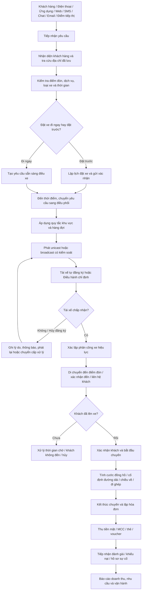

# 01 — THIẾT KẾ NGHIỆP VỤ VÀ HỆ THỐNG TOÀN DIỆN TAXI MAI LINH
## Cơ sở: Quy trình Taxi tương lai và yêu cầu hệ thống của KPMG

**Mã tài liệu:** TAXI-BIZ-001 · **Phiên bản:** 0.2 · **Trạng thái:** DỰ THẢO — CHỜ NGHIỆP VỤ XÁC NHẬN  
**Tài liệu nguồn:** *MLG_Luu do va mo ta quy trinh & Yeu cau _Dieu hanh taxi_v3.docx*, KPMG, năm 2015, 90 trang.  
**Điều hướng:** [README kho tài liệu](../README.md) · [Tài liệu tổng quan hệ thống](../00-OVERVIEW.md)

> Tài liệu này chuyển hóa các quy trình điều hành Taxi tương lai và yêu cầu hệ thống trong tài liệu KPMG thành bản thiết kế nghiệp vụ và hệ thống ở cấp toàn nền tảng. Không mặc định mọi chính sách năm 2015 vẫn còn hiệu lực. Các yêu cầu nguồn được bảo toàn, các điểm còn thiếu được đánh dấu và phải được chủ nghiệp vụ phê duyệt trước khi triển khai.

## 1. Nhận thức tổng thể

Hệ thống mục tiêu không chỉ là một ứng dụng gọi xe. Đây là **Nền tảng Điều hành Taxi tích hợp**, hỗ trợ xuyên suốt từ tiếp nhận nhu cầu khách hàng qua nhiều kênh, tổng đài, điều phối và phân bổ xe, tác nghiệp tài xế, điểm tiếp thị/khu vực sắp tài, đặt xe trước, cước đường dài cố định, khai thác chiều về, đi chung/đi ghép, lập hóa đơn và thanh toán, chăm sóc khách hàng, kiểm soát vận hành, báo cáo quản trị đến tích hợp các hệ thống doanh nghiệp.

KPMG xác định tài liệu quy trình gồm: mô tả bằng văn bản (đầu vào/đầu ra), lưu đồ quy trình và danh mục các bước kèm người chịu trách nhiệm. Tài liệu nguồn cũng nêu rõ quy trình tương lai cần có khả năng thích ứng khi nhu cầu doanh nghiệp thay đổi.

## 2. Danh mục quy trình KPMG và truy vết yêu cầu

### 2.1. Các quy trình tương lai — Phần A

| Mã nguồn | Tên quy trình | Phạm vi nghiệp vụ chính | Vai trò chính |
|---|---|---|---|
| TO.P1 | Khách hàng yêu cầu Taxi qua Tổng đài | Gọi đến, gọi nhỡ, yêu cầu mới/nhắc/thay đổi/hủy, tổng đài nhập yêu cầu, điều xe, tài xế phản hồi, đón khách, thực hiện chuyến, thanh toán và phản hồi | Khách hàng, Điện thoại viên, Điều hành, Tài xế |
| TO.P2 | Khách hàng sử dụng Ứng dụng | Đăng nhập, yêu cầu xe, ước tính lộ trình/cước, chọn phương án đường dài, xem/chọn xe gần, tài xế nhận, đến đón, thực hiện chuyến, hóa đơn/thanh toán/phản hồi | Khách hàng, Hệ thống, Điều hành, Tài xế |
| TO.P3 | Khách yêu cầu tại Điểm tiếp thị có nhân viên điều hành điểm | Tiếp nhận yêu cầu tại điểm có nhân viên và tổ chức phục vụ từ đầu đến cuối | Khách hàng, Điều hành điểm tiếp thị, Điều hành tổng đài, Tài xế |
| TO.P4 | Khách yêu cầu tại Khu vực sắp tài không có nhân viên điều hành điểm | Xử lý khu vực sắp tài, phát yêu cầu unicast/broadcast, hàng đợi xe, điều xe theo thứ tự sắp tài, chuyến đi và thanh toán | Khách hàng, Điều hành, Tài xế |
| TO.P5 | Khách hàng yêu cầu Taxi qua Tin nhắn SMS | Phân tích cú pháp SMS, kiểm tra hợp lệ, cấp mã đặt chỗ, điều xe và thực hiện chuyến | Khách hàng, Hệ thống, Điều hành, Tài xế |
| TO.P6 | Khách hàng yêu cầu Taxi qua Chat | Tiếp nhận qua chat, nhân viên xử lý và cung cấp dịch vụ từ đầu đến cuối | Khách hàng, Nhân viên tiếp nhận, Điều hành, Tài xế |
| TO.P7 | Khách hàng yêu cầu Taxi qua Web | Yêu cầu trên web có xác thực, mã đặt chỗ, xác nhận/thay đổi/hủy và phục vụ | Khách hàng, Hệ thống, Điều hành, Tài xế |
| TO.P8 | Khách hàng đặt xe trước | Đặt trước qua ứng dụng/web/điện thoại/email/chat/SMS, xác nhận, lập lịch và phát điều xe trước giờ đón | Khách hàng, Nhân viên tiếp nhận, Điều hành, Tài xế |
| TO.P9 | Cước phí đường dài | Cước cố định đường dài, điều kiện tuyến đường/khoảng cách/thời gian, chuyến đi, phụ trội, hóa đơn/thanh toán/phản hồi | Khách hàng, Tài xế, Điều hành |

### 2.2. Các nhóm yêu cầu chức năng — Phần B

| Mã nguồn | Nhóm năng lực | Nội dung yêu cầu |
|---|---|---|
| TO.A | Phục vụ khách hàng | Đặt xe đa kênh, thay đổi/hủy yêu cầu, đường dài, chiều về, ước tính cước/khoảng cách, đi chung, thời gian chờ dự kiến, xem/chọn xe và tài xế gần, tài khoản, thanh toán, đánh giá |
| TO.B | Phục vụ tài xế | Nhận yêu cầu theo unicast/broadcast, danh sách/bản đồ, nhu cầu tại điểm tiếp thị, đăng ký đón, xem yêu cầu khác, dẫn đường, hàng đợi sắp tài, đường dài/chiều về, hủy đăng ký |
| TO.C | Phục vụ Điều hành Mai Linh | Tìm kiếm xe/chuyến, quản lý giá đường dài và điểm tiếp thị/khu vực sắp tài, danh sách khách chờ/nhắc xe, dữ liệu chuyến, trạng thái xe, chỉ định/hủy chỉ định, dự báo nhu cầu, danh sách đặt trước, danh bạ dịch vụ |
| TO.D | Phục vụ Điện thoại viên | Nhập yêu cầu, nhận diện người gọi và địa chỉ lưu, thay đổi/hủy, đếm số lần nhắc, danh sách chờ, phím tắt địa chỉ, cuộc gọi nhỡ, nhận biết khách VIP/khách hàng quan tâm, điểm tiếp thị, danh bạ dịch vụ |
| TO.E | Phục vụ Điều hành điểm tiếp thị | Yêu cầu xe về điểm, hàng đợi FIFO, thời gian chờ/khoảng cách sắp tài có thể cấu hình, chỉ định thủ công, GPS nhân viên, giờ hoạt động, hiệu quả điểm và ghi nhận nhu cầu tiềm năng |
| TO.F | Yêu cầu kiểm soát | Tính và ghi nhận doanh thu cước, cảnh báo tăng đột biến nhu cầu, kiểm soát một xe đăng ký cho một yêu cầu, xác thực, phân quyền vai trò/nhóm, nhật ký sự kiện và bảo mật |
| TO.G | Báo cáo nhu cầu | Nhu cầu theo số điện thoại/khách hàng/khu vực/đường/phường/quận, điểm tiếp thị/khu vực sắp tài, loại hình đường dài, chủng loại xe, khách mới, thời gian và so sánh cùng kỳ |
| TO.H | Báo cáo doanh thu | Km vận doanh/km có khách, doanh thu theo khách hàng/khu vực/điểm/tài xế/loại hình đường dài/cuộc gọi, năng suất và hiệu suất sử dụng xe |
| TO.I | Báo cáo vận hành | Cuốc xe, đón thành công/thất bại, không có xe nhận, thời gian điều xe/đón, thời gian chờ, tài xế hủy/từ chối, đón lâu, hành lý thất lạc, tai nạn, sự cố kỹ thuật, khiếu nại, không phù hợp nội bộ và sự cố an ninh |
| TO.J | Yêu cầu kỹ thuật | 20.000 tài xế kết nối đồng thời, 5.000 yêu cầu khách hàng đồng thời, nền tảng di động và tích hợp CRM/nhân sự/kế toán |

Tài liệu nguồn phân loại yêu cầu theo mức **Phải có / Cần có / Tùy chọn**. Phải giữ nguyên mức ưu tiên nguồn trong bảng truy vết; không tự ý đổi thành thứ tự triển khai mới khi chưa được rà soát.

## 3. Bản đồ năng lực nghiệp vụ mục tiêu

### 3.1. Tiếp nhận nhu cầu và các kênh khách hàng
- Ứng dụng khách hàng trên điện thoại/máy tính bảng, cổng Web, tổng đài thoại, SMS, email, chat, điểm tiếp thị/điểm đón; kênh đối tác/API là hướng mở rộng đề xuất.
- Định danh khách hàng, nhận diện số gọi đến, thông tin liên hệ, địa chỉ đã lưu, phân nhóm VIP/khách hàng quan tâm và danh bạ dịch vụ đặc thù.
- Tiếp nhận yêu cầu mới, nhắc xe, thay đổi, hủy, đặt trước, theo dõi mã/phiên đặt xe, thông báo và phản hồi.

### 3.2. Đặt xe và yêu cầu dịch vụ
- Thu thập điểm đón (địa chỉ/địa danh/GPS), điểm đến nếu có, loại/dòng xe, số lượng xe, thời gian đón, liên hệ và ghi chú.
- Chuẩn hóa/kiểm tra địa chỉ, khu vực có cung cấp dịch vụ, phát hiện yêu cầu trùng, cấp mã yêu cầu/mã đặt chỗ.
- Đặt xe đi ngay và đặt xe trước; thay đổi/hủy có lưu lịch sử.
- Đặt nhiều xe theo nhu cầu, phụ thuộc năng lực cung ứng và chính sách được duyệt.
- Quản lý vòng đời yêu cầu và bản ghi Booking thống nhất, không phụ thuộc kênh tiếp nhận.

### 3.3. Điều phối và nguồn cung xe
- Phát unicast đến xe trống trong bán kính/khu vực cấu hình; chỉ phát broadcast toàn hệ thống khi có điều kiện và được Điều hành kiểm soát.
- Hiển thị yêu cầu dạng danh sách/bản đồ, khoảng cách theo lộ trình, ETA và thông tin cần thiết.
- Tài xế tự đăng ký nhận khách hoặc Điều hành chỉ định xe.
- Ngăn không cho nhiều xe cùng đăng ký một yêu cầu khách hàng.
- Ghi nhận chấp nhận/từ chối/hủy và lý do; theo dõi trường hợp từ chối/hủy lặp lại.
- Danh sách khách chờ/nhắc xe, cảnh báo nhu cầu tăng đột biến và phương án xử lý thủ công.
- Phân biệt trạng thái sẵn sàng, điều kiện đủ để nhận điều xe, độ mới của vị trí GPS và tình trạng kết nối.

### 3.4. Điểm tiếp thị và khu vực sắp tài
- Khai báo điểm tiếp thị bình thường/đặc biệt và khu vực sắp tài không có nhân viên.
- Dữ liệu điểm: tên, địa chỉ, liên hệ, mã hợp đồng, đặc điểm, giờ hoạt động, sức chứa/nhu cầu xe và nhân viên phụ trách.
- Tài xế đến điểm và đăng ký theo FIFO (đến trước phục vụ trước); kiểm soát sức chứa, khoảng cách hợp lệ, thời gian đến lượt, chuyển lượt cho xe kế tiếp và quyền can thiệp có nhật ký.
- Theo dõi vị trí nhân viên, yêu cầu xe về điểm, hiệu suất khai thác, nhu cầu tiềm năng và doanh thu điểm.
- Không gộp thứ tự hàng đợi tại điểm tiếp thị với thứ hạng xe trong thuật toán điều phối thông thường.

### 3.5. Tài xế và thực hiện chuyến
- Hồ sơ tài xế, số tài/mã nhân viên, xe, trạng thái hiện tại và phân công chuyến.
- Ứng dụng tài xế: danh sách/bản đồ yêu cầu, đăng ký/hủy đăng ký, chấp nhận/từ chối, dẫn đường đến đón, xác nhận đến nơi, liên hệ khách, bắt đầu đồng hồ/chuyến, điểm đến, vết hành trình, kết thúc, hóa đơn và thông tin phản hồi.
- Ghi nhận thời điểm đón/trả và khoảng cách GPS/công-tơ/thiết bị giám sát hành trình khi có dữ liệu.
- Tài xế có thể hủy nhận đón theo chính sách; phải thông báo khách hàng/Điều hành và đưa yêu cầu về hàng đợi hoặc luồng xử lý ngoại lệ.
- Quản lý hành lý thất lạc, va chạm/tai nạn, lỗi kỹ thuật, sự cố an ninh (ví dụ mã 313 trong tài liệu nguồn), khiếu nại khách hàng và sự không phù hợp nội bộ.

### 3.6. Giá cước và loại hình dịch vụ thương mại
- Cước đồng hồ theo cự ly thực tế và thời gian chờ.
- Cước cố định đường dài theo tuyến và dòng xe; một chiều/hai chiều; ngưỡng áp dụng và phụ trội khi vượt cự ly/thời gian.
- Ghép nối và tính giá chuyến chiều về/vãng lai chiều về.
- Đi chung/đi ghép: tìm khách có tuyến tương thích và chia cước; tài liệu nguồn xếp chức năng này ở mức tùy chọn.
- Ước tính cự ly/cước; hiển thị lựa chọn đi đường dài trực tiếp hoặc xe trống chiều về và thời gian chờ dự kiến.
- Chi tiết hóa đơn: cước đồng hồ/cước cố định, phụ trội đường dài, phí cầu đường, tiền tip, mã tài xế/nhân viên, điểm đón/trả và ngày giờ chuyến.
- Quy tắc giá phải có phiên bản và được áp dụng nhất quán giữa kênh đặt xe, chuyến đi, hóa đơn và tài chính.

### 3.7. Thanh toán và trải nghiệm khách hàng
- Phương thức trong tài liệu nguồn: tiền mặt, thẻ trả sau MCC, thẻ tín dụng/thẻ ATM và voucher.
- Bằng chứng thanh toán/biên nhận và đối soát.
- Đánh giá chất lượng dịch vụ là bắt buộc theo quy trình nguồn; nội dung góp ý là tùy chọn. Tiếp nhận qua ứng dụng, tổng đài, khảo sát gọi ra ngẫu nhiên, email/chat/CSKH.
- Quản lý khiếu nại, hành lý thất lạc, tai nạn, sự cố kỹ thuật và sự cố an ninh.

### 3.8. Trung tâm kiểm soát và báo cáo
- Theo dõi trạng thái xe/bản đồ trực tuyến; danh sách nhu cầu, khách chờ lâu, nhắc xe và yêu cầu chưa có xe nhận.
- Tìm kiếm theo doanh thu, địa điểm, thời gian, hành trình, điểm đón/trả, màu xe, loại xe, tài xế và biển số.
- Báo cáo nhu cầu, doanh thu, vận hành và so sánh theo kỳ.
- Giám sát từ chối/hủy của tài xế, thời gian chờ, thời gian đón và chất lượng phục vụ.
- Dự báo nhu cầu theo khu vực/thời gian là tùy chọn trong tài liệu nguồn; không tự nâng thành bắt buộc khi chưa phê duyệt.

### 3.9. Nền tảng và tích hợp doanh nghiệp
- Xác thực và phân quyền theo vai trò/nhóm cho khách hàng, tài xế, điện thoại viên, điều hành điểm, điều hành tổng đài và quản trị viên.
- Chính sách bảo mật có thể cấu hình; ghi nhật ký các thay đổi nhạy cảm về bảo mật.
- Tích hợp CRM, nhân sự và kế toán; kiến trúc tích hợp và quyền sở hữu dữ liệu cần được thiết kế chi tiết.
- Khả năng phục hồi, giám sát, sao lưu, quyền riêng tư và an ninh mạng cần được bổ sung theo yêu cầu hiện hành, ngoài phạm vi tài liệu năm 2015.

## 4. Mô hình vận hành xuyên suốt

Đây là lưu đồ tổng hợp được xây dựng từ các quy trình nguồn. Mỗi quy trình TO.P1–TO.P9 vẫn phải có lưu đồ và swimlane riêng để thể hiện khác biệt theo kênh tiếp nhận, điểm tiếp thị, khu vực sắp tài và dịch vụ đường dài.

## 5. Kiến trúc Module gắn với yêu cầu KPMG

| Module | Trách nhiệm | Truy vết KPMG |
|---|---|---|
| M01 — Khách hàng và Đặt xe | Khách hàng/liên hệ/địa chỉ, tiếp nhận đa kênh, tạo/sửa/hủy yêu cầu, đặt ngay/đặt trước, phiên và mã đặt xe | TO.P1, P2, P5, P6, P7, P8; TO.A; TO.D |
| M02 — Đội xe và Đối tác | Hồ sơ tài xế/xe, trạng thái, năng lực, khả năng sẵn sàng, định danh và thuộc tính khai thác | TO.B; TO.C.12–13; TO.F.8 |
| M03 — Điều phối và Hàng đợi | Unicast/broadcast, danh sách xe ứng viên, tài xế tự đăng ký, Điều hành chỉ định, hủy/từ chối, chống trùng xe, quy tắc khách chờ/nhắc xe/hàng đợi | TO.P1–P8; TO.B.1–B.10; TO.C.8–C.15; TO.F.5–F.6 |
| M04 — Ứng dụng Tài xế và Chuyến đi | Tác nghiệp tài xế, đón khách, xác nhận đến, xác minh khách, đồng hồ/chuyến, GPS, kết thúc và ngoại lệ | TO.P1–P9; TO.B; TO.C.12–C.13 |
| M05 — Giá cước và Thanh toán | Ước tính, cước đồng hồ, cước cố định đường dài, phụ trội, chiều về, đi ghép, hóa đơn, tiền mặt/MCC/thẻ/voucher | TO.P2, P8, P9; TO.A.8–A.11, A.16; TO.F.1–F.4 |
| M06 — Điểm tiếp thị và Khu vực sắp tài | Danh mục điểm, hàng đợi có/không có nhân viên, FIFO, sức chứa, điều hành điểm, vị trí và hiệu quả điểm | TO.P3–P4; TO.B.3, B.7; TO.C.5–C.7; TO.E |
| M07 — Tổng đài và Trung tâm kiểm soát | Màn hình điện thoại viên, nhận diện người gọi, địa chỉ lưu/phím tắt, cuộc gọi nhỡ, nhắc xe, danh sách chờ, màn hình điều phối và quyền can thiệp | TO.P1, P3–P7; TO.C; TO.D |
| M08 — Chăm sóc khách hàng và Quản lý sự cố | Đánh giá, khiếu nại, hành lý thất lạc, tai nạn, lỗi kỹ thuật, sự cố an ninh và sự không phù hợp nội bộ | TO.P1–P9; TO.A.17; TO.I.9 |
| M09 — Báo cáo và Phân tích | Nhu cầu, doanh thu, năng suất, hiệu suất đội xe, chất lượng tài xế, ngoại lệ vận hành, so sánh và dự báo tùy chọn | TO.C; TO.G; TO.H; TO.I |
| M10 — Nền tảng, Tích hợp và Vận hành CNTT | Định danh, vai trò/nhóm, nhật ký kiểm soát/bảo mật, tích hợp CRM/nhân sự/kế toán, năng lực tải, khả năng phục hồi và vận hành | TO.F.7–F.9; TO.J |

Việc nhóm thành Module là đề xuất ranh giới phần mềm. Vai trò quy trình trong KPMG vẫn là trách nhiệm nghiệp vụ; cơ cấu tổ chức và ma trận RACI cuối cùng cần Mai Linh xác nhận.

## 6. Đối tượng nghiệp vụ chuẩn và quyền sở hữu dữ liệu

| Đối tượng | Ý nghĩa nghiệp vụ | Module sở hữu |
|---|---|---|
| Customer / ContactPoint / SavedAddress | Khách hàng cá nhân/doanh nghiệp, thông tin liên hệ và địa chỉ đón đã lưu | M01 |
| Booking / BookingRevision | Yêu cầu dịch vụ của khách và các lần chỉnh sửa | M01 |
| DispatchRun / Candidate / Offer | Một lượt điều phối, các xe được đánh giá và lời mời nhận cuốc | M03 |
| Assignment | Phân công tài xế/xe có hiệu lực cho yêu cầu | M03 |
| Driver / Vehicle / DriverState | Hồ sơ tài xế, xe và trạng thái khai thác | M02 |
| QueueRegistration | Đăng ký vị trí FIFO của tài xế tại điểm tiếp thị/khu vực sắp tài | M06 |
| Trip / TripEvent / RouteTrace | Việc đón khách, hành trình, điểm dừng và bằng chứng hoàn tất | M04 |
| FareQuote / FareResult / Invoice | Báo giá ước tính, kết quả tính cước và hóa đơn | M05 |
| Payment / PaymentEvidence | Thu tiền/hoàn tiền và bằng chứng thanh toán | M05 |
| ServiceCase / IncidentCase | Khiếu nại, tai nạn, hành lý thất lạc, sự cố kỹ thuật/an ninh | M08 |
| Demand/Revenue/Operations projections | Dữ liệu tổng hợp phục vụ báo cáo, tối ưu đọc | M09 |
| User/Role/AuditEvent | Định danh, quyền và lịch sử kiểm soát | M10 |

Nền tảng mới có thể tách DispatchRun, Offer và Assignment thành các đối tượng riêng, dù quy trình cũ chỉ dùng một trạng thái “đăng ký đón khách”. Đây là đề xuất thiết kế để làm rõ nghiệp vụ, không phải nội dung được KPMG khẳng định.

## 7. Các tham số quan trọng trong tài liệu nguồn — giữ lại, không lập trình cố định

| Tham số nguồn | Giá trị/ví dụ KPMG | Cách xử lý |
|---|---:|---|
| Ngưỡng đường dài | Trên 30 km | Quy tắc lịch sử; cần nghiệp vụ xác nhận lại |
| Số xe gần khách trên App/Web | 5 xe gần nhất, bán kính 500 m | Chính sách cấu hình; đánh giá lại trải nghiệm hiện tại |
| Điều kiện tài xế đăng ký đón | Trong 500 m theo lộ trình thực | Yêu cầu nguồn; xác nhận cách tính tuyến hiện hành |
| Điều kiện đăng ký sắp tài | Trong 100 m | Tham số nguồn; cấu hình và xác nhận lại |
| Thời gian chờ đến lượt tại điểm | 60 giây | Tham số nguồn; cấu hình và xác nhận lại |
| Khóa hủy nhận cuốc trước giờ đón đặt trước | 20 phút | Tham số nguồn; xác nhận chính sách vận hành |
| Danh sách khách chờ của Điều hành | Trên 5 phút | Tham số nguồn; cấu hình theo hoạt động |
| Thời điểm đưa chuyến đặt trước vào danh sách điều xe | 60 phút trước giờ đón | Tham số nguồn; có thể cấu hình |
| Thời gian hiển thị cuộc gọi nhỡ | 30 giây | Tham số nguồn; cấu hình |
| Thời gian trả địa chỉ VIP về mặc định | 5 giờ | Quy tắc nguồn; xác nhận chính sách dữ liệu khách hàng |
| Số lần từ chối xe do Điều hành chỉ định | Trên 2 lần | Tham số nguồn; xác nhận cấp xử lý |
| Cảnh báo thời gian đón bình quân của tài xế | Trên 8 phút | Ngưỡng báo cáo nguồn; xác nhận lại |
| Báo cáo tài xế hủy đón | Trên 3 lần | Ngưỡng báo cáo nguồn; xác nhận lại |
| Năng lực kỹ thuật | 20.000 tài xế đồng thời; 5.000 yêu cầu khách hàng đồng thời | Yêu cầu quy mô năm 2015; phải lập mô hình tải mới và kiểm thử hiệu năng |

Không tham số nào trong bảng được viết cố định trong mã nguồn. Các tham số vận hành đã duyệt phải được lưu với ngày hiệu lực, phạm vi áp dụng, phiên bản, lịch sử thay đổi và người có thẩm quyền.

## 8. Bảo toàn mức ưu tiên yêu cầu chức năng

- **Phải có:** giữ là yêu cầu bắt buộc theo tài liệu nguồn, chờ chủ nghiệp vụ hiện tại xác nhận.
- **Cần có:** giữ là yêu cầu cần thiết theo nguồn; thứ tự triển khai là quyết định của dự án.
- **Tùy chọn:** giữ là năng lực tùy chọn trong nguồn; không tự ý loại khỏi lộ trình sản phẩm dài hạn.
- **Chưa xác định (TBD):** áp dụng khi tài liệu nguồn không nêu, diễn đạt chưa rõ, còn chỗ trống như [xxx] hoặc chính sách có thể đã thay đổi.

Mỗi yêu cầu phải có bản ghi truy vết gồm: mã nguồn, số trang, nội dung nguyên văn/tóm lược trung thành, mức ưu tiên nguồn, Module/tính năng đích, tiêu chí nghiệm thu, quyết định hiện tại (giữ nguyên/thay đổi/hoãn/loại bỏ), người phụ trách và phê duyệt.

## 9. Các quy tắc nghiệp vụ trọng yếu phải mô hình hóa

1. Mọi kênh tiếp nhận phải tạo về một bản ghi yêu cầu thống nhất, đồng thời lưu lại kênh và tương tác nguồn.
2. Nhận diện người gọi dựa trên số điện thoại và địa chỉ đã lưu; điện thoại viên vẫn phải được chọn/sửa điểm đón.
3. Thay đổi/hủy phải tìm đúng yêu cầu theo mã đặt xe hoặc ngữ cảnh cuộc gọi/khách hàng đã xác minh.
4. Một yêu cầu khách hàng không được có nhiều xe phân công hiệu lực cùng lúc.
5. Unicast là cơ chế mặc định trong tài liệu nguồn; broadcast do Điều hành Mai Linh kiểm soát trong tình huống đặc biệt.
6. Tài xế tự đăng ký và Điều hành chỉ định là hai luồng khác nhau; cả hai đều phải có kiểm soát tranh chấp.
7. Từ chối/rút đăng ký/hủy của tài xế phải có lý do và phản ánh tới khách hàng/Điều hành.
8. FIFO tại điểm tiếp thị tách biệt với điều phối yêu cầu thông thường; phải tuân thủ sức chứa, điều kiện hợp lệ, hết thời gian đến lượt và quyền can thiệp.
9. Đặt xe trước phải được lập lịch và chuyển sang điều phối theo thời điểm dẫn trước đã được phê duyệt, có thể cấu hình.
10. Bắt đầu/kết thúc chuyến, cự ly thực tế, thời gian chờ và vết hành trình là căn cứ tính cước và báo cáo.
11. Cước đồng hồ, cước cố định đường dài, chiều về và đi ghép là các phương thức tính giá riêng, có điều kiện áp dụng rõ ràng.
12. Thành phần hóa đơn, phương thức thanh toán và bằng chứng phải đối soát được với chuyến và doanh thu.
13. Đánh giá của khách hàng là bắt buộc theo quy trình nguồn; nội dung góp ý là tùy chọn.
14. Phân quyền vai trò/nhóm và ghi nhật ký sự kiện bảo mật áp dụng xuyên suốt nền tảng.

## 10. Danh mục tình huống ngoại lệ phải đặc tả

| Mã | Tình huống | Hành vi hệ thống cần đặc tả |
|---|---|---|
| EX-01 | Cuộc gọi nhỡ | Thời hạn gọi lại theo khu vực/thời điểm; tiếp tục hiển thị nếu đang có yêu cầu mở |
| EX-02 | Khách gọi bằng số điện thoại khác | Điện thoại viên tìm theo địa chỉ/mã yêu cầu và xác minh danh tính có kiểm soát |
| EX-03 | SMS sai cú pháp | Trả hướng dẫn chỉnh sửa; không tạo yêu cầu giả |
| EX-04 | Địa chỉ không rõ/không có trên bản đồ | Xử lý bằng phím tắt/địa danh/ghim bản đồ/kiểm tra thủ công |
| EX-05 | Không có xe trong bán kính unicast | Tiếp tục chờ, mở rộng bán kính, broadcast theo quyền hoặc thông báo khách |
| EX-06 | Nhu cầu broadcast tăng đột biến | Bật/tắt có kiểm soát, ghi nhật ký, bảo vệ năng lực và giới hạn phát |
| EX-07 | Nhiều tài xế cùng đăng ký một yêu cầu | Chỉ một tài xế thắng theo cơ chế nguyên tử; từ chối các đăng ký cạnh tranh |
| EX-08 | Tài xế từ chối/rút đăng ký | Ghi lý do, thông báo và đưa yêu cầu về nhóm xe đủ điều kiện |
| EX-09 | Tài xế hủy sau khi đang trên đường đón | Thông báo khách; điều phối lại hoặc chuyển Điều hành xử lý |
| EX-10 | Khách thay đổi/hủy sau khi đã phân công | Kiểm tra thời điểm/trạng thái; báo tài xế; giải phóng hoặc phân công lại an toàn |
| EX-11 | Tài xế đến nhưng không gặp khách | Bộ đếm thời gian chờ, liên hệ, bằng chứng khách không đến và chính sách xử lý |
| EX-12 | Điểm sắp tài đã đủ sức chứa | Từ chối/giữ chờ đăng ký và hiển thị nhu cầu cho nhân viên điểm |
| EX-13 | Hết thời gian đến lượt tại điểm | Chuyển lượt cho tài xế đủ điều kiện kế tiếp, ghi nhận lượt bị bỏ qua/lý do |
| EX-14 | GPS cũ hoặc mất kết nối mạng | Đánh dấu độ mới vị trí; không mặc định xe đang gần hoặc đang sẵn sàng |
| EX-15 | Không còn đủ điều kiện áp dụng cước đường dài cố định | Tính lại báo giá và lấy xác nhận khách trước khi đổi phương thức cước |
| EX-16 | Ghép xe khai thác chiều về | Kiểm tra hướng tuyến, khung thời gian, xe sẵn sàng và giá cố định |
| EX-17 | Tuyến/sức chứa không phù hợp để đi ghép | Không ghép; giữ các yêu cầu và cước riêng |
| EX-18 | Sai lệch cự ly chuyến và dữ liệu giám sát hành trình | Đưa vào hàng đợi kiểm tra và điều chỉnh cước có kiểm soát |
| EX-19 | Phương thức thanh toán và bằng chứng không khớp | Đưa vào đối soát; không đánh dấu đã thanh toán khi chưa có bằng chứng |
| EX-20 | Tai nạn/hành lý thất lạc/sự cố an ninh | Quy trình hồ sơ sự cố, chuyển cấp, bằng chứng, quyền riêng tư và nhật ký |
| EX-21 | Gọi lại/yêu cầu bị gửi trùng | Xử lý lũy đẳng (idempotent), chỉ tạo một tác động đặt xe/tài chính |
| EX-22 | Tích hợp CRM/nhân sự/kế toán bị gián đoạn | Lưu hàng đợi gửi lại bền vững, đối soát và có phương án vận hành dự phòng |

## 11. Các tài liệu chi tiết bắt buộc trước khi giao DEV

### 11.1. Cấp toàn hệ thống
- Bối cảnh nghiệp vụ, danh sách bên liên quan và phạm vi được phê duyệt.
- Bản đồ quy trình E2E và swimlane theo vai trò cho toàn bộ TO.P1–TO.P9.
- Từ điển nghiệp vụ chuẩn và ma trận truy vết yêu cầu.
- Bản đồ ngữ cảnh/ranh giới nghiệp vụ và quyền sở hữu.
- State Machine liên miền và bảng chuyển trạng thái.
- ERD logic và từ điển dữ liệu.
- Danh mục API/sự kiện và hợp đồng tích hợp.
- Ma trận phân quyền theo vai trò/hành động/phạm vi dữ liệu.
- Yêu cầu phi chức năng, năng lực tải, SLO, sao lưu/khôi phục thảm họa, giám sát và bảo mật.
- Sổ quyết định và danh mục tham số chính sách.

### 11.2. Cấp Module
- Mục tiêu, phạm vi và ranh giới Module.
- Quy trình chi tiết: luồng chính, luồng thay thế, ngoại lệ và khôi phục.
- Danh mục quy tắc nghiệp vụ có dẫn chiếu nguồn.
- State Machine và điều kiện chuyển trạng thái.
- Mô hình thực thể, từ điển trường dữ liệu và ràng buộc.
- Sơ đồ màn hình và hành vi từng trạng thái giao diện.
- API/lệnh/sự kiện và hợp đồng tích hợp.
- Phân quyền, nhật ký và kiểm soát vận hành.
- Danh mục tính năng có truy vết yêu cầu nguồn.
- Kịch bản kiểm thử và bằng chứng nghiệm thu.

### 11.3. Cấp tính năng
Mỗi tính năng phải có: mục tiêu, tác nhân, phạm vi, điều kiện trước/sau, luồng từng bước, bảng quyết định, kiểm tra dữ liệu, trạng thái giao diện, lược đồ API, thay đổi CSDL, phân quyền, nhật ký, tính lũy đẳng/đồng thời, xử lý lỗi, log/chỉ số giám sát, ca kiểm thử, tiêu chí nghiệm thu Given/When/Then, phụ thuộc và người phê duyệt.

## 12. Trình tự triển khai đề xuất

1. Phê duyệt danh mục tài liệu nguồn và quyết định giữ/thay đổi/loại bỏ đối với toàn bộ yêu cầu TO.P.
2. Phê duyệt mô hình vận hành toàn hệ thống và các luồng E2E TO.P1–TO.P9.
3. Chốt ranh giới Module và luồng chi tiết từng Module.
4. Thống nhất trạng thái, dữ liệu, phân quyền và hợp đồng tích hợp.
5. Đặc tả trước các tính năng Booking → Dispatch → Trip, bao gồm biến thể Tổng đài, Ứng dụng, SMS/Web và điểm tiếp thị/khu vực sắp tài.
6. Đặc tả giá cước/thanh toán, đường dài/chiều về/đi ghép và kiểm soát tài chính.
7. Đặc tả CSKH, báo cáo, bảo mật, tích hợp và hỗ trợ vận hành.
8. DEV/QA/UAT phát triển, kiểm thử và nghiệm thu từng tính năng trước khi tích hợp.

## 13. Các quyết định còn mở — cần xác nhận hiện trạng

- Yêu cầu KPMG năm 2015 nào còn hiệu lực, đã thay đổi hoặc cần loại bỏ?
- Các kênh đặt xe hiện tại và năng lực tổng đài/CRM hiện tại.
- Mô hình đội xe DIRECT/PARTNER hiện tại và quy tắc hợp đồng/quyết toán.
- Biểu giá hiện tại, ngưỡng đường dài, giá chiều về và chính sách đi ghép.
- Nguồn bản đồ/định tuyến/GPS/giám sát hành trình và độ mới dữ liệu vị trí.
- Chính sách unicast/broadcast, bán kính điều xe, quyền chọn xe của tài xế và quyền can thiệp của Điều hành.
- Mô hình vận hành điểm tiếp thị và khu vực sắp tài hiện tại.
- Phương thức thanh toán và vòng đời MCC/voucher hiện tại.
- Vai trò tổ chức, phân cấp chi nhánh/khu vực và phân quyền hiện tại.
- Lưu lượng tải thực tế và chỉ tiêu hiệu năng hiện tại.
- Yêu cầu hiện hành về quyền riêng tư, lưu trữ dữ liệu, an ninh mạng và tuân thủ pháp luật.

## 14. Trạng thái phê duyệt

Tài liệu này là bản cấu trúc hóa và mở rộng có truy vết từ tài liệu KPMG năm 2015. **Đây chưa phải chính sách nghiệp vụ đã được phê duyệt.** Chủ nghiệp vụ phải xác nhận từng yêu cầu được giữ/thay đổi và toàn bộ tham số trước khi chốt đường cơ sở triển khai.
