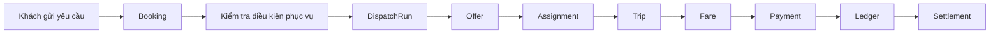
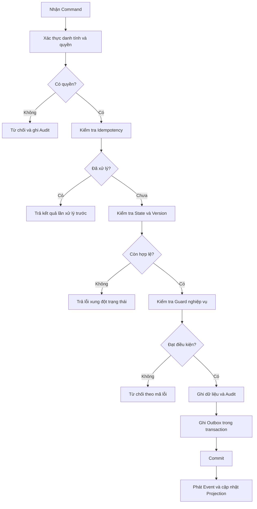

# X-01 — MÔ HÌNH TRẠNG THÁI VÀ QUY TẮC CHUYỂN TRẠNG THÁI

**Mã tài liệu:** TAXI-X-01  
**Phiên bản:** 0.2  
**Trạng thái:** DỰ THẢO KIẾN TRÚC — CHỜ CHỦ NGHIỆP VỤ VÀ CHỦ MODULE PHÊ DUYỆT  
**Phạm vi:** Booking, DispatchRun, Offer, Assignment, Trip, Fare, Payment, Refund, Settlement, Driver/Vehicle Availability và Queue  
**Tài liệu liên quan:** [00 — Tổng quan](../../00-OVERVIEW.md) · [03 — Kiến trúc Module](../../03-MODULE-ARCHITECTURE-AND-OWNERSHIP.md) · [04 — Quy trình TO.P1–TO.P9](../../04-END-TO-END-WORKFLOWS-TO-P1-TO-P9.md)

> **Lưu ý về nguồn:** Tài liệu KPMG năm 2015 mô tả các bước nghiệp vụ, vai trò và một số tình huống xử lý, nhưng không cung cấp một bộ enum State Machine thống nhất cho toàn hệ thống. Các tên trạng thái, transition và guard trong tài liệu này là **đề xuất thiết kế hệ thống** được suy ra từ quy trình và kiến trúc hiện tại; không được hiểu là chính sách vận hành đã được Mai Linh phê duyệt. Mọi tham số [xxx], thời hạn, điều kiện hủy, no-show và chính sách tài chính vẫn phải được xác nhận.

---

## 1. Mục tiêu và nguyên tắc thiết kế

### 1.1. Mục tiêu

Chuẩn hóa vòng đời của từng đối tượng nghiệp vụ để:
- Các kênh App, Web, Tổng đài, SMS, Chat, điểm tiếp thị và đặt trước cùng sử dụng một mô hình nghiệp vụ thống nhất.
- Điều phối, tài xế, tổng đài và Trung tâm Điều hành nhìn thấy cùng một sự thật nghiệp vụ.
- Không phát sinh trạng thái mâu thuẫn khi khách thay đổi/hủy, tài xế từ chối, hết thời gian nhận chuyến, mất kết nối hoặc điều phối lại.
- Có thể truy vết mọi thay đổi, tái xử lý sự kiện và đối soát tài chính.
- Làm cơ sở thiết kế Database, API, Event Contract, UI/UX và Test Case.

### 1.2. Nguyên tắc bắt buộc

1. **Mỗi Aggregate có vòng đời riêng.** Không dùng một trường `status` để đại diện đồng thời cho Booking, Dispatch, Trip, Fare, Payment và Settlement.
2. **Một Module sở hữu dữ liệu gốc.** Module khác không cập nhật trực tiếp bảng của Module sở hữu.
3. **Trạng thái là kết quả của Command hợp lệ.** Không cho phép UI hoặc client tự ghi trạng thái tùy ý.
4. **Transition phải có điều kiện (Guard).** Kiểm tra quyền, trạng thái hiện tại, phiên bản dữ liệu, điều kiện nghiệp vụ và xung đột tài nguyên.
5. **Sự kiện đã phát phải có dấu vết.** Ghi dữ liệu nghiệp vụ, Audit và Outbox trong cùng transaction phù hợp.
6. **Lệnh quan trọng phải idempotent.** Gửi lặp cùng một lệnh không được tạo nhiều Booking, Assignment, giao dịch thu tiền hoặc bút toán.
7. **Không xóa lịch sử nghiệp vụ.** Hủy, từ chối, hết hạn, điều phối lại và điều chỉnh phải lưu lịch sử cùng lý do.
8. **Trạng thái vận hành không đồng nghĩa với kết nối kỹ thuật.** GPS, kết nối mạng, trạng thái ứng dụng và khả năng nhận chuyến là các thuộc tính khác nhau.
9. **DIRECT/PARTNER dùng chung luồng vận hành nhưng tách nghĩa vụ tài chính.** Không suy ra loại hình khai thác từ kênh đặt xe.
10. **Không tự động hóa chính sách chưa được duyệt.** Quy tắc còn thiếu phải đánh dấu TBD, có người quyết định và ngày chốt.

### 1.3. Thuật ngữ

| Thuật ngữ | Ý nghĩa |
|---|---|
| Aggregate | Đối tượng nghiệp vụ có định danh, dữ liệu và vòng đời được quản lý nhất quán |
| State | Trạng thái hiện tại của Aggregate |
| Transition | Chuyển từ trạng thái này sang trạng thái khác thông qua một Command hợp lệ |
| Command | Yêu cầu thực hiện hành động nghiệp vụ |
| Event | Sự kiện bất biến mô tả điều đã xảy ra |
| Guard | Điều kiện bắt buộc phải đúng trước khi cho phép Transition |
| Side effect | Hành động phát sinh sau Transition, ví dụ gửi thông báo hoặc tạo yêu cầu điều phối |
| Terminal state | Trạng thái kết thúc của một vòng đời; không được quay lại luồng bình thường |
| Reconciliation | Đối chiếu để xác định kết quả thực tế khi hệ thống không chắc chắn, thường gặp với giao dịch thanh toán |
| Projection | Mô hình dữ liệu đọc được tổng hợp từ dữ liệu/sự kiện của các Module |

---

## 2. Bản đồ vòng đời toàn hệ thống

### 2.1. Chuỗi nghiệp vụ tổng quát



Đây là chuỗi liên kết nghiệp vụ, không phải một State Machine duy nhất. Một đối tượng có thể kết thúc trong khi đối tượng khác vẫn cần xử lý, ví dụ Trip đã hoàn tất nhưng Payment đang chờ đối soát.

### 2.2. Các Aggregate và Module sở hữu

| Aggregate | Module sở hữu | Vai trò |
|---|---|---|
| Booking | M01 — Khách hàng và Đặt xe | Yêu cầu dịch vụ của khách hàng |
| DispatchRun | M03 — Điều phối và Hàng đợi | Một lần chạy tìm kiếm và phân bổ nguồn lực cho Booking |
| Offer | M03 — Điều phối và Hàng đợi | Lời mời tài xế nhận một yêu cầu/chuyến |
| Assignment | M03 — Điều phối và Hàng đợi | Quan hệ phân công có hiệu lực giữa Booking và nguồn lực |
| Trip | M04 — Ứng dụng Tài xế và Chuyến đi | Quá trình cung cấp dịch vụ thực tế |
| FareQuote / FareResult | M05 — Giá cước và Thanh toán | Báo giá và kết quả tính cước |
| PaymentTransaction / RefundTransaction | M05 — Giá cước và Thanh toán | Giao dịch thu tiền và hoàn tiền |
| LedgerEntry / SettlementBatch | M06 — Tài chính và Quyết toán | Ghi nhận tài chính và quyết toán |
| DriverAvailability / VehicleAvailability | M02 — Đội xe và Đối tác | Khả năng khai thác của tài xế/xe |
| QueueRegistration | M03 — Điều phối và Hàng đợi | Đăng ký thứ tự tại điểm tiếp thị/khu vực sắp tài |

### 2.3. Không đồng nhất các trạng thái sau

- Booking đã được tiếp nhận ≠ đã có xe nhận.
- Offer đã gửi ≠ tài xế đã nhận.
- Assignment đã hiệu lực ≠ tài xế đã đến điểm đón.
- Tài xế đã đến ≠ khách đã lên xe.
- Trip đã hoàn thành ≠ khách đã thanh toán.
- Payment thành công ≠ đối tác đã được quyết toán.
- Driver đang Online ≠ Driver đủ điều kiện nhận chuyến.
- GPS mới ≠ tài xế chắc chắn đang sẵn sàng.
- Hủy Booking ≠ tự động xóa Payment hoặc Ledger đã phát sinh.

---

## 3. State Machine đề xuất theo Aggregate

## 3.1. Booking — M01

### Danh mục trạng thái

| Enum | Tên hiển thị | Ý nghĩa |
|---|---|---|
| DRAFT | Bản nháp | Yêu cầu đang được nhập, chưa gửi chính thức |
| SUBMITTED | Đã gửi yêu cầu | Khách/kênh đã gửi yêu cầu đến hệ thống |
| VALIDATING | Đang kiểm tra | Hệ thống kiểm tra dữ liệu, địa chỉ, vùng phục vụ và điều kiện đặt xe |
| ACCEPTED | Đã tiếp nhận | Yêu cầu hợp lệ và được hệ thống tiếp nhận |
| SCHEDULED | Đã lên lịch | Booking đặt trước đã được ghi nhận, chưa đến thời điểm điều phối |
| READY_FOR_DISPATCH | Sẵn sàng điều phối | Đủ điều kiện đưa vào quy trình tìm xe |
| FULFILLING | Đang được phục vụ | Dịch vụ đã được bắt đầu theo Assignment/Trip hợp lệ |
| COMPLETED | Hoàn tất | Booking đã được phục vụ xong theo quy tắc hoàn tất |
| CANCELLED | Đã hủy | Booking bị hủy hợp lệ |
| EXPIRED | Hết hiệu lực | Booking hết thời hạn chờ/xác nhận theo chính sách |
| REJECTED | Không được tiếp nhận | Không đạt điều kiện phục vụ hoặc dữ liệu không hợp lệ không thể khắc phục |
| UNFULFILLED | Không phục vụ được | Đã tiếp nhận nhưng không thể bố trí nguồn lực phục vụ |
| ON_HOLD | Tạm giữ xử lý | Chờ xác minh hoặc can thiệp của Điều hành |

**Thiết kế:** Không đưa `DISPATCHING` hoặc `ASSIGNED` thành trạng thái vòng đời bắt buộc của Booking. Các thông tin này được lấy từ DispatchRun/Assignment và hiển thị qua read projection. Cách này tránh đồng bộ hai chiều giữa trạng thái Booking và trạng thái điều phối.

### Transition chính

| Trạng thái hiện tại | Command / điều kiện | Trạng thái kế tiếp | Actor có thể thực hiện |
|---|---|---|---|
| DRAFT | SubmitBooking; dữ liệu tối thiểu hợp lệ | SUBMITTED | Khách hàng, Tổng đài viên, hệ thống kênh |
| SUBMITTED | Bắt đầu kiểm tra | VALIDATING | M01/System |
| VALIDATING | Hợp lệ, trong vùng phục vụ, thỏa điều kiện | ACCEPTED | M01/System |
| VALIDATING | Thiếu dữ liệu có thể bổ sung | DRAFT hoặc giữ trạng thái chờ bổ sung theo thiết kế UX | M01/System |
| VALIDATING | Không hợp lệ/ngoài vùng phục vụ | REJECTED | M01/System |
| ACCEPTED | Đặt ngay, đủ điều kiện điều phối | READY_FOR_DISPATCH | M01/System |
| ACCEPTED | Booking đặt trước | SCHEDULED | M01/System |
| SCHEDULED | Đến thời điểm kích hoạt điều phối | READY_FOR_DISPATCH | M01/System |
| READY_FOR_DISPATCH | Trip bắt đầu hợp lệ | FULFILLING | M04 phát sự kiện; M01 xử lý |
| FULFILLING | Trip hoàn tất hợp lệ | COMPLETED | M04 phát sự kiện; M01 xử lý |
| DRAFT/SUBMITTED/VALIDATING/ACCEPTED/SCHEDULED/READY_FOR_DISPATCH | Hủy hợp lệ theo chính sách | CANCELLED | Khách hàng, Tổng đài viên, Điều hành |
| SCHEDULED/READY_FOR_DISPATCH | Hết hạn theo chính sách | EXPIRED | M01/System |
| ACCEPTED/READY_FOR_DISPATCH | Không tìm được xe sau các lần điều phối và xử lý ngoại lệ | UNFULFILLED | M03 phát kết quả; M01 xử lý |
| Các trạng thái cho phép | Có lý do cần xác minh | ON_HOLD | Điều hành có quyền |
| ON_HOLD | Xác minh xong và đủ điều kiện tiếp tục | Trạng thái phù hợp trước đó | Vai trò được phân quyền |

**Lưu ý:** Trạng thái được phép hủy sau khi Assignment đã tạo, sau khi tài xế đến hoặc sau khi Trip bắt đầu phải được quy định riêng. Không mặc định mọi trạng thái đều có thể hủy.

### Quy tắc bất biến

- Mỗi Booking có mã định danh duy nhất; mã hiển thị không thay thế khóa nội bộ.
- Booking phải lưu `booking_channel` độc lập với `fleet_type` (DIRECT/PARTNER).
- Mọi thay đổi nội dung quan trọng tạo BookingRevision hoặc bản ghi lịch sử tương đương.
- Không sửa âm thầm điểm đón, thời gian, loại xe sau khi tài xế đã nhận; phải phát lệnh thay đổi có kiểm tra ảnh hưởng đến Offer/Assignment.
- Một Booking chỉ được đánh dấu COMPLETED khi có căn cứ Trip hoàn tất hợp lệ.
- Hủy Booking phải gửi yêu cầu xử lý tới M03 để thu hồi Offer/Assignment còn hiệu lực và cập nhật nguồn lực.
- Nếu Trip đã bắt đầu, yêu cầu hủy Booking không được xử lý như hủy trước chuyến; chuyển sang luồng kết thúc sớm/sự cố theo chính sách.

## 3.2. DispatchRun — M03

| Enum | Tên hiển thị | Ý nghĩa |
|---|---|---|
| CREATED | Đã tạo | Đã tạo một lượt điều phối |
| RUNNING | Đang tìm xe | Đang kiểm tra điều kiện và tìm ứng viên |
| COMPLETED | Hoàn tất lượt | Lượt điều phối đã kết thúc theo kết quả xử lý |
| NO_CANDIDATE | Không có xe phù hợp | Không tìm được ứng viên đủ điều kiện |
| ESCALATED | Chuyển Điều hành xử lý | Cần can thiệp hoặc quyết định thủ công |
| FAILED | Lỗi xử lý | Lỗi kỹ thuật/nghiệp vụ khiến lượt điều phối không thể tiếp tục |
| CANCELLED | Đã hủy lượt | Lượt điều phối bị hủy do Booking thay đổi/hủy hoặc quyết định hợp lệ |

Transition:
- CREATED → RUNNING: bắt đầu xử lý.
- RUNNING → COMPLETED: đã tạo kết quả phân bổ/hoàn thành lượt tìm kiếm.
- RUNNING → NO_CANDIDATE: không có ứng viên đạt điều kiện cứng.
- RUNNING → ESCALATED: cần Điều hành can thiệp.
- RUNNING → FAILED: lỗi không thể tự khôi phục.
- CREATED/RUNNING → CANCELLED: Booking bị hủy/thay đổi làm lượt cũ không còn hợp lệ.
- NO_CANDIDATE/FAILED/ESCALATED có thể tạo DispatchRun mới; không ghi đè lượt cũ.

Quy tắc:
- Mỗi lần thử điều phối là một DispatchRun riêng, có số thứ tự và lý do khởi tạo.
- Eligibility phải được kiểm tra trước Candidate Ranking.
- CandidateSnapshot lưu dữ liệu đủ để giải thích tại sao một xe được/chưa được chọn tại thời điểm đó.
- Retry tạo lượt mới hoặc attempt mới có định danh; không tái sử dụng kết quả cũ nếu điều kiện nguồn lực đã thay đổi.
- Kết quả NO_CANDIDATE không tự động đồng nghĩa Booking UNFULFILLED; chính sách số lần thử/thời gian chờ và xử lý Điều hành quyết định.

## 3.3. Offer — M03

| Enum | Tên hiển thị | Ý nghĩa |
|---|---|---|
| CREATED | Đã tạo | Đã tạo lời mời, chưa gửi |
| SENT | Đã gửi | Đã gửi đến tài xế |
| ACCEPTED | Đã chấp nhận | Tài xế chấp nhận trong thời hạn và qua kiểm tra hợp lệ |
| DECLINED | Đã từ chối | Tài xế từ chối |
| EXPIRED | Hết hạn | Quá thời hạn mà không có phản hồi hợp lệ |
| CANCELLED | Đã thu hồi | Hệ thống/Điều hành thu hồi lời mời |
| SUPERSEDED | Bị thay thế | Có Offer mới thay thế Offer cũ |

Transition:
- CREATED → SENT.
- SENT → ACCEPTED hoặc DECLINED.
- SENT → EXPIRED khi hết hạn theo thời gian máy chủ.
- CREATED/SENT → CANCELLED khi Booking bị hủy/thay đổi hoặc điều phối dừng.
- CREATED/SENT → SUPERSEDED khi tạo Offer thay thế theo chính sách.
- ACCEPTED là kết quả chấp nhận Offer, nhưng Assignment chỉ có hiệu lực sau khi kiểm tra xung đột và ghi nhận thành công.

Guard khi chấp nhận:
1. Offer còn hiệu lực theo server time.
2. Offer chưa bị chấp nhận/từ chối/thu hồi/hết hạn.
3. Booking còn đủ điều kiện điều phối.
4. Driver và Vehicle vẫn đủ điều kiện khai thác.
5. Driver/Vehicle không bị giữ bởi Assignment xung đột.
6. Phiên bản hoặc token cạnh tranh chưa bị thay đổi.
7. Lệnh có idempotency key và actor hợp lệ.

## 3.4. Assignment — M03

| Enum | Tên hiển thị | Ý nghĩa |
|---|---|---|
| PENDING | Chờ kích hoạt | Đã tạo quan hệ phân công, đang hoàn tất kiểm tra |
| ACTIVE | Có hiệu lực | Xe/tài xế được phân công cho Booking |
| RELEASED | Đã giải phóng | Đã giải phóng nguồn lực, không còn hiệu lực |
| COMPLETED | Hoàn tất | Assignment kết thúc cùng Trip hợp lệ |
| CANCELLED | Đã hủy | Phân công bị hủy trước khi thực hiện |
| FAILED | Không tạo được | Không thể kích hoạt Assignment |
| SUPERSEDED | Bị thay thế | Được thay bằng Assignment khác |

Transition:
- PENDING → ACTIVE: kiểm tra và ghi nhận atomic thành công.
- PENDING → FAILED: xung đột hoặc điều kiện không còn hợp lệ.
- ACTIVE → COMPLETED: Trip hoàn tất.
- ACTIVE → RELEASED: kết thúc phân công nhưng không phải Trip hoàn tất, theo lý do được phép.
- PENDING/ACTIVE → CANCELLED: hủy hợp lệ.
- ACTIVE → SUPERSEDED: chỉ khi có quy trình điều phối lại được kiểm soát và Assignment thay thế đã được tạo/ghi nhận đúng thứ tự.

**Invariant quan trọng:** Tối đa một Assignment hiệu lực cho một Booking tại một thời điểm. Đồng thời phải ngăn một Driver hoặc Vehicle nhận hai Assignment xung đột thời gian/nguồn lực theo chính sách khai thác.

Việc kích hoạt Assignment phải dùng transaction/locking hoặc cơ chế concurrency tương đương; không dựa riêng vào kiểm tra ở giao diện.

## 3.5. Trip — M04

| Enum | Tên hiển thị | Ý nghĩa |
|---|---|---|
| CREATED | Đã tạo chuyến | Trip được tạo từ Assignment hợp lệ |
| DRIVER_EN_ROUTE | Tài xế đang đến | Tài xế bắt đầu di chuyển đến điểm đón |
| ARRIVED | Đã đến điểm đón | Tài xế xác nhận đã đến |
| WAITING_FOR_CUSTOMER | Đang chờ khách | Tài xế đã đến và bắt đầu thời gian chờ |
| IN_PROGRESS | Đang thực hiện chuyến | Khách đã lên xe và chuyến đã bắt đầu |
| COMPLETED | Hoàn tất chuyến | Đã kết thúc chuyến hợp lệ |
| CANCELLED | Đã hủy chuyến | Chuyến bị hủy theo điều kiện cho phép |
| NO_SHOW | Khách không xuất hiện | Xác định khách không đến theo quy trình/chính sách |
| INTERRUPTED | Chuyến bị gián đoạn | Chuyến không thể tiếp tục như kế hoạch |
| INCIDENT | Có sự cố | Có sự cố an toàn/vận hành cần xử lý |
| NEEDS_REVIEW | Chờ rà soát | Dữ liệu hoặc kết quả cần kiểm tra |
| DISPUTED | Đang tranh chấp | Có tranh chấp về chuyến/cước/bằng chứng |

Transition chính:
- CREATED → DRIVER_EN_ROUTE: tài xế bắt đầu đi đón.
- DRIVER_EN_ROUTE → ARRIVED: xác nhận đến điểm đón.
- ARRIVED → WAITING_FOR_CUSTOMER: bắt đầu tính thời gian chờ khách nếu quy trình được duyệt.
- ARRIVED/WAITING_FOR_CUSTOMER → IN_PROGRESS: xác nhận khách lên xe và bắt đầu chuyến.
- WAITING_FOR_CUSTOMER → NO_SHOW: chỉ sau khi thỏa thời gian, liên hệ và bằng chứng theo chính sách.
- CREATED/DRIVER_EN_ROUTE/ARRIVED/WAITING_FOR_CUSTOMER → CANCELLED: chỉ theo ma trận quyền và điều kiện hủy đã duyệt.
- IN_PROGRESS → COMPLETED: kết thúc chuyến, có dữ liệu tối thiểu theo quy định.
- IN_PROGRESS → INTERRUPTED/INCIDENT: có gián đoạn hoặc sự cố.
- COMPLETED → NEEDS_REVIEW/DISPUTED: chỉ qua quy trình hậu kiểm; không sửa lịch sử Trip gốc.
- INCIDENT/INTERRUPTED → NEEDS_REVIEW hoặc kết thúc theo quyết định có thẩm quyền.

Quy tắc:
- `NO_SHOW` không phải trạng thái thay thế tùy tiện cho CANCELLED; phải lưu bên chịu trách nhiệm và bằng chứng.
- Khi Trip đã IN_PROGRESS, không xử lý như hủy Booking thông thường.
- Sự kiện Trip phải có sequence/version để xử lý đúng thứ tự, đặc biệt khi ứng dụng tài xế hoạt động offline.
- Dữ liệu GPS, công-tơ-mét, điểm dừng, thời điểm và bằng chứng phải lưu nguồn gốc, độ tin cậy và thời điểm nhận.
- Việc chuyển Trip sang COMPLETED không được tự suy ra Payment SUCCEEDED.

## 3.6. FareQuote và FareResult — M05

**FareQuote** là báo giá tại thời điểm khách đặt/được tư vấn; **FareResult** là kết quả tính cước cuối cùng theo dữ liệu chuyến và biểu giá áp dụng. Hai đối tượng không nên dùng chung một trạng thái.

FareQuote đề xuất:
- DRAFT → CALCULATED → PRESENTED → ACCEPTED.
- CALCULATED/PRESENTED → EXPIRED.
- PRESENTED → REJECTED.
- Thay đổi điểm đón/điểm đến/loại dịch vụ có thể yêu cầu Quote mới; không ghi đè lịch sử báo giá cũ.

FareResult đề xuất:
- PENDING → CALCULATING → CALCULATED → VERIFIED → FINALIZED.
- CALCULATING → FAILED.
- CALCULATED/VERIFIED → NEEDS_REVIEW khi thiếu dữ liệu hoặc có sai lệch.
- FINALIZED là kết quả đã chốt; điều chỉnh sau đó phải tạo Adjustment/Revision có truy vết, không sửa âm thầm kết quả cũ.

Guard:
- Xác định đúng TariffVersion và thời điểm hiệu lực.
- Có đủ dữ liệu cước bắt buộc theo loại dịch vụ.
- Phân biệt cước đồng hồ, cước cố định đường dài, phụ phí, phí cầu đường, tiền tip và khoản điều chỉnh.
- TO.P9 yêu cầu làm rõ giá một chiều/hai chiều, chiều về, khách bổ sung chiều về, khách hủy chiều về và trường hợp tài xế tự tìm khách chiều về. Các công thức/điều kiện giá chưa có trong tài liệu nguồn, cần Business xác nhận.

## 3.7. PaymentTransaction và RefundTransaction — M05

PaymentTransaction:
- PENDING → INITIATED → SUCCEEDED.
- INITIATED → FAILED khi nhà cung cấp xác nhận thất bại.
- INITIATED → EXPIRED nếu hết hạn và đã xác minh không có giao dịch thành công.
- INITIATED → RECONCILIATION_REQUIRED nếu timeout/mất kết nối khiến chưa biết kết quả.
- RECONCILIATION_REQUIRED → SUCCEEDED hoặc FAILED sau khi đối chiếu với nhà cung cấp/ngân hàng.
- PENDING → CANCELLED nếu chưa gửi giao dịch và được phép hủy.

**Không được coi timeout là FAILED.** Nếu chưa biết giao dịch có bị trừ tiền hay không, phải đối soát trước khi cho phép thu lại.

RefundTransaction:
- PENDING → INITIATED → SUCCEEDED/FAILED.
- INITIATED → RECONCILIATION_REQUIRED khi không xác định được kết quả.
- Refund phải tham chiếu Payment gốc, số tiền hoàn không vượt số tiền có thể hoàn theo chính sách và tổng các lần hoàn.
- Không xóa giao dịch thu tiền gốc khi phát sinh hoàn tiền.

## 3.8. SettlementBatch — M06

| Enum | Tên hiển thị | Ý nghĩa |
|---|---|---|
| DRAFT | Bản nháp | Tập hợp dữ liệu chờ tính |
| CALCULATED | Đã tính | Đã tính nghĩa vụ và số tiền |
| REVIEWED | Đã rà soát | Đã kiểm tra sai lệch |
| APPROVED | Đã phê duyệt | Được duyệt thanh toán/quyết toán |
| REJECTED | Bị từ chối | Không được phê duyệt |
| ON_HOLD | Tạm giữ | Chờ xử lý chênh lệch/tranh chấp |
| LOCKED | Đã khóa | Dữ liệu batch không được sửa trực tiếp |
| PAID | Đã chi trả | Có bằng chứng chi trả thành công |
| CANCELLED | Đã hủy | Batch bị hủy theo quyền và điều kiện |

Transition đề xuất:
- DRAFT → CALCULATED → REVIEWED → APPROVED → LOCKED → PAID.
- CALCULATED/REVIEWED → ON_HOLD khi có chênh lệch hoặc tranh chấp.
- REVIEWED → REJECTED nếu không đạt điều kiện.
- REJECTED/ON_HOLD → DRAFT hoặc CALCULATED mới theo quy trình xử lý; phải giữ lịch sử lần tính trước.
- DRAFT/CALCULATED → CANCELLED nếu chưa ghi nhận nghĩa vụ không thể đảo ngược và có quyền hợp lệ.
- LOCKED/PAID không được sửa/xóa trực tiếp; điều chỉnh bằng Adjustment/SettlementBatch bổ sung.

**DIRECT/PARTNER:** phải phân loại theo chủ thể hợp đồng, chủ thể sở hữu doanh thu, đơn vị hưởng, nghĩa vụ và điều khoản hợp đồng. Không gộp số liệu quyết toán của hai mô hình chỉ vì dùng chung Dispatch.

## 3.9. DriverAvailability và VehicleAvailability — M02

DriverAvailability đề xuất:
- OFFLINE: không tham gia hệ thống điều phối.
- AVAILABLE: sẵn sàng được xem xét điều phối.
- RESERVED: đang được giữ cho một Assignment/Offer theo chính sách.
- ON_TRIP: đang thực hiện chuyến.
- PAUSED: tạm ngừng nhận chuyến.
- SUSPENDED: bị đình chỉ khai thác.

VehicleAvailability đề xuất:
- AVAILABLE, RESERVED, ON_TRIP, PAUSED, MAINTENANCE, SUSPENDED.

Lưu ý:
- Driver và Vehicle có trạng thái riêng; điều kiện khai thác phải đánh giá cả hai cùng hồ sơ/ca làm/giấy tờ/hợp đồng.
- GPS freshness, app connectivity, last_seen_at và network status là thuộc tính độc lập, không phải enum thay thế Availability.
- AVAILABLE không đồng nghĩa đủ điều kiện cho mọi Booking; phải qua Eligibility.
- Việc giữ nguồn lực khi gửi Offer hay chỉ khi Assignment được tạo là quyết định nghiệp vụ/kiến trúc cần chốt để tránh giữ xe quá lâu hoặc nhận trùng.

## 3.10. QueueRegistration — M03

Trạng thái đề xuất:
- REGISTERED: đã đăng ký vào hàng đợi.
- WAITING: đang chờ lượt.
- CALLED: đã đến lượt được mời nhận khách.
- ACCEPTED: tài xế nhận lượt.
- SKIPPED: bị chuyển lượt theo quy tắc.
- EXPIRED: hết thời gian giữ lượt.
- CANCELLED: tài xế/Điều hành hủy đăng ký.
- COMPLETED: lượt đã phục vụ xong.

Quy tắc:
- FIFO theo thời điểm đăng ký hợp lệ, có tie-breaker ổn định.
- Không trộn QueueRegistration tại điểm tiếp thị/khu vực sắp tài với Candidate Ranking điều phối xe thông thường.
- Mốc 60 giây và khoảng cách 100m từng xuất hiện trong tài liệu KPMG 2015 ở một số quy trình; phải xác nhận lại, không hard-code.
- Bỏ lượt, quay lại hàng đợi, ưu tiên xe đặc biệt và can thiệp thủ công phải có lý do, quyền và audit.

---

## 4. Ma trận quyền và kiểm soát Transition

| Actor | Hành động điển hình | Kiểm soát bắt buộc |
|---|---|---|
| Khách hàng | Tạo/sửa/hủy Booking, xác nhận dịch vụ | Xác thực quyền sở hữu Booking; kiểm tra trạng thái và thời hạn |
| Tổng đài viên | Tạo/sửa/hủy Booking thay khách | Quyền theo nhóm/đơn vị; xác minh khách; ghi actor và kênh |
| Tài xế | Nhận/từ chối Offer; cập nhật tiến độ Trip | Chỉ thao tác trên Offer/Assignment/Trip được giao; xác thực thiết bị/tài khoản |
| Điều hành | Chỉ định xe, thu hồi, điều phối lại, xử lý ngoại lệ | Role + data scope; lý do bắt buộc; maker-checker với hành động rủi ro |
| Hệ thống | Hết hạn, tự chuyển trạng thái, retry, phát thông báo | Service identity; rule version; audit; idempotency |
| Kế toán/Đối soát | Rà soát/phê duyệt/khóa/chi trả | Phân tách người lập và người duyệt; quyền theo pháp nhân/đối tác/kỳ |
| Quản trị hệ thống | Cấu hình kỹ thuật và quyền | Không mặc định có quyền sửa dữ liệu nghiệp vụ hoặc bút toán |

Mọi hành động can thiệp thủ công phải ghi tối thiểu: actor, vai trò, thời điểm, đối tượng, trạng thái trước/sau, lý do, nguồn thao tác, correlation_id và dữ liệu thay đổi.

---

## 5. Event Model — Mô hình sự kiện

### 5.1. Phân biệt Command và Event

| Command | Event phát sinh khi thành công |
|---|---|
| SubmitBooking | BookingSubmitted |
| AcceptBooking | BookingAccepted |
| CancelBooking | BookingCancelled |
| StartDispatchRun | DispatchRunStarted |
| SendOffer | OfferSent |
| AcceptOffer | OfferAccepted |
| ActivateAssignment | AssignmentActivated |
| DriverArrived | TripDriverArrived |
| StartTrip | TripStarted |
| CompleteTrip | TripCompleted |
| FinalizeFare | FareFinalized |
| InitiatePayment | PaymentInitiated |
| ConfirmPayment | PaymentSucceeded / PaymentFailed |
| ApproveSettlement | SettlementApproved |

Command là ý định/yêu cầu; Event là sự thật đã được ghi nhận. Không phát Event thành công trước khi transaction nghiệp vụ commit.

### 5.2. Hợp đồng Event tối thiểu

| Trường | Ý nghĩa |
|---|---|
| event_id | UUID duy nhất của sự kiện |
| event_type | Tên sự kiện, ví dụ BookingSubmitted |
| event_version | Phiên bản schema của sự kiện |
| aggregate_type | Loại Aggregate |
| aggregate_id | ID Aggregate |
| aggregate_version | Phiên bản tăng dần của Aggregate |
| occurred_at | Thời điểm nghiệp vụ xảy ra |
| recorded_at | Thời điểm hệ thống ghi nhận |
| actor_id | Người/hệ thống gây ra sự kiện |
| actor_type | CUSTOMER/DRIVER/STAFF/SYSTEM/PROVIDER |
| source | APP/WEB/CALL_CENTER/SMS/CHAT/DRIVER_APP/CONTROL_TOWER/API |
| correlation_id | Liên kết các hoạt động trong cùng một luồng nghiệp vụ |
| causation_id | Command/Event gây ra sự kiện hiện tại |
| idempotency_key | Khóa chống xử lý lặp nếu áp dụng |
| payload | Dữ liệu nghiệp vụ cần thiết, không chứa bí mật không cần thiết |

Ví dụ minh họa:

```json
{
  "event_id": "uuid",
  "event_type": "BookingSubmitted",
  "event_version": 1,
  "aggregate_type": "Booking",
  "aggregate_id": "booking-id",
  "aggregate_version": 1,
  "occurred_at": "2026-11-14T10:00:00+07:00",
  "recorded_at": "2026-11-14T10:00:01+07:00",
  "actor_id": "actor-id",
  "actor_type": "CUSTOMER",
  "source": "APP",
  "correlation_id": "uuid",
  "causation_id": "command-uuid",
  "idempotency_key": "client-generated-key",
  "payload": {
    "booking_channel": "APP",
    "service_type": "IMMEDIATE"
  }
}
```

Đây là ví dụ cấu trúc, không phải hợp đồng API/Event cuối cùng. Danh mục enum và trường payload sẽ được chốt ở tài liệu API & Event Contracts.

### 5.3. Nguyên tắc phát và tiêu thụ Event

- Dùng Transactional Outbox hoặc cơ chế tương đương để tránh ghi DB thành công nhưng mất Event.
- Consumer phải idempotent; lưu event_id đã xử lý hoặc cơ chế dedup tương đương.
- Có retry với backoff, giới hạn số lần và Dead Letter Queue cho sự kiện lỗi kéo dài.
- Xử lý sự kiện sai thứ tự bằng aggregate_version/sequence; không áp dụng mù quáng sự kiện cũ lên trạng thái mới.
- Không giả định Event chỉ đến một lần hoặc luôn đến đúng thứ tự.
- Event không chứa thông tin nhạy cảm nếu consumer không cần.
- Khi xử lý lại, phải có khả năng truy vết event gốc, lần thử và kết quả.

---

## 6. Command Envelope và quy trình xử lý

### 6.1. Command Envelope đề xuất

```json
{
  "command_id": "uuid",
  "aggregate_id": "business-id",
  "expected_state": "CURRENT_STATE",
  "expected_version": 4,
  "idempotency_key": "stable-key",
  "actor_id": "user-or-service",
  "source": "DRIVER_APP",
  "reason_code": "optional-code",
  "correlation_id": "uuid",
  "occurred_at": "2026-11-14T10:00:00+07:00",
  "payload": {}
}
```

### 6.2. Trình tự xử lý Command



### 6.3. Kiểm soát đồng thời

- Dùng optimistic locking qua `expected_version`, hoặc khóa/constraint phù hợp với thao tác tranh chấp cao.
- Tạo Assignment phải bảo đảm atomic và chống hai tài xế cùng nhận một Booking.
- Payment phải có idempotency key theo giao dịch nghiệp vụ và nhà cung cấp.
- Không dùng thời gian client làm căn cứ duy nhất để xác định Offer hết hạn; server time là nguồn chuẩn.
- Xung đột phiên bản trả lỗi có thể xử lý, ví dụ `409 STATE_CONFLICT`; không tự ghi đè dữ liệu mới hơn.

---

## 7. Danh mục mã lỗi chuẩn đề xuất

| Mã lỗi | Ý nghĩa | Hướng xử lý |
|---|---|---|
| INVALID_STATE_TRANSITION | Chuyển trạng thái không được phép | Làm mới dữ liệu, kiểm tra luồng |
| STATE_VERSION_CONFLICT | Phiên bản dữ liệu đã thay đổi | Đọc lại Aggregate và quyết định lại |
| IDEMPOTENCY_KEY_REUSED | Khóa idempotency bị dùng sai payload | Kiểm tra client/integration |
| OFFER_EXPIRED | Offer đã hết hạn | Tìm Offer mới/điều phối lại |
| OFFER_ALREADY_RESOLVED | Offer đã được xử lý | Trả trạng thái hiện tại |
| BOOKING_NOT_DISPATCHABLE | Booking không còn đủ điều kiện điều phối | Kiểm tra Booking và chính sách |
| RESOURCE_NOT_ELIGIBLE | Tài xế/xe không đủ điều kiện | Không tạo Assignment |
| RESOURCE_CONFLICT | Tài nguyên đã có phân công xung đột | Tìm ứng viên khác |
| ASSIGNMENT_ALREADY_ACTIVE | Booking đã có Assignment hiệu lực | Không tạo trùng |
| TRIP_NOT_STARTABLE | Trip chưa đủ điều kiện bắt đầu | Kiểm tra Assignment và mốc đón |
| PAYMENT_OUTCOME_UNKNOWN | Chưa xác định kết quả thanh toán | Chuyển đối soát, không thu lại ngay |
| SETTLEMENT_LOCKED | Batch đã khóa | Tạo Adjustment theo quyền |
| PERMISSION_DENIED | Không đủ quyền | Kiểm tra Role/Data Scope |
| POLICY_NOT_CONFIGURED | Thiếu chính sách bắt buộc | Chuyển cấu hình/Điều hành xử lý |

Mã lỗi trên là danh mục đề xuất. Cần chuẩn hóa trong tài liệu API & Event Contracts và quy ước HTTP/API response.

---

## 8. Những quyết định nghiệp vụ phải chốt trước khi phát triển

| ID | Nội dung cần quyết định | Chủ trì đề xuất | Tác động |
|---|---|---|---|
| SM-01 | Thời hạn khách xác nhận/giữ Booking và điều kiện EXPIRED | Vận hành + CSKH | M01/M03 |
| SM-02 | Booking đặt trước chuyển sang READY_FOR_DISPATCH khi nào | Vận hành | M01/M03 |
| SM-03 | Bao nhiêu lần điều phối, thời gian chờ và điều kiện UNFULFILLED | Điều hành | M03/M01 |
| SM-04 | Offer timeout, retry, unicast/broadcast và thứ tự ưu tiên | Điều hành | M03 |
| SM-05 | Khi nào giữ Driver/Vehicle: lúc gửi Offer hay lúc Assignment ACTIVE | Điều hành + Kiến trúc | M02/M03 |
| SM-06 | Điều kiện tài xế từ chối, hủy sau nhận và điều phối lại | Vận hành + Nhân sự đội xe | M02/M03/M04 |
| SM-07 | Ma trận hủy trước đón, đã đến, đang chờ và đã bắt đầu chuyến | Vận hành + CSKH | M01/M03/M04 |
| SM-08 | Thời gian chờ và bằng chứng xác định NO_SHOW | Vận hành + CSKH | M04/M05 |
| SM-09 | Điều kiện hoàn tất Trip và dữ liệu bắt buộc | Vận hành | M04 |
| SM-10 | Giá đường dài một chiều/hai chiều, chiều về, hủy chiều về | Kinh doanh + Tài chính | M05/M06 |
| SM-11 | Thanh toán tiền mặt/chuyển khoản/thẻ/ví và đối soát giao dịch không rõ kết quả | Tài chính | M05/M06 |
| SM-12 | Ma trận phê duyệt, khóa và điều chỉnh Settlement | Tài chính + Kiểm soát nội bộ | M06 |
| SM-13 | Quy tắc FIFO, bỏ lượt, quay lại hàng đợi và can thiệp tại điểm | Vận hành điểm | M03/M07 |
| SM-14 | Quy tắc riêng theo DIRECT/PARTNER về quyền sở hữu và nghĩa vụ tài chính | Kinh doanh + Tài chính | M02/M06 |
| SM-15 | Thời hạn lưu Event/Audit, dữ liệu GPS và dữ liệu cá nhân | Pháp chế + CNTT | M08/M09/M10 |

Không được tự điền giá trị thời gian, bán kính, số lần retry, số phút chờ hoặc tỷ lệ tài chính khi chưa có quyết định được phê duyệt.

---

## 9. Tiêu chí nghiệm thu tài liệu State Machine

Tài liệu chỉ được xem là đủ điều kiện chuyển sang thiết kế ERD/API chi tiết khi:

- [ ] Chủ nghiệp vụ xác nhận danh mục Aggregate và ý nghĩa từng trạng thái.
- [ ] Mỗi Transition có Command, Actor, Guard, kết quả và mã lỗi.
- [ ] Có ma trận quyền cho khách hàng, tổng đài, tài xế, điều hành, kế toán và hệ thống.
- [ ] Có quy tắc xử lý hủy/thay đổi sau khi Offer/Assignment/Trip đã phát sinh.
- [ ] Có cơ chế chống nhận trùng và xử lý đồng thời.
- [ ] Có Event schema, versioning, idempotency, retry và dead-letter.
- [ ] Có xử lý offline/replay cho ứng dụng tài xế.
- [ ] Có nguyên tắc tách Booking, Dispatch, Trip, Fare, Payment và Settlement.
- [ ] DIRECT/PARTNER được giữ tách biệt trong dữ liệu tài chính.
- [ ] Mọi tham số chưa xác nhận được ghi thành quyết định TBD có người chịu trách nhiệm.

---

## 10. Lộ trình thiết kế tiếp theo

1. Rà soát và phê duyệt State Catalog, Transition và các quyết định SM-01 đến SM-15.
2. Thiết kế ERD và Data Dictionary theo Aggregate/Module ownership.
3. Thiết kế API Command/Query và Event Contracts.
4. Đặc tả chi tiết Feature theo lát cắt ưu tiên **Booking → Dispatch → Trip**.
5. Thiết kế ma trận quyền, Audit, bảo mật và NFR.
6. Viết Test Scenario cho State Transition, concurrency, idempotency, offline, timeout và recovery.
7. Chỉ chuyển Feature sang DEV khi đạt Definition of Ready.

**Nguyên tắc chốt:** State Machine là hợp đồng hành vi giữa các Module. Nếu trạng thái và điều kiện chuyển trạng thái chưa thống nhất, chưa nên triển khai code hoặc tạo các API rời rạc.

---
**Quay lại:** [README — Taxi Management System](../../README.md)
