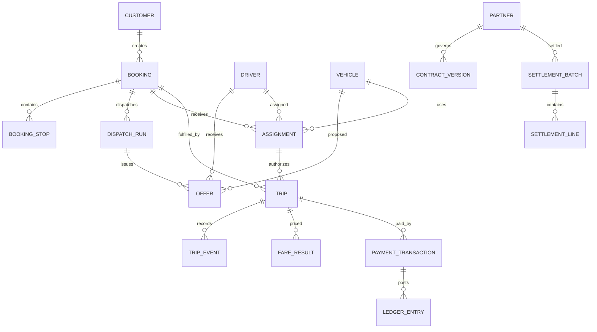

# X-02 — KIẾN TRÚC DỮ LIỆU VÀ ERD

**Version:** 0.1 · **Status:** DRAFT · **Owner:** Data Architect/Domain Owners

## 1. Data ownership
Each Module owns its write model. Cross-module access through versioned APIs/events; reporting may use projections. Direct cross-module table updates are prohibited by design.

## 2. Core logical entities

| Domain | Entities | Key relations |
|---|---|---|
| Customer | Customer, ContactPoint, SavedPlace | Customer 1-N Booking |
| Booking | Booking, BookingStop, BookingRevision | Booking 1-N stops/revisions |
| Fleet | Driver, Vehicle, DriverVehicleLink, Shift | Driver/Vehicle eligibility |
| Partner | Partner, Contract, ContractVersion | Partner 1-N contracts |
| Dispatch | DispatchRun, CandidateSnapshot, Offer, Assignment | Booking 1-N runs/offers/assignments |
| Trip | Trip, TripEvent, IncidentCase | Trip references Booking + Assignment |
| Pricing | TariffVersion, FareQuote, FareResult | Fare to Booking/Trip |
| Payment | PaymentTransaction, RefundTransaction | Payment to Fare/Trip |
| Finance | LedgerEntry, Receivable, Payable | Posting references source event |
| Settlement | SettlementBatch, SettlementLine, Payout | Batch 1-N lines |
| Platform | User, Role, Permission, AuditEvent | Actor/scope/audit |
| Support | ServiceCase, Complaint | Case references Booking/Trip/customer |

## 3. Logical ERD

## 4. Data invariants
- BookingStop sequence unique per Booking.
- Offer unique identifier and expiry.
- At most one active Assignment per Booking; resource conflict constraints.
- Trip references valid Assignment; prevent multiple active trips for same resource.
- Fare result preserves tariff/version/input snapshot.
- Financial amount stored with currency and approved precision; no floating point for posted money.
- Ledger source_event unique/idempotent and balanced according to approved accounting mapping.
- Contract snapshot is immutable once referenced by a completed trip/settlement.
- Audit and posted finance are append-only with correction links.

## 5. Physical design decisions TBD
DB engine/version, spatial index/GPS store, partitioning, retention/archival, tenant/branch/partner scoping, encryption, backup, read replicas, consistency boundary, ID strategy, event store/outbox and warehouse.
