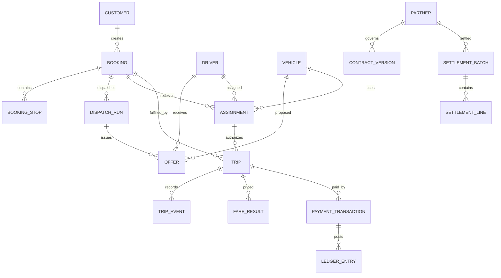

# X-02 — KIẾN TRÚC DỮ LIỆU VÀ ERD
**Version:** 0.1 · **Status:** DRAFT · **Owner:** Data Architect/Domain Owners

## 1. Ownership
Each Module owns its write model. Cross-module access uses versioned APIs/events. Reporting may use read projections. Cross-module direct table updates are prohibited.

## 2. Core entities
| Domain | Entities | Relations |
|---|---|---|
| Customer | Customer, ContactPoint, SavedPlace | Customer 1-N Booking |
| Booking | Booking, BookingStop, BookingRevision | Booking 1-N stops/revisions |
| Fleet | Driver, Vehicle, DriverVehicleLink, Shift | Eligibility |
| Partner | Partner, Contract, ContractVersion | Partner 1-N contracts |
| Dispatch | DispatchRun, CandidateSnapshot, Offer, Assignment | Booking 1-N runs/offers/assignments |
| Trip | Trip, TripEvent, IncidentCase | Trip references Booking + Assignment |
| Pricing | TariffVersion, FareQuote, FareResult | Fare to Booking/Trip |
| Payment | PaymentTransaction, RefundTransaction | Payment to Fare/Trip |
| Finance | LedgerEntry, Receivable, Payable | Posting references source event |
| Settlement | SettlementBatch, SettlementLine, Payout | Batch 1-N lines |
| Platform | User, Role, Permission, AuditEvent | Actor/scope/audit |
| Support | ServiceCase, Complaint | References booking/trip/customer |

## 3. Logical ERD

## 4. Invariants
BookingStop sequence unique per Booking; Offer ID unique/expiry server-owned; one active Assignment per Booking; no resource conflict; Trip references valid Assignment; FareResult preserves tariff/input snapshot; money uses currency precision; Ledger source event unique/idempotent and balanced; Contract snapshot immutable when referenced; audit/posted finance append-only.

## 5. Physical design TBD
DB engine/version, spatial index/GPS store, partitioning, retention/archival, tenant/branch/partner scope, encryption, backup, read replicas, transaction boundaries, ID strategy, outbox and warehouse.
