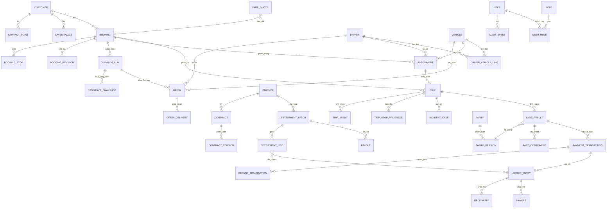
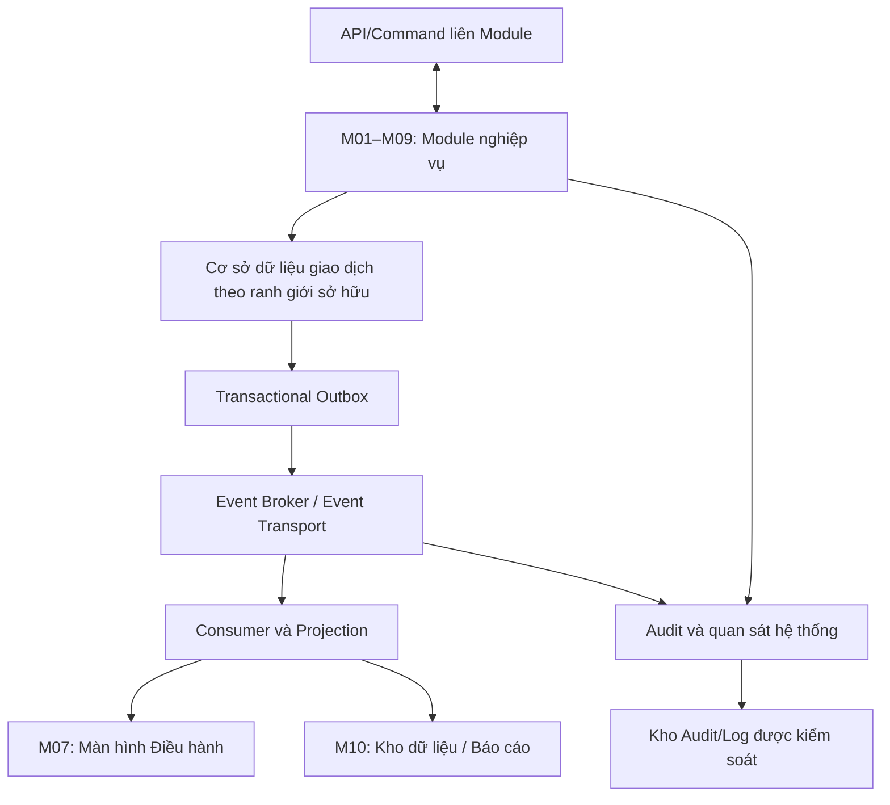

# X-02 — KIẾN TRÚC DỮ LIỆU VÀ MÔ HÌNH QUAN HỆ ERD

**Mã tài liệu:** TAXI-X-02  
**Phiên bản:** 0.2  
**Trạng thái:** DỰ THẢO KIẾN TRÚC — CHỜ CHỦ MODULE, DATA ARCHITECT VÀ NGHIỆP VỤ PHÊ DUYỆT  
**Phạm vi:** Mô hình dữ liệu logic toàn nền tảng Taxi Mai Linh  
**Tài liệu liên quan:** [00 — Tổng quan](../00-OVERVIEW.md) · [03 — Kiến trúc Module](../03-MODULE-ARCHITECTURE-AND-OWNERSHIP.md) · [04 — Quy trình TO.P1–TO.P9](../04-END-TO-END-WORKFLOWS-TO-P1-TO-P9.md) · [X-01 — State Machine](./01-state-machines-and-transition-rules.md)

> **Phân biệt nguồn và thiết kế:** Tài liệu KPMG 2015 mô tả các quy trình, dữ liệu nghiệp vụ cần thu thập và các yêu cầu vận hành; không cung cấp ERD vật lý hay danh mục bảng chuẩn cho hệ thống mới. Các Entity, quan hệ, khóa và ràng buộc trong tài liệu này là mô hình dữ liệu logic đề xuất dựa trên quy trình KPMG, kiến trúc 10 Module và State Machine. Đây chưa phải thiết kế DDL được phê duyệt. Các trường, chỉ mục, kiểu dữ liệu và chính sách lưu trữ vật lý sẽ được chốt sau khi khảo sát hệ thống hiện trạng và chọn nền tảng dữ liệu.

---

## 1. Mục tiêu và phạm vi

Tài liệu xác định cấu trúc dữ liệu logic để:
- Thống nhất cách biểu diễn khách hàng, Booking, nguồn lực, điều phối, chuyến đi, giá cước, thanh toán và tài chính.
- Xác định Module sở hữu dữ liệu gốc (Write Ownership).
- Chuẩn hóa quan hệ giữa các Aggregate, tránh trùng lặp và phụ thuộc chéo.
- Bảo đảm truy vết xuyên suốt từ yêu cầu khách hàng đến chuyến đi, hóa đơn, giao dịch và quyết toán.
- Làm cơ sở thiết kế Database Schema, API, Event, Data Migration, Audit và báo cáo.
- Giữ nguyên khả năng dùng chung quy trình vận hành cho DIRECT/PARTNER nhưng tách bạch hợp đồng và nghĩa vụ tài chính.

**Ngoài phạm vi phiên bản này:** DDL chi tiết theo một DBMS cụ thể, kiểu dữ liệu vật lý cuối cùng, dung lượng/partition, chiến lược lưu GPS thời gian thực, Data Warehouse, ETL/ELT và phương án triển khai HA/DR.

## 2. Nguyên tắc kiến trúc dữ liệu

1. **Một nguồn dữ liệu gốc cho mỗi miền:** Mỗi Module chịu trách nhiệm ghi và bảo vệ dữ liệu của mình.
2. **Không ghi trực tiếp xuyên Module:** Module khác truy cập qua API/Command/Event hoặc Read Projection được công bố.
3. **Tách giao dịch và dữ liệu đọc:** Màn hình điều hành/báo cáo có thể dùng projection, nhưng không trở thành nguồn dữ liệu giao dịch.
4. **Tách định danh và mã hiển thị:** ID nội bộ ổn định; booking_code/trip_code là mã nghiệp vụ có quy tắc riêng.
5. **Lưu lịch sử thay đổi:** BookingRevision, PolicyVersion, TariffVersion, ContractVersion và AuditEvent không bị ghi đè mất dấu vết.
6. **Snapshot tại thời điểm phát sinh:** Các dữ liệu có thể thay đổi như biểu giá, hợp đồng, tỷ lệ chia sẻ và thông tin nguồn lực cần snapshot hoặc tham chiếu phiên bản hiệu lực tại thời điểm giao dịch.
7. **Tiền tệ có đơn vị và độ chính xác:** Không dùng kiểu số thực dấu phẩy động để lưu tiền; phải lưu currency và quy tắc làm tròn.
8. **Thời gian có múi giờ:** Lưu thời điểm chuẩn theo UTC hoặc quy ước thống nhất; giao diện hiển thị theo múi giờ địa phương. Quy tắc lưu cụ thể phải được chốt.
9. **Dữ liệu cá nhân có kiểm soát:** Hạn chế sao chép số điện thoại/địa chỉ; phân quyền, mã hóa, masking và retention theo quy định.
10. **DIRECT/PARTNER là thuộc tính nghiệp vụ có kiểm soát:** Không suy ra từ kênh đặt xe, loại xe hoặc người tạo Booking.
11. **Không hard-delete dữ liệu tài chính và lịch sử giao dịch:** Hủy/điều chỉnh bằng trạng thái và bản ghi bù trừ có truy vết.
12. **Tính nhất quán có chủ đích:** Dùng transaction trong ranh giới Module; liên Module sử dụng Event/Outbox và xử lý eventual consistency có kiểm soát.

---

## 3. Phân vùng dữ liệu theo 10 Module

| Module | Miền dữ liệu sở hữu | Entity chính | Không sở hữu |
|---|---|---|---|
| M01 — Khách hàng và Đặt xe | Hồ sơ khách, địa chỉ, yêu cầu đặt xe và lịch sử chỉnh sửa | Customer, ContactPoint, SavedPlace, Booking, BookingStop, BookingRevision | Offer, Assignment, Trip, Payment, Ledger |
| M02 — Đội xe và Đối tác | Tài xế, xe, ca làm, đội xe, đối tác, hợp đồng và điều kiện khai thác | Driver, Vehicle, DriverVehicleLink, Shift, Partner, Contract, ContractVersion, EligibilityProfile | Candidate ranking, Assignment, Trip |
| M03 — Điều phối và Hàng đợi | Lượt điều phối, ứng viên, Offer, Assignment, hàng đợi và chính sách điều phối | DispatchRun, CandidateSnapshot, CandidateDecision, Offer, OfferDelivery, Assignment, DispatchPolicyVersion, QueueRegistration | Hồ sơ gốc tài xế/xe, Trip, Fare |
| M04 — Ứng dụng Tài xế và Chuyến đi | Chuyến đi, tiến độ, sự kiện, thiết bị và sự cố | Trip, TripStopProgress, TripEvent, DriverDevice, OfflineEventEnvelope, IncidentCase, SOSAlert | Booking gốc, Assignment, Tariff, Payment |
| M05 — Giá cước và Thanh toán | Biểu giá, báo giá, kết quả cước, thu và hoàn tiền | Tariff, TariffVersion, FareQuote, FareResult, FareComponent, PaymentTransaction, RefundTransaction | Ledger, Payable, Settlement |
| M06 — Tài chính và Quyết toán | Tài khoản kế toán, bút toán, công nợ, batch và chi trả | LedgerAccount, LedgerEntry, Receivable, Payable, SettlementBatch, SettlementLine, AdjustmentEntry, Payout, ReconciliationRun, VarianceCase | Dữ liệu gốc Booking/Trip/Payment |
| M07 — Trung tâm Điều hành và CSKH | Hồ sơ hỗ trợ/khiếu nại và mô hình đọc điều hành | ServiceCase, Complaint, SLAClock, OperationalProjection | Nguồn giao dịch Booking/Dispatch/Trip |
| M08 — Nền tảng, Phân quyền và Kiểm toán | Danh tính, quyền, phạm vi dữ liệu, cấu hình và audit | User, Role, Permission, UserRole, DataScope, OrgUnit, AuditEvent | Quy tắc nghiệp vụ riêng của từng Module |
| M09 — Tích hợp và Thông báo | Cấu hình nhà cung cấp, giao nhận, webhook, outbox/inbox | ProviderConfig, NotificationDelivery, IntegrationDelivery, WebhookReceipt, OutboxEvent, InboxReceipt | Nguồn dữ liệu nghiệp vụ chuẩn |
| M10 — Báo cáo và Phân tích | Định nghĩa KPI, mô hình đọc, lineage và dữ liệu tổng hợp | KPI/MetricDefinition, ReportingProjection, DataLineage, AggregateFact | Ghi trực tiếp vào bảng giao dịch Module khác |

**Quy tắc:** Tên Entity ở trên là tên logic. Khi thiết kế vật lý có thể tách bảng, gom bảng hoặc đổi tên theo chuẩn kỹ thuật, nhưng không được làm mất ranh giới sở hữu nghiệp vụ.

---

## 4. ERD logic tổng thể

Sơ đồ dưới đây tập trung vào quan hệ cốt lõi. Một số quan hệ tham chiếu xuyên Module được thể hiện bằng khóa tham chiếu logic; không hàm ý tất cả đều là Foreign Key vật lý trong cùng một Database.

### 4.1. Cách đọc ERD

- Customer có thể tạo nhiều Booking; Booking có nhiều điểm dừng và nhiều phiên bản chỉnh sửa.
- Một Booking có thể trải qua nhiều DispatchRun; mỗi lượt điều phối có nhiều ứng viên và Offer.
- Offer là lời mời, Assignment là phân công có hiệu lực. Không gộp hai Entity này.
- Booking có thể có nhiều Assignment theo lịch sử điều phối lại, nhưng tối đa một Assignment hiệu lực tại cùng thời điểm.
- Trip tham chiếu Booking và Assignment cụ thể đã kích hoạt chuyến.
- FareResult lưu kết quả cước của Trip; FareComponent lưu từng thành phần cước.
- PaymentTransaction có thể có nhiều RefundTransaction; không xóa giao dịch thu gốc.
- LedgerEntry là dữ liệu tài chính do M06 sở hữu; Payment không tự ghi trực tiếp vào Ledger.
- SettlementBatch/Line tập hợp các khoản cần đối soát theo kỳ và đối tác; Payout lưu chứng từ chi trả.

### 4.2. Lưu ý về ERD liên Module

Nếu hệ thống triển khai theo nhiều Database/Service, quan hệ thể hiện trong ERD là quan hệ logic. Không tạo Foreign Key xuyên Database. Mỗi Module lưu ID tham chiếu và xác minh thông qua API/Event hoặc projection phù hợp.

---

## 5. Mô hình dữ liệu chi tiết theo miền

### 5.1. M01 — Customer và Booking

| Entity | Thuộc tính logic quan trọng | Quan hệ/ghi chú |
|---|---|---|
| Customer | customer_id, customer_type, display_name, status, created_at | Hồ sơ khách hàng; không bắt buộc mọi Booking đều có Customer đã đăng ký |
| ContactPoint | contact_point_id, customer_id, type, value_ref, is_verified, is_primary | Số điện thoại/email; cần mã hóa/masking |
| SavedPlace | saved_place_id, customer_id, label, address_ref, latitude, longitude | Địa chỉ đã lưu; quyền truy cập theo chủ thể |
| Booking | booking_id, booking_code, customer_id nullable, booking_channel, service_type, fleet_type, requested_vehicle_type, pickup_at, status, pickup_location_ref, destination_location_ref, created_at | Aggregate gốc của yêu cầu |
| BookingStop | booking_stop_id, booking_id, sequence_no, stop_type, location_ref, instruction | Điểm đón/đến/trung gian theo thứ tự |
| BookingRevision | revision_id, booking_id, revision_no, changed_by, change_reason, snapshot, created_at | Lưu thay đổi nội dung Booking |
| QuoteReference | quote_reference_id, booking_id, fare_quote_id, quote_version | Tham chiếu báo giá từ M05; M01 không sở hữu FareQuote |

**Trường cần làm rõ với nghiệp vụ:**
- `service_type`: đi ngay, đặt trước, đường dài, nhiều xe, đi ghép hay loại dịch vụ khác.
- `fleet_type`: DIRECT/PARTNER hoặc mô hình phân loại đã được phê duyệt.
- `booking_channel`: APP/WEB/CALL_CENTER/SMS/CHAT/MARKETING_POINT/API...
- Địa chỉ chuẩn hóa, mã vùng phục vụ, cách lưu tọa độ và nguồn xác minh.
- Quy tắc khách vãng lai/khách đăng ký, nhiều số điện thoại, số gọi thay và bảo vệ thông tin liên hệ.

### 5.2. M02 — Driver, Vehicle, Partner, Contract

| Entity | Thuộc tính logic quan trọng | Quan hệ/ghi chú |
|---|---|---|
| Driver | driver_id, employee_code, display_name, status, identity_ref | Hồ sơ tài xế; thông tin định danh cần bảo vệ |
| Vehicle | vehicle_id, fleet_code, plate_number_ref, vehicle_type, seat_capacity, status | Hồ sơ xe; biển số là dữ liệu nhạy cảm vận hành |
| DriverVehicleLink | link_id, driver_id, vehicle_id, valid_from, valid_to, link_type | Lịch sử quan hệ tài xế–xe; không giả định cố định |
| Shift | shift_id, driver_id, shift_start, shift_end, status | Ca làm và điều kiện thời gian |
| Partner | partner_id, partner_code, legal_name, status | Đối tác/pháp nhân |
| Contract | contract_id, partner_id, contract_code, status | Hợp đồng |
| ContractVersion | contract_version_id, contract_id, version_no, effective_from, effective_to, terms_snapshot | Snapshot điều khoản hiệu lực |
| EligibilityProfile | eligibility_profile_id, subject_type, subject_id, rule_version, status | Hồ sơ điều kiện khai thác |

Không dùng một cột partner_id đơn giản để suy ra toàn bộ chủ thể hưởng doanh thu. Quan hệ khai thác, sở hữu xe, đơn vị quản lý tài xế và bên nhận quyết toán có thể khác nhau; cần xác nhận operating model.

### 5.3. M03 — Dispatch và Queue

| Entity | Thuộc tính logic quan trọng | Quan hệ/ghi chú |
|---|---|---|
| DispatchRun | dispatch_run_id, booking_id, attempt_no, policy_version_id, status, started_at, ended_at, trigger_reason | Một lần chạy điều phối |
| CandidateSnapshot | candidate_snapshot_id, dispatch_run_id, driver_id, vehicle_id, route_distance, eta, gps_observed_at, eligibility_result, rank_value | Ảnh chụp ứng viên tại thời điểm xét |
| CandidateDecision | decision_id, candidate_snapshot_id, decision, reason_code, decided_at | Giải thích đủ/không đủ điều kiện và quyết định |
| Offer | offer_id, dispatch_run_id, booking_id, driver_id, vehicle_id, status, sent_at, expires_at, resolved_at | Lời mời tài xế |
| OfferDelivery | delivery_id, offer_id, channel, provider_ref, delivery_status, sent_at, acknowledged_at | Tách trạng thái gửi thông báo khỏi trạng thái Offer |
| Assignment | assignment_id, booking_id, dispatch_run_id, offer_id nullable, driver_id, vehicle_id, status, effective_from, effective_to, release_reason | Phân công có hiệu lực |
| DispatchPolicyVersion | policy_version_id, policy_code, version_no, effective_from, policy_snapshot | Lưu phiên bản quy tắc |
| QueueRegistration | queue_registration_id, point_id, driver_id, vehicle_id, sequence_no, registered_at, status, called_at, resolved_at | Hàng đợi FIFO tại điểm/khu vực |

**Ràng buộc quan trọng:**
- `attempt_no` duy nhất trong phạm vi Booking hoặc một quy ước tương đương.
- Một Offer không thể được chấp nhận sau khi hết hạn/đã thu hồi.
- CandidateSnapshot phải lưu dữ liệu đủ để giải thích quyết định; không chỉ lưu thứ hạng cuối.
- OfferDelivery không quyết định Offer đã được tài xế chấp nhận.
- Assignment có lịch sử; không xóa Assignment cũ khi điều phối lại.
- Queue sequence phải ổn định trong phạm vi điểm/hàng đợi và thời gian hiệu lực.

### 5.4. M04 — Trip và sự kiện tài xế

| Entity | Thuộc tính logic quan trọng | Quan hệ/ghi chú |
|---|---|---|
| Trip | trip_id, trip_code, booking_id, assignment_id, status, started_at, completed_at, trip_type | Chuyến thực tế, tham chiếu Assignment hiệu lực |
| TripStopProgress | progress_id, trip_id, booking_stop_id nullable, sequence_no, arrived_at, departed_at, status | Tiến độ tại từng điểm |
| TripEvent | trip_event_id, trip_id, event_type, event_sequence, device_event_id, occurred_at, recorded_at, actor_id, payload_ref | Nhật ký sự kiện bất biến |
| DriverDevice | device_id, driver_id, device_fingerprint_ref, app_version, last_seen_at, status | Thiết bị tài xế |
| OfflineEventEnvelope | offline_event_id, trip_id, device_id, client_event_uuid, client_sequence, device_time, received_at, sync_status | Hàng đợi sự kiện offline |
| IncidentCase | incident_id, trip_id, incident_type, severity, status, reported_at, closed_at | Sự cố gắn với Trip |
| SOSAlert | sos_alert_id, trip_id, driver_id, latitude, longitude, triggered_at, status | Cảnh báo khẩn cấp |

Trip server là nguồn trạng thái có thẩm quyền. Sự kiện offline phải được xác minh, chống trùng, kiểm tra thứ tự và lưu cả thời gian thiết bị lẫn thời gian máy chủ nhận.

### 5.5. M05 — Tariff, Fare và Payment

| Entity | Thuộc tính logic quan trọng | Quan hệ/ghi chú |
|---|---|---|
| Tariff | tariff_id, tariff_code, service_type, status | Danh mục biểu giá |
| TariffVersion | tariff_version_id, tariff_id, version_no, effective_from, effective_to, currency, rule_snapshot | Phiên bản biểu giá bất biến |
| FareQuote | fare_quote_id, booking_id, tariff_version_id, quoted_amount, currency, expires_at, status, input_snapshot | Báo giá tại thời điểm yêu cầu |
| FareResult | fare_result_id, trip_id, tariff_version_id, final_amount, currency, status, calculation_snapshot, finalized_at | Kết quả tính cước cuối |
| FareComponent | fare_component_id, fare_result_id, component_type, quantity, unit_price, amount, tax_code nullable | Chi tiết cấu thành cước |
| PaymentTransaction | payment_transaction_id, fare_result_id, payment_method, provider_ref, amount, currency, status, initiated_at, confirmed_at | Giao dịch thu tiền |
| RefundTransaction | refund_transaction_id, payment_transaction_id, amount, currency, reason_code, status, provider_ref, created_at | Hoàn tiền tham chiếu giao dịch gốc |

**Cần lưu ý:**
- FareQuote và FareResult không phải cùng một đối tượng.
- FareResult cần lưu snapshot đầu vào, phiên bản biểu giá và từng thành phần để có thể giải thích số tiền.
- Cước đồng hồ, cước cố định đường dài, phụ thu, cầu đường, tip, giảm giá và điều chỉnh phải được phân loại rõ.
- Giao dịch thanh toán có thể timeout nhưng chưa biết kết quả; cần trạng thái đối soát.
- Phương thức thanh toán KPMG 2015 liệt kê là thông tin lịch sử, không mặc định là phương thức đang được Mai Linh sử dụng.

### 5.6. M06 — Ledger, Receivable, Payable, Settlement

| Entity | Thuộc tính logic quan trọng | Quan hệ/ghi chú |
|---|---|---|
| LedgerAccount | ledger_account_id, account_code, account_name, account_type, currency | Hệ thống tài khoản |
| LedgerEntry | ledger_entry_id, source_type, source_id, source_event_id, posting_date, account_id, debit_amount, credit_amount, currency, status | Bút toán; M06 sở hữu |
| Receivable | receivable_id, source_ref, debtor_ref, amount, outstanding_amount, due_date, status | Khoản phải thu |
| Payable | payable_id, source_ref, beneficiary_ref, amount, outstanding_amount, due_date, status | Khoản phải trả |
| SettlementBatch | settlement_batch_id, beneficiary_type, beneficiary_id, contract_version_id, period_start, period_end, status, total_amount, currency | Batch quyết toán |
| SettlementLine | settlement_line_id, settlement_batch_id, source_type, source_id, gross_amount, deduction_amount, net_amount, currency, status | Dòng quyết toán |
| AdjustmentEntry | adjustment_entry_id, original_entry_id, reason_code, amount, currency, approved_by, created_at | Điều chỉnh có truy vết |
| Payout | payout_id, settlement_batch_id, payout_ref, amount, currency, status, paid_at, evidence_ref | Chi trả |
| ReconciliationRun | reconciliation_run_id, source_type, period, status, started_at, completed_at | Lần đối soát |
| VarianceCase | variance_case_id, reconciliation_run_id, source_ref, expected_amount, actual_amount, variance_amount, status | Chênh lệch cần xử lý |

**DIRECT/PARTNER:** cần lưu rõ beneficiary, contract version, legal entity, fleet/operating model và rule set áp dụng. Không dùng một công thức quyết toán chung nếu hợp đồng và nghĩa vụ khác nhau.

### 5.7. M07–M10 — dữ liệu hỗ trợ

| Module | Entity | Mục đích |
|---|---|---|
| M07 | ServiceCase, Complaint, SLAClock | Hồ sơ hỗ trợ, khiếu nại, thời gian SLA |
| M07 | OperationalProjection | Mô hình đọc cho Trung tâm Điều hành; không phải nguồn ghi giao dịch |
| M08 | User, Role, Permission, UserRole, DataScope, OrgUnit | Danh tính, quyền và phạm vi dữ liệu |
| M08 | AuditEvent | Nhật ký thao tác và thay đổi |
| M09 | ProviderConfig, IntegrationDelivery, WebhookReceipt | Kết nối nhà cung cấp và nhận webhook |
| M09 | OutboxEvent, InboxReceipt | Giao nhận sự kiện đáng tin cậy |
| M09 | NotificationDelivery | Theo dõi gửi SMS/Push/Email/Voice; không thay thế trạng thái nghiệp vụ |
| M10 | MetricDefinition, ReportingProjection, DataLineage | Định nghĩa KPI, mô hình báo cáo và nguồn gốc dữ liệu |

---

## 6. Các quan hệ và ràng buộc dữ liệu cốt lõi

| ID | Ràng buộc | Cách bảo vệ đề xuất | Module |
|---|---|---|---|
| DAT-01 | Một Booking có nhiều BookingStop nhưng sequence không trùng | Unique(booking_id, sequence_no) | M01 |
| DAT-02 | BookingRevision tăng tuần tự theo Booking | Unique(booking_id, revision_no) | M01 |
| DAT-03 | Một Booking có tối đa một Assignment hiệu lực | Unique/partial constraint hoặc transaction lock theo DBMS | M03 |
| DAT-04 | Offer không được chấp nhận sau expires_at | Server time + atomic state/version check | M03 |
| DAT-05 | Một tài xế/xe không có Assignment xung đột | Resource reservation/locking và kiểm tra khoảng thời gian | M03 |
| DAT-06 | CandidateDecision phải truy về CandidateSnapshot | Foreign key nội bộ/constraint | M03 |
| DAT-07 | Trip phải tham chiếu Assignment hợp lệ | Kiểm tra trạng thái và ownership qua API/transaction phù hợp | M04 |
| DAT-08 | TripEvent có event_sequence duy nhất trong Trip | Unique(trip_id, event_sequence) | M04 |
| DAT-09 | Offline event không xử lý lặp | Unique(device_id, client_event_uuid) | M04 |
| DAT-10 | FareResult phải lưu phiên bản biểu giá và snapshot tính toán | FK nội bộ + immutable snapshot | M05 |
| DAT-11 | Payment/Refund dùng currency và precision nhất quán | Decimal + currency validation | M05 |
| DAT-12 | Tổng Refund không vượt giới hạn được phép của Payment gốc | Transaction lock/aggregate validation | M05 |
| DAT-13 | Ledger posting không ghi trùng một source event | Unique(source_event_id, posting_rule/version) theo quy tắc kế toán | M06 |
| DAT-14 | Tổng Debit = tổng Credit theo đơn vị tiền tệ và bút toán | Posting validation | M06 |
| DAT-15 | SettlementLine phải truy về nguồn giao dịch/bút toán | Source reference + snapshot | M06 |
| DAT-16 | Batch đã LOCKED/PAID không sửa trực tiếp | State guard + append-only adjustment | M06 |
| DAT-17 | Hợp đồng/biểu giá đã được giao dịch tham chiếu không bị thay đổi nội dung | Versioned immutable record | M02/M05 |
| DAT-18 | AuditEvent không được sửa/xóa bởi luồng nghiệp vụ thông thường | Append-only permission + retention policy | M08 |
| DAT-19 | Event được consumer xử lý idempotent | Inbox/dedup key | M09 |
| DAT-20 | Báo cáo không cập nhật bảng giao dịch nguồn | Read-only role/projection | M10 |

**Lưu ý kỹ thuật:** Partial unique index, exclusion constraint, row lock hoặc serializable transaction là các phương án phụ thuộc DBMS. Không được chốt một cú pháp SQL trước khi quyết định nền tảng Database và chiến lược triển khai.

---

## 7. DIRECT và PARTNER — mô hình dữ liệu tách bạch

Dùng chung Booking/Dispatch/Trip không có nghĩa là dùng chung cách ghi nhận tài chính.

### 7.1. Thông tin cần truy vết

| Thuộc tính/quan hệ | Mục đích |
|---|---|
| fleet_type / operating_model | Phân biệt DIRECT và PARTNER theo định nghĩa được phê duyệt |
| partner_id nullable | Đối tác liên quan khi có |
| contract_id / contract_version_id | Hợp đồng và phiên bản điều khoản hiệu lực |
| service_provider_id | Chủ thể cung cấp dịch vụ |
| revenue_beneficiary_id | Chủ thể được hưởng doanh thu |
| settlement_beneficiary_id | Chủ thể nhận quyết toán |
| deduction_rule_version_id | Phiên bản quy tắc khấu trừ |
| legal_entity_id | Pháp nhân chịu trách nhiệm |
| accounting_mapping_version_id | Phiên bản ánh xạ tài khoản kế toán |

Các trường trên là đề xuất logic; cần xác nhận có thể suy ra từ Contract/Partner hay phải lưu snapshot tại Assignment/Trip/Finance.

### 7.2. Nguyên tắc

- Không xác định DIRECT/PARTNER bằng `booking_channel`.
- Một Booking chỉ có một mô hình khai thác chính tại một thời điểm, trừ khi nghiệp vụ cho phép mô hình khác và có quy tắc phân bổ rõ.
- Khi Trip hoàn thành, dữ liệu tài chính phải xác định được hợp đồng/điều khoản áp dụng.
- SettlementLine phải truy ngược đến Trip, FareResult, LedgerEntry và ContractVersion tương ứng.
- Mọi thay đổi hợp đồng sau thời điểm giao dịch không được làm thay đổi hồi tố nghĩa vụ đã phát sinh, trừ điều chỉnh có phê duyệt và truy vết.

---

## 8. Quy tắc dữ liệu dùng chung

### 8.1. ID và mã nghiệp vụ

Đề xuất phân biệt:
- `*_id`: khóa định danh nội bộ, không mang ý nghĩa nghiệp vụ, không tái sử dụng.
- `*_code`: mã hiển thị/nghiệp vụ như booking_code, trip_code, partner_code.
- `*_ref`: tham chiếu đến hệ thống ngoài hoặc nhà cung cấp.
- `*_version`: phiên bản Aggregate/Policy/Contract/Tariff.

Chiến lược UUID/ULID/snowflake và quy tắc cấp mã hiển thị cần quyết định sau khi chọn công nghệ, yêu cầu offline và tích hợp.

### 8.2. Tiền tệ và số lượng

- Tiền dùng Decimal/Numeric với precision/scale được quyết định theo loại tiền và quy định kế toán.
- Mọi số tiền phải gắn currency.
- Không dùng Float/Double cho giá trị tiền.
- Lưu rõ gross, discount, surcharge, tax, deduction, net khi có ý nghĩa nghiệp vụ.
- Quy tắc làm tròn phải được định nghĩa tại Tariff/Accounting Policy Version.
- Không cộng trực tiếp số tiền khác currency nếu chưa có tỷ giá và thời điểm quy đổi.

### 8.3. Thời gian và dữ liệu GPS

- Lưu cả thời điểm sự kiện nghiệp vụ và thời điểm hệ thống tiếp nhận nếu dữ liệu đến trễ.
- Ghi rõ nguồn thời gian: server/device/provider.
- GPS cần latitude, longitude, observed_at, received_at, accuracy và source khi phù hợp.
- Không dùng GPS cũ để kết luận xe hiện đang ở vị trí đó.
- Dữ liệu GPS tần suất cao có thể cần kho lưu trữ chuyên biệt; không mặc định lưu mọi điểm GPS vào cùng bảng giao dịch quan hệ.

### 8.4. Audit và lịch sử

AuditEvent tối thiểu cần:
- audit_event_id, actor_id, actor_type, action, aggregate_type, aggregate_id.
- before/after hoặc change set có kiểm soát.
- reason_code, source, occurred_at, recorded_at.
- correlation_id, request_id, ip/device metadata khi được phép.
- Không lưu bí mật xác thực, token hoặc dữ liệu nhạy cảm không cần thiết.

### 8.5. Xóa, ẩn danh và lưu trữ

- Không hard-delete Booking/Trip/Payment/Ledger đã phát sinh nghiệp vụ.
- Có thể dùng soft delete hoặc anonymization cho dữ liệu phù hợp, nhưng không làm mất khả năng đáp ứng nghĩa vụ kế toán/pháp lý.
- Retention theo từng nhóm: PII, GPS, thông báo, Audit, Event, giao dịch tài chính.
- Thời hạn lưu cụ thể cần Pháp chế/Kế toán/CNTT phê duyệt; tài liệu này không tự đặt số năm.

---

## 9. Phân tách Database giao dịch, Event và báo cáo

Mô hình logic đề xuất:

Đây là kiến trúc logic. Có thể triển khai bằng một Database với schema/ownership rõ ràng ở giai đoạn đầu, hoặc tách Database theo Module khi cần. Dù lựa chọn nào, ranh giới sở hữu và quyền ghi vẫn phải được giữ.

---

## 10. Data Dictionary — quy ước trường tối thiểu

| Nhóm trường | Quy ước | Ghi chú |
|---|---|---|
| Primary ID | `<entity>_id` | Không dùng mã hiển thị làm khóa chính |
| Foreign/reference ID | `<related_entity>_id` hoặc `<related_entity>_ref` | Phân biệt FK nội bộ và tham chiếu liên Module |
| State | `status` | Enum theo State Machine của Aggregate |
| Version | `version` / `aggregate_version` | Optimistic concurrency |
| Created | `created_at`, `created_by` | Thời điểm và actor tạo |
| Updated | `updated_at`, `updated_by` | Chỉ dùng cho dữ liệu được phép cập nhật |
| Effective period | `effective_from`, `effective_to` | Chính sách/hợp đồng/biểu giá |
| Currency | `currency` | Mã tiền tệ |
| Amount | `amount`, `gross_amount`, `net_amount` | Decimal/Numeric |
| Source | `source`, `source_ref` | Nguồn tạo/nhà cung cấp |
| Correlation | `correlation_id`, `causation_id` | Truy vết xuyên dịch vụ |
| Idempotency | `idempotency_key` | Chống xử lý lặp |
| Audit | `reason_code`, `actor_id` | Lý do và chủ thể thao tác |

Không bắt buộc mọi bảng có đủ tất cả các trường. Data Architect sẽ xác định trường dùng chung và trường chuyên biệt trong Data Dictionary vật lý.

---

## 11. Những quyết định cần xác nhận trước thiết kế vật lý

| ID | Quyết định | Chủ trì đề xuất | Ảnh hưởng |
|---|---|---|---|
| DA-01 | DBMS và phiên bản; một DB hay phân tách theo Module | CNTT/Architecture | Toàn hệ thống |
| DA-02 | ID strategy: UUID/ULID/sequence; mã nghiệp vụ | Architecture | Toàn hệ thống |
| DA-03 | Mô hình khách vãng lai, khách đăng ký và định danh số điện thoại | Kinh doanh/CSKH | M01 |
| DA-04 | Cấu trúc địa chỉ, geocoding, vùng phục vụ và dữ liệu bản đồ | Vận hành/CNTT | M01/M03 |
| DA-05 | Mô hình sở hữu xe, tài xế, ca làm và quan hệ đối tác | Vận hành/Nhân sự/Kinh doanh | M02 |
| DA-06 | DIRECT/PARTNER: pháp nhân, beneficiary, hợp đồng và snapshot | Kinh doanh/Tài chính | M02/M06 |
| DA-07 | Cấu trúc Offer, Assignment và quy tắc giữ tài nguyên | Điều hành | M03 |
| DA-08 | Cấu trúc Trip, Trip Leg, điểm dừng và chuyến đường dài | Vận hành | M04 |
| DA-09 | Tần suất GPS, retention và kho dữ liệu vị trí | Vận hành/CNTT/Pháp chế | M04/M09 |
| DA-10 | Tariff, FareComponent, thuế, phụ phí, giảm giá và làm tròn | Kinh doanh/Tài chính | M05 |
| DA-11 | Payment provider, nhiều lần thu, hoàn tiền và reconciliation | Tài chính/CNTT | M05 |
| DA-12 | Chart of Accounts, posting rule và kỳ kế toán | Kế toán | M06 |
| DA-13 | Settlement theo đối tác, hợp đồng, beneficiary và kỳ | Tài chính/Kinh doanh | M06 |
| DA-14 | Phân quyền theo đơn vị, chi nhánh, đội xe, đối tác và pháp nhân | CNTT/An toàn thông tin | M08 |
| DA-15 | Retention, ẩn danh, mã hóa và quyền truy cập dữ liệu cá nhân | Pháp chế/ATTT | Toàn hệ thống |
| DA-16 | Event Broker, Outbox/Inbox, schema registry và replay | Architecture | M09 |
| DA-17 | Reporting projection, Data Warehouse và độ trễ báo cáo | Tài chính/Vận hành/CNTT | M10 |
| DA-18 | Partitioning, HA/DR, backup, RPO/RTO và dung lượng | Hạ tầng/CNTT | Toàn hệ thống |

---

## 12. Tiêu chí nghiệm thu mô hình dữ liệu logic

- [ ] Mỗi Entity có Module sở hữu rõ ràng.
- [ ] Mỗi Aggregate chính có định danh, trạng thái và version.
- [ ] ERD thể hiện được chuỗi Customer → Booking → Dispatch → Assignment → Trip → Fare → Payment → Ledger → Settlement.
- [ ] Offer và Assignment là hai Entity riêng.
- [ ] BookingRevision, PolicyVersion, TariffVersion và ContractVersion có lịch sử.
- [ ] Có mô hình DIRECT/PARTNER và beneficiary/contract snapshot.
- [ ] Có ràng buộc chống Assignment trùng và xử lý đồng thời.
- [ ] Có thiết kế TripEvent/OfflineEvent chống trùng và kiểm tra thứ tự.
- [ ] Có snapshot dữ liệu đầu vào tính cước và phiên bản biểu giá.
- [ ] Có liên kết Payment/Refund/Ledger/Settlement có thể đối soát.
- [ ] Có Audit, PII protection và retention.
- [ ] Có quyết định về DBMS, ID strategy, transaction boundary và event transport trước DDL.
- [ ] Không có Module báo cáo hoặc màn hình điều hành ghi trực tiếp vào dữ liệu nguồn Module khác.

---

## 13. Lộ trình tiếp theo

1. Rà soát Entity/relationship với chủ sở hữu 10 Module.
2. Chốt các quyết định DA-01 đến DA-18.
3. Xây Data Dictionary chi tiết cho lát cắt ưu tiên:
   - M01: Customer, Booking, BookingStop, BookingRevision.
   - M03: DispatchRun, CandidateSnapshot, Offer, Assignment.
   - M04: Trip, TripEvent, TripStopProgress.
4. Hoàn thiện ERD vật lý theo DBMS được chọn.
5. Thiết kế Index, Unique Constraint, Foreign Key, transaction boundary và migration.
6. Thiết kế API/Command/Event Contracts tương ứng.
7. Viết Test Data, migration test, concurrency test, reconciliation test và backup/restore test.
8. Chỉ bàn giao DDL/DEV khi Business và Architecture đã duyệt các quyết định liên quan.

**Nguyên tắc chốt:** ERD phải phản ánh đúng quyền sở hữu dữ liệu và vòng đời nghiệp vụ. Không thiết kế một bảng lớn chứa mọi trạng thái, không nhân bản dữ liệu gốc giữa các Module, và không để mô hình tài chính DIRECT/PARTNER nhập nhằng.

---
**Quay lại:** [README — Taxi Management System](../README.md)
