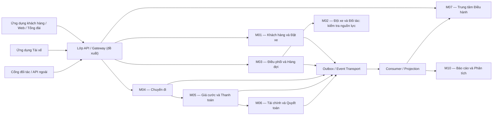

# X-03 — THIẾT KẾ API VÀ HỢP ĐỒNG SỰ KIỆN

**Mã tài liệu:** TAXI-X-03  
**Phiên bản:** 0.2  
**Trạng thái:** DỰ THẢO KIẾN TRÚC — CHỜ CHỦ MODULE, AN TOÀN THÔNG TIN VÀ NGHIỆP VỤ PHÊ DUYỆT  
**Phạm vi:** API nội bộ giữa các Module, API cho ứng dụng/kênh khách hàng và tài xế, tích hợp đối tác, Command/Event Contracts  
**Tài liệu liên quan:** [00 — Tổng quan](../00-OVERVIEW.md) · [03 — Kiến trúc Module](../03-MODULE-ARCHITECTURE-AND-OWNERSHIP.md) · [04 — Quy trình TO.P1–TO.P9](../04-END-TO-END-WORKFLOWS-TO-P1-TO-P9.md) · [X-01 — State Machine](./01-state-machines-and-transition-rules.md) · [X-02 — Data Architecture & ERD](./02-data-architecture-and-erd.md)

> **Lưu ý:** Tài liệu KPMG 2015 mô tả quy trình và thao tác nghiệp vụ, không quy định REST endpoint, JSON schema hay công nghệ giao tiếp. Các endpoint, payload và event trong tài liệu này là **đề xuất hợp đồng logic** để thống nhất BA/DEV/QA. REST/JSON, API Gateway, Event Broker và Schema Registry chưa được xem là quyết định công nghệ chính thức. Mỗi API/Schema triển khai thực tế phải được sinh/kiểm tra từ Feature Specification đã phê duyệt.

---

## 1. Mục tiêu và nguyên tắc

### 1.1. Mục tiêu

- Chuẩn hóa cách các ứng dụng và Module gọi nghiệp vụ.
- Bảo vệ ranh giới sở hữu dữ liệu; Module không ghi trực tiếp vào dữ liệu gốc của Module khác.
- Đồng bộ Command, State Machine, Database và Event.
- Hỗ trợ tích hợp App, Web, Tổng đài, SMS, Chat, hệ thống đối tác, bản đồ, thanh toán và hệ thống doanh nghiệp.
- Có thể xử lý retry, timeout, mất kết nối, gửi lặp, sự kiện sai thứ tự và đối soát.
- Tạo hợp đồng rõ ràng cho DEV và bộ kiểm thử cho QA.

### 1.2. Nguyên tắc bắt buộc

1. **API gọi đúng Module sở hữu:** M01 sở hữu Booking; M03 sở hữu DispatchRun/Offer/Assignment; M04 sở hữu Trip; M05 sở hữu Fare/Payment; M06 sở hữu Ledger/Settlement.
2. **Phân biệt Query và Command:** Query đọc dữ liệu; Command yêu cầu thay đổi trạng thái/nghiệp vụ.
3. **Không cho client cập nhật status trực tiếp:** Client gửi hành động; server xác thực Guard và quyết định Transition.
4. **Mỗi lệnh ghi quan trọng có idempotency:** đặc biệt tạo Booking, nhận Offer, kích hoạt Assignment, bắt đầu/kết thúc Trip, thu/hoàn tiền và ghi sổ.
5. **Kiểm soát đồng thời:** dùng expected_version/ETag hoặc cơ chế tương đương.
6. **Không trả PII/bí mật thừa:** chỉ trả các trường cần cho vai trò và mục đích.
7. **Event chỉ phát sau khi dữ liệu nghiệp vụ commit:** dùng Transactional Outbox hoặc cơ chế bảo đảm tương đương.
8. **Consumer phải idempotent:** không giả định Event chỉ đến một lần.
9. **Không để lỗi nhà cung cấp biến thành kết quả nghiệp vụ giả:** timeout thanh toán phải đối soát; lỗi gửi SMS không có nghĩa Booking thất bại.
10. **API đối tác có ranh giới riêng:** xác thực, giới hạn tốc độ, data scope, hợp đồng, versioning và threat model riêng.

---

## 2. Mô hình giao tiếp và ranh giới

### 2.1. Các kiểu giao tiếp

| Kiểu | Mục đích | Ví dụ |
|---|---|---|
| Query API | Đọc dữ liệu hiện tại hoặc projection | Tra cứu Booking, xem hàng đợi, xem trạng thái Trip |
| Command API | Yêu cầu thực hiện hành động nghiệp vụ | Tạo Booking, hủy Booking, nhận Offer, bắt đầu Trip |
| Domain Event | Thông báo sự kiện đã xảy ra | BookingSubmitted, OfferAccepted, TripCompleted |
| Provider Callback/Webhook | Nhà cung cấp thông báo kết quả | PaymentSucceeded, SMSDeliveryUpdated |
| Internal Projection API | Đọc mô hình tổng hợp phục vụ màn hình | Bảng điều hành, lịch sử khách hàng |

### 2.2. Sơ đồ luồng giao tiếp



Sơ đồ thể hiện quan hệ logic. Lựa chọn đồng bộ/bất đồng bộ, giao thức và cách triển khai vật lý phải được quyết định trong hồ sơ kiến trúc.

### 2.3. Quy tắc gọi xuyên Module

- Module cần thay đổi dữ liệu của Module khác phải gọi Command API của Module sở hữu.
- Module có thể tiêu thụ Event để cập nhật Projection của riêng mình.
- Không dùng Event để thay thế Command cần phản hồi đồng bộ ngay cho người dùng.
- Không dùng Query Projection để quyết định thao tác có tính cạnh tranh cao nếu dữ liệu có thể cũ; phải kiểm tra lại tại Module sở hữu trước khi commit.
- Không tạo chuỗi gọi đồng bộ vòng tròn giữa các Module.
- Mỗi luồng nghiệp vụ phải có correlation_id xuyên suốt.

---

## 3. Quy ước API chung

### 3.1. Base path và version

Đề xuất minh họa:

`/api/v1`

Đây chưa phải quyết định URL công khai. Phiên bản API phải thay đổi khi có breaking change; thay đổi tương thích có thể bổ sung field tùy chọn theo chính sách schema.

### 3.2. Quy ước HTTP method

| Method | Mục đích | Lưu ý |
|---|---|---|
| GET | Query/read | Không làm thay đổi dữ liệu nghiệp vụ |
| POST | Tạo tài nguyên hoặc Command | Command không nhất thiết là CRUD |
| PATCH | Sửa một phần tài nguyên khi được phép | Phải có kiểm tra trạng thái/version |
| PUT | Thay thế tài nguyên theo semantics đã định nghĩa | Tránh dùng để cập nhật trạng thái tùy ý |
| DELETE | Xóa tài nguyên chưa phát sinh nghiệp vụ nếu chính sách cho phép | Không dùng xóa cứng giao dịch lịch sử |

### 3.3. Header chuẩn đề xuất

| Header | Bắt buộc khi | Ý nghĩa |
|---|---|---|
| Authorization | API có xác thực | Access token/credential theo cơ chế được chọn |
| Content-Type | Có request body | Thường là application/json nếu chọn REST/JSON |
| Accept | API response | Định dạng client chấp nhận |
| Idempotency-Key | Command có thể gửi lặp/tạo tác động | Khóa chống thực hiện lặp |
| If-Match hoặc Expected-Version | Cập nhật có kiểm soát đồng thời | Phiên bản client đã đọc |
| X-Correlation-ID | Mọi luồng cần truy vết | ID xuyên dịch vụ |
| X-Request-ID | Mọi request | ID của lần gọi cụ thể |
| X-Client-Source | Khi cần xác định kênh | APP/WEB/CALL_CENTER/DRIVER_APP/PARTNER_API |

Tên header cuối cùng cần thống nhất trong API Style Guide. Không tin cậy giá trị actor_id/source do client tự khai; server phải suy ra hoặc kiểm tra từ danh tính đã xác thực.

### 3.4. Quy tắc phân trang và lọc

Đề xuất query parameters:
- `page`, `page_size` hoặc cursor-based pagination.
- `sort` theo danh sách field cho phép.
- `from`, `to` cho khoảng thời gian.
- `status`, `branch_id`, `partner_id`, `fleet_type` chỉ khi caller có quyền xem phạm vi đó.

Response phân trang phải trả metadata nhất quán; giới hạn page_size do server cấu hình. Không cho phép client tự truyền SQL/filter expression.

### 3.5. Chuẩn thời gian và tiền

- Thời gian truyền theo ISO-8601 có múi giờ/offset rõ ràng.
- Giá trị tiền luôn kèm currency.
- Không truyền tiền dưới dạng số dấu phẩy động.
- Mọi field tọa độ phải nêu rõ hệ tọa độ, thứ tự latitude/longitude và đơn vị.
- Các trường PII phải được masking theo role và mục đích.

---

## 4. Command Envelope — hợp đồng lệnh ghi

### 4.1. Cấu trúc chuẩn đề xuất

```json
{
  "command_id": "uuid",
  "idempotency_key": "stable-key-per-business-command",
  "expected_version": 7,
  "actor_context": {
    "source": "CALL_CENTER",
    "reason_code": "CUSTOMER_REQUEST",
    "device_id": null
  },
  "correlation_id": "uuid",
  "payload": {}
}
```

**Quy tắc:**
- `command_id` định danh lần phát lệnh.
- `idempotency_key` định danh ý định nghiệp vụ cần chống lặp; cùng key nhưng payload khác phải bị từ chối.
- `expected_version` dùng chống ghi đè dữ liệu mới hơn; không bắt buộc với mọi Command nhưng bắt buộc ở thao tác có rủi ro concurrency.
- `actor_context` không thay thế danh tính xác thực; actor thực tế lấy từ security context.
- `reason_code` bắt buộc cho các thao tác can thiệp/hủy/điều chỉnh theo chính sách.
- `payload` theo schema riêng của Command.

### 4.2. Xử lý Command tại Module sở hữu

1. Xác thực danh tính và phạm vi dữ liệu.
2. Kiểm tra idempotency key và payload hash.
3. Đọc Aggregate hiện tại.
4. Kiểm tra expected_version và trạng thái.
5. Kiểm tra Guard nghiệp vụ, quyền và xung đột nguồn lực.
6. Ghi dữ liệu nghiệp vụ, tăng version, ghi Audit và Outbox trong transaction phù hợp.
7. Commit.
8. Trả response và phát Event qua Outbox.
9. Consumer nhận Event theo cơ chế retry/dedup.

---

## 5. Response và Error Contract

### 5.1. Response thành công

```json
{
  "data": {
    "id": "resource-id",
    "code": "business-code",
    "status": "CURRENT_STATE",
    "version": 8
  },
  "meta": {
    "request_id": "uuid",
    "correlation_id": "uuid",
    "server_time": "2026-11-14T10:00:00+07:00"
  }
}
```

### 5.2. Response lỗi

```json
{
  "error": {
    "code": "STATE_VERSION_CONFLICT",
    "message": "Dữ liệu đã thay đổi; vui lòng tải lại trước khi thực hiện.",
    "field_errors": [],
    "retryable": false,
    "details": {
      "current_version": 8
    }
  },
  "meta": {
    "request_id": "uuid",
    "correlation_id": "uuid"
  }
}
```

Không đưa stack trace, SQL, secret, token hoặc PII không cần thiết vào response.

### 5.3. Mã HTTP gợi ý

| HTTP | Trường hợp |
|---|---|
| 200 | Query/Command thành công và có kết quả |
| 201 | Tạo tài nguyên thành công |
| 202 | Đã nhận Command, xử lý bất đồng bộ |
| 204 | Thành công, không có response body |
| 400 | Request sai cú pháp/format |
| 401 | Chưa xác thực |
| 403 | Không đủ quyền |
| 404 | Không tìm thấy hoặc không thuộc phạm vi được phép tiết lộ |
| 409 | Xung đột trạng thái, version hoặc tài nguyên |
| 422 | Dữ liệu đúng cú pháp nhưng vi phạm quy tắc nghiệp vụ |
| 429 | Vượt giới hạn tần suất |
| 500 | Lỗi nội bộ không dự kiến |
| 502/503/504 | Lỗi gateway, dịch vụ phụ thuộc hoặc timeout |

HTTP status và business error code phải được thống nhất; không dùng HTTP 200 cho mọi lỗi nghiệp vụ.

### 5.4. Business Error Code nền tảng

| Code | Ý nghĩa |
|---|---|
| VALIDATION_FAILED | Dữ liệu không hợp lệ |
| PERMISSION_DENIED | Không đủ quyền/phạm vi |
| RESOURCE_NOT_FOUND | Không tìm thấy tài nguyên |
| INVALID_STATE_TRANSITION | Transition không được phép |
| STATE_VERSION_CONFLICT | Version đã thay đổi |
| IDEMPOTENCY_KEY_REUSED | Idempotency key đã dùng với payload khác |
| BOOKING_NOT_DISPATCHABLE | Booking không đủ điều kiện điều phối |
| OFFER_EXPIRED | Offer đã hết hạn |
| OFFER_ALREADY_RESOLVED | Offer đã được xử lý |
| RESOURCE_NOT_ELIGIBLE | Tài xế/xe không đủ điều kiện |
| RESOURCE_CONFLICT | Tài nguyên bị xung đột |
| ASSIGNMENT_ALREADY_ACTIVE | Booking đã có Assignment hiệu lực |
| TRIP_NOT_STARTABLE | Trip chưa đủ điều kiện bắt đầu |
| PAYMENT_OUTCOME_UNKNOWN | Chưa xác định kết quả thanh toán |
| SETTLEMENT_LOCKED | Batch đã khóa |
| PROVIDER_UNAVAILABLE | Nhà cung cấp không sẵn sàng |
| RATE_LIMIT_EXCEEDED | Vượt giới hạn gọi API |

Danh mục đầy đủ cần liên kết với X-01 và từng Feature Specification.

---

## 6. API Catalog theo Module

Endpoint bên dưới là **đề xuất tên và semantics**, không phải API đã triển khai. Mọi request/response chi tiết phải được chốt trong Feature Spec.

### 6.1. M01 — Khách hàng và Đặt xe

| Method | Endpoint đề xuất | Mục đích |
|---|---|---|
| GET | `/customers/{customer_id}` | Xem hồ sơ khách theo quyền |
| GET | `/customers/search` | Tìm khách theo tiêu chí được phép |
| POST | `/bookings` | Tạo Booking |
| GET | `/bookings/{booking_id}` | Xem chi tiết Booking |
| GET | `/bookings` | Tìm kiếm Booking |
| POST | `/bookings/{booking_id}/submit` | Gửi Booking để kiểm tra |
| POST | `/bookings/{booking_id}/revise` | Yêu cầu thay đổi Booking |
| POST | `/bookings/{booking_id}/cancel` | Yêu cầu hủy Booking |
| GET | `/bookings/{booking_id}/timeline` | Xem lịch sử/projection nghiệp vụ |

Không cung cấp endpoint kiểu `PATCH /bookings/{id} {status:"COMPLETED"}`. Trạng thái chỉ thay đổi thông qua Command có Guard.

### 6.2. M02 — Đội xe và Đối tác

| Method | Endpoint đề xuất | Mục đích |
|---|---|---|
| GET | `/drivers/{driver_id}` | Xem hồ sơ tài xế |
| GET | `/vehicles/{vehicle_id}` | Xem hồ sơ xe |
| GET | `/drivers/{driver_id}/eligibility` | Kiểm tra điều kiện khai thác |
| POST | `/drivers/{driver_id}/availability` | Yêu cầu cập nhật khả năng sẵn sàng |
| GET | `/partners/{partner_id}` | Xem hồ sơ đối tác |
| GET | `/contracts/{contract_id}/versions` | Tra cứu phiên bản hợp đồng |
| GET | `/resources/eligibility-check` | Kiểm tra nguồn lực theo điều kiện |

M03 vẫn là Module ra quyết định điều phối. M02 cung cấp dữ liệu và kết quả kiểm tra điều kiện theo hợp đồng API nội bộ.

### 6.3. M03 — Điều phối và Hàng đợi

| Method | Endpoint đề xuất | Mục đích |
|---|---|---|
| GET | `/dispatch/queue` | Xem Booking chờ điều phối |
| POST | `/bookings/{booking_id}/dispatch-runs` | Khởi tạo lượt điều phối |
| GET | `/dispatch-runs/{dispatch_run_id}` | Xem kết quả lượt |
| GET | `/dispatch-runs/{dispatch_run_id}/candidates` | Xem ứng viên và giải thích |
| POST | `/offers/{offer_id}/accept` | Tài xế nhận Offer |
| POST | `/offers/{offer_id}/decline` | Tài xế từ chối Offer |
| POST | `/offers/{offer_id}/expire` | Lệnh hệ thống hết hạn; không dành cho client tùy ý |
| POST | `/assignments/{assignment_id}/release` | Giải phóng Assignment |
| POST | `/bookings/{booking_id}/manual-assignments` | Điều hành chỉ định xe thủ công |
| POST | `/bookings/{booking_id}/reassign` | Yêu cầu điều phối lại |
| GET | `/queue-registrations` | Xem hàng đợi điểm tiếp thị/khu vực sắp tài |

**Kiểm soát:** Accept Offer phải kiểm tra Offer còn hạn, Booking còn đủ điều kiện, Driver/Vehicle không xung đột và Assignment được kích hoạt atomic. API không được chỉ dựa vào dữ liệu ứng viên cũ từ màn hình.

### 6.4. M04 — Ứng dụng Tài xế và Chuyến đi

| Method | Endpoint đề xuất | Mục đích |
|---|---|---|
| GET | `/driver/me/offers` | Danh sách Offer của tài xế |
| GET | `/trips/{trip_id}` | Xem Trip được phép truy cập |
| POST | `/trips/{trip_id}/en-route` | Bắt đầu đi đón |
| POST | `/trips/{trip_id}/arrive` | Xác nhận đến điểm đón |
| POST | `/trips/{trip_id}/start` | Bắt đầu chuyến |
| POST | `/trips/{trip_id}/stops/{stop_id}/arrive` | Đến điểm dừng |
| POST | `/trips/{trip_id}/stops/{stop_id}/depart` | Rời điểm dừng |
| POST | `/trips/{trip_id}/complete` | Kết thúc chuyến |
| POST | `/trips/{trip_id}/no-show` | Báo khách không xuất hiện |
| POST | `/trips/{trip_id}/incidents` | Báo sự cố |
| POST | `/driver/offline-events/sync` | Đồng bộ sự kiện offline |

Sự kiện offline cần client_event_uuid, device_id, client_sequence, device_time và payload; server xác thực, chống trùng, kiểm tra thứ tự và trả kết quả cho từng event.

### 6.5. M05 — Giá cước và Thanh toán

| Method | Endpoint đề xuất | Mục đích |
|---|---|---|
| POST | `/fare-quotes` | Tính báo giá |
| GET | `/fare-quotes/{quote_id}` | Xem báo giá |
| GET | `/tariffs/active` | Tra cứu biểu giá hiệu lực theo điều kiện |
| POST | `/trips/{trip_id}/fare-calculations` | Yêu cầu tính cước cuối |
| GET | `/fare-results/{fare_result_id}` | Xem kết quả cước |
| POST | `/fare-results/{fare_result_id}/finalize` | Chốt kết quả cước theo quyền |
| POST | `/payments` | Khởi tạo giao dịch thu tiền |
| GET | `/payments/{payment_id}` | Tra cứu trạng thái giao dịch |
| POST | `/payments/{payment_id}/reconcile` | Yêu cầu đối soát |
| POST | `/payments/{payment_id}/refunds` | Tạo yêu cầu hoàn tiền |
| POST | `/provider-callbacks/payments/{provider}` | Nhận callback nhà cung cấp qua adapter bảo mật |

Callback nhà cung cấp phải xác minh chữ ký/chứng thực, chống replay, kiểm tra amount/currency/provider reference và xử lý idempotent.

### 6.6. M06 — Tài chính và Quyết toán

| Method | Endpoint đề xuất | Mục đích |
|---|---|---|
| POST | `/ledger/postings` | Yêu cầu ghi sổ từ sự kiện đã xác minh |
| GET | `/ledger/entries` | Tra cứu bút toán theo quyền |
| POST | `/ledger/adjustments` | Tạo bút toán điều chỉnh/bù trừ |
| POST | `/settlements/batches/calculate` | Tính batch quyết toán |
| GET | `/settlements/batches/{batch_id}` | Xem batch |
| POST | `/settlements/batches/{batch_id}/review` | Ghi nhận rà soát |
| POST | `/settlements/batches/{batch_id}/approve` | Phê duyệt |
| POST | `/settlements/batches/{batch_id}/lock` | Khóa batch |
| POST | `/settlements/batches/{batch_id}/payouts` | Ghi nhận chi trả |
| POST | `/settlements/batches/{batch_id}/hold` | Tạm giữ xử lý chênh lệch |

API tài chính phải có quyền theo pháp nhân/đối tác/kỳ; phân tách người lập và người duyệt theo chính sách. Không cho phép sửa trực tiếp batch LOCKED/PAID.

### 6.7. M07 — Trung tâm Điều hành và CSKH

| Method | Endpoint đề xuất | Mục đích |
|---|---|---|
| GET | `/control-tower/overview` | Projection tổng quan |
| GET | `/control-tower/map` | Dữ liệu bản đồ theo quyền |
| GET | `/control-tower/queues` | Hàng đợi và Booking đang chờ |
| POST | `/control-tower/interventions` | Yêu cầu can thiệp qua Module sở hữu |
| POST | `/service-cases` | Tạo hồ sơ hỗ trợ |
| POST | `/complaints` | Tiếp nhận khiếu nại |
| GET | `/service-cases/{case_id}` | Xem hồ sơ và SLA |

M07 là giao diện giám sát/điều hành; không sở hữu dữ liệu gốc Booking, Assignment, Trip, Fare hay Payment. Mọi can thiệp phải gọi API Command của Module tương ứng và lưu lý do.

### 6.8. M08, M09, M10

| Module | Nhóm API đề xuất | Nguyên tắc |
|---|---|---|
| M08 | Users, Roles, Permissions, DataScopes, Audit search | Quyền tối thiểu; audit không cho sửa/xóa qua API nghiệp vụ |
| M09 | Provider config, Notification send/status, Webhook receive, Integration retry | Bí mật được quản lý an toàn; callback/webhook xác minh chữ ký và chống replay |
| M10 | KPI definitions, report query, dashboard projection, export jobs | Read-only với dữ liệu nguồn; export có phân quyền và audit |

---

## 7. Ví dụ hợp đồng API cho lát cắt Booking → Dispatch → Trip

Các ví dụ chỉ minh họa cấu trúc. Enum, field bắt buộc và policy phải được chốt trong Feature Spec.

### 7.1. Tạo Booking

`POST /api/v1/bookings`

Request minh họa:

```json
{
  "idempotency_key": "client-generated-key",
  "correlation_id": "uuid",
  "payload": {
    "customer_id": "customer-id",
    "booking_channel": "APP",
    "service_type": "IMMEDIATE",
    "fleet_type": "DIRECT",
    "requested_vehicle_type": "TAXI_4_SEAT",
    "pickup_at": "2026-11-14T10:30:00+07:00",
    "pickup": {
      "address_text": "Địa chỉ đón",
      "latitude": 10.000000,
      "longitude": 106.000000
    },
    "destination": null,
    "contact_reference": "contact-ref",
    "notes": null
  }
}
```

Response minh họa:

```json
{
  "data": {
    "booking_id": "booking-id",
    "booking_code": "business-code",
    "status": "SUBMITTED",
    "version": 1
  },
  "meta": {
    "correlation_id": "uuid"
  }
}
```

Không coi tọa độ/địa chỉ ví dụ là dữ liệu thật. Cần quy định rõ geocoding, vùng phục vụ, khách vãng lai, số điện thoại liên hệ và xác nhận khách.

### 7.2. Yêu cầu điều phối Booking

`POST /api/v1/bookings/{booking_id}/dispatch-runs`

Request minh họa:

```json
{
  "idempotency_key": "dispatch-command-key",
  "expected_version": 4,
  "correlation_id": "uuid",
  "payload": {
    "trigger_reason": "BOOKING_READY",
    "policy_version": "dispatch-policy-version"
  }
}
```

Response có thể là:
- 202 Accepted nếu lượt điều phối xử lý bất đồng bộ.
- 200/201 nếu hệ thống hoàn tất bước khởi tạo đồng bộ.
- Luôn trả dispatch_run_id để truy vết.

Không trả lời client rằng đã có xe nhận nếu mới chỉ tạo DispatchRun.

### 7.3. Tài xế chấp nhận Offer

`POST /api/v1/offers/{offer_id}/accept`

Request minh họa:

```json
{
  "idempotency_key": "offer-accept-key",
  "expected_version": 2,
  "correlation_id": "uuid",
  "payload": {
    "driver_device_id": "device-id"
  }
}
```

Module M03 phải kiểm tra Offer hết hạn chưa, Booking còn hợp lệ không, Driver/Vehicle còn đủ điều kiện không, có xung đột tài nguyên không; sau đó tạo Assignment atomic. Nếu một điều kiện thất bại, không được trả thành công giả.

### 7.4. Tài xế bắt đầu và hoàn tất Trip

`POST /api/v1/trips/{trip_id}/start`

```json
{
  "idempotency_key": "trip-start-key",
  "expected_version": 3,
  "correlation_id": "uuid",
  "payload": {
    "device_event_id": "uuid",
    "device_time": "2026-11-14T10:45:00+07:00",
    "location": {
      "latitude": 10.000000,
      "longitude": 106.000000,
      "accuracy_m": 15
    }
  }
}
```

`POST /api/v1/trips/{trip_id}/complete`

```json
{
  "idempotency_key": "trip-complete-key",
  "expected_version": 9,
  "correlation_id": "uuid",
  "payload": {
    "device_event_id": "uuid",
    "device_time": "2026-11-14T11:20:00+07:00",
    "odometer_end": null,
    "completion_note": null
  }
}
```

Trường bắt buộc khi hoàn tất Trip phải được xác định theo loại dịch vụ và quy định vận hành; ví dụ không được tự yêu cầu odometer nếu thiết bị/nguồn dữ liệu hiện tại chưa hỗ trợ.

---

## 8. Event Catalog và Event Contract

### 8.1. Quy tắc đặt tên

Đề xuất dùng tên dạng `<Aggregate><PastTenseAction>` cho Domain Event, ví dụ:
- BookingSubmitted
- BookingAccepted
- BookingCancelled
- DispatchRunStarted
- OfferSent
- OfferAccepted
- AssignmentActivated
- TripDriverArrived
- TripStarted
- TripCompleted
- FareFinalized
- PaymentSucceeded
- PaymentOutcomeUnknown
- RefundSucceeded
- LedgerEntryPosted
- SettlementApproved
- SettlementLocked
- SettlementPaid

Tên event là sự kiện đã xảy ra, không phải Command. Ví dụ `AcceptOffer` là Command; `OfferAccepted` là Event.

### 8.2. Event Catalog tối thiểu

| Producer | Event | Consumer gợi ý | Mục đích |
|---|---|---|---|
| M01 | BookingSubmitted | M01, M07, M10 | Ghi nhận Booking được gửi |
| M01 | BookingAccepted | M03, M07, M10 | Booking hợp lệ/được tiếp nhận |
| M01 | BookingReadyForDispatch | M03 | Đưa Booking vào hàng đợi điều phối |
| M01 | BookingRevised | M03, M07, M10 | Thông báo nội dung Booking thay đổi |
| M01 | BookingCancelled | M03, M07, M10 | Thu hồi Offer/Assignment phù hợp và cập nhật màn hình |
| M03 | DispatchRunStarted | M07, M10 | Bắt đầu lượt điều phối |
| M03 | DispatchRunCompleted | M01, M07, M10 | Kết quả lượt điều phối |
| M03 | NoEligibleCandidateFound | M01, M07 | Không có ứng viên đạt điều kiện |
| M03 | OfferSent | M04, M07 | Thông báo Offer đến tài xế |
| M03 | OfferAccepted | M03, M07 | Tài xế chấp nhận Offer |
| M03 | OfferDeclined | M03, M07 | Tài xế từ chối |
| M03 | OfferExpired | M03, M07 | Offer hết hạn |
| M03 | AssignmentActivated | M01, M04, M07, M10 | Phân công có hiệu lực |
| M03 | AssignmentReleased | M01, M04, M07 | Giải phóng nguồn lực |
| M04 | TripDriverArrived | M01, M03, M07 | Tài xế đến điểm đón |
| M04 | TripStarted | M01, M05, M07, M10 | Bắt đầu thực hiện chuyến |
| M04 | TripCompleted | M01, M05, M06, M07, M10 | Kết thúc chuyến |
| M04 | TripNoShow | M01, M03, M05, M07 | Khách không xuất hiện |
| M04 | TripIncidentReported | M07, M08 | Phát sinh sự cố |
| M05 | FareFinalized | M06, M07, M10 | Kết quả cước đã chốt |
| M05 | PaymentInitiated | M07 | Bắt đầu thu tiền |
| M05 | PaymentSucceeded | M06, M07, M10 | Giao dịch thu tiền thành công |
| M05 | PaymentFailed | M06, M07 | Giao dịch thất bại đã xác minh |
| M05 | PaymentOutcomeUnknown | M06, M07 | Chưa xác định kết quả, cần đối soát |
| M05 | RefundSucceeded | M06, M07 | Hoàn tiền thành công |
| M06 | LedgerEntryPosted | M10 | Đã ghi nhận bút toán |
| M06 | SettlementApproved | M07, M10 | Batch được phê duyệt |
| M06 | SettlementLocked | M07, M10 | Batch được khóa |
| M06 | SettlementPaid | M07, M10 | Đã chi trả |
| M09 | NotificationDeliveryUpdated | M07, M10 | Cập nhật trạng thái giao nhận thông báo |

Event Catalog là danh mục đề xuất; cần xác nhận tên, payload, producer/consumer và chính sách PII trong từng Feature.

### 8.3. Event Envelope chuẩn đề xuất

```json
{
  "event_id": "uuid",
  "event_type": "BookingSubmitted",
  "event_version": 1,
  "aggregate_type": "Booking",
  "aggregate_id": "booking-id",
  "aggregate_version": 1,
  "occurred_at": "2026-11-14T10:00:00+07:00",
  "recorded_at": "2026-11-14T10:00:01+07:00",
  "actor": {
    "actor_id": "principal-id",
    "actor_type": "CUSTOMER",
    "source": "APP"
  },
  "correlation_id": "uuid",
  "causation_id": "command-id",
  "data": {
    "booking_channel": "APP",
    "service_type": "IMMEDIATE"
  }
}
```

### 8.4. Quy tắc Event

- Event bất biến; sửa schema bằng version mới, không thay đổi ý nghĩa event đã phát.
- Consumer xử lý idempotent theo event_id và/hoặc business dedup key.
- Dùng aggregate_version để phát hiện sự kiện cũ/sai thứ tự.
- Có retry/backoff, dead-letter và quy trình replay được phân quyền.
- Không phát dữ liệu thừa như số điện thoại đầy đủ, token, thông tin thanh toán nhạy cảm.
- Consumer không được giả định mọi Event đều được nhận đúng một lần hoặc đúng thứ tự.
- Có cơ chế theo dõi độ trễ Outbox → Broker → Consumer.

---

## 9. Webhook và tích hợp nhà cung cấp

### 9.1. Quy trình nhận Webhook

1. Nhận request qua endpoint chuyên biệt.
2. Xác minh chữ ký/chứng thực và timestamp.
3. Kiểm tra chống replay.
4. Kiểm tra provider event ID và dedup.
5. Lưu WebhookReceipt/InboxReceipt.
6. Trả ACK theo hợp đồng nhà cung cấp.
7. Xử lý nghiệp vụ bất đồng bộ.
8. Phát Event nội bộ sau khi xác minh.

### 9.2. Nguyên tắc bảo vệ

- Không dùng một webhook endpoint chung không phân biệt provider/credential.
- Secret lưu trong secret manager hoặc cơ chế bảo vệ tương đương; không lưu plaintext trong cấu hình thông thường.
- Chặn IP hoặc mTLS chỉ là lớp bổ sung, không thay thế xác minh chữ ký nếu provider hỗ trợ.
- Giới hạn body size, rate, timeout và loại nội dung.
- Ghi log có masking; không ghi PAN/CVV/token hoặc secret.
- Có quy trình xoay vòng secret và thu hồi credential.

---

## 10. Idempotency, Retry, Timeout và Concurrency

### 10.1. Idempotency

Áp dụng tối thiểu cho:
- Tạo Booking từ App/Web/API và xử lý SMS/Chat có thể gửi lặp.
- Tài xế Accept/Decline Offer.
- Kích hoạt/giải phóng Assignment.
- Trip Start/Complete và đồng bộ sự kiện offline.
- Payment Initiate/Refund.
- Ledger Posting và Settlement Payout.

Quy tắc:
- Key có phạm vi theo principal/endpoint hoặc nghiệp vụ được xác định.
- Cùng key + cùng payload: trả lại kết quả lần xử lý trước.
- Cùng key + payload khác: trả lỗi IDEMPOTENCY_KEY_REUSED.
- Lưu kết quả/idempotency record theo thời hạn được quy định.
- Không tái sử dụng key cho ý định nghiệp vụ mới.

### 10.2. Retry và Timeout

| Tình huống | Hành vi đề xuất |
|---|---|
| Lỗi kết nối trước khi request đến server | Client có thể retry với cùng idempotency key |
| Server commit thành công nhưng response bị mất | Retry cùng key trả kết quả cũ |
| Lỗi 429/503 tạm thời | Retry theo Retry-After/backoff, giới hạn số lần |
| Lỗi validation/permission/state | Không retry tự động; sửa nguyên nhân |
| Provider timeout khi thanh toán | Đánh dấu kết quả chưa rõ và đối soát; không thu lần hai ngay |
| Gửi SMS/Push thất bại | Retry giao nhận theo chính sách; không đảo trạng thái Booking |
| Consumer Event lỗi tạm thời | Retry có giới hạn; sau đó dead-letter và cảnh báo |

### 10.3. Concurrency

- Dùng expected_version/ETag hoặc khóa tương đương cho cập nhật Aggregate.
- Accept Offer phải kiểm tra và tạo Assignment atomic.
- Ràng buộc một Assignment hiệu lực/Booking phải được bảo vệ ở tầng dữ liệu và nghiệp vụ.
- Không dựa vào UI để ngăn hai tài xế cùng nhận một chuyến.
- Không dùng thời gian thiết bị làm nguồn duy nhất cho Offer expiry.
- Với thao tác tài chính, kiểm soát duplicate posting và double payout bằng idempotency + unique source reference + transaction.

---

## 11. Bảo mật và quyền truy cập API

### 11.1. Nhóm danh tính

- Customer identity: chỉ xem/thao tác dữ liệu Booking thuộc quyền sở hữu.
- Driver identity: chỉ xem Offer/Assignment/Trip được giao và thông tin khách cần thiết.
- Staff identity: phân quyền theo Role, đơn vị, chi nhánh, đội xe, partner và data scope.
- Service identity: giao tiếp giữa Module; quyền giới hạn theo API và hành động.
- Provider identity: credential riêng cho từng nhà cung cấp/webhook.
- Partner API identity: phạm vi dữ liệu theo hợp đồng và partner_id/beneficiary đã cấp.

### 11.2. Kiểm soát bắt buộc

- Authentication và Authorization ở server.
- Least privilege; deny-by-default.
- Object-level authorization để chống IDOR.
- Rate limiting và abuse protection.
- TLS cho giao tiếp; mã hóa dữ liệu nhạy cảm khi lưu.
- Masking số điện thoại/địa chỉ theo role và ngữ cảnh.
- Audit thao tác nhạy cảm và xuất dữ liệu.
- Không để client quyết định actor_id, partner_id, fare amount hoặc quyền sở hữu.
- Không tin dữ liệu từ thiết bị tài xế nếu chưa qua kiểm tra server.
- Quản lý secret/token, rotate và revoke.

Cơ chế OAuth2/OIDC, JWT, mTLS, API key hay session cookie là quyết định công nghệ cần chốt; không mặc định chỉ vì ví dụ API dùng Bearer token.

---

## 12. Kiểm thử hợp đồng API/Event

### 12.1. Nhóm kiểm thử tối thiểu

| Nhóm | Tình huống |
|---|---|
| Schema validation | Thiếu field, sai kiểu, field lạ, version không hỗ trợ |
| Authorization | Không đăng nhập, sai role, sai data scope, truy cập IDOR |
| State transition | Command sai trạng thái, Offer hết hạn, Trip chưa được phép bắt đầu |
| Idempotency | Gửi lặp, cùng key khác payload, response mất sau commit |
| Concurrency | Hai tài xế nhận cùng Offer/Booking; hai lệnh hoàn tất cùng lúc |
| Event | Duplicate, out-of-order, schema version, consumer downtime |
| Provider | Callback giả mạo, replay, timeout, callback trùng |
| Offline | Mất mạng, gửi lại, event sai thứ tự, thiết bị đổi phiên |
| Finance | Double posting, double refund, double payout, lệch currency |
| Security | PII leakage, secret exposure, rate limit, privilege escalation |
| Recovery | Retry, dead-letter, replay, reconciliation và khôi phục projection |

### 12.2. Contract Test

- Producer phải chứng minh Event/Response đúng schema đã công bố.
- Consumer phải kiểm thử với schema tương thích và trường tùy chọn không biết trước.
- Breaking change phải có version/migration plan.
- Mỗi Feature Spec cần API example, business error, permission matrix và test cases.
- QA không chỉ kiểm tra HTTP 200; phải xác minh Aggregate state, Event, Audit và side effect.

---

## 13. Quyết định cần chốt trước khi triển khai API

| ID | Nội dung | Chủ trì đề xuất |
|---|---|---|
| API-01 | REST/JSON hay giao thức khác; quy ước URL/version | Architecture |
| API-02 | API Gateway, ingress và service discovery | Hạ tầng/Architecture |
| API-03 | Cơ chế Authentication/Authorization: OIDC/OAuth2/session/mTLS | ATTT/Architecture |
| API-04 | Header, request/response, pagination và error standard | API Architect |
| API-05 | Sync/async boundary và SLA từng API | Chủ Module/Vận hành |
| API-06 | Event transport, broker và Schema Registry | Architecture |
| API-07 | Event naming/version/retention/replay | Domain Owners |
| API-08 | Idempotency key scope và retention | Architecture/DEV |
| API-09 | Rate limit theo Customer/Driver/Staff/Partner | ATTT/Vận hành |
| API-10 | API public cho Partner, scope và contract | Kinh doanh/ATTT |
| API-11 | Provider webhook signature/replay protection | Tích hợp/ATTT |
| API-12 | API bản đồ/geocoding/ETA và fallback | CNTT/Vận hành |
| API-13 | Payment callback, reconciliation và refund contract | Tài chính/Tích hợp |
| API-14 | Offline sync contract và conflict resolution | M04/Architecture |
| API-15 | API audit, observability, trace và PII masking | ATTT/CNTT |
| API-16 | Compatibility/deprecation policy | Architecture |

---

## 14. Tiêu chí nghiệm thu tài liệu API & Event

- [ ] Mỗi API có Module owner và mục đích rõ ràng.
- [ ] Mỗi Command có Actor, Permission, Precondition, Guard, State Transition và side effect.
- [ ] Request/Response/Error schema được định nghĩa ở Feature Spec.
- [ ] API không cho client ghi status tùy ý.
- [ ] Có idempotency và concurrency cho thao tác quan trọng.
- [ ] Có Event Catalog với Producer/Consumer và schema version.
- [ ] Có Outbox/Inbox, retry, dead-letter, replay và dedup.
- [ ] Có quy trình webhook bảo mật.
- [ ] Có data scope cho DIRECT/PARTNER và nhân sự nội bộ.
- [ ] Có xử lý offline cho ứng dụng tài xế.
- [ ] Có kiểm thử contract, security, concurrency, recovery và finance.
- [ ] Các quyết định API-01 đến API-16 được gán owner và phê duyệt trước production.

---

## 15. Lộ trình tiếp theo

1. Chốt API Style Guide, Error Contract và Command Envelope.
2. Chốt Event Catalog và Event Schema cho Booking → Dispatch → Trip.
3. Thiết kế API chi tiết cho Feature BKG-001, BKG-003, DSP-002, DSP-004, DSP-005, TRP-001 và TRP-003.
4. Thiết kế API Fare/Payment và Finance sau khi quy tắc cước/đối soát được duyệt.
5. Sinh OpenAPI/AsyncAPI hoặc tài liệu schema tương đương từ hợp đồng đã chốt.
6. Viết Contract Test và Security Test.
7. Chỉ bàn giao DEV khi API, Data Model, State Machine và Feature Spec thống nhất cùng một phiên bản.

**Nguyên tắc chốt:** API là hợp đồng giữa các Module, không phải danh sách URL để lập trình tùy ý. Mỗi API phải tuân thủ quyền sở hữu dữ liệu, State Machine, ERD, bảo mật, idempotency và khả năng truy vết.

---
**Quay lại:** [README — Taxi Management System](../README.md)
