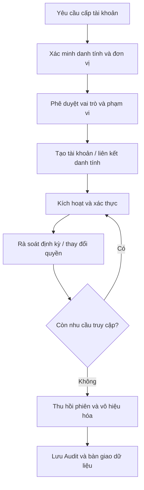
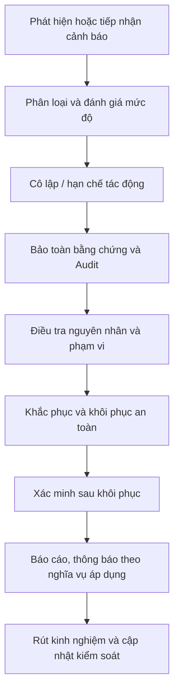

# X-04 — BẢO MẬT, QUẢN LÝ DANH TÍNH, PHÂN QUYỀN VÀ KIỂM TOÁN

**Mã tài liệu:** TAXI-X-04  
**Phiên bản:** 0.1  
**Trạng thái:** DỰ THẢO KIẾN TRÚC — CHỜ ATTT, CHỦ MODULE, NHÂN SỰ, VẬN HÀNH VÀ TÀI CHÍNH PHÊ DUYỆT  
**Phạm vi:** Identity & Access Management (IAM), RBAC, Data Scope, bảo vệ dữ liệu, bảo mật ứng dụng/API, Audit và xử lý sự cố  
**Tài liệu liên quan:** [00 — Tổng quan](../00-OVERVIEW.md) · [03 — Kiến trúc Module](../03-MODULE-ARCHITECTURE-AND-OWNERSHIP.md) · [X-01 — State Machine](./01-state-machines-and-transition-rules.md) · [X-02 — Data Architecture & ERD](./02-data-architecture-and-erd.md) · [X-03 — API & Event Contracts](./03-api-and-event-contracts.md)

> **Phân biệt nguồn và đề xuất:** KPMG 2015 mô tả vai trò nghiệp vụ trong các quy trình Taxi (khách hàng, tài xế, nhân viên tổng đài, điều hành, nhân viên điểm tiếp thị và các hoạt động kiểm soát/báo cáo). Tài liệu nguồn không cung cấp ma trận IAM đầy đủ, mô hình RBAC/Data Scope, chính sách mật khẩu, MFA, mã hóa hay tiêu chuẩn bảo mật ứng dụng. Các nội dung dưới đây là đề xuất kiến trúc bảo mật cho hệ thống mới, cần được Mai Linh/ATTT/Pháp chế phê duyệt; không được hiểu là chính sách hiện hành đã xác nhận.

---

## 1. Mục tiêu và nguyên tắc

### 1.1. Mục tiêu

- Mỗi người dùng và dịch vụ có danh tính xác thực riêng.
- Mỗi hành động được kiểm tra theo vai trò, phạm vi dữ liệu, trạng thái nghiệp vụ và ngữ cảnh.
- Nhân viên chỉ xem và thao tác dữ liệu cần thiết cho công việc.
- Tách quyền vận hành, quyền phê duyệt và quyền quản trị kỹ thuật.
- Bảo vệ dữ liệu khách hàng, tài xế, đối tác, vị trí GPS và thông tin tài chính.
- Truy vết được ai đã làm gì, trên đối tượng nào, khi nào, từ đâu và vì lý do gì.
- Phát hiện, ứng phó và khôi phục sau sự cố bảo mật.

### 1.2. Nguyên tắc bắt buộc

1. **Deny by default:** mặc định từ chối; chỉ cấp quyền khi được phê duyệt.
2. **Least privilege:** cấp quyền tối thiểu đủ thực hiện nhiệm vụ.
3. **RBAC + Data Scope:** vai trò quyết định hành động; phạm vi dữ liệu quyết định đối tượng được thao tác.
4. **Server-side authorization:** không tin kiểm tra quyền ở giao diện.
5. **Object-level authorization:** kiểm tra quyền trên từng Booking, Trip, Driver, Partner, Settlement; không chỉ kiểm tra endpoint.
6. **Separation of Duties (SoD):** người tạo không mặc nhiên được tự duyệt giao dịch nhạy cảm.
7. **MFA cho truy cập rủi ro cao:** ưu tiên tài khoản quản trị, tài chính, điều hành và truy cập từ xa.
8. **Audit không thể bị sửa tùy tiện:** người dùng nghiệp vụ không được xóa/sửa nhật ký.
9. **Bảo vệ dữ liệu theo vòng đời:** thu thập tối thiểu, sử dụng đúng mục đích, lưu trữ có kiểm soát, xóa/ẩn danh theo chính sách.
10. **Tách tài khoản người dùng và tài khoản dịch vụ:** không dùng tài khoản chung cho người và tích hợp máy-máy.
11. **Tách môi trường:** DEV/UAT/PROD không dùng chung credential hoặc dữ liệu thật nếu chưa được phép.
12. **Kiểm soát đặc quyền:** quyền cao phải có lý do, thời hạn, phê duyệt và nhật ký.

---

## 2. Mô hình danh tính và chủ thể truy cập

### 2.1. Nhóm Principal

| Nhóm | Ví dụ | Phạm vi danh tính |
|---|---|---|
| CUSTOMER | Khách đặt xe qua App/Web | Hồ sơ và Booking của chính khách |
| DRIVER | Tài xế | Hồ sơ, Offer, Assignment và Trip được giao |
| STAFF | Nhân viên Mai Linh | Quyền theo Role và Data Scope |
| PARTNER_USER | Người dùng thuộc đối tác | Dữ liệu đối tác theo hợp đồng/phạm vi được cấp |
| SERVICE_ACCOUNT | Module/service nội bộ | API và Event được cấp cụ thể |
| PROVIDER | Nhà cung cấp tích hợp | Webhook/API riêng theo hợp đồng |
| ADMINISTRATOR | Quản trị hệ thống | Quyền quản trị kỹ thuật, không mặc nhiên có quyền nghiệp vụ/tài chính |

Không sử dụng một tài khoản chia sẻ cho nhiều nhân viên. Nếu cần thao tác thay mặt người khác, phải có cơ chế delegation/impersonation được kiểm soát và ghi Audit.

### 2.2. Vòng đời tài khoản

### 2.3. Thuộc tính danh tính tối thiểu

- principal_id, principal_type, status.
- username/subject từ Identity Provider; không lưu mật khẩu plaintext.
- employee_id/driver_id/partner_id/customer_id liên kết khi có.
- authentication_method, MFA status, last_login_at.
- created_at, created_by, disabled_at, disabled_by.
- role assignments, data scopes và thời hạn hiệu lực.
- thiết bị/phiên đăng nhập theo mức độ cần thiết và chính sách riêng tư.

---

## 3. Mô hình phân quyền RBAC + Data Scope

### 3.1. Ba lớp quyết định truy cập

Mỗi request được cho phép khi đồng thời thỏa mãn:

1. **Identity:** chủ thể đã xác thực và tài khoản đang hoạt động.
2. **Permission:** Role có quyền thực hiện Action trên Resource.
3. **Data Scope + Context:** đối tượng nằm trong phạm vi được cấp và thỏa điều kiện nghiệp vụ/trạng thái.

Công thức logic:

`ALLOW = AUTHENTICATED AND PERMISSION_GRANTED AND SCOPE_MATCH AND CONTEXT_GUARD_PASS`

Thiếu bất kỳ điều kiện nào thì từ chối.

### 3.2. Mô hình quan hệ

- User/Principal có thể được gán nhiều Role theo thời gian và phạm vi.
- Role chứa Permission.
- UserRoleAssignment có hiệu lực từ ngày đến ngày, có người cấp và người duyệt.
- DataScope giới hạn theo tổ chức, chi nhánh, khu vực, đội xe, đối tác, pháp nhân hoặc tài nguyên cụ thể.
- Permission có thể có điều kiện: trạng thái bản ghi, hạn mức, maker-checker, thời gian hoặc lý do bắt buộc.

### 3.3. Các loại Data Scope đề xuất

| Scope | Ý nghĩa | Ví dụ |
|---|---|---|
| SELF | Dữ liệu của chính mình | Khách chỉ xem Booking của mình |
| ASSIGNED | Dữ liệu được giao | Tài xế chỉ xem Trip được phân công |
| TEAM | Nhóm/đội được quản lý | Trưởng nhóm xem nhân sự thuộc nhóm |
| BRANCH | Chi nhánh | Điều hành chi nhánh xem dữ liệu trong chi nhánh |
| REGION | Khu vực | Quản lý vùng xem các chi nhánh thuộc vùng |
| FLEET | Đội xe | Điều phối xem nguồn lực thuộc đội xe được cấp |
| PARTNER | Đối tác | Đối tác chỉ xem dữ liệu gắn partner_id của mình |
| LEGAL_ENTITY | Pháp nhân | Kế toán xem dữ liệu pháp nhân được giao |
| GLOBAL | Toàn hệ thống | Chỉ cấp cho vai trò có phê duyệt đặc biệt |

Không cấp GLOBAL chỉ vì người dùng có chức danh quản lý. Mọi quyền vượt phạm vi thông thường phải có lý do và Audit.

### 3.4. Permission naming

Đề xuất quy ước:

`<module>.<resource>.<action>`

Ví dụ:
- `booking.read`
- `booking.create`
- `booking.revise`
- `booking.cancel`
- `dispatch.view_candidates`
- `dispatch.manual_assign`
- `trip.view`
- `trip.intervene`
- `fare.adjust`
- `payment.refund`
- `settlement.review`
- `settlement.approve`
- `settlement.lock`
- `iam.user_manage`
- `audit.search`
- `report.export`

Tên permission là mã kỹ thuật đề xuất. Danh mục chính thức phải quản lý tập trung, tránh mỗi Module tự đặt tên khác nhau.

---

## 4. Danh mục vai trò nghiệp vụ đề xuất

| Role | Nhiệm vụ chính | Phạm vi mặc định đề xuất |
|---|---|---|
| CUSTOMER | Đặt, xem, thay đổi/hủy Booking theo điều kiện | SELF |
| DRIVER | Nhận Offer và tác nghiệp Trip | ASSIGNED + hồ sơ của mình |
| CALL_CENTER_AGENT | Tiếp nhận, tạo/sửa/hủy Booking; liên hệ khách | Chi nhánh/đơn vị tổng đài được cấp |
| DISPATCHER | Theo dõi hàng đợi, điều phối và phân công | Khu vực/chi nhánh/đội xe được cấp |
| STATION_OPERATOR | Tiếp nhận khách tại điểm, đăng ký/yêu cầu xe | Điểm tiếp thị được giao |
| OPERATIONS_SUPERVISOR | Giám sát, can thiệp có kiểm soát | Chi nhánh/khu vực được cấp |
| CUSTOMER_SERVICE_AGENT | Tiếp nhận và xử lý Service Case/Complaint | Hồ sơ được phân công hoặc đơn vị được cấp |
| BRANCH_MANAGER | Giám sát vận hành chi nhánh | BRANCH |
| REGIONAL_MANAGER | Giám sát nhiều chi nhánh | REGION |
| FLEET_MANAGER | Quản lý tài xế/xe/ca làm | FLEET/đơn vị được giao |
| PARTNER_ADMIN | Quản lý người dùng và dữ liệu đối tác | PARTNER |
| FINANCE_OPERATOR | Lập/kiểm tra dữ liệu tài chính | LEGAL_ENTITY/đối tác/kỳ được giao |
| FINANCE_APPROVER | Phê duyệt nghiệp vụ tài chính | LEGAL_ENTITY/đối tác/kỳ được giao |
| AUDITOR | Đọc hồ sơ và Audit phục vụ kiểm tra | Phạm vi kiểm toán được phê duyệt |
| REPORT_VIEWER | Xem báo cáo | Scope theo đơn vị |
| REPORT_EXPORTER | Xuất báo cáo được phép | Scope + loại dữ liệu + mục đích |
| IAM_ADMIN | Quản lý danh tính, Role, Permission | Quyền IAM; không mặc nhiên có quyền đọc dữ liệu nghiệp vụ |
| PLATFORM_ADMIN | Quản trị hạ tầng/cấu hình kỹ thuật | Môi trường/hệ thống được giao |
| SECURITY_ADMIN | Điều tra sự kiện bảo mật và quản lý chính sách ATTT | Phạm vi bảo mật được phê duyệt |

Một người có thể giữ nhiều Role, nhưng phải kiểm tra xung đột SoD. Role không thay thế phê duyệt của nghiệp vụ.

---

## 5. Ma trận quyền nghiệp vụ mức tổng quan

Ký hiệu: **C** = tạo; **R** = xem; **U** = thay đổi; **X** = hủy/giải phóng; **A** = phê duyệt; **I** = can thiệp; **—** = không mặc định cấp. Ma trận là đề xuất ban đầu; quyền thực tế còn phụ thuộc Data Scope, trạng thái và SoD.

| Chức năng | Khách | Tài xế | Tổng đài | Điều phối | Giám sát | CSKH | Tài chính lập | Tài chính duyệt | Đối tác |
|---|---:|---:|---:|---:|---:|---:|---:|---:|---:|
| Tạo Booking | C | — | C | — | I* | C* | — | — | C* |
| Xem Booking | SELF | ASSIGNED* | R* | R* | R* | R* | R* | R* | PARTNER* |
| Sửa Booking | U* | — | U* | — | I* | U* | — | — | U* |
| Hủy Booking | X* | — | X* | — | I* | X* | — | — | X* |
| Xem ứng viên điều phối | — | — | R* | R | R | — | — | — | — |
| Điều phối thủ công | — | — | — | I | I* | — | — | — | — |
| Nhận/từ chối Offer | — | U* | — | — | — | — | — | — | — |
| Cập nhật Trip | — | U* | — | — | I* | — | — | — | — |
| Xử lý khiếu nại | — | — | C* | — | R* | U | — | — | C* |
| Điều chỉnh cước | — | — | — | — | I* | C* | C* | A* | — |
| Hoàn tiền | — | — | — | — | — | C* | C* | A* | — |
| Xem công nợ/quyết toán | — | — | — | — | R* | — | R* | R* | PARTNER* |
| Lập quyết toán | — | — | — | — | — | — | C | — | — |
| Phê duyệt/khóa quyết toán | — | — | — | — | — | — | — | A | — |
| Quản lý người dùng | — | — | — | — | — | — | — | — | C* |
| Xem Audit | — | — | — | — | R* | R* | R* | R* | — |

* Có điều kiện; cần xác định rõ trong Permission Catalog và Feature Spec. Ví dụ:
- Khách chỉ sửa/hủy Booking trước mốc khóa nghiệp vụ.
- Tài xế chỉ cập nhật Trip được giao và trong trạng thái hợp lệ.
- Tổng đài không mặc nhiên được xem toàn bộ số điện thoại; chỉ xem thông tin cần liên hệ.
- Điều hành can thiệp phải nhập reason_code; thao tác nhạy cảm có thể cần Supervisor approval.
- Đối tác chỉ xem dữ liệu gắn với partner_id và hợp đồng của chính mình.
- Tài chính lập và tài chính duyệt phải tách người theo ngưỡng và chính sách.
- IAM Admin không tự cấp quyền GLOBAL cho chính mình.

---

## 6. Phân quyền theo dữ liệu DIRECT/PARTNER

### 6.1. Nguyên tắc

- DIRECT và PARTNER có thể dùng chung luồng Booking/Dispatch/Trip.
- Data Scope phải dựa trên quan hệ hợp đồng, đơn vị, đội xe và chủ thể có quyền truy cập đã xác minh.
- Không dùng booking_channel để lọc dữ liệu DIRECT/PARTNER.
- Không cho Partner A tra cứu bằng cách thay partner_id trên URL hoặc payload.
- Mọi truy vấn phải áp dụng scope ở server/query layer, không chỉ lọc tại giao diện.
- Tài chính phải có scope theo legal_entity, partner, contract và settlement period.
- Quản trị viên hệ thống không mặc nhiên có quyền đọc dữ liệu tài chính hoặc PII.

### 6.2. Kiểm tra quyền mẫu

Khi Partner User gọi `GET /bookings/{booking_id}`:
1. Xác thực principal thuộc Partner đang hoạt động.
2. Lấy partner_id từ danh tính/phân quyền phía server, không lấy từ payload tin cậy của client.
3. Tải Booking projection có liên kết hợp lệ với Assignment/Contract/Partner.
4. Kiểm tra trạng thái và mục đích truy cập.
5. Mask số điện thoại/địa chỉ theo quyền.
6. Ghi Audit cho dữ liệu nhạy cảm nếu chính sách yêu cầu.
7. Trả 404 hoặc 403 theo chính sách tránh tiết lộ sự tồn tại của tài nguyên.

---

## 7. Separation of Duties và Maker–Checker

### 7.1. Các thao tác cần xem xét tách nhiệm vụ

| Nghiệp vụ | Người lập | Người kiểm tra/duyệt | Ghi chú |
|---|---|---|---|
| Cấp Role đặc quyền | IAM Operator | IAM/Security Approver | Không tự cấp quyền cho chính mình |
| Điều phối thủ công ngoại lệ | Dispatcher | Supervisor nếu vượt ngưỡng | Theo policy được phê duyệt |
| Điều chỉnh cước | Nhân viên có quyền lập | Người duyệt theo hạn mức | Lưu lý do và chứng cứ |
| Hoàn tiền | Finance Operator/CSKH theo quy trình | Finance Approver | Chống hoàn trùng/vượt số tiền |
| Điều chỉnh công nợ | Finance Operator | Finance Approver | Có tham chiếu khoản gốc |
| Khóa batch quyết toán | Finance Operator lập/rà soát | Approver độc lập | Batch phải qua validation |
| Chi trả đối tác | Người lập lệnh | Người duyệt chi | Có đối soát và chứng từ |
| Xuất dữ liệu PII quy mô lớn | Người yêu cầu | Data Owner/Privacy Approver | Ghi mục đích và phạm vi |

### 7.2. Quy tắc

- Người tạo không được tự phê duyệt cùng một đối tượng khi SoD yêu cầu tách biệt.
- Phê duyệt gắn với version/snapshot được duyệt; nếu dữ liệu thay đổi, yêu cầu duyệt lại.
- Có hạn mức theo số tiền, loại giao dịch, pháp nhân và đối tác; con số phải do Tài chính phê duyệt.
- Mọi lần từ chối, trả lại, duyệt, khóa và mở khóa đều có Audit.
- Emergency/BREAK-GLASS access phải có thời hạn, lý do, cảnh báo và hậu kiểm.

---

## 8. Bảo vệ dữ liệu và quyền riêng tư

### 8.1. Phân loại dữ liệu đề xuất

| Cấp | Ví dụ | Biện pháp |
|---|---|---|
| PUBLIC | Nội dung công khai, thông tin dịch vụ đã duyệt | Kiểm soát tính toàn vẹn |
| INTERNAL | Quy trình, danh mục nội bộ, cấu hình không nhạy cảm | Xác thực và phân quyền nội bộ |
| CONFIDENTIAL | Booking, lịch sử vận hành, hợp đồng, thông tin nhân sự | RBAC/Data Scope, mã hóa, Audit |
| RESTRICTED | Số điện thoại, địa chỉ chi tiết, định danh, GPS chi tiết, dữ liệu thanh toán/credential | Least privilege, masking, encryption, logging hạn chế, truy cập có mục đích |

Phân loại cuối cùng cần Pháp chế/ATTT/Chủ dữ liệu phê duyệt.

### 8.2. Dữ liệu cá nhân cần kiểm soát

- Họ tên, số điện thoại, email, địa chỉ nhà/điểm đón.
- Định danh khách hàng, tài xế, nhân viên.
- Vị trí GPS và lịch sử hành trình có thể liên kết đến cá nhân.
- Nội dung ghi âm cuộc gọi, Chat và khiếu nại.
- Thông tin thiết bị, IP, lịch sử truy cập.
- Dữ liệu thanh toán và thông tin liên quan đến giao dịch.

### 8.3. Quy tắc bảo vệ

- Chỉ thu thập dữ liệu cần thiết cho mục đích nghiệp vụ.
- Mã hóa khi truyền; mã hóa khi lưu đối với dữ liệu nhạy cảm theo thiết kế ATTT.
- Số điện thoại hiển thị dạng masking theo vai trò; việc mở đầy đủ phải có quyền và mục đích.
- Không ghi PII đầy đủ vào application log, Event, URL hoặc thông báo không an toàn.
- Tách dữ liệu định danh khỏi dữ liệu phân tích khi có thể.
- Không sử dụng dữ liệu sản xuất cho DEV/UAT nếu chưa được phê duyệt và bảo vệ/ẩn danh phù hợp.
- Có quy trình yêu cầu truy cập, chỉnh sửa, xuất, ẩn danh hoặc xóa dữ liệu theo quy định áp dụng.
- Retention và legal hold phải được xác định bởi Pháp chế và chủ dữ liệu; tài liệu này không tự đặt thời hạn.

### 8.4. Ghi âm và nội dung liên lạc

Quy trình KPMG có nhắc đến tổng đài và liên hệ khách hàng, nhưng không đủ căn cứ để xác định chính sách ghi âm, thời hạn lưu, thông báo cho khách hoặc quyền nghe lại. Các nội dung này phải được khảo sát và phê duyệt riêng; không mặc định bật ghi âm hoặc mở quyền nghe cho mọi nhân viên.

---

## 9. Bảo mật ứng dụng, API và thiết bị

### 9.1. Ứng dụng Web/App

- Bảo vệ phiên đăng nhập, token và luồng refresh/revoke.
- Chống CSRF/XSS/SQL injection/SSRF và lỗi kiểm soát truy cập.
- Kiểm tra input ở server; encode output; truy vấn tham số hóa.
- Không lưu secret trong mã nguồn hoặc ứng dụng client.
- Bảo vệ deep link, upload file và export.
- Giới hạn brute force, credential stuffing và hành vi bất thường.
- Có cơ chế logout/revoke phiên khi tài khoản bị khóa hoặc mất thiết bị.

### 9.2. API và Service-to-Service

- Authentication và authorization cho từng API.
- Service identity riêng, credential có vòng đời và khả năng rotate.
- TLS; cân nhắc mTLS cho luồng nội bộ/đối tác có rủi ro cao.
- Rate limit, request size limit, timeout và circuit breaker.
- Chống replay cho webhook và callback.
- Không tin actor_id, role, partner_id hoặc amount do client gửi mà không xác minh.
- Log correlation_id, request_id và business reference nhưng không log secret/PII thừa.

### 9.3. Ứng dụng tài xế và thiết bị di động

- Liên kết tài khoản với thiết bị theo chính sách được duyệt.
- Có khả năng thu hồi phiên/thiết bị bị mất.
- Bảo vệ dữ liệu cục bộ; không lưu thông tin khách quá mức cần thiết.
- Xác minh tính hợp lệ của sự kiện offline khi đồng bộ; không tin timestamp/GPS do client tự khai một cách tuyệt đối.
- Phát hiện phiên đăng nhập bất thường, thiết bị root/jailbreak nếu có yêu cầu và công nghệ hỗ trợ.
- Không để tài xế truy cập Trip/Booking ngoài phạm vi được phân công.
- Cân nhắc device attestation và app integrity theo mức rủi ro; chưa phải yêu cầu công nghệ đã chốt.

### 9.4. Hạ tầng và vận hành

- Tách mạng quản trị, ứng dụng, dữ liệu và vùng tích hợp theo kiến trúc được duyệt.
- Quản lý secrets, certificate, key và rotation.
- Quét lỗ hổng, cập nhật bản vá, kiểm soát cấu hình.
- Backup được mã hóa và kiểm tra khả năng khôi phục.
- Giám sát truy cập đặc quyền, hành vi bất thường và thay đổi cấu hình.
- Quyền truy cập production phải được phê duyệt và có thời hạn khi phù hợp.

---

## 10. Audit Trail và Security Logging

### 10.1. Sự kiện bắt buộc ghi Audit

- Đăng nhập thành công/thất bại, MFA, đổi credential, revoke session.
- Tạo/khóa/mở khóa tài khoản.
- Gán/gỡ Role, Permission, Data Scope.
- Xem/xuất dữ liệu nhạy cảm ở quy mô hoặc ngữ cảnh cần kiểm soát.
- Tạo/sửa/hủy Booking khi có tác động nghiệp vụ.
- Điều phối thủ công, nhận/từ chối/giải phóng Assignment và override.
- Can thiệp Trip, no-show, incident và SOS.
- Điều chỉnh Fare, Payment, Refund, Ledger, Receivable/Payable, Settlement.
- Thay đổi Contract, Tariff, Dispatch Policy và cấu hình bảo mật.
- Thay đổi cấu hình tích hợp, webhook secret, API credential.
- Truy cập BREAK-GLASS và thao tác khẩn cấp.

### 10.2. Cấu trúc AuditEvent đề xuất

| Trường | Ý nghĩa |
|---|---|
| audit_event_id | ID duy nhất |
| occurred_at / recorded_at | Thời gian hành động và thời gian ghi nhận |
| actor_id / actor_type | Ai thực hiện |
| action | Hành động |
| resource_type / resource_id | Đối tượng bị tác động |
| outcome | Thành công/thất bại/bị từ chối |
| reason_code / reason_text | Lý do |
| before_snapshot / after_snapshot | Thay đổi cần thiết, có masking |
| source / device_id / ip_ref | Nguồn thực hiện theo chính sách |
| request_id / correlation_id | Truy vết request |
| approval_ref | Tham chiếu phê duyệt nếu có |

Không lưu password, access token, refresh token, secret, CVV hoặc dữ liệu xác thực nhạy cảm trong Audit.

### 10.3. Bảo vệ Audit

- Append-only đối với luồng nghiệp vụ thông thường.
- Phân quyền đọc Audit riêng; Audit Admin không đồng nghĩa được sửa Audit.
- Đồng bộ thời gian hệ thống và giám sát sai lệch.
- Có cảnh báo khi Audit pipeline ngừng hoạt động hoặc mất dữ liệu.
- Có cơ chế integrity/tamper-evidence phù hợp với mức rủi ro.
- Lưu trữ, retention, archive và truy xuất theo chính sách được duyệt.
- Mọi truy vấn/xuất Audit nhạy cảm cũng cần được ghi nhận.

---

## 11. Rà soát quyền và quản lý truy cập đặc quyền

### 11.1. Rà soát định kỳ đề xuất

| Đối tượng | Nội dung rà soát | Tần suất đề xuất |
|---|---|---|
| Tài khoản nhân viên | Còn làm việc, đúng đơn vị, Role còn cần | Theo chu kỳ HR/ATTT phê duyệt |
| Tài khoản tài xế | Trạng thái hợp tác, thiết bị, phạm vi Trip | Theo quy trình vận hành |
| Tài khoản đối tác | Hợp đồng còn hiệu lực, người dùng được ủy quyền | Theo kỳ hợp đồng |
| Tài khoản đặc quyền | Người sở hữu, lý do, MFA, hoạt động | Thường xuyên hơn tài khoản thường |
| Service Account | Owner, quyền API, secret expiry, lần sử dụng | Theo chu kỳ ATTT |
| Data Scope | Phạm vi chi nhánh/đội xe/đối tác/pháp nhân | Khi điều chuyển và rà soát định kỳ |

Tần suất cụ thể là TBD; không coi đề xuất là lịch kiểm soát đã ban hành.

### 11.2. Joiner–Mover–Leaver

- **Joiner:** tạo danh tính sau khi xác minh; cấp Role tối thiểu theo chức danh/đơn vị và phê duyệt.
- **Mover:** khi đổi vị trí/đơn vị, thu hồi scope cũ trước hoặc đồng thời cấp scope mới; kiểm tra xung đột.
- **Leaver:** vô hiệu hóa theo thời điểm hiệu lực, thu hồi session/token/device/service credential liên quan; bàn giao công việc và giữ Audit.
- Tài khoản không hoạt động, nghỉ dài hạn hoặc hợp đồng hết hạn phải được xử lý theo policy.

### 11.3. BREAK-GLASS

Chỉ sử dụng khi có sự cố nghiêm trọng và quy trình thường không đáp ứng:
- Lý do và phạm vi bắt buộc.
- Phê duyệt hoặc cơ chế hậu kiểm khẩn cấp đã được ban hành.
- Tự hết hạn; không cấp quyền thường trực.
- Cảnh báo tới nhóm bảo mật/vận hành.
- Ghi Audit đầy đủ và rà soát sau sự cố.

---

## 12. Phát hiện, ứng phó và báo cáo sự cố bảo mật

### 12.1. Nhóm sự cố

- Tài khoản bị chiếm quyền/đăng nhập bất thường.
- Truy cập trái phép Booking, GPS, PII hoặc dữ liệu tài chính.
- Lộ token, secret, API key hoặc credential.
- Webhook/API bị giả mạo hoặc replay.
- Thay đổi dữ liệu điều phối/cước/quyết toán không được phép.
- Malware/ransomware, mất thiết bị hoặc rò rỉ dữ liệu.
- Audit/Monitoring bị gián đoạn hoặc có dấu hiệu bị can thiệp.

### 12.2. Luồng xử lý

Quy trình chi tiết, đầu mối trực, thời hạn báo cáo và nghĩa vụ thông báo phải do ATTT/Pháp chế/Ban điều hành phê duyệt theo quy định áp dụng.

---

## 13. Ma trận trách nhiệm quản trị bảo mật

| Hoạt động | Business Owner | IAM Admin | Security/ATTT | Module Owner | HR/Partner Owner | Finance |
|---|---|---|---|---|---|---|
| Xác định vai trò nghiệp vụ | A | C | C | R | C | C |
| Quản lý danh tính nhân viên | C | R | C | — | A/R | — |
| Gán quyền kỹ thuật | A* | R | C | C | C | A* |
| Xác định Data Scope | A | C | C | R | C | C |
| Phê duyệt quyền đặc quyền | A* | — | R | C | C | A* |
| Thiết kế bảo vệ dữ liệu | C | C | A/R | R | C | C |
| Theo dõi Audit | C | R* | A/R | R | — | R* |
| Xử lý sự cố bảo mật | C | C | A/R | R | C | C |
| Rà soát quyền định kỳ | A | R | C | C | R | C |

A = Accountable, R = Responsible, C = Consulted. Ma trận chính thức phải được điều chỉnh theo cơ cấu tổ chức Mai Linh và phân tách trách nhiệm thực tế.

---

## 14. Các quyết định cần Mai Linh xác nhận

| ID | Quyết định | Chủ trì đề xuất |
|---|---|---|
| IAM-01 | Identity Provider và cơ chế SSO cho nhân viên | CNTT/ATTT |
| IAM-02 | Cơ chế đăng nhập khách hàng và tài xế | Sản phẩm/Vận hành/ATTT |
| IAM-03 | MFA bắt buộc cho nhóm vai trò nào | ATTT/Ban điều hành |
| IAM-04 | Cơ cấu tổ chức, chi nhánh, khu vực, đội xe và pháp nhân dùng làm Data Scope | Nhân sự/Vận hành/Tài chính |
| IAM-05 | Danh mục Role chính thức và người phê duyệt | Business Owner |
| IAM-06 | Permission Catalog theo 10 Module | Chủ Module/ATTT |
| IAM-07 | Phân quyền xem số điện thoại/địa chỉ/GPS/ghi âm | CSKH/Pháp chế/ATTT |
| IAM-08 | Quy tắc che số điện thoại và mở thông tin đầy đủ | CSKH/ATTT |
| IAM-09 | Maker-checker cho điều chỉnh cước, hoàn tiền, công nợ, settlement | Tài chính |
| IAM-10 | Hạn mức phê duyệt và nguyên tắc SoD | Tài chính/Ban điều hành |
| IAM-11 | Chính sách Audit, retention, archive và integrity | ATTT/Pháp chế |
| IAM-12 | Chính sách ghi âm tổng đài và truy cập bản ghi | CSKH/Pháp chế |
| IAM-13 | Chính sách thiết bị tài xế, offline data và thu hồi thiết bị | Vận hành/ATTT |
| IAM-14 | Service Account, secret manager và rotation | CNTT/ATTT |
| IAM-15 | Quy trình BREAK-GLASS và hậu kiểm | ATTT/Ban điều hành |
| IAM-16 | Quy trình ứng phó sự cố và nghĩa vụ thông báo | ATTT/Pháp chế |
| IAM-17 | Quy trình Joiner–Mover–Leaver và SLA thu hồi quyền | HR/CNTT |
| IAM-18 | Quyền Partner Admin và cơ chế ủy quyền người dùng đối tác | Kinh doanh/Pháp chế/ATTT |

---

## 15. Tiêu chí nghiệm thu Security/IAM/Audit

- [ ] Có danh mục Principal và vòng đời tài khoản.
- [ ] Có Role Catalog và Permission Catalog do chủ sở hữu phê duyệt.
- [ ] Mọi quyền đều có Data Scope và nguyên tắc deny-by-default.
- [ ] API kiểm tra object-level authorization phía server.
- [ ] Không thể truy cập chéo Partner/Branch/Fleet/Legal Entity bằng cách thay ID.
- [ ] Có SoD/Maker–Checker cho nghiệp vụ tài chính và thao tác nhạy cảm.
- [ ] Có MFA/privileged access policy được phê duyệt.
- [ ] Có phân loại dữ liệu và masking PII.
- [ ] Có Audit cho hành động nghiệp vụ và quản trị quan trọng.
- [ ] Audit được bảo vệ khỏi sửa/xóa trái phép.
- [ ] Có Joiner–Mover–Leaver và rà soát quyền.
- [ ] Có quản lý Service Account/Secret/Provider credential.
- [ ] Có quy trình xử lý sự cố và BREAK-GLASS.
- [ ] Có test authorization, IDOR, privilege escalation, data leakage, SoD và audit integrity.
- [ ] IAM-01 đến IAM-18 được gán owner, approver và trạng thái quyết định.

---

## 16. Lộ trình triển khai tiếp theo

1. Khảo sát cơ cấu tổ chức, chi nhánh, đội xe, đối tác, pháp nhân và các nhóm người dùng thực tế.
2. Chốt Role Catalog và Permission Catalog cho 10 Module.
3. Xây ma trận Role × Permission × Data Scope.
4. Thiết kế IAM Data Model và API cấp/thu hồi quyền.
5. Thiết kế quy trình Maker–Checker cho điều phối ngoại lệ và tài chính.
6. Thiết kế Audit Schema, Security Event và cảnh báo.
7. Tạo Test Matrix cho IDOR, privilege escalation, SoD, PII masking và Partner isolation.
8. Chỉ triển khai production sau khi ATTT, Pháp chế và Business Owner phê duyệt chính sách.

**Nguyên tắc chốt:** Quyền truy cập không chỉ trả lời “người này là ai?” mà phải trả lời đủ bốn câu hỏi: “được làm gì, trên dữ liệu nào, trong trạng thái nào, và có cần ai phê duyệt không?”.

---
**Quay lại:** [README — Taxi Management System](../README.md)
