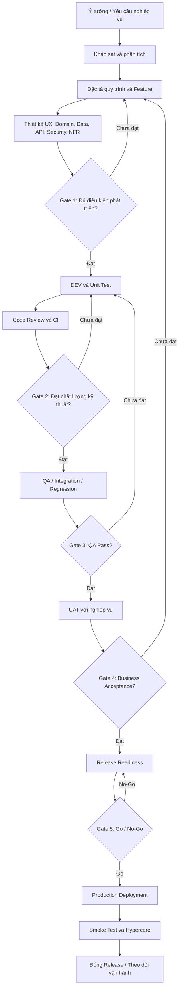
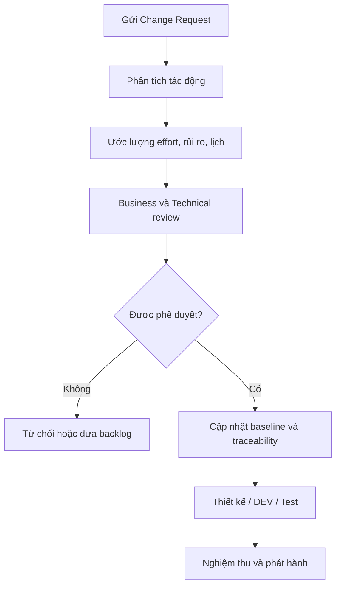

# X-06 — QUẢN TRỊ PHÁT TRIỂN VÀ TRIỂN KHAI (DELIVERY GOVERNANCE)

**Mã tài liệu:** TAXI-X-06  
**Phiên bản:** 0.1  
**Trạng thái:** DỰ THẢO QUẢN TRỊ DỰ ÁN — CHỜ BAN CHỈ ĐẠO, BUSINESS OWNER, CNTT VÀ QA PHÊ DUYỆT  
**Phạm vi:** Quản trị yêu cầu, thiết kế, phát triển, kiểm thử, nghiệm thu, phát hành, thay đổi và vận hành sau triển khai  
**Tài liệu liên quan:** [00 — Tổng quan](../00-OVERVIEW.md) · [03 — Kiến trúc Module](../03-MODULE-ARCHITECTURE-AND-OWNERSHIP.md) · [04 — Quy trình TO.P1–TO.P9](../04-END-TO-END-WORKFLOWS-TO-P1-TO-P9.md) · [X-01 — State Machine](./01-state-machines-and-transition-rules.md) · [X-02 — Data Architecture & ERD](./02-data-architecture-and-erd.md) · [X-03 — API & Event Contracts](./03-api-and-event-contracts.md) · [X-04 — Security, IAM & Audit](./04-security-iam-and-audit.md) · [X-05 — NFR](./05-non-functional-requirements.md)

> **Phân biệt nguồn và đề xuất:** KPMG 2015 là tài liệu quy trình vận hành Taxi, không phải quy trình quản trị phát triển phần mềm. Quy trình, vai trò, cổng kiểm soát và tiêu chí dưới đây là đề xuất quản trị dự án Taxi Management System; cần Mai Linh thống nhất trước khi áp dụng chính thức.

---

## 1. Mục tiêu và nguyên tắc quản trị

### 1.1. Mục tiêu

- Mọi yêu cầu đều có nguồn gốc, người chịu trách nhiệm, mức ưu tiên và tiêu chí nghiệm thu.
- BA, Business Owner, Architect, UX, DEV, QA và Operations sử dụng cùng một baseline.
- Không phát triển khi nghiệp vụ, trạng thái, dữ liệu, API, quyền và ngoại lệ quan trọng chưa được làm rõ.
- Mỗi thay đổi được đánh giá ảnh hưởng xuyên Module trước khi thực hiện.
- Mỗi bản phát hành có kiểm thử, phê duyệt, kế hoạch triển khai, rollback và bằng chứng.
- Tiến độ được đo bằng Feature đạt tiêu chí nghiệm thu, không chỉ bằng số task đã đóng.

### 1.2. Nguyên tắc

1. **Single source of truth:** tài liệu, quyết định, mã nguồn và test evidence có liên kết rõ ràng.
2. **Traceability:** Requirement → Process → Module → Feature → API/Data/UI → Test → Release.
3. **Definition before implementation:** đặc tả và tiêu chí nghiệm thu phải có trước code.
4. **Small vertical slices:** phát triển lát cắt nghiệp vụ có thể kiểm thử đầu-cuối, tránh hoàn thành riêng giao diện hoặc API mà chưa chạy được luồng.
5. **Ownership:** mỗi Feature có một Business Owner và một Technical Owner chịu trách nhiệm.
6. **Quality built-in:** QA, Security, Data và Operations tham gia từ giai đoạn thiết kế.
7. **No silent scope change:** thay đổi yêu cầu phải đánh giá tác động, phê duyệt và cập nhật baseline.
8. **Evidence-based acceptance:** chỉ nghiệm thu dựa trên test và bằng chứng.
9. **Release safely:** triển khai có kiểm soát, quan sát được và có phương án khôi phục.
10. **TBD is visible:** nội dung chưa quyết định phải có owner và hạn chốt; không để DEV tự suy đoán.

---

## 2. Vai trò và trách nhiệm

| Vai trò | Trách nhiệm chính | Quyền quyết định |
|---|---|---|
| Steering Committee / Ban chỉ đạo | Phạm vi, ngân sách, ưu tiên và quyết định liên đơn vị | Phê duyệt baseline lớn, go/no-go cấp chương trình |
| Business Owner | Mục tiêu nghiệp vụ, quy tắc, ngoại lệ và giá trị đầu ra | Phê duyệt nghiệp vụ và UAT |
| Product Owner | Backlog, thứ tự ưu tiên, phạm vi Feature | Sắp xếp backlog trong phạm vi được ủy quyền |
| Business Analyst (BA) | Khảo sát, mô hình hóa, đặc tả và truy vết yêu cầu | Đề xuất, không tự phê duyệt chính sách |
| Solution/Domain Architect | Kiến trúc, ranh giới Module, state/data/API contract | Phê duyệt kỹ thuật theo thẩm quyền |
| UX/UI Designer | Luồng màn hình, trạng thái, usability và prototype | Phê duyệt thiết kế UX theo tiêu chuẩn |
| Tech Lead | Phân rã kỹ thuật, review, chất lượng và tích hợp | Phê duyệt kỹ thuật trong Module |
| Developer | Thiết kế chi tiết, code, unit test và tài liệu kỹ thuật | Không tự thay đổi quy tắc nghiệp vụ |
| QA/Test Lead | Test strategy, test cases, defect, test evidence | Đánh giá chất lượng; đề xuất release readiness |
| Security/ATTT | Threat review, security control, security test | Chấp thuận kiểm soát bảo mật theo thẩm quyền |
| Data Owner/DBA | Data governance, migration, backup, integrity | Phê duyệt thay đổi dữ liệu theo thẩm quyền |
| Operations/SRE/IT | Monitoring, deployment, runbook, capacity, DR | Xác nhận sẵn sàng vận hành |
| Release Manager | Lịch phát hành, checklist, điều phối go/no-go | Điều phối release, không thay Business Owner phê duyệt |

Một người có thể kiêm nhiều vai trò trong nhóm nhỏ, nhưng các quyết định cần độc lập như Maker–Checker, phê duyệt tài chính và phê duyệt release phải tuân theo X-04 và chính sách tổ chức.

---

## 3. Quy trình phát triển tổng thể và các cổng kiểm soát

### 3.1. Gate 0 — Yêu cầu được tiếp nhận

Điều kiện:
- Có Requirement ID, nguồn yêu cầu và người đề xuất.
- Có vấn đề/mục tiêu nghiệp vụ cần giải quyết.
- Có Business Owner hoặc người được ủy quyền.
- Có phạm vi sơ bộ, nhóm người dùng và mức ưu tiên.
- Có liên kết tới TO.P1–TO.P9 hoặc ghi rõ yêu cầu mới/ngoài phạm vi.
- Có đánh giá sơ bộ tác động DIRECT/PARTNER và Module liên quan.

### 3.2. Gate 1 — Definition of Ready (DoR)

Feature chỉ được đưa vào DEV khi đáp ứng các điều kiện tại Mục 4. Business Owner và Tech Lead xác nhận; QA/Security/Operations được tham vấn tùy mức độ ảnh hưởng.

### 3.3. Gate 2 — Code Review và CI

Điều kiện:
- Code theo coding convention và kiến trúc đã duyệt.
- Pull Request có reviewer độc lập phù hợp.
- CI pass: lint/static analysis/build/unit test và các kiểm tra bắt buộc.
- Không có secret, credential hoặc dữ liệu thật nhạy cảm trong repository.
- Migration, API/Event schema và tài liệu liên quan đã cập nhật.
- Không có lỗi nghiêm trọng chưa xử lý.

### 3.4. Gate 3 — QA Pass

Điều kiện:
- Test case đã chạy trên đúng build/version.
- Happy path, alternate path, exception, recovery và regression đã kiểm thử.
- Authorization/Data Scope, DIRECT/PARTNER isolation và Audit được kiểm tra khi liên quan.
- Không còn defect Blocker/Critical chưa có chấp thuận rủi ro hợp lệ.
- Test evidence được lưu và liên kết với Feature.

### 3.5. Gate 4 — Business Acceptance / UAT

Điều kiện:
- Người dùng nghiệp vụ kiểm thử theo kịch bản thực tế.
- Kết quả đúng quy trình, quy tắc, biểu mẫu và báo cáo đã phê duyệt.
- Ngoại lệ và thao tác thủ công được kiểm chứng.
- Business Owner ký xác nhận hoặc ghi nhận tồn tại được chấp thuận.
- UAT không thay thế QA và kiểm thử bảo mật.

### 3.6. Gate 5 — Release Go/No-Go

Điều kiện:
- Có Release Note, danh sách Feature/Defect và phạm vi thay đổi.
- Có kết quả QA/UAT và phê duyệt cần thiết.
- Có backup/restore hoặc rollback plan phù hợp.
- Có DB migration plan và đánh giá tương thích.
- Có monitoring, alert, runbook, người trực và phương án liên lạc.
- Có kế hoạch triển khai, smoke test, tiêu chí dừng và tiêu chí rollback.
- Business Owner, Tech Lead, QA và Operations xác nhận theo RACI.
- Security/Finance/Data Owner phê duyệt khi release ảnh hưởng lĩnh vực của họ.

---

## 4. Definition of Ready (DoR) — Điều kiện trước khi DEV

### 4.1. Checklist bắt buộc

- [ ] Feature ID và tên chức năng thống nhất.
- [ ] Mục tiêu nghiệp vụ và vấn đề cần giải quyết rõ ràng.
- [ ] In-scope và out-of-scope được nêu rõ.
- [ ] Actor, Role, Permission và Data Scope được xác định.
- [ ] Precondition và Postcondition rõ ràng.
- [ ] Happy path có luồng từng bước.
- [ ] Alternate path, exception, timeout, retry và recovery được mô tả.
- [ ] Business Rules có ID, nguồn, owner và trạng thái phê duyệt.
- [ ] State transition và guard thống nhất X-01.
- [ ] UI/UX có màn hình, trạng thái loading/empty/error/disabled/success phù hợp.
- [ ] Field dictionary, validation, default và error message được xác định.
- [ ] API/Command/Event contract thống nhất X-03.
- [ ] Data entity/field/relationship và ownership thống nhất X-02.
- [ ] Idempotency, concurrency và duplicate handling được xác định khi cần.
- [ ] Audit event và dữ liệu nhạy cảm được xác định theo X-04.
- [ ] NFR và tiêu chí hiệu năng/khả năng phục hồi liên quan được xác định theo X-05.
- [ ] DIRECT/PARTNER impact đã được phân tích.
- [ ] Dependencies, external provider, quota và failure behavior được xác định.
- [ ] Test scenarios và Given/When/Then Acceptance Criteria có thể kiểm chứng.
- [ ] TBD có người quyết định và hạn chốt; không còn TBD chặn phát triển.
- [ ] Business Owner và Tech Lead xác nhận Ready.

### 4.2. Quy tắc TBD

TBD phải có cấu trúc:
- Decision ID.
- Nội dung chưa quyết định.
- Ảnh hưởng nếu chưa chốt.
- Người chịu trách nhiệm quyết định.
- Người phê duyệt.
- Ngày cần chốt.
- Trạng thái: OPEN / IN_REVIEW / APPROVED / REJECTED / DEFERRED.

TBD ảnh hưởng đến an toàn, tài chính, quyền truy cập, state transition hoặc tính đúng đắn dữ liệu là blocker cho Feature liên quan.

---

## 5. Definition of Done (DoD) — Điều kiện hoàn thành Feature

- [ ] Code hoàn thành theo phạm vi và thiết kế đã duyệt.
- [ ] Unit Test đạt và có coverage theo ngưỡng dự án phê duyệt.
- [ ] Code Review được chấp thuận.
- [ ] CI và các kiểm tra chất lượng đạt.
- [ ] API/Event/Data migration tương thích và có tài liệu.
- [ ] Authorization, Data Scope, Audit và bảo vệ dữ liệu đã kiểm thử.
- [ ] QA test pass; regression phù hợp đã chạy.
- [ ] Không còn defect Blocker/Critical; defect còn lại có owner và chấp thuận.
- [ ] UAT được Business Owner nghiệm thu.
- [ ] Monitoring, logs, metrics, alert và runbook được cập nhật.
- [ ] Tài liệu người dùng/vận hành/DEV cập nhật.
- [ ] Traceability Requirement → Feature → Test → Release hoàn chỉnh.
- [ ] Feature được triển khai đúng môi trường và phiên bản.
- [ ] Có bằng chứng nghiệm thu và người phê duyệt.

Feature ở trạng thái Done không có nghĩa toàn bộ Module hoặc toàn hệ thống đã hoàn thành.

---

## 6. Chuẩn Feature Specification

Mỗi Feature phải có một hồ sơ duy nhất, theo cấu trúc chuẩn:

1. Metadata: Feature ID, Module, version, status, owner, approver.
2. Business Context: mục tiêu, vấn đề, nguồn yêu cầu và traceability.
3. Scope: in-scope, out-of-scope, assumption, dependency.
4. Actors & Permissions: actor, role, permission, data scope.
5. Preconditions/Postconditions.
6. Business Flow: happy path, alternate, exception, timeout, recovery.
7. Business Rules: rule ID, mô tả, priority, nguồn, owner, trạng thái.
8. State & Transition: state, event, guard, side effect, invalid transition.
9. UI/UX: màn hình, field, action, validation, loading/empty/error/success.
10. API Contract: endpoint/command, request, response, error, idempotency.
11. Event Contract: event name, schema, producer, consumer, retry, ordering.
12. Data Model: entity, field, constraint, ownership, migration.
13. Security & Audit: authorization, masking, audit event, SoD.
14. NFR: latency, capacity, availability, offline/resilience.
15. Test Cases: unit, integration, negative, security, regression, UAT.
16. Acceptance Criteria: Given/When/Then.
17. Release & Operations: feature flag, config, monitoring, runbook, rollback.
18. Decision Log: TBD, decision, approver và lịch sử thay đổi.

Không được dùng mockup hoặc đoạn mô tả vài dòng làm tài liệu thay thế Feature Specification.

---

## 7. Quy tắc Backlog và ưu tiên

### 7.1. Cấp quản lý công việc

`Program → End-to-End Flow → Module → Epic → Feature → User Story/Task → Subtask`

- **Program:** toàn bộ Taxi Management System.
- **End-to-End Flow:** TO.P1–TO.P9 và luồng mới được phê duyệt.
- **Module:** 10 Module chuẩn.
- **Epic:** nhóm năng lực nghiệp vụ lớn.
- **Feature:** chức năng có giá trị và nghiệm thu độc lập.
- **User Story/Task:** phần việc triển khai.
- **Subtask:** công việc kỹ thuật cụ thể.

### 7.2. Ưu tiên

Đánh giá theo:
- Giá trị nghiệp vụ và tác động khách hàng.
- Rủi ro vận hành/an toàn/tài chính.
- Phụ thuộc kiến trúc và dữ liệu.
- Mức độ sẵn sàng nghiệp vụ.
- Chi phí và độ phức tạp.
- Khả năng nghiệm thu và triển khai theo lát cắt.

Không chỉ dùng mức độ dễ code để quyết định thứ tự.

### 7.3. Lát cắt ưu tiên đã thống nhất

**Booking → Dispatch → Trip** là lát cắt đầu tiên. Tuy nhiên, trước khi Feature của lát cắt này vào DEV, phải có các nền tảng tối thiểu về IAM, Data, API/Event, Audit, Monitoring và quy tắc DIRECT/PARTNER.

---

## 8. Git, Branch, Pull Request và Code Review

### 8.1. Quy tắc đề xuất

- `main`: baseline ổn định, chỉ nhận thay đổi qua Pull Request được duyệt.
- `develop`: nhánh tích hợp nếu nhóm chọn mô hình Git Flow.
- `feature/<feature-id>-<short-name>`: phát triển Feature.
- `bugfix/<issue-id>-<short-name>`: sửa lỗi thông thường.
- `hotfix/<issue-id>-<short-name>`: sửa lỗi production khẩn cấp.
- Release branch chỉ tạo khi quy mô và lịch phát hành yêu cầu.

Tên nhánh và mô hình Git cuối cùng cần thống nhất với đội DEV; không bắt buộc dùng Git Flow nếu trunk-based development phù hợp hơn.

### 8.2. Pull Request tối thiểu

- Liên kết Feature/Issue và Requirement.
- Mô tả thay đổi và phạm vi.
- Ảnh/video minh chứng UI khi cần.
- Test đã chạy và kết quả.
- DB migration/API/Event compatibility.
- Security/permission impact.
- Monitoring/rollback impact.
- Reviewer và phê duyệt.
- Không tự merge khi branch protection yêu cầu review.

### 8.3. Code Review checklist

- Có đúng Module ownership và không ghi trực tiếp dữ liệu Module khác?
- Có tuân thủ State Machine và business rule?
- Có authorization/Data Scope ở server?
- Có idempotency/concurrency/retry phù hợp?
- Có xử lý lỗi và timeout?
- Có tránh lộ PII/secret?
- Có test và observability?
- Có ảnh hưởng hiệu năng, query và migration?
- Có tương thích ngược với consumer/API cũ?

---

## 9. Quản lý kiểm thử và lỗi

### 9.1. Phân tầng test

- Unit Test: rule, function, state guard, calculation.
- Component Test: service/repository/module.
- Contract Test: API/Event producer-consumer.
- Integration Test: liên kết giữa Module/provider.
- End-to-End Test: TO.P1–TO.P9 và các luồng đầu cuối.
- Regression Test: bảo đảm thay đổi không phá chức năng cũ.
- Security Test: IAM, IDOR, escalation, PII, secret, audit.
- Performance/Resilience Test: theo X-05.
- UAT: nghiệp vụ thực tế.

### 9.2. Severity đề xuất

| Mức | Định nghĩa | Hành động |
|---|---|---|
| Blocker | Hệ thống/luồng trọng yếu không thể tiếp tục; có rủi ro dữ liệu nghiêm trọng | Dừng release, xử lý ngay |
| Critical | Sai nghiệp vụ trọng yếu, mất/nhân đôi giao dịch, lộ dữ liệu hoặc sai tài chính nghiêm trọng | Không release nếu chưa khắc phục/chấp thuận rủi ro hợp lệ |
| Major | Chức năng quan trọng lỗi nhưng có workaround được kiểm soát | Ưu tiên sửa; Business/QA đánh giá |
| Minor | Lỗi cục bộ, không ảnh hưởng trọng yếu | Đưa backlog theo ưu tiên |
| Cosmetic | Hiển thị/format không ảnh hưởng nghiệp vụ | Sửa theo kế hoạch |

Severity và Priority là hai thuộc tính khác nhau; không dùng một trường thay thế cho cả hai.

### 9.3. Vòng đời Defect

`NEW → TRIAGED → ASSIGNED → IN_PROGRESS → FIXED → RETEST → VERIFIED → CLOSED`

Nếu không đạt retest, quay về IN_PROGRESS. Nếu không sửa, phải có lý do và người chấp thuận trạng thái DEFERRED/REJECTED.

---

## 10. Quản lý thay đổi và tác động xuyên Module

Mỗi Change Request phải có:
- CR ID, lý do, người đề xuất.
- Mô tả hiện tại và mong muốn.
- Business impact và urgency.
- Module/Feature/TO.Px bị ảnh hưởng.
- State/Data/API/Event/Permission/NFR impact.
- DIRECT/PARTNER impact.
- Test, migration, report và training impact.
- Effort/cost/schedule impact.
- Business Owner và Technical Owner.
- Approver và quyết định.

### 10.1. Quy trình thay đổi

Không sửa trực tiếp tài liệu baseline hoặc code theo trao đổi miệng nếu thay đổi ảnh hưởng quy tắc nghiệp vụ, tài chính, quyền, dữ liệu hoặc API contract.

---

## 11. Release, Deployment và Rollback

### 11.1. Release checklist

- [ ] Release ID, version, phạm vi và người phụ trách.
- [ ] Danh sách Feature, CR, defect và known issues.
- [ ] QA/UAT evidence và phê duyệt.
- [ ] Security/ATTT approval nếu liên quan.
- [ ] Backup/restore point đã xác nhận.
- [ ] DB migration đã review và có kế hoạch khôi phục.
- [ ] Cấu hình/secret đã kiểm tra.
- [ ] Tích hợp bên ngoài và quota đã xác minh.
- [ ] Monitoring/alert/dashboard sẵn sàng.
- [ ] Runbook, người trực và kênh liên lạc sẵn sàng.
- [ ] Smoke test và business validation có kịch bản.
- [ ] Rollback/forward-fix criteria và người quyết định.
- [ ] Go/No-Go được ghi nhận.

### 11.2. Triển khai an toàn

- Ưu tiên triển khai theo từng bước/nhóm người dùng khi kiến trúc hỗ trợ.
- Có thể dùng feature flag hoặc canary/blue-green nếu phù hợp với nền tảng.
- Theo dõi error rate, latency, queue backlog, DB health và KPI nghiệp vụ sau triển khai.
- Không bật tính năng ảnh hưởng tài chính/điều phối diện rộng trước khi có kiểm chứng và phê duyệt.
- Có thời gian hypercare, owner và tiêu chí kết thúc.

### 11.3. Rollback

Rollback phải xem xét đồng thời:
- Binary/application version.
- Database schema/data migration.
- Event/API compatibility.
- Message queue và event đã phát.
- Payment/Finance side effects.
- Mobile app version và khả năng tương thích.

Không mặc định có thể rollback DB bằng cách chạy migration ngược. Với dữ liệu nghiệp vụ đã phát sinh, có thể cần forward-fix hoặc giao dịch bù để giữ tính toàn vẹn.

---

## 12. Quản lý môi trường và cấu hình

| Môi trường | Mục đích | Quy tắc |
|---|---|---|
| DEV | Phát triển | Dữ liệu giả lập; tích hợp sandbox |
| SIT/Integration | Kiểm thử liên Module | Contract và tích hợp |
| UAT | Nghiệp vụ nghiệm thu | Dataset được kiểm soát; quyền theo UAT |
| Staging/Pre-prod | Kiểm chứng gần production | Cấu hình tương đương production ở mức phù hợp |
| PROD | Vận hành thật | Change approval, monitoring, backup, access control |

- Credential, secret, certificate tách riêng theo môi trường.
- Không copy dữ liệu production về DEV/UAT nếu chưa được phê duyệt và bảo vệ/ẩn danh.
- Cấu hình nghiệp vụ như tariff, dispatch policy, threshold phải có version, effective date, approver và audit.
- Không hard-code tham số đang chờ xác nhận từ nghiệp vụ.

---

## 13. Quản trị tài liệu, quyết định và truy vết

### 13.1. Artifact tối thiểu

- Requirement Register.
- Decision Log.
- Process/Module/Feature Catalog.
- Feature Specification.
- API/Event Contract.
- Data Dictionary/ERD/Migration.
- Permission Matrix.
- Test Plan/Test Cases/Test Evidence.
- Defect Register.
- Change Request Register.
- Release Note/Deployment Record.
- Runbook/Incident/DR Evidence.

### 13.2. Quy tắc phiên bản

- Mỗi tài liệu có Document ID, version, status, owner, approver, last updated.
- Thay đổi nội dung có ảnh hưởng phải ghi Change History.
- Trạng thái tối thiểu: DRAFT, IN_REVIEW, APPROVED, DEPRECATED.
- Tài liệu DRAFT không được dùng làm chính sách production.
- API/Event schema cần versioning và compatibility policy.
- Quyết định đã phê duyệt không được thay đổi âm thầm; phải có Decision/Change ID.

### 13.3. Chuỗi truy vết

`Requirement → TO.Px → Module → Epic → Feature → Rule/State → API/Data/UI → Test Case → UAT → Release`

---

## 14. Báo cáo tiến độ và chỉ số chất lượng

Không chỉ báo cáo phần trăm task đã hoàn thành. Tối thiểu cần theo dõi:

- Số Requirement/Feature theo trạng thái.
- Tỷ lệ Feature đạt DoR.
- Tỷ lệ Feature hoàn thành DoD.
- Lead time và cycle time.
- Defect leakage từ QA sang UAT/Production.
- Tỷ lệ test pass và regression pass.
- Số CR và effort phát sinh.
- Số quyết định/TBD quá hạn.
- Tỷ lệ release thành công và rollback.
- Incident sau release và MTTR.
- Mức độ hoàn thành NFR và security control.
- Tiến độ theo E2E Flow và Module, không chỉ theo team.

Mọi KPI cần có định nghĩa, công thức, nguồn dữ liệu và owner; không so sánh nhóm nếu cách tính khác nhau.

---

## 15. RACI mức tổng quan

Ký hiệu: **A** chịu trách nhiệm cuối cùng; **R** trực tiếp thực hiện; **C** tham vấn; **I** được thông báo.

| Hoạt động | Business Owner | PO/BA | Architect/Tech Lead | DEV | QA | Security | Operations |
|---|---|---|---|---|---|---|---|
| Xác định nghiệp vụ | A | R | C | I | C | C | C |
| Đặc tả Feature | A | R | C | C | C | C | C |
| Phê duyệt kiến trúc | C | C | A/R | C | C | C | C |
| UX/Workflow | A | R | C | C | C | C | C |
| Phát triển | I | C | A | R | C | C | I |
| Code Review | I | I | A/R | R | C | C | I |
| QA/Regression | C | C | C | R | A/R | C | C |
| Security Review | I | C | C | R | C | A/R | C |
| UAT | A/R | R | C | C | R | C | C |
| Release Go/No-Go | A* | I | R | C | R | C* | A/R* |
| Vận hành sau release | I | I | C | C | C | C | A/R |

A* và các vai trò có điều kiện phải được chốt theo phân cấp phê duyệt của Mai Linh; bảng là RACI đề xuất, không thay thế quy chế nội bộ.

---

## 16. Quyết định cần phê duyệt

| ID | Quyết định | Owner đề xuất |
|---|---|---|
| GOV-01 | Mô hình quản trị: Scrum, Kanban, hybrid hay mô hình khác | Ban chỉ đạo/PO |
| GOV-02 | Vai trò và quyền quyết định chính thức | Ban chỉ đạo |
| GOV-03 | Definition of Ready/Done chính thức | PO/BA/Tech Lead/QA |
| GOV-04 | Công cụ quản lý backlog, defect, test và release | CNTT/PMO |
| GOV-05 | Git branching, PR và branch protection | Tech Lead |
| GOV-06 | Quy trình phê duyệt API/Data/Architecture change | Architect |
| GOV-07 | Severity/Priority và SLA xử lý defect | QA/Business |
| GOV-08 | Cổng kiểm soát Security/ATTT | ATTT |
| GOV-09 | Quy trình UAT và người ký nghiệm thu | Business Owner |
| GOV-10 | Quyền Go/No-Go và lịch release | Ban chỉ đạo/Operations |
| GOV-11 | Quy trình hotfix và emergency change | CNTT/ATTT/Business |
| GOV-12 | Quản lý môi trường và dữ liệu test | CNTT/Data Owner |
| GOV-13 | Chính sách versioning API/Event và backward compatibility | Architect |
| GOV-14 | Quy tắc tài liệu, Decision Log và traceability | PMO/BA |
| GOV-15 | Báo cáo tiến độ, chất lượng và KPI dự án | PMO/PO |

---

## 17. Tiêu chí nghiệm thu Delivery Governance

- [ ] Có vai trò, owner, approver và RACI được phê duyệt.
- [ ] Có quy trình Gate 0–5 và điều kiện từng Gate.
- [ ] Có DoR và DoD áp dụng thống nhất.
- [ ] Có mẫu Feature Specification thống nhất.
- [ ] Có backlog hierarchy và quy tắc ưu tiên.
- [ ] Có Git/PR/Code Review policy.
- [ ] Có Test Strategy, Defect Lifecycle và Severity.
- [ ] Có Change Request và Impact Assessment.
- [ ] Có Release/Deployment/Rollback checklist.
- [ ] Có quy tắc môi trường, dữ liệu test và secrets.
- [ ] Có Document Control, Decision Log và Traceability.
- [ ] Có dashboard tiến độ/chất lượng dựa trên số liệu.
- [ ] GOV-01 đến GOV-15 được gán owner, approver và trạng thái.

---

## 18. Lộ trình áp dụng

1. Ban chỉ đạo và các chủ bộ phận phê duyệt mô hình vai trò/RACI.
2. Chốt DoR, DoD và các Gate.
3. Chốt công cụ quản lý yêu cầu, backlog, Git, QA và release.
4. Chuẩn hóa Feature Specification và các register.
5. Áp dụng thử trên một lát cắt đầu tiên: Booking.
6. Đánh giá sau vòng phát triển đầu tiên, điều chỉnh quy trình.
7. Áp dụng thống nhất cho Dispatch, Trip và các Module tiếp theo.

**Nguyên tắc chốt:** Không đo tiến độ bằng số dòng code hoặc số task đóng. Một Feature chỉ được tính hoàn thành khi nghiệp vụ đã nghiệm thu, chất lượng kỹ thuật đạt, bảo mật được kiểm tra và vận hành có thể tiếp nhận.

---
**Quay lại:** [README — Taxi Management System](../README.md)
