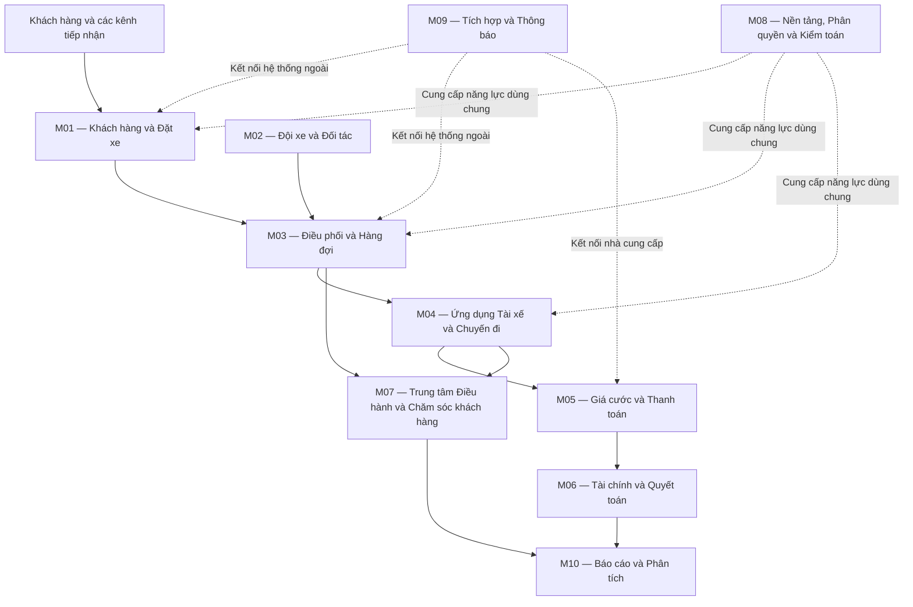

# 03 — KIẾN TRÚC PHÂN RÃ MODULE VÀ QUYỀN SỞ HỮU NGHIỆP VỤ

**Mã tài liệu:** TAXI-ARC-003  
**Phiên bản:** 0.1  
**Trạng thái:** ĐỀ XUẤT CHUẨN HÓA — CHỜ CHỦ NGHIỆP VỤ VÀ KIẾN TRÚC PHÊ DUYỆT  
**Cơ sở:** Tài liệu 01, tài liệu 02, tổng quan 00 và các README Module hiện có.

> Tài liệu này giải quyết sự không thống nhất giữa danh mục Module trong tài liệu 01 và README hiện tại. Đây là đề xuất kiến trúc chuẩn hóa để làm cơ sở phát triển tài liệu tiếp theo; chưa phải quyết định tổ chức hoặc chính sách nghiệp vụ đã được Mai Linh phê duyệt.

## 1. Quyết định kiến trúc đề xuất

Đề xuất lấy danh mục 10 Module đang được tổ chức trong README và thư mục domain làm **đường cơ sở kiến trúc**, vì danh mục này đã tách riêng các miền có vòng đời và trách nhiệm dữ liệu khác nhau, đặc biệt là:
- Tài chính và quyết toán đối tác.
- Nền tảng IAM và kiểm toán.
- Tích hợp và thông báo.
- Báo cáo và phân tích.

Các năng lực **Điểm tiếp thị và Khu vực sắp tài** trong tài liệu KPMG không bị loại bỏ. Chúng được phân chia theo trách nhiệm:
- Quy tắc hàng đợi, đăng ký lượt, FIFO và phân bổ xe thuộc M03 — Điều phối.
- Quản lý danh mục điểm, nhân viên điểm, giờ hoạt động, sức chứa và hiệu quả khai thác được quản lý bởi M03; dữ liệu cấu hình dùng chung do M08 quản trị theo phân quyền.
- Màn hình giám sát, can thiệp có kiểm soát và theo dõi hoạt động điểm thuộc M07 — Trung tâm Điều hành và Chăm sóc khách hàng.

Cách phân chia này tránh tạo một Module điểm tiếp thị cô lập trong khi vẫn bảo toàn đầy đủ yêu cầu TO.P3, TO.P4 và TO.E của KPMG.

## 2. Danh mục 10 Module chuẩn đề xuất

| Mã | Tên Module chuẩn | Trách nhiệm chính | Dữ liệu/đối tượng sở hữu chính |
|---|---|---|---|
| M01 | Khách hàng và Đặt xe | Hồ sơ khách, địa chỉ, tiếp nhận đa kênh, tạo/sửa/hủy và quản lý yêu cầu đặt xe | Customer, ContactPoint, SavedAddress, Booking, BookingRevision |
| M02 | Đội xe và Đối tác | Tài xế, xe, quan hệ tài xế–xe, ca làm, đội xe, đối tác, hợp đồng và điều kiện khai thác | Driver, Vehicle, Shift, FleetGroup, Partner, Contract, EligibilityProfile |
| M03 | Điều phối và Hàng đợi | Tìm nguồn lực, điều kiện đủ tư cách, xếp hạng, mời nhận, phân công, điều phối lại, điểm tiếp thị và hàng đợi FIFO | DispatchRun, CandidateSnapshot, Offer, Assignment, DispatchPolicy, QueueRegistration, MarketingPoint |
| M04 | Ứng dụng Tài xế và Chuyến đi | Tác nghiệp tài xế, trạng thái thực hiện chuyến, hành trình, bằng chứng và sự cố trên chuyến | Trip, TripEvent, TripStopProgress, OfflineEventEnvelope, SOSAlert |
| M05 | Giá cước và Thanh toán | Biểu giá, báo giá, tính cước, thành phần cước, giao dịch thu tiền và hoàn tiền | TariffVersion, FareQuote, FareResult, PaymentTransaction, RefundTransaction |
| M06 | Tài chính và Quyết toán | Sổ cái, doanh thu, chi phí, công nợ, nghĩa vụ đối tác, đối soát và chi trả | LedgerEntry, Receivable, Payable, SettlementBatch, SettlementLine, Payout |
| M07 | Trung tâm Điều hành và Chăm sóc khách hàng | Bảng điều hành, bản đồ, hàng đợi giám sát, can thiệp có kiểm soát, hồ sơ CSKH/khiếu nại và SLA | OperationalBoard, read projections, ServiceCase, Complaint, SLAClock |
| M08 | Nền tảng, Phân quyền và Kiểm toán | Người dùng, vai trò, phạm vi dữ liệu, cấu hình chính sách, nhật ký kiểm toán và nền tảng vận hành | User, Role, Permission, OrgUnit, DataScope, PolicyConfig, AuditEvent |
| M09 | Tích hợp và Thông báo | Kết nối nhà cung cấp/hệ thống ngoài, cổng đối tác, bản đồ, SMS/Voice/Push/Email, webhook và cơ chế gửi lại | ProviderConfig, IntegrationDelivery, WebhookReceipt, NotificationDelivery |
| M10 | Báo cáo và Phân tích | Chỉ tiêu, báo cáo, KPI, phân tích vận hành và hiệu quả tài chính | Reporting projections, KPI definitions, DataLineage |

## 3. Phạm vi sở hữu và ranh giới Module

### M01 — Khách hàng và Đặt xe
**Sở hữu:** hồ sơ khách hàng, thông tin liên hệ, địa chỉ đã lưu, Booking và lịch sử chỉnh sửa Booking.

**Không sở hữu:** danh sách xe ứng viên, Offer, Assignment, Trip, kết quả tính cước cuối cùng hoặc bút toán tài chính.

**Bàn giao:** phát sinh sự kiện Booking hợp lệ/sẵn sàng điều phối; yêu cầu thay đổi/hủy sau khi đã điều phối phải gọi lệnh có kiểm tra trạng thái, không tự sửa dữ liệu của M03/M04.

### M02 — Đội xe và Đối tác
**Sở hữu:** hồ sơ tài xế, xe, đội xe, đối tác, hợp đồng/phiên bản hợp đồng, giấy tờ và điều kiện khai thác.

**Không sở hữu:** quyết định xếp hạng xe cho từng Booking, Assignment hoặc kết quả quyết toán.

**Bàn giao:** cung cấp dữ liệu nguồn lực và kết quả kiểm tra điều kiện khai thác cho M03; cung cấp ảnh chụp hợp đồng/nguồn lực cần thiết cho M04/M06 khi phát sinh nghiệp vụ.

### M03 — Điều phối và Hàng đợi
**Sở hữu:** lượt điều phối, tập xe ứng viên, quyết định đủ điều kiện, thứ tự xếp hạng, lời mời, phân công, lịch sử điều phối, hàng đợi điểm tiếp thị và quy tắc điều phối có phiên bản.

**Bao gồm năng lực điểm tiếp thị:** danh mục điểm phục vụ điều phối, vùng phục vụ, sức chứa vận hành, đăng ký hàng đợi, FIFO, bỏ lượt, chuyển lượt và can thiệp điều hành. Nếu sau khảo sát, dữ liệu điểm cần một chủ sở hữu nghiệp vụ độc lập, kiến trúc có thể tách miền này ở phiên bản sau mà không thay đổi nguyên tắc tích hợp.

**Không sở hữu:** hồ sơ pháp lý gốc của xe/tài xế/đối tác (M02), dữ liệu chuyến thực tế (M04), bảng giá (M05) hoặc bảng điều khiển giám sát (M07).

### M04 — Ứng dụng Tài xế và Chuyến đi
**Sở hữu:** vòng đời Trip, các mốc đến đón/bắt đầu/kết thúc, điểm dừng, sự kiện chuyến, bằng chứng và sự cố gắn với chuyến.

**Không sở hữu:** Booking gốc, Offer/Assignment, biểu giá hoặc giao dịch tài chính.

**Bàn giao:** tham chiếu Assignment hiệu lực; phát sự kiện Trip để M05 tính cước và các Module liên quan cập nhật read model.

### M05 — Giá cước và Thanh toán
**Sở hữu:** phiên bản biểu giá, báo giá, kết quả tính cước, chi tiết cấu thành cước, giao dịch thu tiền/hoàn tiền và phản hồi nhà cung cấp thanh toán.

**Không sở hữu:** sổ cái, công nợ hoặc quyết toán đối tác (M06).

**Bàn giao:** kết quả cước và giao dịch đã xác minh cho M06 ghi nhận theo quy tắc kế toán đã duyệt.

### M06 — Tài chính và Quyết toán
**Sở hữu:** bút toán, công nợ phải thu/phải trả, kỳ đối soát, dòng quyết toán, chênh lệch, điều chỉnh và bằng chứng chi trả.

**Nguyên tắc bắt buộc:** DIRECT và PARTNER có thể dùng chung chuỗi Booking → Dispatch → Trip nhưng phải phân biệt chủ thể hưởng doanh thu, nghĩa vụ, khoản khấu trừ, công nợ và quyết toán. Bút toán đã ghi sổ không sửa/xóa tùy tiện; điều chỉnh bằng bút toán bù trừ có truy vết.

### M07 — Trung tâm Điều hành và Chăm sóc khách hàng
**Sở hữu:** hồ sơ yêu cầu hỗ trợ/khiếu nại, SLA và các read model phục vụ giám sát. Đây không phải nguồn dữ liệu giao dịch gốc của Booking, Dispatch, Trip hoặc Payment.

**Quyền can thiệp:** mọi thao tác thay đổi nghiệp vụ phải gọi API/lệnh của Module sở hữu dữ liệu; bắt buộc kiểm tra quyền, lý do, phạm vi và ghi nhật ký.

### M08 — Nền tảng, Phân quyền và Kiểm toán
**Sở hữu:** danh tính, vai trò, quyền, phạm vi tổ chức/dữ liệu, cấu hình chính sách dùng chung và nhật ký kiểm toán.

**Không sở hữu:** quy tắc nghiệp vụ riêng của Booking, Dispatch, Fare hoặc Settlement. Module nghiệp vụ định nghĩa hành vi; M08 cung cấp cơ chế cấu hình/phân quyền/kiểm toán.

### M09 — Tích hợp và Thông báo
**Sở hữu:** cấu hình kết nối, thông tin tham chiếu bí mật, nhật ký gửi/nhận, webhook, trạng thái giao nhận, retry và dead-letter.

**Không sở hữu:** dữ liệu nghiệp vụ chuẩn từ hệ thống ngoài. Adapter phải chuyển đổi hợp đồng nhà cung cấp sang hợp đồng nội bộ; lỗi nhà cung cấp không được tự tạo trạng thái nghiệp vụ giả.

### M10 — Báo cáo và Phân tích
**Sở hữu:** định nghĩa KPI, mô hình đọc, dữ liệu tổng hợp, nguồn gốc dữ liệu và lịch làm mới.

**Không sở hữu:** giao dịch nguồn. Báo cáo chỉ đọc từ API/event/replica/projection; không cập nhật bảng giao dịch của Module khác.

## 4. Sơ đồ phân rã Module

Sơ đồ thể hiện quan hệ năng lực ở mức khái quát, không thay thế sơ đồ triển khai hạ tầng hoặc hợp đồng API/event chi tiết.

## 5. Bảng truy vết yêu cầu KPMG sang Module

| Nhóm/quy trình nguồn | Module chính | Module phối hợp | Ghi chú |
|---|---|---|---|
| TO.P1 — Tổng đài | M01, M03, M04 | M02, M05, M06, M07, M09 | M07 cung cấp màn hình vận hành; Booking vẫn do M01 sở hữu |
| TO.P2 — Ứng dụng khách hàng | M01, M03, M04 | M02, M05, M06, M09 | Ứng dụng khách hàng là kênh của M01 |
| TO.P3 — Điểm tiếp thị có nhân viên | M03, M07 | M01, M02, M04, M05, M06 | Hàng đợi/điều phối thuộc M03; giám sát thuộc M07 |
| TO.P4 — Khu vực sắp tài không nhân viên | M03 | M02, M04, M07 | FIFO và lượt tài xế thuộc M03 |
| TO.P5 — SMS | M01, M09 | M03, M04, M07 | M09 nhận/gửi SMS; M01 tạo Booking |
| TO.P6 — Chat | M01, M07, M09 | M03, M04 | M07 quản lý tương tác/hỗ trợ; M01 sở hữu Booking |
| TO.P7 — Web | M01, M09 | M03, M04, M05 | Kênh Web gọi chức năng M01 |
| TO.P8 — Đặt trước | M01, M03 | M02, M04, M09 | Lịch Booking do M01 sở hữu; kích hoạt điều phối ở M03 |
| TO.P9 — Đường dài | M05, M04 | M01, M03, M06 | M05 quản lý quy tắc giá; M04 quản lý Trip |
| TO.A — Khách hàng | M01, M05, M09 | M07 | Đặt xe, báo giá, thanh toán, thông báo |
| TO.B — Tài xế | M02, M03, M04 | M09 | Nguồn lực, nhận cuốc, hàng đợi và tác nghiệp |
| TO.C — Điều hành | M03, M07 | M02, M04, M05 | Điều phối và giám sát |
| TO.D — Điện thoại viên | M01, M07, M09 | M03 | Màn hình tổng đài và tiếp nhận |
| TO.E — Điểm tiếp thị | M03, M07 | M02, M04 | Quản lý hàng đợi và giám sát điểm |
| TO.F — Kiểm soát | M05, M06, M08 | Tất cả Module | Kiểm soát doanh thu, phân quyền, nhật ký |
| TO.G — Báo cáo nhu cầu | M10 | M01, M03, M07 | Dữ liệu tổng hợp từ nguồn có thẩm quyền |
| TO.H — Báo cáo doanh thu | M10 | M05, M06 | Phân biệt doanh thu vận hành và ghi nhận tài chính |
| TO.I — Báo cáo vận hành | M10 | M02, M03, M04, M07 | Chỉ tiêu vận hành và sự cố |
| TO.J — Kỹ thuật | M08, M09, M10 | Tất cả Module | Năng lực tải, nền tảng và tích hợp |

## 6. Quy tắc giao tiếp xuyên Module

1. Module sở hữu dữ liệu là nơi duy nhất có quyền ghi dữ liệu chuẩn của miền đó.
2. Module khác không cập nhật trực tiếp bảng dữ liệu của nhau.
3. Giao tiếp đồng bộ dùng API/command có xác thực, phân quyền, kiểm tra đầu vào và mã tương quan.
4. Giao tiếp bất đồng bộ dùng event có phiên bản, mã sự kiện duy nhất và cơ chế xử lý lặp an toàn.
5. Mỗi command/event phải xác định bên phát, bên nhận, dữ liệu tối thiểu, điều kiện, lỗi, retry và trách nhiệm xử lý.
6. Dữ liệu đọc liên Module được cung cấp qua API hoặc read projection; phải thể hiện thời điểm cập nhật và độ mới.
7. Lệnh điều phối nhận xe phải kiểm soát đồng thời nguyên tử; không tạo hai Assignment hiệu lực cho cùng một Booking.
8. Sự kiện tài chính phải tham chiếu nguồn nghiệp vụ và chống ghi nhận trùng.
9. Tích hợp nhà cung cấp đi qua M09; không để logic riêng của nhà cung cấp lan vào Module nghiệp vụ.
10. Mọi hành động quản trị/can thiệp nhạy cảm phải qua M08 và được ghi nhật ký.

## 7. Quy tắc phân định DIRECT và PARTNER

| Năng lực | Dùng chung hay tách riêng | Quy tắc |
|---|---|---|
| Booking | Dùng chung | Một mô hình Booking chuẩn; lưu kênh tiếp nhận độc lập loại hình đội xe |
| Dispatch | Dùng chung nền tảng | Cùng cơ chế điều phối, nhưng chính sách đủ điều kiện/ưu tiên có thể cấu hình theo hợp đồng và khu vực |
| Driver/Vehicle | Dùng chung mô hình dữ liệu | Bắt buộc xác định chủ sở hữu/đơn vị quản lý và loại hình nguồn lực |
| Trip | Dùng chung mô hình | Lưu ảnh chụp tài xế, xe, đối tác và hợp đồng áp dụng tại thời điểm chuyến |
| Tariff/Fare | Có thể có bộ quy tắc khác nhau | Phải xác định chủ thể chịu/nhận từng thành phần cước |
| Payment | Dùng chung hạ tầng giao dịch | Phân loại người trả, người thu, phương thức và tài khoản nhận |
| Ledger/Receivable/Payable | Tách theo chủ thể và quy tắc kế toán | Không gộp doanh thu/công nợ DIRECT và PARTNER |
| Settlement | Tách theo hợp đồng/đối tác/kỳ | Có bảng tính, phê duyệt, khóa kỳ và bằng chứng chi trả riêng |

## 8. Các điểm chưa được phép tự quyết

- Mô hình pháp nhân/chủ thể ghi nhận doanh thu và nghĩa vụ thuế.
- Cơ chế ưu tiên điều phối giữa xe DIRECT và PARTNER.
- Quyền sở hữu, phê duyệt và vận hành điểm tiếp thị/khu vực sắp tài.
- Chính sách giá, chiết khấu, phí, khấu trừ và chia sẻ doanh thu đối tác.
- Hệ thống nguồn cho hồ sơ tài xế, xe, khách hàng, hợp đồng và biểu giá.
- Cơ cấu tổ chức, phân quyền theo chi nhánh/vùng/đơn vị.
- Yêu cầu tích hợp và lưu trữ dữ liệu.
- SLO, quy mô tải, RTO/RPO và yêu cầu tuân thủ.

Mỗi nội dung phải được ghi vào sổ quyết định, có người quyết định và bằng chứng phê duyệt.

## 9. Tiêu chí nghiệm thu kiến trúc Module

Kiến trúc chỉ được xem là đủ điều kiện làm đường cơ sở khi:
1. Mỗi Module có mục tiêu, phạm vi và trách nhiệm rõ ràng.
2. Mỗi thực thể dữ liệu chuẩn có đúng một Module sở hữu.
3. Không có hai Module cùng sở hữu một vòng đời nghiệp vụ.
4. Các điểm bàn giao Booking → Dispatch → Trip → Fare → Payment → Finance được xác định.
5. DIRECT/PARTNER dùng chung điều phối nhưng tách nghĩa vụ tài chính theo chủ thể.
6. TO.P1–TO.P9 và TO.A–TO.J có truy vết đến Module.
7. Điểm tiếp thị/FIFO được bảo toàn trong thiết kế.
8. Mọi nội dung TBD có người chịu trách nhiệm quyết định.
9. Đại diện Vận hành, Kinh doanh, Tài chính và CNTT rà soát, phê duyệt.

## 10. Tài liệu tiếp theo

**04 — BẢN ĐỒ QUY TRÌNH ĐẦU CUỐI VÀ SWIMLANE TO.P1–TO.P9**

Tài liệu 04 sẽ mô tả từng quy trình theo vai trò, bao gồm luồng chuẩn, nhánh quyết định, ngoại lệ, trạng thái và điểm bàn giao giữa 10 Module. Trước khi dùng làm thiết kế chính thức, danh mục Module trong tài liệu này cần được chủ nghiệp vụ và kiến trúc xác nhận.

## 11. Lịch sử phiên bản

| Phiên bản | Ngày | Nội dung | Trạng thái |
|---|---|---|---|
| 0.1 | 2026-11-14 | Chuẩn hóa danh mục 10 Module và trách nhiệm sở hữu theo cấu trúc repository | Đề xuất |
