# 04 — QUY TRÌNH NGHIỆP VỤ ĐẦU CUỐI VÀ SWIMLANE TO.P1–TO.P9

**Mã tài liệu:** TAXI-BIZ-004  
**Phiên bản:** 0.7  
**Trạng thái:** ĐANG XÂY DỰNG — TO.P1–TO.P7 ĐÃ ĐẶC TẢ BẢN ĐẦU; TO.P8–TO.P9 CHƯA ĐẶC TẢ  
**Nguồn nghiệp vụ:** *MLG_Luu do va mo ta quy trinh & Yeu cau _Dieu hanh taxi_v3.docx*, KPMG, 2015.

> Tài liệu này bám theo mã bước, vai trò và mô tả trong tài liệu KPMG. Không xem quy trình năm 2015 là chính sách hiện hành. Những nội dung KPMG để [xxx], yêu cầu Mai Linh tự quy định hoặc chưa đủ dữ liệu đều được giữ ở trạng thái cần xác nhận. Phần diễn giải thiết kế hệ thống được tách riêng khỏi nội dung nguồn.

## 1. Danh mục quy trình

| Mã | Quy trình | Trạng thái đặc tả |
|---|---|---|
| TO.P1 | Khách hàng yêu cầu Taxi qua Tổng đài | Đã dựng luồng và swimlane bản đầu |
| TO.P2 | Khách hàng sử dụng Ứng dụng | Đã dựng luồng và swimlane bản đầu |
| TO.P3 | Khách yêu cầu tại Điểm tiếp thị có nhân viên điều hành điểm | Đã dựng luồng và swimlane bản đầu |
| TO.P4 | Khách yêu cầu tại Khu vực sắp tài không có nhân viên điều hành điểm | Đã dựng luồng và swimlane bản đầu |
| TO.P5 | Khách hàng yêu cầu Taxi qua SMS | Đã dựng luồng và swimlane bản đầu |
| TO.P6 | Khách hàng yêu cầu Taxi qua Chat | Đã dựng luồng và swimlane bản đầu |
| TO.P7 | Khách hàng yêu cầu Taxi qua Web | Đã dựng luồng và swimlane bản đầu |
| TO.P8 | Khách hàng đặt xe trước | Chưa đặc tả |
| TO.P9 | Cước phí đường dài | Chưa đặc tả |

## 2. TO.P1 — Khách hàng yêu cầu Taxi qua Tổng đài

### 2.1. Mục tiêu và phạm vi theo KPMG

Quy trình mô tả việc điều hành Taxi khi khách hàng yêu cầu qua cuộc gọi tổng đài, từ lúc bắt đầu đến khi khách hàng thanh toán dịch vụ. Chủ quy trình được nêu gồm Tổng đài viên, Tổng đài Điều hành và Tài xế.

Khách hàng có thể gọi bằng điện thoại bàn hoặc di động để:
- Yêu cầu/nhắc xe.
- Thay đổi yêu cầu dịch vụ.
- Hủy yêu cầu dịch vụ.
- Đặt chỗ trước; trường hợp này chuyển sang TO.P8.

### 2.2. Vai trò tham gia

| Vai trò | Trách nhiệm được mô tả trong nguồn |
|---|---|
| Khách hàng | Gọi tổng đài, cung cấp yêu cầu, xác nhận chờ, thay đổi/hủy, lên xe, thanh toán và phản hồi |
| Tổng đài viên | Tiếp nhận cuộc gọi, nhập/cập nhật/hủy yêu cầu, gọi lại/thông báo khách, cập nhật tình trạng chờ |
| Tổng đài Điều hành | Phát yêu cầu đến tài xế, theo dõi khách chờ lâu, chỉ định xe và xử lý tình huống thiếu xe |
| Tài xế | Đăng ký nhận khách, hủy đăng ký, nhận chỉ định, đến điểm đón, liên hệ khách, thực hiện chuyến và thu tiền |
| Hệ thống | Hiển thị dữ liệu, phát yêu cầu, cập nhật trạng thái, ghi nhận đăng ký/hủy và hỗ trợ báo cáo |

### 2.3. Luồng tổng thể

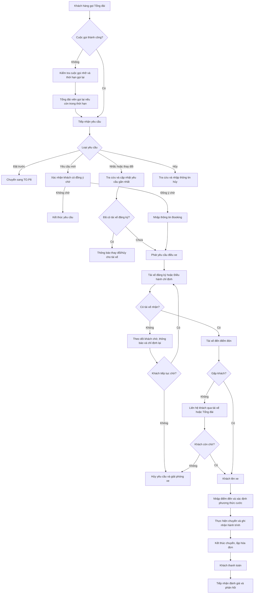

**Giới hạn:** Đây là lưu đồ tổng hợp để đọc nhanh. Các nhánh chi tiết phải đối chiếu bảng bước ở mục 2.4 và các chính sách hiện hành trước khi dùng làm căn cứ phát triển.

### 2.4. Diễn giải các bước theo mã KPMG

| Mã bước | Hoạt động | Vai trò theo nguồn | Nội dung được mô tả trong KPMG |
|---|---|---|---|
| TO.P1.1 | Gọi tổng đài | Khách hàng | Gọi bằng điện thoại bàn/di động để yêu cầu, nhắc, thay đổi hoặc hủy dịch vụ |
| TO.P1.2 | Đặt chỗ trước | Khách hàng | Nếu đặt trước thì chuyển sang TO.P8 |
| TO.P1.3 | Cuộc gọi thành công | Tổng đài viên | Xác định cuộc gọi có thành công hay không |
| TO.P1.4 | Gọi lại khách hàng | Tổng đài viên | Với cuộc gọi nhỡ từ di động, gọi lại trong thời hạn do Mai Linh quy định theo khu vực và thời điểm; nguồn để [xxx] phút |
| TO.P1.5 | Phân loại yêu cầu | Khách hàng | Yêu cầu mới đi TO.P1.6; nhắc/thay đổi đi TO.P1.8; hủy đi TO.P1.10 |
| TO.P1.6 | Khách hàng đồng ý chờ? | Tổng đài viên | Nếu đồng ý chờ thì lấy thông tin; nếu không đồng ý thì quy trình kết thúc |
| TO.P1.7 | Nhập dữ liệu vào hệ thống | Tổng đài viên | Nhập số nhà, đường, phường, quận, loại/hiệu xe, đặc điểm, số điện thoại nếu cần, số lượng xe theo loại. Hệ thống hiển thị địa chỉ gắn với số điện thoại bàn hoặc ba địa chỉ yêu cầu gần nhất của số di động. Nếu tài xế gọi yêu cầu xe thì để trống số điện thoại khách |
| TO.P1.8 | Nhập dữ liệu yêu cầu thay đổi/nhắc xe | Tổng đài viên | Tra cứu theo số điện thoại; nếu dùng số khác thì dựa vào điểm đón. Chọn yêu cầu gần nhất để chỉnh sửa. Nếu đã có xe đăng ký thì cập nhật cho xe; nếu chưa có xe đăng ký thì xử lý như yêu cầu mới |
| TO.P1.9 | Lái xe đã đăng ký? | Tổng đài viên | Có xe đăng ký thì sang TO.P1.16; chưa có xe thì sang TO.P1.12 |
| TO.P1.10 | Nhập dữ liệu hủy yêu cầu xe | Tổng đài viên | Tra cứu yêu cầu gần nhất theo số điện thoại hoặc điểm đón và chọn yêu cầu để hủy |
| TO.P1.11 | Lái xe đã đăng ký? | Tổng đài viên | Nếu có xe đăng ký thì sang TO.P1.16; nếu chưa có xe thì quy trình kết thúc |
| TO.P1.12 | Phát yêu cầu xe theo Unicast/Broadcast | Tổng đài Điều hành | Unicast là mặc định, phát đến xe trống trong bán kính cấu hình [xxx] km. Broadcast phát đến xe trống toàn hệ thống, do Tổng đài Điều hành kiểm soát trong tình huống đặc biệt như cao điểm/thiếu xe cục bộ. Có cảnh báo nhu cầu tăng đột biến và danh sách khách chờ lâu |
| TO.P1.13 | Hiển thị yêu cầu trên ứng dụng tài xế | Hệ thống | Hiển thị yêu cầu để tài xế xem và đăng ký; chi tiết bước cần rà soát thêm trong bản lưu đồ nguồn |
| TO.P1.14 | Đăng ký đón khách | Tài xế | Tài xế bấm đăng ký; tại một thời điểm chỉ đăng ký một yêu cầu. Ứng dụng hiển thị 10 yêu cầu chưa đăng ký gần nhất theo lộ trình giao thông thực. Ngoài bán kính phát sóng [xxx] km thì có thể thấy nhưng không đăng ký được |
| TO.P1.15 | Hủy đăng ký đón khách? | Tài xế | Nếu hủy thì yêu cầu trở về chưa có xe đăng ký, xe trở về trống; hệ thống ghi nhận lịch sử hủy. Nếu không hủy thì tài xế đi đến điểm đón |
| TO.P1.16 | Tài xế nhận thông báo hủy/thay đổi | Tài xế | Khi Tổng đài viên hủy/thay đổi, ứng dụng tài xế hiển thị thông báo kèm âm báo. Hủy thì kết thúc; thay đổi thì tài xế có thể hủy đăng ký theo luồng được mô tả |
| TO.P1.17 | Trường hợp giờ cao điểm | Tổng đài Điều hành | Khi chưa có tài xế nhận hoặc tài xế đã đăng ký rồi hủy, Tổng đài cần thông báo tình hình cho khách để khách chọn tiếp tục chờ hay hủy |
| TO.P1.18 | Hiển thị thông tin sang hỗ trợ viên | Tổng đài Điều hành | Trong giờ cao điểm, cho phép hiển thị thông tin khách chờ lâu sang hỗ trợ viên để thông báo tình hình xe |
| TO.P1.19 | Gọi khách cập nhật tình hình xe | Tổng đài viên | Gọi khách từ danh sách chờ lâu; yêu cầu được tạm khóa trong lúc cập nhật. Lưu thông tin cập nhật gần nhất. Nếu không có số điện thoại và không thấy khách thì coi như hủy, ghi nhận để xử lý khiếu nại |
| TO.P1.20 | Khách hàng đồng ý chờ? | Tổng đài viên | Nếu khách chờ thì cập nhật danh sách chờ lâu để Điều hành chỉ định xe; nếu không chờ thì đi bước hủy |
| TO.P1.21 | Hủy yêu cầu đặt xe | Tổng đài viên | Nhập thông tin hủy; yêu cầu biến khỏi danh sách chờ, bản đồ và danh sách yêu cầu trên xe; xe đã đăng ký được trả về trạng thái trống |
| TO.P1.22 | Chỉ định xe đón khách | Tổng đài Điều hành | Điều hành có quyền chỉ định xe cho khách chờ lâu; xe gần nhất theo lộ trình thực được hệ thống hỗ trợ lựa chọn. Có thể cung cấp số điện thoại khách cho tài xế nếu được phép |
| TO.P1.23 | Từ chối/hủy nhận chỉ định? | Tài xế | Tài xế từ chối, không chấp nhận trong [xxx] giây hoặc hủy sau khi đã nhận thì được xem là không nhận chỉ định; chấp nhận thì sang TO.P1.26 |
| TO.P1.24 | Cần thông báo khách không có xe? | Tổng đài viên | Nguồn nêu nếu chỉ định hai lần vẫn không có xe chấp nhận thì cần thông báo khách; hệ thống lập báo cáo tài xế từ chối |
| TO.P1.25 | Thông báo khách hàng không có xe | Tổng đài viên | Dựa trên danh sách chờ và thời gian từ lần gọi khách cuối cùng [xxx] phút, gọi thông báo và tiến hành hủy |
| TO.P1.26 | Nhận chỉ định đón khách | Tài xế | Ứng dụng hiển thị yêu cầu được chỉ định. Hệ thống ghi nhận xe nhận chỉ định; chính sách khuyến khích tài xế được Mai Linh quy định cụ thể |
| TO.P1.27 | Đến điểm đón khách | Tài xế | Tài xế đến điểm đón; hành trình chở khách được ghi nhận bởi hệ thống quản lý hành trình trên xe |
| TO.P1.28 | Thấy khách? | Tài xế | Có khách thì sang TO.P1.34; không thấy khách thì sang TO.P1.29 |
| TO.P1.29 | Xin số điện thoại khách? | Tổng đài Điều hành | Khi không thấy khách, tài xế gọi Tổng đài; trong giờ cao điểm có thể cần chuyển số điện thoại khách cho tài xế |
| TO.P1.30 | Chuyển số điện thoại khách cho tài xế | Tổng đài Điều hành | Nếu cao điểm và tổng đài viên bận, Điều hành chuyển số điện thoại để tài xế tự liên lạc |
| TO.P1.31 | Tài xế gọi khách báo xe đến | Tài xế | Nếu không liên lạc được, tài xế có thể báo cáo để nhận cuốc khác. Thời gian chờ khách cần Mai Linh quy định |
| TO.P1.32 | Gọi khách báo xe đến | Tổng đài viên | Nếu thấp điểm hoặc không thể chuyển số điện thoại cho tài xế, tổng đài viên gọi khách |
| TO.P1.33 | Khách hàng phản hồi | Tổng đài viên | Khách hủy thì nhập hủy để xe nhận yêu cầu khác; khách vẫn chờ thì yêu cầu khách ra xe |
| TO.P1.34 | Khách lên xe, thông báo điểm đến | Tài xế | Khách thông báo điểm đến. Nếu khách không phải người đã gọi tổng đài, tài xế báo hủy đăng ký đón nhầm và yêu cầu xe khác đến |
| TO.P1.35 | Bấm đồng hồ, nhập điểm đến | Tài xế | Tài xế bấm đồng hồ, nhập điểm đến vào ứng dụng để dẫn đường; có thể hiển thị cước ước tính |
| TO.P1.36 | Có thể áp dụng cước đường dài? | Tài xế/Hệ thống | Nếu đủ điều kiện, hệ thống hiển thị cước đường dài để khách chọn cước cố định hay cước đồng hồ; chọn cước đường dài thì chuyển TO.P9 |
| TO.P1.37 | Yêu cầu cấp mã đi đường dài | Tài xế | Gửi điểm đầu/cuối, cự ly và đăng ký một chiều/hai chiều để yêu cầu cấp mã |
| TO.P1.38 | Xử lý và cấp mã đường dài | Tổng đài Điều hành | Cấp mã theo khung giá cố định đã định nghĩa và cự ly đăng ký |
| TO.P1.39 | Thực hiện dịch vụ chở khách | Tài xế | Chở khách đến nơi; hành trình được lưu trong hệ thống quản lý hành trình |
| TO.P1.40 | Kết thúc hành trình và xuất hóa đơn | Tài xế | Hóa đơn gồm doanh thu đồng hồ, cước cố định đường dài/phụ thu vượt lộ trình, phí cầu đường, tiền tip, số tài/MSNV, điểm đầu/cuối, ngày giờ |
| TO.P1.41 | Thanh toán | Khách hàng | Kiểm tra hóa đơn và thanh toán; nguồn nêu tiền mặt, thẻ trả sau MCC, thẻ tín dụng/thẻ ATM và voucher |
| TO.P1.42 | Khách hàng phản hồi chất lượng dịch vụ | Khách hàng | Chấm điểm chất lượng là thông tin bắt buộc theo nguồn; ý kiến góp ý/phàn nàn là tùy chọn. Kênh gồm ứng dụng, gọi tổng đài hoặc tổng đài gọi ngẫu nhiên |

**Lưu ý truy vết:** Bước TO.P1.13 trong bản diễn giải trích xuất chưa có đủ nội dung mô tả; cần kiểm tra trực tiếp trang lưu đồ/bản gốc khi hoàn thiện. Một số bước trong KPMG dẫn chiếu chéo chưa rõ hoặc có lỗi đánh số; tài liệu này không tự ý sửa mã nguồn.

### 2.5. Swimlane theo vai trò

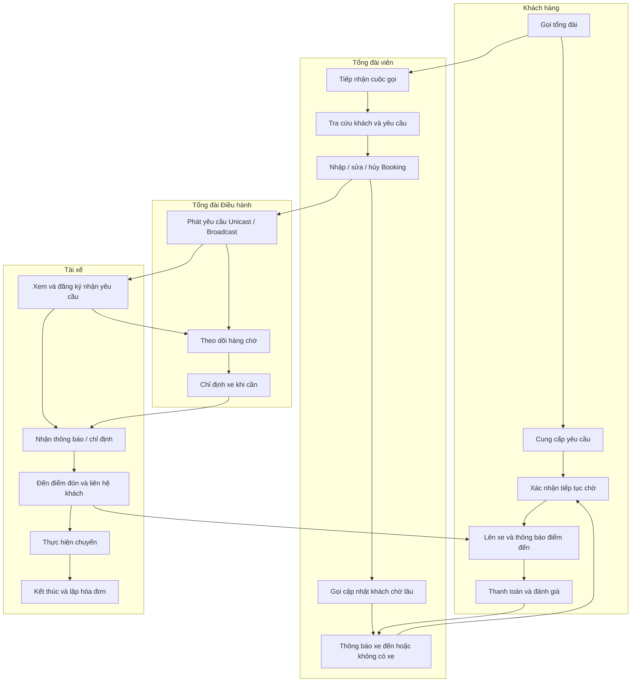

Swimlane trên là sơ đồ trách nhiệm khái quát. Các nhánh từ chối, hủy, khách không đến và lỗi kết nối cần được kiểm thử riêng; không dùng sơ đồ này thay cho bảng mã bước.

### 2.6. Dữ liệu đầu vào và đầu ra

| Nhóm | Dữ liệu theo tài liệu nguồn |
|---|---|
| Đầu vào Booking | Số nhà, đường, phường, quận, loại xe, hiệu xe, đặc điểm, số điện thoại nếu cần, số lượng xe theo loại |
| Dữ liệu hỗ trợ tra cứu | Địa chỉ gắn số điện thoại bàn hoặc ba địa chỉ yêu cầu gần nhất của số di động |
| Điều phối | Điểm đón, danh sách xe trống, bán kính phát, phương thức Unicast/Broadcast, đăng ký và chỉ định |
| Thực hiện chuyến | Điểm đến, thời điểm đến đón, hành trình, dữ liệu đồng hồ và mã đường dài nếu có |
| Hóa đơn | Cước đồng hồ, cước cố định/phụ thu đường dài, phí cầu đường, tiền tip, số tài/MSNV, điểm đầu/cuối, ngày giờ |
| Thanh toán | Tiền mặt, MCC, thẻ tín dụng/thẻ ATM, voucher |
| Phản hồi | Điểm đánh giá bắt buộc; ý kiến chi tiết tùy chọn |

### 2.7. Điểm bàn giao Module theo kiến trúc đề xuất

| Hoạt động nghiệp vụ | Module sở hữu/đảm nhiệm | Bàn giao |
|---|---|---|
| Tiếp nhận và quản lý Booking qua điện thoại | M01 | Booking sẵn sàng điều phối gửi M03 |
| Hồ sơ và trạng thái nguồn lực | M02 | Nguồn lực đủ điều kiện cung cấp cho M03 |
| Phát yêu cầu, Offer, đăng ký, chỉ định, hàng đợi | M03 | Assignment hiệu lực chuyển M04 |
| Đến đón, bắt đầu/kết thúc Trip, hành trình | M04 | Sự kiện Trip chuyển M05 |
| Biểu giá, tính cước, giao dịch thanh toán | M05 | Kết quả tài chính chuyển M06 |
| Ghi nhận doanh thu, công nợ, đối soát | M06 | Dữ liệu tài chính đã xác minh chuyển M10 |
| Màn hình tổng đài, giám sát, can thiệp và CSKH | M07 | Gọi lệnh đến Module sở hữu dữ liệu |
| Người dùng, quyền, nhật ký và chính sách | M08 | Cung cấp năng lực dùng chung |
| Tích hợp thoại/tổng đài và thông báo | M09 | Chuyển sự kiện/kết quả giao tiếp |
| Báo cáo nhu cầu, doanh thu, vận hành | M10 | Chỉ đọc dữ liệu nguồn đã được phân quyền |

### 2.8. Các điểm cần Mai Linh xác nhận

| Mã quyết định | Nội dung chưa được chốt | Căn cứ |
|---|---|---|
| P1-DEC-01 | Thời hạn gọi lại cuộc gọi nhỡ theo khu vực và giờ cao/thấp điểm | TO.P1.4 ghi [xxx] phút |
| P1-DEC-02 | Bán kính Unicast và bán kính tài xế được phép đăng ký | TO.P1.12, TO.P1.14 ghi [xxx] km |
| P1-DEC-03 | Thời gian chờ phản hồi nhận chỉ định của tài xế | TO.P1.23 ghi [xxx] giây |
| P1-DEC-04 | Số lần chỉ định tối đa và thời hạn chờ trước khi thông báo không có xe | TO.P1.24–P1.25 |
| P1-DEC-05 | Thời gian tài xế chờ khách tại điểm đón và số lần gọi khách | TO.P1.31 yêu cầu quy định |
| P1-DEC-06 | Quyền chuyển số điện thoại khách cho tài xế, điều kiện bảo vệ dữ liệu | TO.P1.29–P1.32 |
| P1-DEC-07 | Chính sách thưởng/khuyến khích tài xế nhận chỉ định | TO.P1.26 |
| P1-DEC-08 | Biểu giá, điều kiện đường dài, mã xác nhận và phụ thu | TO.P1.35–P1.40; chuyển TO.P9 |
| P1-DEC-09 | Phương thức thanh toán còn được Mai Linh sử dụng hiện nay | TO.P1.41 |
| P1-DEC-10 | Kênh, thời điểm và nội dung bắt buộc của đánh giá chất lượng | TO.P1.42 |

### 2.9. Các diễn giải thiết kế cần tách khỏi chính sách nguồn

Các nội dung sau là đề xuất kỹ thuật để thiết kế hệ thống mới, không phải câu chữ hoặc kết luận trực tiếp của KPMG:
- Mỗi lần tiếp nhận tạo một Booking có mã định danh duy nhất và lưu lịch sử thay đổi.
- Hủy Booking, hủy đăng ký và giải phóng xe cần được xử lý nhất quán, tránh giải phóng nhầm xe đã nhận yêu cầu khác.
- Chấp nhận Offer/chỉ định phải có kiểm soát đồng thời để không phát sinh hai Assignment hiệu lực.
- Mọi thay đổi sau khi tài xế đã đăng ký cần có phiên bản thông tin mà tài xế đã nhận và xác nhận đã xem.
- Việc chuyển số điện thoại phải qua phân quyền, ghi nhật ký và chính sách bảo vệ dữ liệu.
- Trip, FareResult, PaymentTransaction và LedgerEntry phải là các bản ghi riêng có liên kết truy vết.
- Các trạng thái và thời hạn phải cấu hình theo chính sách được phê duyệt, không mã hóa cứng các giá trị [xxx].


## 3. TO.P2 — Khách hàng yêu cầu Taxi qua Ứng dụng

### 3.1. Mục tiêu và phạm vi theo KPMG

TO.P2 mô tả quy trình điều hành taxi khi khách hàng yêu cầu dịch vụ bằng ứng dụng trên điện thoại thông minh hoặc máy tính bảng, từ lúc đăng nhập/yêu cầu xe đến khi thanh toán. Tài liệu nguồn nêu khách hàng phải sử dụng ứng dụng trên thiết bị thông minh trong suốt quá trình yêu cầu dịch vụ.

**Vai trò chủ quy trình theo bảng tổng quan KPMG:** Tổng đài Điều hành và Tài xế. Khách hàng là tác nhân khởi tạo yêu cầu, lựa chọn xe, phối hợp đón khách, thanh toán và phản hồi.

### 3.2. Vai trò tham gia

| Vai trò | Trách nhiệm theo nguồn |
|---|---|
| Khách hàng | Đăng nhập, nhập thông tin chuyến, xác nhận yêu cầu, chọn xe, theo dõi xe, ra xe, thông báo điểm đến, thanh toán và đánh giá |
| Tổng đài Điều hành | Hệ thống điều hành hỗ trợ tính toán, hiển thị xe trống và thông tin phục vụ lựa chọn; điều phối theo luồng App |
| Tài xế | Tiếp nhận yêu cầu, xác nhận hoặc từ chối, có thể hủy đón, đến điểm đón, liên hệ khách, xác nhận đúng khách và thực hiện chuyến |
| Hệ thống | Xác thực, định vị, tính lộ trình/cước/thời gian chờ, hiển thị xe, gửi yêu cầu, thông báo, ghi nhận hành trình và dữ liệu dịch vụ |

### 3.3. Luồng tổng thể

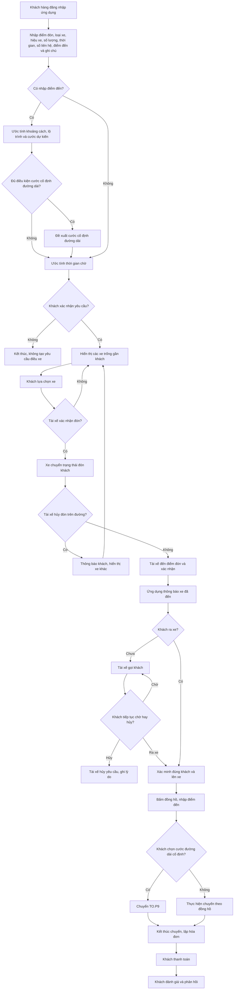

**Lưu ý:** Sơ đồ trên tổng hợp các nhánh được mô tả trong KPMG. Riêng nhánh khách chưa ra xe, tài liệu nguồn không mô tả rõ trường hợp khách không phản hồi hoặc không liên lạc được; không tự bổ sung một quy tắc tự hủy vào quy trình gốc.

### 3.4. Diễn giải các bước TO.P2.1–TO.P2.23 theo KPMG

| Mã bước | Hoạt động | Vai trò theo nguồn | Nội dung được mô tả trong KPMG |
|---|---|---|---|
| TO.P2.1 | Đăng nhập ứng dụng và yêu cầu dịch vụ | Khách hàng | Đăng nhập ứng dụng Mai Linh Taxi trên smartphone/tablet. Nhập điểm đón (địa chỉ hoặc địa danh); hệ thống tự dò vị trí hiện tại làm điểm đón mặc định và cho phép thay đổi. Chọn loại xe 4/7 chỗ, hiệu xe, số lượng xe theo loại, thời gian đón (không nhập hiểu là đón ngay), số điện thoại (tự lấy số di động), điểm đến (không bắt buộc) và ghi chú. Nguồn nêu khách phải đăng ký tài khoản; xác thực bằng user ID/password; thông tin đăng ký lưu ở CRM nếu có |
| TO.P2.2 | Khách hàng cho biết điểm đến? | Khách hàng | Có điểm đến thì sang TO.P2.3; không có thì sang TO.P2.6 |
| TO.P2.3 | Ước tính khoảng cách hành trình và cước phí dự kiến | Hệ thống/Tổng đài Điều hành | Dựa trên điểm đón và điểm đến, hệ thống tính và hiển thị khoảng cách hành trình, cước phí dự kiến |
| TO.P2.4 | Có thể áp dụng cước phí cố định đường dài? | Hệ thống/Tổng đài Điều hành | Tính điều kiện áp dụng. KPMG 2015 định nghĩa lộ trình đường dài là trên 30 km và áp dụng cước cố định thay cho cước đồng hồ. Đây là định nghĩa lịch sử, cần Mai Linh xác nhận lại |
| TO.P2.5 | Đề xuất cước phí cố định đường dài | Hệ thống/Tổng đài Điều hành | Đề xuất theo khoảng cách dự kiến và khung cước cố định được định nghĩa, có thể cập nhật trong hệ thống |
| TO.P2.6 | Ước tính thời gian chờ xe dự kiến | Hệ thống/Tổng đài Điều hành | Dựa trên điểm đón và vị trí xe taxi gần nhất để tính, hiển thị thời gian chờ dự kiến |
| TO.P2.7 | Xác nhận yêu cầu dịch vụ? | Khách hàng | Khách xem thời gian chờ, khoảng cách lộ trình và cước ước tính rồi xác nhận có yêu cầu dịch vụ hay không. Không xác nhận thì kết thúc; xác nhận thì sang TO.P2.8 |
| TO.P2.8 | Hiển thị các xe trống gần khách hàng | Hệ thống/Tổng đài Điều hành | Hiển thị 5 xe trống gần nhất. Thông tin gồm khoảng cách theo lộ trình giao thông thực, thời gian xe đến điểm đón, loại xe 4/7 chỗ, hình ảnh/tên/số tài/biển số/số điện thoại tài xế. Điểm đánh giá tài xế là tùy chọn theo quyết định của Mai Linh |
| TO.P2.9 | Chọn xe | Khách hàng | Khách tham khảo thông tin 5 xe trống gần nhất và chọn xe phục vụ |
| TO.P2.10 | Xác nhận đón khách? | Tài xế | Tài xế nhận yêu cầu cùng điểm đón, điểm đến (nếu có), đăng ký cước đường dài (nếu có), số điện thoại và thông tin khác. Nếu xác nhận, xe chuyển trạng thái “đón khách” và được xem vị trí khách cùng các điểm khách yêu cầu. Nếu không xác nhận, quay lại TO.P2.8; hệ thống ghi nhận việc từ chối để lập báo cáo đánh giá tài xế |
| TO.P2.11 | Hủy đón khách khi đang đi trên đường? | Tài xế | Sau khi đăng ký nhận đón, tài xế vẫn có thể hủy khi đang trên đường. Nếu hủy, quay lại TO.P2.8; hệ thống thông báo khách và hiển thị các xe khác. Nếu không hủy, tiếp tục TO.P2.12 |
| TO.P2.12 | Đến điểm đón khách | Tài xế | Khi đến điểm đón, tài xế xác nhận trên hệ thống |
| TO.P2.13 | Hiển thị thông báo xe đã đến điểm đón | Hệ thống | Sau khi tài xế xác nhận đến, hệ thống hiển thị thông báo trên ứng dụng khách hàng |
| TO.P2.14 | Nhận thông báo và ra xe? | Khách hàng | Nếu khách thấy thông báo và ra xe thì tiếp tục TO.P2.15. Nếu khách chưa thấy thông báo và tài xế đợi quá [1] phút thì tiếp tục theo nhánh TO.P2.13 trong mô tả nguồn |
| TO.P2.15 | Gọi điện thoại khách hàng thông báo xe đến | Tài xế | Sau khi đợi quá [1] phút mà khách chưa ra, tài xế gọi điện báo xe đã tới |
| TO.P2.16 | Khách hàng phản hồi | Khách hàng | Nếu khách báo tài xế chờ để ra xe thì tiếp tục theo TO.P2.15. Nếu khách báo hủy gọi xe (không còn nhu cầu/đã đi xe khác), tài xế hủy yêu cầu trên ứng dụng, ghi chú lý do và kết thúc quy trình |
| TO.P2.17 | Khách hàng lên xe, thông báo điểm đến | Tài xế và khách hàng | Khách lên xe và thông báo điểm đến. Tài xế xác nhận khách đúng là người đã yêu cầu qua ứng dụng smartphone/tablet/web. Nếu người lên xe không phải người yêu cầu, tài xế hủy đăng ký đón để đưa yêu cầu về trạng thái chưa có xe đăng ký |
| TO.P2.18 | Tài xế bấm đồng hồ, nhập điểm đến vào ứng dụng | Tài xế và khách hàng | Tài xế bấm đồng hồ, nhập điểm đến để ứng dụng hướng dẫn đường; thông báo lộ trình cho khách. Nếu khách không thay đổi thì đi theo hướng dẫn. Nếu khách yêu cầu, tài xế hiển thị cước ước tính từ ứng dụng trên xe |
| TO.P2.19 | Có thể áp dụng cước phí đường dài? | Tài xế/Hệ thống | Sau khi nhập điểm đến, nếu đủ điều kiện, hệ thống hiển thị cước đường dài. Tài xế hỏi khách chọn cước cố định hay cước đồng hồ. Chọn cước đường dài thì chuyển TO.P9; chọn đồng hồ thì sang TO.P2.20 |
| TO.P2.20 | Thực hiện dịch vụ chở khách đến nơi yêu cầu | Tài xế | Tài xế chở khách đến nơi; hành trình được lưu bởi hệ thống quản lý hành trình cài trên xe |
| TO.P2.21 | Kết thúc hành trình và xuất hóa đơn | Tài xế | Hóa đơn gồm doanh thu đồng hồ; cước cố định đường dài và phụ thu vượt lộ trình (nếu có); phí cầu đường; tiền tip; số tài/MSNV; điểm đầu/cuối; ngày giờ |
| TO.P2.22 | Thanh toán | Khách hàng | Khách kiểm tra hóa đơn và thanh toán. KPMG 2015 liệt kê tiền mặt, thẻ trả sau MCC, thẻ tín dụng/thẻ ATM và voucher; quy trình chứng từ giấy được mô tả cho MCC, thẻ và voucher |
| TO.P2.23 | Khách hàng phản hồi chất lượng dịch vụ | Khách hàng | Chấm điểm dịch vụ là bắt buộc; ý kiến góp ý/phàn nàn chi tiết là tùy chọn. Kênh phản hồi gồm ứng dụng, khách gọi tổng đài hoặc tổng đài gọi khách hàng ngẫu nhiên |

**Các điểm cần đọc đúng theo nguồn:**
- TO.P2.14 mô tả nhánh khách chưa thấy thông báo và tài xế đợi quá [1] phút quay lại TO.P2.13; TO.P2.15 lại nói tài xế gọi khách sau khi đợi quá [1] phút. Đây là chỗ luồng văn bản có thể chưa khớp hoàn toàn; cần đối chiếu sơ đồ gốc và xác nhận nghiệp vụ, không tự ý đổi mã bước.
- TO.P2.16 chỉ nêu rõ nhánh khách yêu cầu chờ và nhánh khách hủy. Không có quy tắc cụ thể cho khách không nghe máy/không phản hồi.
- TO.P2.4 có ngưỡng trên 30 km trong tài liệu năm 2015; không xem đây là tham số hiện hành nếu chưa được phê duyệt lại.
- Thông tin số điện thoại tài xế hiển thị cho khách ở TO.P2.8 và số điện thoại khách gửi cho tài xế ở TO.P2.10 là dữ liệu cá nhân; cách hiển thị/chia sẻ hiện tại cần được Mai Linh phê duyệt.

### 3.5. Swimlane theo vai trò

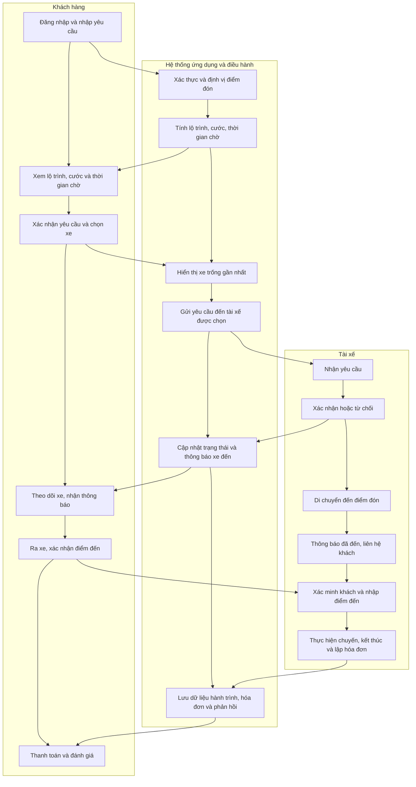

### 3.6. Dữ liệu đầu vào và đầu ra

| Nhóm dữ liệu | Trường được nêu trong nguồn |
|---|---|
| Tài khoản | User ID, password; tài khoản đăng ký; thông tin CRM nếu có |
| Booking | Điểm đón, loại xe, hiệu xe, số lượng theo loại, thời gian đón, số điện thoại liên hệ, điểm đến tùy chọn, ghi chú |
| Vị trí | Vị trí thiết bị khách hàng; vị trí xe taxi; vị trí khách mà xe đã đăng ký đón |
| Ước tính | Khoảng cách/lộ trình, cước dự kiến, thời gian chờ; đề xuất cước cố định đường dài nếu đủ điều kiện |
| Lựa chọn xe | Danh sách 5 xe trống gần nhất; khoảng cách theo đường thực; thời gian đến; loại xe; thông tin tài xế và xe; điểm đánh giá tùy chọn |
| Điều phối | Tài xế xác nhận/từ chối; trạng thái xe “đón khách”; hủy đón trên đường; thời điểm đến điểm đón |
| Trip | Điểm đến, dữ liệu đồng hồ, hướng dẫn đường, dữ liệu hành trình từ thiết bị quản lý hành trình trên xe |
| Hóa đơn | Cước đồng hồ/cố định, phụ thu đường dài, cầu đường, tip, số tài/MSNV, điểm đầu/cuối, ngày giờ |
| Thanh toán và phản hồi | Phương thức thanh toán; điểm đánh giá bắt buộc; nội dung góp ý tùy chọn |

### 3.7. Điểm bàn giao Module theo kiến trúc đề xuất

| Hoạt động | Module sở hữu/đảm nhiệm | Bàn giao |
|---|---|---|
| Tài khoản khách hàng và hồ sơ | M08 (quản trị danh tính/quyền) phối hợp M01 | Danh tính khách hàng đã xác thực cho Booking |
| Tạo và quản lý yêu cầu qua App | M01 — Booking | Booking hợp lệ, có điểm đón và thông tin dịch vụ |
| Định vị, tìm xe, hiển thị xe và lựa chọn | M03 — Dispatch & Queue | Danh sách xe đủ điều kiện và lựa chọn xe |
| Tài xế nhận/từ chối/hủy, trạng thái xe đón khách | M02 — Fleet/Driver phối hợp M03 | Trạng thái nguồn lực và kết quả Assignment |
| Đến đón, xác minh khách, bắt đầu/kết thúc chuyến | M04 — Trip | Sự kiện Trip và dữ liệu hành trình |
| Tính giá, cước đường dài, hóa đơn và thanh toán | M05 — Fare & Payment | FareResult, hóa đơn và giao dịch thanh toán |
| Doanh thu, công nợ, đối soát | M06 — Finance | Bút toán/đối soát theo loại hợp đồng DIRECT/PARTNER |
| Thông báo App, SMS/cuộc gọi hỗ trợ | M09 — Integration | Trạng thái gửi/nhận thông báo |
| Giám sát, hỗ trợ và can thiệp | M07 — Control Center | Lệnh can thiệp có phân quyền và nhật ký |
| Báo cáo vận hành/chất lượng | M10 — Reporting | Dữ liệu báo cáo từ các Module nguồn |

**Nguyên tắc kiến trúc:** App là một kênh tạo Booking và tương tác khách hàng; không sở hữu logic điều phối riêng. Sau khi Booking được xác nhận, yêu cầu đi vào cùng nền tảng Dispatch với các kênh Tổng đài, SMS, Chat và Web. DIRECT/PARTNER tiếp tục dùng chung luồng Booking–Dispatch–Trip nhưng không gộp dữ liệu hợp đồng, doanh thu, công nợ và đối soát.

### 3.8. Các điểm cần Mai Linh xác nhận

| Mã quyết định | Nội dung cần xác nhận | Căn cứ KPMG |
|---|---|---|
| P2-DEC-01 | Cơ chế đăng ký, xác thực tài khoản; có tiếp tục dùng user ID/password hay tích hợp OTP/SSO không | TO.P2.1 |
| P2-DEC-02 | Quyền truy cập vị trí thiết bị, cách xử lý khi khách từ chối cấp quyền hoặc GPS không chính xác | TO.P2.1 |
| P2-DEC-03 | Danh mục loại xe, hiệu xe, số lượng xe tối đa và quy tắc chọn thời gian đón | TO.P2.1 |
| P2-DEC-04 | Quy tắc bắt buộc/tùy chọn của số điện thoại và điểm đến; có cho đặt nhiều xe trong một Booking không | TO.P2.1 |
| P2-DEC-05 | Ngưỡng áp dụng cước đường dài; KPMG 2015 nêu trên 30 km, cần xác nhận ngưỡng và biểu giá hiện tại | TO.P2.4–P2.5, P2.19 |
| P2-DEC-06 | Thuật toán tính ETA, lộ trình thực, cước dự kiến và nguồn bản đồ/GPS | TO.P2.3, P2.6 |
| P2-DEC-07 | Có tiếp tục hiển thị đúng 5 xe gần nhất hay thay đổi số lượng; tiêu chí xếp hạng xe | TO.P2.8 |
| P2-DEC-08 | Trường thông tin tài xế/xe nào được hiển thị cho khách; có hiển thị số điện thoại và điểm đánh giá không | TO.P2.8 |
| P2-DEC-09 | Tài xế có bao lâu để xác nhận; xử lý khi từ chối/không phản hồi; có tự động chuyển sang xe khác không | TO.P2.10 |
| P2-DEC-10 | Điều kiện và hậu quả khi tài xế hủy sau khi đã nhận cuốc; cơ chế tìm xe thay thế | TO.P2.11 |
| P2-DEC-11 | Thời gian chờ khách tại điểm đón, số lần gọi, thời gian giữa các lần gọi và xử lý không liên lạc được | TO.P2.14–P2.16 |
| P2-DEC-12 | Cách xác minh người lên xe đúng là người đặt; xử lý người đặt hộ/người đi thay | TO.P2.17 |
| P2-DEC-13 | Thời điểm bắt đầu đồng hồ và quy tắc xử lý khi thay đổi điểm đến/lộ trình | TO.P2.18–P2.20 |
| P2-DEC-14 | Phương thức thanh toán còn hiệu lực; tích hợp thanh toán điện tử và phát hành hóa đơn điện tử | TO.P2.21–P2.22 |
| P2-DEC-15 | Thang điểm, thời hạn gửi đánh giá, cách xử lý khi khách không đánh giá và quy trình khiếu nại | TO.P2.23 |

### 3.9. Diễn giải thiết kế hệ thống — tách biệt với yêu cầu nguồn

Các nội dung sau là đề xuất thiết kế để bảo đảm hệ thống mới nhất quán; không phải quy định KPMG 2015:
- Tách Customer Account, Customer Profile, Booking, Dispatch Offer, Assignment, Trip, Fare, Invoice, Payment và Feedback thành các đối tượng có liên kết.
- Việc khách chọn một xe không đồng nghĩa Assignment đã được xác lập; cần có trạng thái chờ tài xế xác nhận và thời hạn phản hồi được cấu hình.
- Chỉ một Assignment đang hiệu lực cho một Booking/xe theo quy tắc đã phê duyệt; thao tác nhận xe phải có kiểm soát đồng thời.
- Khi tài xế từ chối hoặc hủy, Booking không bị mất; Dispatch tạo vòng tìm xe tiếp theo và lưu lịch sử từng lần.
- Lưu vết vị trí theo thời điểm, nguồn GPS, độ chính xác và quyền truy cập; không coi vị trí thiết bị là chính xác tuyệt đối.
- Thông tin liên hệ khách/tài xế phải được che/mở theo vai trò, mục đích và thời điểm; mọi lần truy cập cần ghi nhật ký.
- Cước dự kiến phải phân biệt với cước cuối cùng; hóa đơn chỉ được lập từ kết quả tính cước đã xác nhận theo chính sách.
- Không mặc định các phương thức thanh toán, ngưỡng 30 km, 5 xe gần nhất hay thời gian [1] phút là chính sách hiện hành.

### 3.10. Tiêu chí hoàn thành TO.P2

TO.P2 chỉ đủ điều kiện chuyển sang đặc tả Feature khi:
1. Nghiệp vụ xác nhận dữ liệu Booking và cách xác thực khách hàng.
2. Nghiệp vụ xác nhận thuật toán hiển thị xe, thứ tự ưu tiên và thông tin được công khai.
3. Có quy định rõ tài xế xác nhận/từ chối/hủy và thời hạn xử lý.
4. Có quy định rõ khách không ra xe, không nghe máy, hủy hoặc lên xe thay.
5. Chốt cách tính cước dự kiến, cước đường dài và quy trình thanh toán hiện hành.
6. Chốt quyền riêng tư/vị trí và nhật ký truy cập.
7. Có test case cho các nhánh thành công, từ chối, hủy, timeout, GPS lỗi, mất kết nối, khách không xuất hiện, sai người lên xe và thanh toán thất bại.


## 4. TO.P3 — Khách hàng yêu cầu Taxi tại Điểm tiếp thị

### 4.1. Mục tiêu và phạm vi theo KPMG

TO.P3 mô tả quy trình điều hành xe khi khách hàng yêu cầu đón tại khu vực sắp tài có nhân viên điều hành điểm của Mai Linh, từ lúc khách yêu cầu đến khi thanh toán. Chủ quy trình theo bảng tổng quan KPMG gồm Tổng đài viên, Điều hành điểm tiếp thị, Tổng đài Điều hành và Tài xế.

Đặc trưng của TO.P3 là có nhân viên điều hành tại điểm tiếp thị, có danh sách xe đăng ký sắp tài tại điểm và điều xe đón khách theo thứ tự sắp tài.

### 4.2. Vai trò tham gia

| Vai trò | Trách nhiệm theo nguồn |
|---|---|
| Khách hàng | Gặp nhân viên tại điểm tiếp thị, yêu cầu xe, lên xe, thông báo điểm đến, thanh toán và phản hồi |
| Điều hành điểm tiếp thị | Nhận yêu cầu khách; kiểm tra xe có sẵn; gửi yêu cầu xe về Tổng đài; đăng nhập/đăng xuất theo ca; theo dõi xe sắp tài; chỉ định xe khi được mở quyền; điều xe theo thứ tự sắp tài |
| Tổng đài Điều hành | Nhận yêu cầu từ điểm tiếp thị và phát yêu cầu theo Unicast/Broadcast |
| Tài xế | Nhận yêu cầu, chạy đến điểm tiếp thị, đăng ký sắp tài; nhận chỉ định; đến lượt thì đón khách và thực hiện chuyến |
| Hệ thống | Ghi nhận ca làm/vị trí điều hành điểm, phát yêu cầu, quản lý danh sách và thứ tự sắp tài, ghi nhận từ chối, hỗ trợ hành trình và dữ liệu doanh thu |

### 4.3. Luồng tổng thể

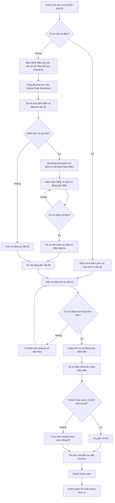

**Giới hạn của sơ đồ:** KPMG mô tả rõ nhánh có/không có xe tại điểm, gửi yêu cầu xe, đăng ký sắp tài, chỉ định khi chờ lâu và điều xe theo thứ tự. Tài liệu không mô tả chi tiết cách xử lý khách đến trong lúc hàng đợi đang có xe, hoặc khi không còn xe nào trong hàng đợi; các trường hợp này được ghi nhận để xác nhận, không tự thêm quy tắc.

### 4.4. Diễn giải các bước TO.P3.1–TO.P3.16 theo KPMG

| Mã bước | Hoạt động | Vai trò theo nguồn | Nội dung được mô tả trong KPMG |
|---|---|---|---|
| TO.P3.1 | Yêu cầu dịch vụ taxi tại điểm tiếp thị | Khách hàng | Khách gặp nhân viên tiếp thị/điều hành điểm để yêu cầu xe. Thông tin gồm địa điểm đón (thông thường ngay tại điểm tiếp thị), loại xe 4/7 chỗ và thông tin thêm nếu có |
| TO.P3.2 | Có sẵn xe tại điểm tiếp thị? | Điều hành điểm tiếp thị | Nếu có xe sẵn tại điểm thì sang TO.P3.8 theo sơ đồ mô tả; nếu không có xe thì tiếp tục TO.P3.3 |
| TO.P3.3 | Gửi yêu cầu xe đến điểm tiếp thị đón khách | Điều hành điểm tiếp thị | Gửi yêu cầu xe về Tổng đài qua ứng dụng cài trên smartphone/tablet. Điều hành điểm đăng nhập khi lên ca, đăng xuất khi xuống ca. GPS thiết bị cho biết vị trí điều hành điểm. Hệ thống ghi nhận thời gian lên/xuống ca và doanh thu của điều hành điểm làm cơ sở tính lương |
| TO.P3.4 | Phát yêu cầu xe đến tài xế theo Unicast/Broadcast | Tổng đài Điều hành | Unicast là mặc định, phát yêu cầu đến xe trống trong bán kính [xxx] km; bán kính có thể điều chỉnh. Broadcast phát đến tất cả xe trống toàn hệ thống và do Tổng đài kiểm soát bật/tắt trong tình huống đặc biệt như cao điểm hoặc thiếu xe cục bộ |
| TO.P3.5 | Chạy xe đến điểm tiếp thị và đăng ký sắp tài | Tài xế | Tài xế thấy yêu cầu trên hệ thống, chạy đến điểm tiếp thị và đăng ký sắp tài. KPMG nêu xe trong bán kính 100 m mới được đăng ký sắp tài tại điểm; tham số có thể điều chỉnh |
| TO.P3.6 | Chỉ định xe đến điểm tiếp thị sắp tài | Điều hành điểm tiếp thị | Khi điểm tiếp thị chờ xe quá lâu tính từ lúc gửi yêu cầu về Tổng đài, hệ thống mở quyền chỉ định. Điều hành điểm thấy xe trống trong bán kính tùy chọn và chỉ định xe về điểm đón khách |
| TO.P3.7 | Tài xế nhận chỉ định về điểm tiếp thị? | Tài xế | Nếu đồng ý thì sang TO.P3.8. Nếu từ chối thì quay lại TO.P3.6 để điều hành điểm chỉ định xe khác gần đó. Hệ thống ghi nhận việc từ chối và có thể trích xuất báo cáo định kỳ/khi được yêu cầu để đánh giá tài xế |
| TO.P3.8 | Đến điểm tiếp thị sắp tài | Tài xế | Tài xế xác nhận chỉ định qua ứng dụng Mai Linh Taxi và chạy xe về điểm tiếp thị |
| TO.P3.9 | Điều xe đón khách theo thứ tự sắp tài | Điều hành điểm tiếp thị | Điều hành điểm điều xe theo thứ tự sắp tài. Hệ thống lưu và hiển thị thứ tự dựa trên thứ tự tài xế đăng ký sắp tài tại điểm. Thời gian tối đa để xe nhận lượt đón khách là [60] giây; quá thời gian thì lượt chuyển sang tài xế tiếp theo. Tham số có thể điều chỉnh |
| TO.P3.10 | Khách hàng lên xe, thông báo điểm đến | Tài xế và khách hàng | Khách lên xe và thông báo điểm đến cho tài xế |
| TO.P3.11 | Tài xế bấm đồng hồ, nhập điểm đến vào ứng dụng | Tài xế và khách hàng | Tài xế bấm đồng hồ, nhập điểm đến để ứng dụng hướng dẫn chỉ đường; thông báo lộ trình cho khách. Nếu khách không thay đổi thì tài xế đi theo hướng dẫn. Nếu khách yêu cầu ước tính tiền, tài xế có thể hiển thị cước ước tính trên ứng dụng xe |
| TO.P3.12 | Có thể áp dụng cước phí đường dài? | Tài xế/Hệ thống | Sau khi nhập điểm đến, nếu đủ điều kiện, hệ thống hiển thị cước đường dài. Tài xế hỏi khách chọn cước cố định hay cước đồng hồ. Chọn cước đường dài thì chuyển TO.P9; chọn cước đồng hồ thì sang TO.P3.13 |
| TO.P3.13 | Thực hiện dịch vụ chở khách đến nơi yêu cầu | Tài xế | Tài xế chở khách đến nơi; hành trình được lưu bởi hệ thống quản lý hành trình cài đặt trên xe |
| TO.P3.14 | Kết thúc hành trình và xuất hóa đơn | Tài xế | Hóa đơn gồm doanh thu cước đồng hồ; cước cố định đường dài/phụ thu vượt lộ trình nếu có; phí cầu đường; tiền tip; số tài/MSNV; điểm đầu/cuối; ngày giờ |
| TO.P3.15 | Thanh toán | Khách hàng | Khách kiểm tra hóa đơn và thanh toán. KPMG 2015 liệt kê tiền mặt, thẻ trả sau MCC, thẻ tín dụng/thẻ ATM và voucher; có mô tả chứng từ giấy kèm theo |
| TO.P3.16 | Khách hàng phản hồi chất lượng dịch vụ | Khách hàng | Chấm điểm dịch vụ là bắt buộc; ý kiến góp ý/phàn nàn chi tiết là tùy chọn |

### 4.5. Swimlane theo vai trò

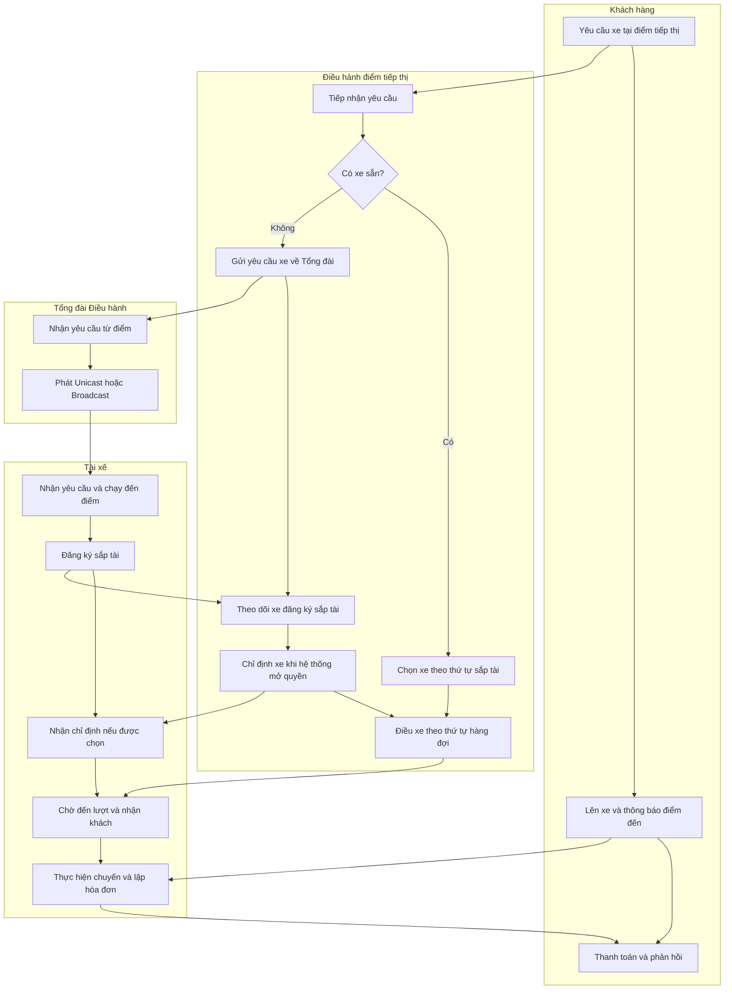

Swimlane thể hiện trách nhiệm chính, không thay thế bảng bước. Các thao tác đăng nhập/đăng xuất theo ca và ghi nhận doanh thu điều hành điểm được mô tả tại TO.P3.3; cần được đưa vào đặc tả Feature quản lý ca/điểm tiếp thị khi phân rã chức năng.

### 4.6. Dữ liệu đầu vào và đầu ra

| Nhóm dữ liệu | Trường/nội dung được nêu trong nguồn |
|---|---|
| Yêu cầu tại điểm | Điểm tiếp thị, loại xe 4/7 chỗ, thông tin thêm |
| Ca điều hành điểm | Thời điểm đăng nhập/lên ca, đăng xuất/xuống ca |
| Vị trí điểm | GPS thiết bị của điều hành điểm |
| Phát yêu cầu | Điểm tiếp thị, chế độ Unicast/Broadcast, bán kính phát |
| Xe sắp tài | Xe/tài xế đăng ký tại điểm; vị trí xe; thứ tự đăng ký |
| Chỉ định | Xe được điều hành điểm chỉ định; kết quả nhận/từ chối |
| Điều xe | Thứ tự hàng đợi; thời hạn nhận lượt [60] giây |
| Trip | Điểm đến, đồng hồ, hướng dẫn lộ trình, dữ liệu hành trình |
| Hóa đơn | Cước đồng hồ/cố định, phụ thu đường dài, cầu đường, tip, số tài/MSNV, điểm đầu/cuối, ngày giờ |
| Kết quả | Thanh toán và phản hồi chất lượng |

### 4.7. Điểm bàn giao Module theo kiến trúc đề xuất

| Hoạt động | Module sở hữu/đảm nhiệm | Bàn giao |
|---|---|---|
| Danh mục điểm tiếp thị, địa chỉ, phân loại và giới hạn sắp tài | M03 — Dispatch & Queue (quản lý năng lực điểm/queue) | Cấu hình điểm tiếp thị và sức chứa hàng đợi |
| Hồ sơ, trạng thái và vị trí xe/tài xế | M02 — Fleet/Driver | Nguồn lực trống đủ điều kiện |
| Tạo yêu cầu điều xe từ điểm tiếp thị | M01 — Booking | Booking gắn điểm tiếp thị/điểm đón |
| Phát yêu cầu, Unicast/Broadcast, đăng ký sắp tài, chỉ định, thứ tự FIFO | M03 — Dispatch & Queue | Assignment và thứ tự queue |
| Ca làm, đăng nhập/đăng xuất và quyền điều hành điểm | M08 — Identity & Access phối hợp M07 | Phiên làm việc, phân quyền và nhật ký |
| Đến đón, bắt đầu/kết thúc Trip, hành trình | M04 — Trip | Sự kiện Trip |
| Biểu giá, hóa đơn và thanh toán | M05 — Fare & Payment | Kết quả tính cước và giao dịch |
| Doanh thu, công nợ và đối soát | M06 — Finance | Dữ liệu tài chính theo DIRECT/PARTNER |
| Màn hình giám sát và quyền can thiệp | M07 — Control Center | Lệnh điều hành có phân quyền |
| Thông báo và tích hợp ứng dụng | M09 — Integration | Sự kiện thông báo |
| Báo cáo xe từ chối chỉ định, ca và hoạt động điểm | M10 — Reporting | Dữ liệu báo cáo từ Module nguồn |

**Lưu ý kiến trúc:** Theo phân rã Module đã thống nhất, Điểm tiếp thị và hàng đợi xe là năng lực thuộc M03 — Dispatch & Queue, không mặc định tạo một Module độc lập. Việc quản lý ca nhân viên, quyền thao tác và ghi nhận phục vụ tính lương cần được làm rõ với HR/Finance trước khi thiết kế dữ liệu chấm công/doanh thu điều hành điểm.

### 4.8. Các điểm cần Mai Linh xác nhận

| Mã quyết định | Nội dung cần xác nhận | Căn cứ KPMG |
|---|---|---|
| P3-DEC-01 | Danh sách điểm tiếp thị, địa chỉ, tọa độ, trạng thái hoạt động và người quản lý | TO.P3.1–P3.3; yêu cầu TO.C.5 |
| P3-DEC-02 | Phân loại điểm tiếp thị bình thường/đặc biệt và quy tắc vận hành khác nhau | TO.C.5 |
| P3-DEC-03 | Quy trình tạo Booking tại điểm: nhân viên nhập những trường nào, có bắt buộc số điện thoại/điểm đến không | TO.P3.1 |
| P3-DEC-04 | Thiết bị, tài khoản, cách xác thực và quy tắc bàn giao ca của điều hành điểm | TO.P3.3 |
| P3-DEC-05 | Cách tính doanh thu/hiệu quả điều hành điểm và việc sử dụng dữ liệu này trong tính lương | TO.P3.3 |
| P3-DEC-06 | Bán kính Unicast cho điểm tiếp thị; KPMG để [xxx] km | TO.P3.4 |
| P3-DEC-07 | Bán kính 100 m cho phép đăng ký sắp tài còn phù hợp không | TO.P3.5 |
| P3-DEC-08 | Định nghĩa “chờ xe quá lâu” để mở quyền chỉ định; ai được thay đổi tham số | TO.P3.6 |
| P3-DEC-09 | Bán kính xe trống được hiển thị để điều hành điểm chỉ định | TO.P3.6 |
| P3-DEC-10 | Có giới hạn số lần tài xế từ chối chỉ định, thời gian phản hồi và cơ chế xử lý tiếp theo không | TO.P3.7 |
| P3-DEC-11 | Thứ tự sắp tài có đúng FIFO theo thời điểm đăng ký hay có ngoại lệ theo loại xe/điểm/điều kiện khác | TO.P3.9 |
| P3-DEC-12 | Thời hạn 60 giây để xe nhận lượt; bắt đầu tính từ thời điểm nào và xử lý khi quá hạn | TO.P3.9 |
| P3-DEC-13 | Quy tắc xử lý khi khách yêu cầu loại xe không phù hợp với xe đầu hàng đợi | TO.P3.1, P3.9 |
| P3-DEC-14 | Ngưỡng và biểu giá cước đường dài, phương thức thanh toán còn hiệu lực | TO.P3.12–P3.15 |
| P3-DEC-15 | Thang điểm, cách tiếp nhận và xử lý phản hồi khách hàng tại điểm | TO.P3.16 |

### 4.9. Diễn giải thiết kế hệ thống — tách biệt với yêu cầu nguồn

Các nội dung sau là đề xuất thiết kế, không phải quy định trực tiếp của KPMG:
- Một điểm tiếp thị cần có định danh, tọa độ, vùng địa lý, loại điểm, giờ hoạt động, sức chứa queue, cấu hình xe phục vụ và trạng thái hoạt động.
- Một phiên làm việc của điều hành điểm cần gắn người dùng, điểm tiếp thị, thời điểm bắt đầu/kết thúc, thiết bị và nhật ký thao tác.
- Queue cần lưu thứ tự vào hàng, thời điểm vào hàng, vị trí hiện tại, trạng thái, lịch sử chuyển lượt và lý do bỏ lượt.
- Quy tắc FIFO cần được áp dụng trong phạm vi nhóm xe đủ điều kiện; việc lọc theo loại xe/Booking phải được nghiệp vụ phê duyệt để tránh bỏ qua lượt không minh bạch.
- Chỉ định xe cần kiểm tra xe còn trống, vị trí, năng lực và trạng thái trước khi gửi; việc nhận chỉ định phải có thời hạn và ghi nhận kết quả.
- Cần phân biệt “xe đến điểm tiếp thị đăng ký sắp tài” với “xe được phân công đón khách”; đây là hai sự kiện/trạng thái khác nhau.
- Dữ liệu doanh thu điều hành điểm không nên tự động coi là thu nhập/lương nếu chưa có công thức và phê duyệt của HR/Finance.
- Mọi thay đổi thứ tự queue hoặc bỏ qua lượt phải có lý do, người thực hiện và nhật ký kiểm toán.

### 4.10. Tiêu chí hoàn thành TO.P3

TO.P3 chỉ đủ điều kiện chuyển sang đặc tả Feature khi:
1. Danh mục điểm tiếp thị, tọa độ, phân loại và năng lực điểm được xác nhận.
2. Quy trình lên ca/xuống ca và quyền của điều hành điểm được phê duyệt.
3. Chốt bán kính phát, bán kính đăng ký sắp tài và điều kiện mở quyền chỉ định.
4. Chốt quy tắc FIFO, điều kiện xe phù hợp và thời hạn nhận lượt.
5. Chốt cách ghi nhận từ chối chỉ định và báo cáo đánh giá tài xế.
6. Chốt cách ghi nhận doanh thu/hiệu quả điều hành điểm và quan hệ với tính lương.
7. Có test case cho điểm không có xe, phát Unicast/Broadcast, xe vào queue, chỉ định bị từ chối, quá hạn 60 giây, xe không phù hợp loại xe, khách lên xe, tính cước và thanh toán.


## 5. TO.P4 — Khách yêu cầu tại Khu vực sắp tài không có nhân viên điều hành điểm

### 5.1. Mục tiêu và phạm vi theo KPMG

Quy trình mô tả việc điều hành xe khi khách hàng yêu cầu đón tại khu vực sắp tài do Mai Linh định nghĩa trên hệ thống, nhưng không có nhân viên điều hành điểm. Phạm vi từ lúc tiếp nhận yêu cầu đến khi khách hàng thanh toán dịch vụ. Chủ quy trình được nêu là Tổng đài Điều hành và Tài xế.

Khách hàng có thể yêu cầu qua điện thoại, chat hoặc SMS. Nếu điểm đón không thuộc khu vực sắp tài được cấu hình, yêu cầu được chuyển về quy trình tiếp nhận tương ứng (TO.P1, TO.P2, TO.P5, TO.P6 hoặc TO.P7).

### 5.2. Vai trò tham gia

| Vai trò | Trách nhiệm được mô tả trong nguồn |
|---|---|
| Khách hàng | Cung cấp điểm đón, loại xe, hiệu xe, số điện thoại và thông tin thêm; lên xe, thông báo điểm đến, thanh toán và phản hồi |
| Tổng đài Điều hành | Xác định điểm đón có thuộc khu vực sắp tài; kiểm tra xe sẵn có; phát yêu cầu Unicast/Broadcast; chỉ định xe về khu vực; điều xe theo thứ tự sắp tài |
| Tài xế | Xem yêu cầu, chạy đến khu vực và đăng ký sắp tài; nhận/từ chối chỉ định; xác nhận và đến khu vực; nhận lượt đón khách; thực hiện chuyến |
| Hệ thống | Quản lý danh mục khu vực sắp tài; phát yêu cầu; ghi nhận đăng ký, vị trí, thứ tự queue, chỉ định/từ chối; hỗ trợ hành trình, hóa đơn, thanh toán và báo cáo |
| Tổng đài viên / kênh tiếp nhận | Tiếp nhận nội dung khách qua điện thoại, chat hoặc SMS theo quy trình/kênh tương ứng; KPMG không mô tả chi tiết thao tác của từng kênh trong TO.P4 |

### 5.3. Luồng tổng thể

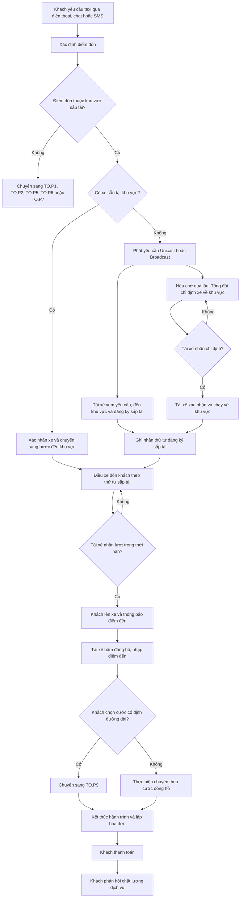

**Điểm cần đọc đúng:** TO.P4.3 nêu trường hợp có xe sẵn thì chuyển đến TO.P4.8; TO.P4.8 là tài xế xác nhận chỉ định và chạy về khu vực. KPMG không giải thích rõ “xe sẵn” đã ở trong khu vực hay cần thực hiện thao tác xác nhận nào. Sơ đồ nghiệp vụ phía trên giữ nguyên nhánh nguồn và đánh dấu đây là nội dung cần xác nhận, không tự suy diễn rằng xe đã có sẵn thì được bỏ qua toàn bộ kiểm tra trạng thái.

### 5.4. Diễn giải các bước TO.P4.1–TO.P4.16 theo KPMG

| Mã bước | Hoạt động | Vai trò theo nguồn | Nội dung được mô tả trong KPMG |
|---|---|---|---|
| TO.P4.1 | Yêu cầu dịch vụ taxi | Khách hàng | Khách yêu cầu qua điện thoại, chat hoặc SMS. Thông tin gồm địa điểm đón; loại xe 7 chỗ/4 chỗ; hiệu xe; số điện thoại di động hoặc điện thoại bàn; thông tin thêm nếu có |
| TO.P4.2 | Điểm đón khách nằm trong khu vực sắp tài? | Tổng đài Điều hành | Nếu thuộc khu vực sắp tài thì sang TO.P4.3. Nếu không thuộc thì chuyển sang quy trình tiếp nhận tương ứng: TO.P1, TO.P2, TO.P5, TO.P6 hoặc TO.P7 |
| TO.P4.3 | Có sẵn xe tại khu vực sắp tài? | Tổng đài Điều hành | Nếu có xe sẵn thì chuyển sang TO.P4.8. Nếu không có thì tiếp tục TO.P4.4 |
| TO.P4.4 | Phát yêu cầu xe theo Unicast/Broadcast | Tổng đài Điều hành | Unicast mặc định, phát đến xe trống trong bán kính [xxx] km và có thể điều chỉnh. Broadcast phát đến tất cả xe trống toàn hệ thống; Tổng đài kiểm soát bật/tắt trong tình huống đặc biệt như cao điểm hoặc thiếu xe cục bộ |
| TO.P4.5 | Chạy xe đến khu vực sắp tài và đăng ký sắp tài | Tài xế | Tài xế thấy yêu cầu, chạy đến khu vực và đăng ký sắp tài. KPMG nêu xe trong bán kính [100] m mới được đăng ký; tham số có thể điều chỉnh |
| TO.P4.6 | Chỉ định xe đến khu vực sắp tài | Tổng đài Điều hành | Khi khu vực chờ xe quá lâu, tính từ lúc Tổng đài phát yêu cầu, hệ thống thực hiện chỉ định xe về khu vực |
| TO.P4.7 | Tài xế nhận chỉ định về khu vực sắp tài? | Tài xế | Nếu đồng ý thì sang TO.P4.8. Nếu từ chối thì quay lại TO.P4.6 để Tổng đài chỉ định xe khác gần đó. Hệ thống ghi nhận việc từ chối và định kỳ sinh báo cáo tài xế từ chối chỉ định |
| TO.P4.8 | Đến khu vực sắp tài | Tài xế | Tài xế xác nhận chỉ định qua ứng dụng Mai Linh Taxi và chạy xe về khu vực sắp tài |
| TO.P4.9 | Điều xe đón khách theo thứ tự sắp tài | Tổng đài Điều hành | Tổng đài điều xe theo thứ tự sắp tài do hệ thống lưu và hiển thị theo thứ tự tài xế đăng ký. Thời gian tối đa nhận lượt là [60 giây]; quá thời gian thì chuyển lượt sang tài xế tiếp theo. Tham số có thể điều chỉnh |
| TO.P4.10 | Khách hàng lên xe, thông báo điểm đến | Khách hàng | Khách lên xe và thông báo điểm đến cho tài xế |
| TO.P4.11 | Tài xế bấm đồng hồ, nhập điểm đến vào ứng dụng | Tài xế và khách hàng | Tài xế bấm đồng hồ, nhập điểm đến để ứng dụng hướng dẫn đường; thông báo lộ trình cho khách. Nếu khách không thay đổi thì tài xế đi theo hướng dẫn. Khi khách yêu cầu, tài xế có thể hiển thị cước ước tính |
| TO.P4.12 | Có thể áp dụng cước phí đường dài? | Tài xế / Hệ thống | Sau khi nhập điểm đến, nếu đủ điều kiện thì hệ thống hiển thị cước đường dài. Tài xế hỏi khách chọn cước cố định đường dài hay cước đồng hồ. Chọn cước đường dài thì chuyển TO.P9; chọn cước đồng hồ thì sang TO.P4.13 |
| TO.P4.13 | Thực hiện dịch vụ chở khách đến nơi yêu cầu | Tài xế | Tài xế chở khách đến nơi; hành trình được lưu vết bởi hệ thống quản lý hành trình cài đặt trên xe |
| TO.P4.14 | Kết thúc hành trình và xuất hóa đơn | Tài xế | Hóa đơn gồm cước đồng hồ; cước cố định đường dài và phụ thu vượt lộ trình nếu có; phí cầu đường do tài xế nhập; tiền tip do tài xế nhập; số tài/MSNV; điểm đầu/cuối; ngày giờ |
| TO.P4.15 | Thanh toán | Khách hàng | Khách kiểm tra hóa đơn và thanh toán. KPMG 2015 liệt kê tiền mặt, thẻ trả sau MCC, thẻ tín dụng/thẻ ATM và voucher; nguồn còn mô tả chứng từ giấy kèm theo |
| TO.P4.16 | Khách hàng phản hồi chất lượng dịch vụ | Khách hàng | Chấm điểm dịch vụ là bắt buộc theo nguồn; ý kiến góp ý/phàn nàn chi tiết là tùy chọn. Kênh được nêu gồm ứng dụng Mai Linh Taxi và gọi tổng đài |

### 5.5. Swimlane theo vai trò

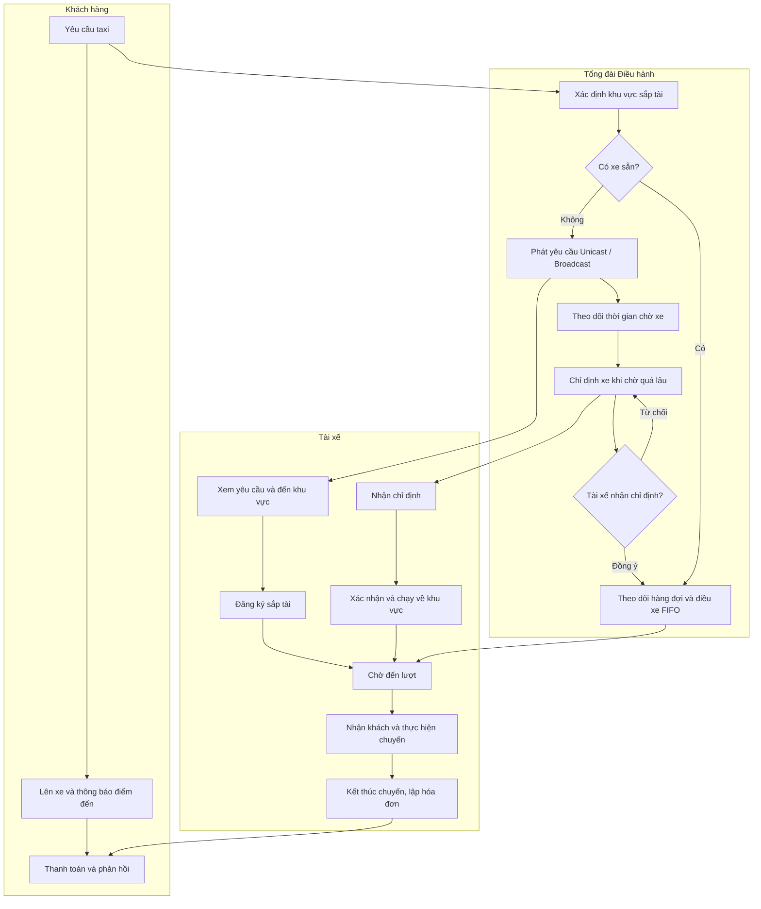

Swimlane là sơ đồ trách nhiệm khái quát. Trường hợp xe sẵn tại khu vực và quan hệ giữa TO.P4.3 với TO.P4.8 cần được nghiệp vụ xác nhận trước khi chốt luồng triển khai.

### 5.6. Dữ liệu đầu vào và đầu ra

| Nhóm dữ liệu | Trường/nội dung được nêu trong nguồn |
|---|---|
| Yêu cầu Booking | Điểm đón, loại xe 4/7 chỗ, hiệu xe, số điện thoại di động/điện thoại bàn, thông tin thêm |
| Phân vùng | Khu vực sắp tài do Mai Linh định nghĩa trên hệ thống; điểm đón và kết quả xác định thuộc/không thuộc vùng |
| Phát yêu cầu | Khu vực đích, chế độ Unicast/Broadcast, bán kính phát |
| Xe đăng ký sắp tài | Xe/tài xế, vị trí, thời điểm đăng ký và thứ tự queue |
| Chỉ định | Xe được chỉ định, thời điểm phát lệnh, kết quả nhận/từ chối và lịch sử từ chối |
| Điều xe | Thứ tự hàng đợi; thời hạn nhận lượt [60] giây |
| Trip | Điểm đến, đồng hồ, lộ trình và dữ liệu hành trình |
| Hóa đơn | Cước đồng hồ/cố định đường dài, phụ thu, phí cầu đường, tip, số tài/MSNV, điểm đầu/cuối, ngày giờ |
| Kết quả | Phương thức và kết quả thanh toán; điểm đánh giá; ý kiến khách hàng nếu có |

### 5.7. Điểm bàn giao Module theo kiến trúc đề xuất

| Hoạt động nghiệp vụ | Module sở hữu/đảm nhiệm | Bàn giao |
|---|---|---|
| Tiếp nhận Booking từ kênh điện thoại/chat/SMS | M01 — Booking phối hợp M09 — Integration | Booking chuẩn hóa có điểm đón và kênh nguồn |
| Danh mục, tọa độ và vùng địa lý khu vực sắp tài | M03 — Dispatch & Queue | Khu vực sắp tài đang hoạt động và cấu hình vùng |
| Hồ sơ, trạng thái, vị trí và khả năng phục vụ của xe/tài xế | M02 — Fleet/Driver | Danh sách nguồn lực đủ điều kiện |
| Phát yêu cầu, Unicast/Broadcast, đăng ký queue, chỉ định, FIFO và chuyển lượt | M03 — Dispatch & Queue | Offer, đăng ký queue và Assignment |
| Đến đón, bắt đầu/kết thúc Trip, hành trình | M04 — Trip | Sự kiện Trip và dữ liệu hành trình |
| Biểu giá, tính cước, hóa đơn và thanh toán | M05 — Fare & Payment | Kết quả tính cước và giao dịch |
| Doanh thu, công nợ và đối soát | M06 — Finance | Dữ liệu tài chính đã xác minh, phân tách DIRECT/PARTNER |
| Màn hình giám sát và can thiệp điều hành | M07 — Control Center | Lệnh điều hành có phân quyền và nhật ký |
| Người dùng, vai trò, quyền và nhật ký truy cập | M08 — Identity & Access | Quyền thao tác và dấu vết kiểm toán |
| Kết nối tổng đài, SMS, Chat và thông báo | M09 — Integration | Sự kiện/kết quả giao tiếp với kênh |
| Báo cáo xe từ chối chỉ định, nhu cầu và hiệu quả vận hành | M10 — Reporting | Báo cáo từ dữ liệu Module nguồn |

### 5.8. Các điểm cần Mai Linh xác nhận

| Mã quyết định | Nội dung cần xác nhận | Căn cứ KPMG |
|---|---|---|
| P4-DEC-01 | Danh sách khu vực sắp tài, tọa độ/ranh giới địa lý, trạng thái hoạt động và đơn vị quản lý | Mô tả TO.P4: khu vực do Mai Linh định nghĩa trên hệ thống |
| P4-DEC-02 | Kênh nào được phép tạo yêu cầu tại khu vực sắp tài; cách xác định đúng khu vực khi khách gọi/chat/SMS | TO.P4.1–P4.2 |
| P4-DEC-03 | Quy tắc xử lý khi điểm đón nằm ngoài khu vực sắp tài và cách chuyển tiếp Booking giữa các quy trình/kênh | TO.P4.2 |
| P4-DEC-04 | Định nghĩa “có sẵn xe tại khu vực”; điều kiện xe hợp lệ và ý nghĩa chuyển TO.P4.3 sang TO.P4.8 | TO.P4.3, TO.P4.8 |
| P4-DEC-05 | Bán kính Unicast; KPMG để [xxx] km | TO.P4.4 |
| P4-DEC-06 | Có tiếp tục dùng Broadcast toàn hệ thống và ai có quyền bật/tắt | TO.P4.4 |
| P4-DEC-07 | Bán kính [100] m cho phép đăng ký sắp tài; cách xác minh vị trí GPS và sai số cho phép | TO.P4.5 |
| P4-DEC-08 | Ngưỡng “chờ quá lâu” tính từ lúc phát yêu cầu để kích hoạt chỉ định xe | TO.P4.6 |
| P4-DEC-09 | Tiêu chí chọn xe chỉ định: khoảng cách đường thực tế, trạng thái, loại xe, vùng hoạt động và giới hạn số lần từ chối | TO.P4.6–P4.7 |
| P4-DEC-10 | Thời gian phản hồi chỉ định, số lần từ chối và hậu quả khi tài xế liên tục từ chối | TO.P4.7 |
| P4-DEC-11 | Quy tắc FIFO, điều kiện đủ tư cách vào queue và xử lý khi xe rời vùng/ mất GPS | TO.P4.5, TO.P4.9 |
| P4-DEC-12 | Thời hạn [60 giây] nhận lượt; thời điểm bắt đầu tính và cách xử lý khi hết hạn | TO.P4.9 |
| P4-DEC-13 | Xử lý khi xe đầu queue không phù hợp loại xe khách yêu cầu hoặc không thể nhận cuốc | TO.P4.1, TO.P4.9 |
| P4-DEC-14 | Ngưỡng, biểu giá và điều kiện cước đường dài; phương thức thanh toán còn hiệu lực | TO.P4.12–P4.15 |
| P4-DEC-15 | Kênh đánh giá, thang điểm, tính bắt buộc và quy trình xử lý phản hồi | TO.P4.16 |

### 5.9. Diễn giải thiết kế hệ thống — tách biệt với yêu cầu nguồn

Các nội dung sau là đề xuất thiết kế, không phải quy định trực tiếp của KPMG:
- Mỗi khu vực sắp tài nên có mã định danh, tên, ranh giới địa lý (polygon/geofence), trạng thái hoạt động, giờ áp dụng, loại xe phục vụ và cấu hình điều phối.
- Việc xác định điểm đón thuộc khu vực phải dùng tọa độ đã chuẩn hóa; cần có phương án khi địa chỉ không định vị được hoặc GPS không chính xác.
- “Xe sẵn tại khu vực”, “xe được chỉ định chạy về khu vực”, “xe đã đến khu vực” và “xe đăng ký queue” phải là các điều kiện/sự kiện riêng, không gộp thành một trạng thái.
- Queue phải lưu thời điểm đăng ký, thứ tự, trạng thái, lần chuyển lượt và lý do bỏ lượt; mọi thao tác điều chỉnh thủ công phải có người thực hiện và nhật ký.
- Không được mặc định việc tài xế nhận chỉ định về khu vực đồng nghĩa với được phân công một Booking cụ thể. Đây là luồng đưa xe đến vùng chờ, khác với Assignment đón một khách.
- Khi chuyển lượt do hết [60 giây], hệ thống cần ghi nhận lượt bị bỏ qua và giữ lịch sử để có thể giải trình; quy tắc quay lại cuối hàng hay giữ vị trí phải do nghiệp vụ phê duyệt.
- DIRECT và PARTNER dùng chung năng lực Dispatch/Queue nhưng Booking, hợp đồng, doanh thu, công nợ và quyết toán phải giữ đúng phạm vi đối tác/đơn vị sở hữu theo kiến trúc chung.
- Mọi ngưỡng khoảng cách/thời gian phải là cấu hình có hiệu lực theo khu vực và phiên bản, không hard-code từ tài liệu KPMG 2015.

### 5.10. Tiêu chí hoàn thành TO.P4

TO.P4 chỉ đủ điều kiện chuyển sang đặc tả Feature khi:
1. Danh mục khu vực sắp tài và ranh giới địa lý được xác nhận.
2. Chốt cách nhận diện điểm đón thuộc/không thuộc khu vực và cách chuyển Booking sang quy trình phù hợp.
3. Làm rõ nhánh “có sẵn xe” tại TO.P4.3 và quan hệ với TO.P4.8.
4. Chốt Unicast/Broadcast, bán kính phát, bán kính đăng ký và điều kiện chỉ định xe.
5. Chốt cách đo thời gian chờ lâu, thời hạn phản hồi chỉ định và cách xử lý từ chối.
6. Chốt FIFO, điều kiện vào queue, thời hạn nhận lượt và quy tắc chuyển lượt.
7. Chốt biểu giá đường dài, thanh toán và phản hồi khách theo chính sách hiện hành.
8. Có test case cho điểm đón trong/ngoài khu vực, có/không có xe, Unicast/Broadcast, GPS ngoài bán kính, từ chối chỉ định, mất kết nối, FIFO, quá hạn nhận lượt, loại xe không phù hợp, Trip, hóa đơn và thanh toán.


## 6. TO.P5 — Khách hàng yêu cầu Taxi qua SMS

### 6.1. Mục tiêu và phạm vi theo KPMG
Khách hàng dùng điện thoại di động gửi SMS đến tổng đài để yêu cầu taxi. Tin nhắn phải theo cú pháp quy ước. Hệ thống kiểm tra cú pháp, tạo mã đặt chỗ, phản hồi khách, phát yêu cầu đến tài xế, theo dõi điều xe và hoàn tất chuyến. Đặt xe trước chuyển TO.P8.

### 6.2. Vai trò tham gia
| Vai trò | Trách nhiệm theo nguồn |
|---|---|
| Khách hàng | Soạn/gửi SMS yêu cầu; nhận mã và tin cập nhật; gửi SMS hủy; gọi nhắc; lên xe, thanh toán, phản hồi |
| Hệ thống tiếp nhận SMS | Nhận SMS, kiểm tra cú pháp, tạo mã đặt chỗ, gửi phản hồi và cập nhật |
| Tổng đài Điều hành | Phát Unicast/Broadcast; theo dõi khách chờ lâu; chỉ định xe; xử lý thiếu xe và từ chối |
| Tổng đài viên | Thông báo không có xe; nhập hủy; tra cứu yêu cầu và ghi nhận số lần khách gọi nhắc |
| Tài xế | Theo dõi yêu cầu, đăng ký/hủy đăng ký, nhận/từ chối chỉ định, đến đón, liên hệ khách và thực hiện chuyến |

### 6.3. Cú pháp SMS theo tài liệu KPMG
**Địa chỉ chi tiết**
```text
DK [Loại xe] [Số nhà] [Đường] [Phường] [Quận] [Tỉnh/Thành] [Giờ đón] [Ngày đón]
DK 7 115 NguyenHue BenNghe 1 HCM 0700 030315
```
**Địa danh cụ thể**
```text
DK [Loại xe] [Địa danh] [Giờ đón] [Ngày đón]
DK 7 Sunwah 0700 030315
```
Đây là cú pháp/ví dụ lịch sử năm 2015, chưa phải chuẩn SMS hiện hành. Cần xác nhận cú pháp chính thức, định dạng ngày giờ, chuẩn hóa địa chỉ và hỗ trợ dấu tiếng Việt.

### 6.4. Luồng tổng thể
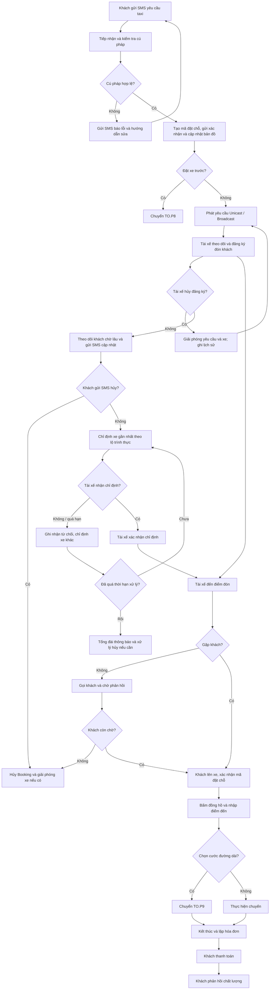
Lưu đồ là tổng hợp nghiệp vụ. Những dẫn chiếu bước không nhất quán của KPMG được ghi nhận ở mục 6.11, không tự sửa mã nguồn.

### 6.5. Diễn giải các bước TO.P5.1–TO.P5.29 theo KPMG
| Mã bước | Hoạt động | Vai trò theo nguồn | Nội dung được mô tả |
|---|---|---|---|
| TO.P5.1 | Nhắn tin yêu cầu dịch vụ taxi | Khách hàng | Gửi SMS theo cú pháp địa chỉ chi tiết hoặc địa danh; gồm loại xe, điểm đón, giờ/ngày đón |
| TO.P5.2 | Kiểm tra cú pháp | Tổng đài Điều hành / Hệ thống | Sai cú pháp: gửi tin báo lỗi để khách sửa; đúng: sang P5.3 |
| TO.P5.3 | Xác nhận tin nhắn | Tổng đài Điều hành / Hệ thống | Sinh mã đặt chỗ, gửi mã cho khách và cập nhật điểm đón lên bản đồ |
| TO.P5.4 | Đặt chỗ trước? | Tổng đài Điều hành | Đặt trước chuyển TO.P8; đi ngay sang P5.5 |
| TO.P5.5 | Phát yêu cầu Unicast/Broadcast | Tổng đài Điều hành | Unicast mặc định đến xe trống trong bán kính [xxx] km; Broadcast đến xe trống toàn hệ thống, do Tổng đài bật/tắt khi cao điểm/thiếu xe. Có cảnh báo nhu cầu tăng và danh sách khách chờ lâu, gồm cả đã/chưa có xe đăng ký |
| TO.P5.6 | Theo dõi điểm đón được phát | Tài xế | Theo dõi yêu cầu Unicast/Broadcast và có thể chọn nhận Unicast hoặc chạy theo Broadcast ở khu vực cao điểm |
| TO.P5.7 | Đăng ký đón khách | Tài xế | Nhấn đăng ký trên ứng dụng; mỗi thời điểm chỉ đăng ký một yêu cầu. Vẫn thấy yêu cầu khác; xe ở trạng thái “đón khách”. Ứng dụng hiển thị 10 yêu cầu chưa đăng ký gần nhất theo lộ trình thực; ngoài bán kính [xxx] km có thể thấy nhưng không đăng ký được |
| TO.P5.8 | Hủy đăng ký đón khách? | Tài xế | Hủy thì Booking về “chưa có xe đăng ký”, hiển thị lại trong bán kính phát; xe về trạng thái trống. Hệ thống ghi lịch sử và hỗ trợ báo cáo tuần/tháng/quý. Không hủy thì tài xế đến điểm đón (P5.19) |
| TO.P5.9 | Gửi SMS cập nhật tình hình xe | Tổng đài Điều hành / Hệ thống | Dựa trên danh sách khách chờ lâu chưa có xe, gửi SMS theo kênh nguồn. Mẫu nguồn có mã đặt chỗ và đề nghị chờ thêm [xxx] phút |
| TO.P5.10 | Nhắn tin hủy đặt xe | Khách hàng / Hệ thống | Khách không đồng ý chờ thì gửi cú pháp “HUY [Mã số đặt xe]”; hệ thống tự hủy mã và trả xe đã đăng ký (nếu có) về trạng thái trống. Không gửi SMS hủy thì hệ thống vẫn tiếp tục chỉ định xe |
| TO.P5.11 | Chỉ định xe rước khách | Tổng đài Điều hành / Hệ thống | Với khách chờ lâu chưa gửi hủy, hệ thống chọn xe gần nhất theo lộ trình giao thông thực để chỉ định |
| TO.P5.12 | Tài xế từ chối chỉ định? | Tài xế / Hệ thống | Nhấn từ chối hoặc không chấp nhận trong [xxx] phút được xem là từ chối; hệ thống ghi báo cáo và chỉ định xe khác. Chấp nhận chuyển P5.18 |
| TO.P5.13 | Cần thông báo khách không có xe? | Tổng đài viên | Nếu đã chỉ định nhiều xe trong [xxx] phút mà chưa có xe đăng ký thì cần thông báo; nếu còn thời hạn thì tiếp tục chỉ định. Hệ thống ghi nhận báo cáo từ chối; dừng chỉ định khi Tổng đài viên nhập hủy |
| TO.P5.14 | Thông báo khách hàng không có xe | Tổng đài viên | Thông báo khi đã chỉ định nhiều xe trong [xxx] phút mà vẫn không có xe; chi tiết cần đối chiếu lưu đồ gốc |
| TO.P5.15 | Hủy yêu cầu đặt xe | Tổng đài viên | Nếu khách không chờ, nhập hủy; yêu cầu biến khỏi danh sách chờ, bản đồ và ứng dụng tài xế; xe đã đăng ký trở về trạng thái trống |
| TO.P5.16 | Khách hàng gọi nhắc | Khách hàng | Khách chờ lâu có thể gọi Tổng đài viên để nhắc xe |
| TO.P5.17 | Ghi nhận số lần nhắc | Tổng đài viên / Hệ thống | Tra cứu theo số điện thoại hoặc mã đặt chỗ; chọn yêu cầu và nhập số lần nhắc. Hiển thị xe đã đăng ký hay chưa và ETA để thông báo khách |
| TO.P5.18 | Nhận chỉ định đón khách | Tài xế | Ứng dụng hiển thị yêu cầu được chỉ định; tài xế nhấn đồng ý. Nguồn ghi chú tài xế vẫn nhìn thấy các yêu cầu khác |
| TO.P5.19 | Đến điểm đón khách | Tài xế | Tài xế đến điểm đón |
| TO.P5.20 | Thấy khách? | Tài xế | Có khách sang P5.23; không thấy sang P5.21 |
| TO.P5.21 | Gọi khách báo xe đến | Tài xế | Gọi khách; nếu không liên lạc được có thể báo cáo để nhận cuốc khác. Thời gian chờ khách cần Mai Linh quy định theo vị trí |
| TO.P5.22 | Khách hàng phản hồi | Khách hàng / Tổng đài viên | Khách hủy: Tổng đài viên nhập hủy theo P5.15; khách còn chờ: yêu cầu ra xe và sang P5.23. Nếu không bắt máy, cần quy định số lần gọi lại và thời gian |
| TO.P5.23 | Khách lên xe, thông báo điểm đến | Tài xế / Khách hàng | Khách thông báo điểm đến; tài xế xác nhận mã đặt chỗ. Nếu không có mã/chưa gọi tổng đài hoặc mã không khớp, tài xế báo hủy đăng ký đón nhầm và liên hệ Tổng đài |
| TO.P5.24 | Bấm đồng hồ, nhập điểm đến | Tài xế | Nhập điểm đến để ứng dụng dẫn đường; thông báo lộ trình; có thể hiển thị cước ước tính khi khách yêu cầu |
| TO.P5.25 | Có thể áp dụng cước đường dài? | Tài xế / Hệ thống | Nếu đủ điều kiện, hiển thị cước đường dài; khách chọn cước cố định hay đồng hồ. Cước đường dài chuyển TO.P9; cước đồng hồ sang P5.26 |
| TO.P5.26 | Thực hiện dịch vụ chở khách | Tài xế | Chở khách đến nơi; hành trình lưu trên hệ thống quản lý hành trình trên xe |
| TO.P5.27 | Kết thúc và xuất hóa đơn | Tài xế | Hóa đơn gồm cước đồng hồ, cước cố định/phụ thu đường dài nếu có, phí cầu đường, tip, số tài/MSNV, điểm đầu/cuối, ngày giờ |
| TO.P5.28 | Thanh toán | Khách hàng | Khách kiểm tra và thanh toán. KPMG 2015 liệt kê tiền mặt, MCC, thẻ tín dụng/thẻ ATM, voucher và chứng từ giấy |
| TO.P5.29 | Phản hồi chất lượng dịch vụ | Khách hàng | Chấm điểm bắt buộc theo nguồn; góp ý/phàn nàn tùy chọn. Kênh gồm ứng dụng, khách gọi Tổng đài hoặc Tổng đài gọi ngẫu nhiên |

### 6.6. Swimlane theo vai trò
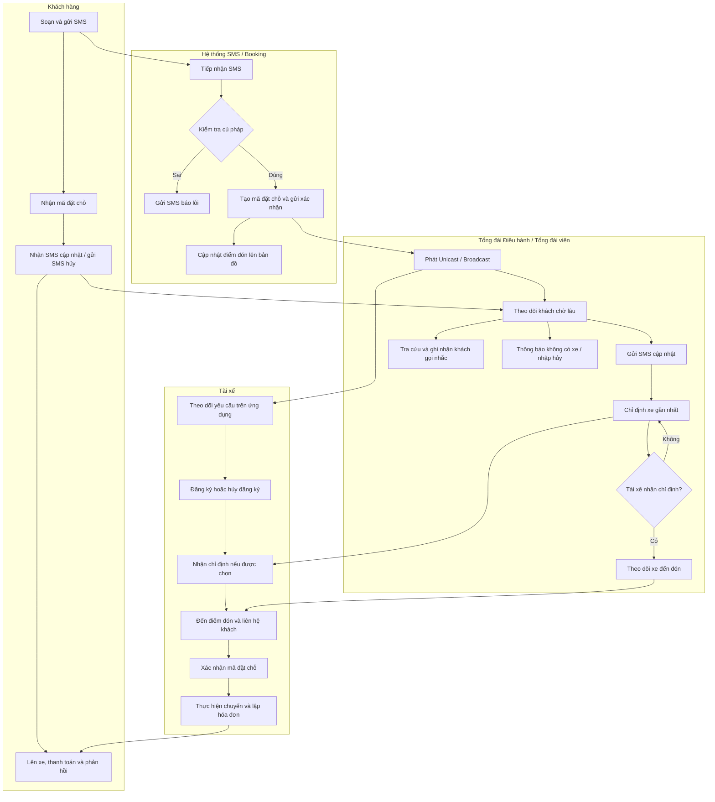

### 6.7. Dữ liệu đầu vào và đầu ra
| Nhóm | Dữ liệu theo nguồn |
|---|---|
| SMS yêu cầu | Số gửi, cú pháp, loại xe, địa chỉ/địa danh, giờ và ngày đón |
| Kiểm tra cú pháp | Nội dung SMS, kết quả phân tích, lỗi và tin phản hồi |
| Booking | Mã đặt chỗ, điểm đón, thời điểm yêu cầu, kênh SMS, trạng thái |
| Điều phối | Xe trống, Unicast/Broadcast, bán kính, tài xế đăng ký/hủy đăng ký |
| Theo dõi chờ | Thời gian chờ, số lần nhắc, lần cập nhật, tình trạng xe |
| SMS hủy | Từ khóa HUY, mã đặt chỗ, số gửi, thời điểm và kết quả hủy |
| Chỉ định | Xe, khoảng cách theo lộ trình thực, thời hạn phản hồi, kết quả nhận/từ chối |
| Đón khách | Điểm đón, thời điểm xe đến, gặp khách, cuộc gọi, xác nhận mã |
| Trip/hóa đơn | Điểm đến, đồng hồ, hành trình, cước, phụ thu, cầu đường, tip, số tài/MSNV, ngày giờ |
| Kết quả | Thanh toán, điểm đánh giá và ý kiến khách |

### 6.8. Điểm bàn giao Module
| Hoạt động | Module sở hữu/đảm nhiệm | Bàn giao |
|---|---|---|
| Nhận SMS, chuẩn hóa nội dung và phản hồi | M09 — Integration phối hợp M01 — Booking | Thông điệp đã phân tích và dữ liệu yêu cầu |
| Tạo/tra cứu/hủy Booking, mã đặt chỗ | M01 — Booking | Booking hợp lệ có kênh nguồn SMS |
| Hồ sơ, trạng thái, vị trí xe/tài xế | M02 — Fleet/Driver | Nguồn lực đủ điều kiện |
| Phát yêu cầu, đăng ký/hủy, chỉ định và theo dõi Assignment | M03 — Dispatch & Queue | Offer/Assignment và lịch sử điều phối |
| Danh sách chờ lâu, màn hình tổng đài và can thiệp | M07 — Control Center | Lệnh điều hành có phân quyền |
| Người dùng, vai trò và nhật ký | M08 — Identity & Access | Quyền và dấu vết kiểm toán |
| SMS xác nhận/cập nhật/hủy và trạng thái gửi | M09 — Integration | Trạng thái giao tiếp và mã giao dịch nhà cung cấp |
| Trip và hành trình | M04 — Trip | Sự kiện Trip |
| Biểu giá, hóa đơn, thanh toán | M05 — Fare & Payment | Kết quả tính cước và giao dịch |
| Doanh thu, công nợ, đối soát | M06 — Finance | Dữ liệu tài chính phân tách DIRECT/PARTNER |
| Báo cáo chờ lâu, nhắc, hủy đăng ký, từ chối | M10 — Reporting | Báo cáo từ dữ liệu Module nguồn |

### 6.9. Các điểm cần Mai Linh xác nhận
| Mã | Nội dung cần xác nhận | Căn cứ |
|---|---|---|
| P5-DEC-01 | Cú pháp SMS yêu cầu/hủy, từ khóa, viết tắt và hỗ trợ dấu tiếng Việt | P5.1–P5.2 |
| P5-DEC-02 | Danh mục loại xe và mã hóa loại xe | P5.1 |
| P5-DEC-03 | Định dạng ngày giờ, múi giờ, ngày quá khứ/giờ không hợp lệ và đặt trước | P5.1, P5.4 |
| P5-DEC-04 | Chuẩn hóa địa chỉ/địa danh và xử lý định vị không thành công/nhiều kết quả | P5.1–P5.3 |
| P5-DEC-05 | Xác thực số gửi và việc dùng số gửi làm số liên hệ khách | P5.1–P5.3 |
| P5-DEC-06 | Mẫu SMS lỗi, xác nhận, cập nhật, hủy và thông báo không có xe | P5.2–P5.15 |
| P5-DEC-07 | Chống SMS trùng/gửi lại và tạo trùng Booking | P5.1–P5.3 |
| P5-DEC-08 | Bán kính Unicast, Broadcast và người có quyền bật/tắt | P5.5 |
| P5-DEC-09 | Bán kính đăng ký, danh sách 10 yêu cầu và giới hạn một Booking/tài xế | P5.7 |
| P5-DEC-10 | Ngưỡng khách chờ lâu và chu kỳ gửi SMS cập nhật | P5.9 |
| P5-DEC-11 | Cú pháp hủy chính thức; nguồn nêu “HUY [Mã số đặt xe]” | P5.10 |
| P5-DEC-12 | Thời hạn phản hồi chỉ định [xxx], số lần chỉ định và thời hạn tổng | P5.11–P5.14 |
| P5-DEC-13 | Nhận diện yêu cầu khi khách gọi nhắc và giới hạn số lần nhắc | P5.16–P5.17 |
| P5-DEC-14 | Thời gian chờ khách, số lần gọi lại và giải phóng xe | P5.20–P5.22 |
| P5-DEC-15 | Xác thực mã đặt chỗ khi lên xe; xử lý mã không khớp/đón nhầm | P5.23 |
| P5-DEC-16 | Điều kiện/cước đường dài, thanh toán và thang điểm hiện hành | P5.25–P5.29 |

### 6.10. Diễn giải thiết kế hệ thống — tách biệt với yêu cầu nguồn
Các nội dung sau là đề xuất thiết kế:
- Tách quy trình xử lý SMS thành nhận thông điệp, xác thực nguồn gửi, phân tích cú pháp, chuẩn hóa trường, định vị điểm đón, kiểm tra hợp lệ và tạo Booking; lưu kết quả từng bước để truy vết.
- Không tạo Booking điều phối khi cú pháp đúng nhưng địa chỉ không định vị được hoặc ngày giờ không hợp lệ; phản hồi mã lỗi có hướng dẫn.
- Có cơ chế chống trùng (idempotency) theo mã tin nhắn nhà cung cấp và dấu vân tay nội dung/thời gian để tránh tạo Booking lặp.
- Mã đặt chỗ phải duy nhất, khó đoán và gắn với Booking; SMS hủy cần xác thực số gửi và mã đặt chỗ.
- Trạng thái gửi SMS phải tách khỏi trạng thái Booking. SMS gửi thất bại không đồng nghĩa Booking tự động hủy.
- Tin cập nhật phải dựa trên trạng thái Booking/Dispatch mới nhất, tránh gửi “chưa có xe” khi xe vừa nhận Assignment.
- SMS hủy phải phát sự kiện hủy Booking và yêu cầu M03 giải phóng Offer/Assignment; cần xử lý an toàn khi tài xế đồng thời nhận cuốc.
- Tách riêng số lần khách gọi nhắc, số SMS cập nhật, số lần tài xế từ chối chỉ định và số lần hủy đăng ký.
- DIRECT/PARTNER dùng chung kênh SMS/Dispatch nhưng dữ liệu Booking, hợp đồng, doanh thu, công nợ và đối soát phải gắn đúng đơn vị sở hữu.
- Các tham số KPMG 2015 phải cấu hình và phê duyệt lại, không hard-code.

### 6.11. Điểm chưa nhất quán trong tài liệu nguồn
1. TO.P5.13 tự dẫn “sang bước TO.P5.13” trong khi TO.P5.14 mới là bước thông báo khách; cần đối chiếu lưu đồ gốc.
2. TO.P5.8 dẫn tài xế không hủy sang P5.19; nhánh tài xế nhận chỉ định tại P5.12 đi qua P5.18 rồi P5.19. Cần thể hiện hai nguồn vào cùng bước trong State Machine.
3. TO.P5.10 nêu khách không gửi SMS hủy thì hệ thống vẫn chỉ định xe; cần xác nhận im lặng có được xem là tiếp tục chờ theo chính sách hiện hành không.
4. TO.P5.22 dẫn hủy về P5.15; cần xác nhận Tổng đài viên nhập hủy có phải cách xử lý duy nhất khi khách gọi điện.
5. TO.P5.23 có nhánh mã đặt chỗ không khớp/đón nhầm; cần xác minh hành động giải phóng Assignment và mã bước theo lưu đồ gốc.
6. Cú pháp, ví dụ ngày 03/03/2015 và phương thức thanh toán là dữ liệu lịch sử, không mặc định còn hiệu lực.

### 6.12. Tiêu chí hoàn thành TO.P5
1. Cú pháp SMS yêu cầu/hủy và mẫu phản hồi được nghiệp vụ phê duyệt.
2. Chốt phân tích cú pháp, chuẩn hóa địa chỉ, định vị và xác thực số gửi.
3. Chốt chống trùng, gửi lại, sai thứ tự và lỗi nhà cung cấp.
4. Chốt tạo Booking, mã đặt chỗ và chuyển TO.P8.
5. Chốt Unicast/Broadcast, bán kính, đăng ký, chỉ định và từ chối.
6. Chốt khách chờ lâu, SMS cập nhật/hủy và gọi nhắc.
7. Chốt thời gian chờ khách, số lần gọi và xử lý mã không khớp.
8. Chốt biểu giá, thanh toán, đánh giá và phân tách DIRECT/PARTNER.
9. Có test case cho cú pháp sai/đúng, định vị lỗi, SMS trùng, hủy, đặt trước, điều phối, tài xế từ chối, khách gọi nhắc, khách không nghe máy, sai mã, Trip, hóa đơn và thanh toán.


## 7. TO.P6 — Khách hàng yêu cầu Taxi qua Chat

### 7.1. Mục tiêu và phạm vi theo KPMG

Quy trình mô tả việc khách hàng chat trực tiếp với tổng đài viên trên các kênh website Mai Linh để yêu cầu xe, thay đổi hoặc hủy dịch vụ. Theo mô tả tổng quan KPMG 2015, khách hàng có thể chat mà không cần tài khoản thành viên. Quy trình bao gồm tiếp nhận chat, nhập Booking, điều phối xe, đón khách, thực hiện chuyến, thanh toán và phản hồi.

**Phân biệt với TO.P5:** TO.P5 tiếp nhận nội dung SMS theo cú pháp; TO.P6 có tổng đài viên tương tác trực tiếp, nhập dữ liệu và gửi mã đặt chỗ qua chat. Tuy nhiên, từ TO.P6.5 trở đi, phần lớn luồng điều phối và thực hiện chuyến tương đồng với các kênh khác.

### 7.2. Vai trò tham gia

| Vai trò | Trách nhiệm được mô tả trong nguồn |
|---|---|
| Khách hàng | Chat yêu cầu/thay đổi/hủy; nhận mã đặt chỗ; có thể gọi nhắc; lên xe, thanh toán và phản hồi |
| Tổng đài viên | Tiếp nhận nội dung chat; nhập, sửa, hủy Booking; gửi mã đặt chỗ; hỗ trợ khách chờ lâu và thông báo tình trạng xe |
| Tổng đài Điều hành | Phát yêu cầu Unicast/Broadcast; theo dõi khách chờ lâu; chỉ định xe; xử lý thiếu xe |
| Tài xế | Theo dõi yêu cầu, đăng ký hoặc hủy đăng ký; nhận chỉ định; đến điểm đón, liên hệ khách và thực hiện chuyến |
| Hệ thống | Sinh mã đặt chỗ, cập nhật bản đồ, phát yêu cầu, cập nhật trạng thái xe và Booking, ghi nhận lịch sử và hỗ trợ báo cáo |

### 7.3. Luồng tổng thể

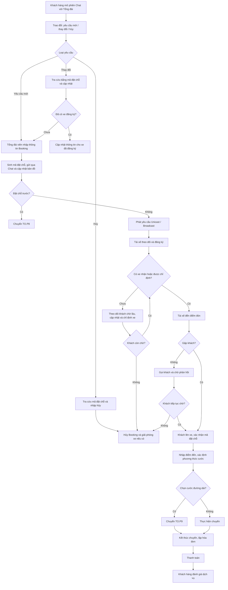

**Giới hạn:** Đây là lưu đồ tổng hợp để đọc nhanh. Các nhánh chi tiết phải đối chiếu bảng bước và chính sách hiện hành trước khi dùng làm căn cứ phát triển. Nhánh thay đổi khi đã có xe đăng ký cần xác định rõ việc tài xế xác nhận đã nhận thông tin mới.

### 7.4. Diễn giải các bước TO.P6.1–TO.P6.29 theo KPMG

| Mã bước | Hoạt động | Vai trò theo nguồn | Nội dung được mô tả trong KPMG |
|---|---|---|---|
| TO.P6.1 | Chat yêu cầu/thay đổi/hủy dịch vụ taxi | Khách hàng | Chat với tổng đài viên để yêu cầu xe, thay đổi yêu cầu hoặc hủy dịch vụ |
| TO.P6.2 | Nhập dữ liệu vào hệ thống | Tổng đài viên | Yêu cầu mới: nhập số nhà, đường, phường, quận, loại/hiệu xe, đặc điểm, số điện thoại nếu cần và số lượng xe theo loại. Thay đổi: nhập mã đặt chỗ, chọn yêu cầu để chỉnh sửa; nếu đã có xe đăng ký thì cập nhật thông tin cho xe, nếu chưa có xe thì xử lý như yêu cầu mới. Hủy: nhập mã đặt chỗ, chọn yêu cầu; xe đã đăng ký được chuyển về trạng thái xe trống |
| TO.P6.3 | Gửi mã đặt chỗ xác nhận | Tổng đài viên / Hệ thống | Hệ thống sinh mã đặt chỗ; tổng đài viên gửi mã cho khách qua Chat; điểm đón được tự động cập nhật lên bản đồ |
| TO.P6.4 | Đặt chỗ trước? | Tổng đài Điều hành | Nếu đặt trước thì chuyển TO.P8; nếu đi ngay thì sang P6.5 |
| TO.P6.5 | Phát yêu cầu Unicast/Broadcast | Tổng đài Điều hành / Hệ thống | Unicast mặc định đến xe trống trong bán kính [xxx] km, có thể điều chỉnh. Broadcast đến xe trống toàn hệ thống, do Tổng đài kiểm soát trong tình huống đặc biệt như cao điểm/thiếu xe cục bộ. Hệ thống cảnh báo nhu cầu tăng đột biến và hiển thị danh sách khách chờ lâu, gồm cả khách đã/chưa có xe đăng ký |
| TO.P6.6 | Theo dõi điểm đón được phát | Tài xế | Theo dõi yêu cầu Unicast/Broadcast và quyết định nhận yêu cầu Unicast hoặc chạy theo Broadcast tại khu vực cao điểm |
| TO.P6.7 | Đăng ký đón khách | Tài xế / Hệ thống | Tài xế nhấn đăng ký trên ứng dụng. Mỗi thời điểm chỉ đăng ký một yêu cầu; sau khi đăng ký vẫn nhìn thấy yêu cầu khác và xe ở trạng thái “đón khách”. Ứng dụng hiển thị 10 yêu cầu chưa đăng ký gần nhất theo lộ trình giao thông thực; ngoài bán kính [xxx] km có thể thấy nhưng không đăng ký được |
| TO.P6.8 | Hủy đăng ký đón khách? | Tài xế / Hệ thống | Nếu tài xế hủy, Booking trở về “chưa có xe đăng ký”, hiển thị lại trong bán kính phát; xe trở về trạng thái trống. Hệ thống ghi nhận lịch sử để truy vấn báo cáo định kỳ. Nếu không hủy, tài xế đến điểm đón (P6.19) |
| TO.P6.9 | Gửi tin nhắn cập nhật tình hình xe | Tổng đài Điều hành / Hệ thống | Dựa vào danh sách khách chờ lâu chưa có xe, gửi cập nhật cho khách. Nguồn nêu ví dụ thông báo qua tin nhắn và yêu cầu khách chờ thêm [XX] phút; cần xác nhận kênh cập nhật tương ứng với Booking qua Chat |
| TO.P6.10 | Nhắn tin hủy đặt xe | Khách hàng / Hệ thống | Nếu không đồng ý chờ, khách gửi SMS hủy theo cú pháp “HUY [Mã số đặt xe]”; hệ thống tự hủy mã đặt chỗ và trả xe đã đăng ký (nếu có) về trạng thái trống. Nếu khách không chờ nhưng không gửi tin hủy, nguồn nêu hệ thống vẫn tiếp tục chỉ định xe |
| TO.P6.11 | Chỉ định xe rước khách | Tổng đài Điều hành / Hệ thống | Nếu không có tin nhắn hủy, Tổng đài có quyền chỉ định xe gần nhất theo lộ trình giao thông thực cho khách chờ lâu |
| TO.P6.12 | Tài xế từ chối chỉ định? | Tài xế / Hệ thống | Tài xế nhấn từ chối hoặc không nhấn chấp nhận trong [xxx] phút thì được xem là từ chối; Tổng đài chỉ định xe khác và hệ thống lập báo cáo từ chối. Nếu chấp nhận, chuyển P6.18 |
| TO.P6.13 | Cần thông báo khách hàng không có xe? | Tổng đài viên | Nếu đã chỉ định nhiều xe trong [xxx] phút mà vẫn không có xe đăng ký thì thông báo khách qua gọi/nhắn tin, sang P6.14. Nếu chưa hết thời hạn thì tiếp tục chỉ định xe gần nhất; hệ thống ghi nhận tài xế từ chối |
| TO.P6.14 | Thông báo khách hàng không có xe | Tổng đài viên | Khi đã chỉ định nhiều xe trong [xxx] phút mà vẫn không có xe, dựa trên danh sách khách chờ lâu và thời gian từ lần gọi khách cuối cùng [xxx] phút để thông báo; sau đó tiến hành hủy theo P6.15 |
| TO.P6.15 | Hủy yêu cầu đặt xe | Tổng đài viên / Hệ thống | Nếu khách không chờ, Tổng đài nhập hủy; yêu cầu biến khỏi danh sách khách chờ lâu, bản đồ và danh sách trên ứng dụng tài xế. Xe đã đăng ký được trả về trạng thái trống |
| TO.P6.16 | Khách hàng gọi nhắc | Khách hàng | Khách chờ lâu có thể gọi Tổng đài viên để nhắc xe |
| TO.P6.17 | Ghi nhận số lần nhắc | Tổng đài viên / Hệ thống | Tra cứu theo số điện thoại; nếu khách dùng số khác thì tra theo mã đặt chỗ. Hiển thị yêu cầu để Tổng đài viên ghi nhận số lần nhắc, tình trạng xe đăng ký và ETA để thông báo khách |
| TO.P6.18 | Nhận chỉ định đón khách | Tài xế / Hệ thống | Tài xế thấy yêu cầu được chỉ định và nhấn đồng ý. Nguồn ghi nhận tài xế vẫn nhìn thấy yêu cầu khác và có thể hủy nhận chỉ định. Hệ thống ghi nhận xe đã nhận chỉ định. Cơ chế ưu đãi/khuyến khích tài xế được nêu là chính sách cần Mai Linh thảo luận và đồng ý |
| TO.P6.19 | Đến điểm đón khách | Tài xế | Tài xế đến điểm đón |
| TO.P6.20 | Thấy khách? | Tài xế | Nếu thấy khách thì sang P6.23; nếu không thấy thì sang P6.21 |
| TO.P6.21 | Tài xế gọi khách báo xe đến | Tài xế | Gọi khách báo xe đến; nếu không liên lạc được có thể báo cáo để nhận cuốc khác. Thời gian chờ khách cần được quy định, có thể khác nhau theo vị trí |
| TO.P6.22 | Khách hàng phản hồi | Khách hàng / Tổng đài viên | Nếu khách hủy, Tổng đài viên nhập hủy theo P6.15 để xe nhận yêu cầu khác. Nếu khách vẫn chờ, yêu cầu khách nhanh chóng ra xe và sang P6.23. Nếu khách không bắt máy, cần quy định số lần gọi lại và khoảng thời gian |
| TO.P6.23 | Khách lên xe, thông báo điểm đến | Tài xế / Khách hàng | Khách lên xe, thông báo điểm đến và tài xế xác nhận mã đặt chỗ. Nếu khách không có mã/chưa gọi Tổng đài, tài xế báo hủy đăng ký do đón nhầm để Booking trở về chưa có xe đăng ký. Nếu mã khách cung cấp khác mã tài xế đã đăng ký, tài xế hủy mã cũ và báo Tổng đài mã đặt chỗ hoặc số điện thoại khách đã dùng |
| TO.P6.24 | Bấm đồng hồ, nhập điểm đến | Tài xế / Hệ thống | Tài xế bấm đồng hồ, nhập điểm đến để ứng dụng hướng dẫn đường; thông báo lộ trình với khách. Nếu khách yêu cầu, tài xế hiển thị cước ước tính |
| TO.P6.25 | Có thể áp dụng cước phí đường dài? | Tài xế / Hệ thống | Nếu đủ điều kiện, hệ thống hiển thị cước đường dài để khách chọn cước cố định hoặc cước đồng hồ. Chọn cước đường dài chuyển TO.P9; chọn cước đồng hồ sang P6.26 |
| TO.P6.26 | Thực hiện dịch vụ chở khách | Tài xế / Hệ thống | Tài xế chở khách đến nơi; hành trình được lưu vết bởi hệ thống quản lý hành trình trên xe |
| TO.P6.27 | Kết thúc hành trình và xuất hóa đơn | Tài xế / Hệ thống | Hóa đơn gồm cước đồng hồ, cước cố định/phụ thu vượt lộ trình đường dài, phí cầu đường, tiền tip, số tài/MSNV, điểm đầu/cuối và ngày giờ |
| TO.P6.28 | Thanh toán | Khách hàng / Tài xế | Khách kiểm tra hóa đơn và thanh toán. KPMG 2015 liệt kê tiền mặt, MCC, thẻ tín dụng/thẻ ATM và voucher; tài xế kẹp chứng từ tương ứng vào hóa đơn |
| TO.P6.29 | Khách hàng phản hồi chất lượng dịch vụ | Khách hàng | Chấm điểm dịch vụ là bắt buộc theo nguồn; góp ý/phàn nàn chi tiết là tùy chọn. Kênh gồm ứng dụng Mai Linh Taxi, khách gọi Tổng đài hoặc Tổng đài gọi khách ngẫu nhiên |

### 7.5. Swimlane theo vai trò

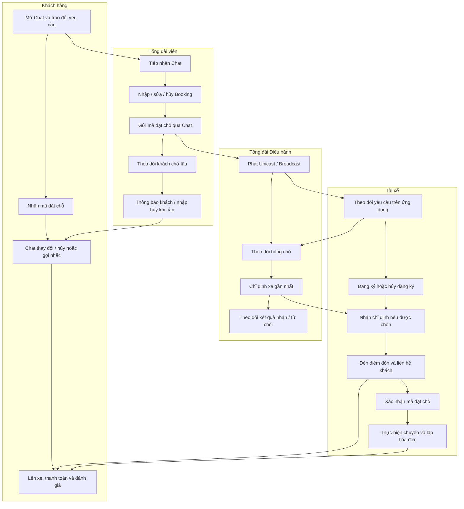

Swimlane là sơ đồ trách nhiệm khái quát. Nhánh hủy qua SMS trong TO.P6.10 là nội dung được ghi nguyên theo nguồn KPMG, nhưng không khớp tự nhiên với kênh Chat; cần xác nhận trước khi thiết kế giao diện/kênh hủy.

### 7.6. Dữ liệu đầu vào và đầu ra

| Nhóm | Dữ liệu theo tài liệu nguồn |
|---|---|
| Phiên Chat | Kênh/phiên Chat, nội dung trao đổi, khách yêu cầu mới/thay đổi/hủy |
| Đầu vào Booking | Số nhà, đường, phường, quận, loại/hiệu xe, đặc điểm, số điện thoại nếu cần, số lượng xe theo loại |
| Tra cứu/cập nhật | Mã đặt chỗ, Booking được chọn, nội dung thay đổi, trạng thái xe đã đăng ký |
| Xác nhận | Mã đặt chỗ, nội dung gửi qua Chat, điểm đón cập nhật lên bản đồ |
| Điều phối | Xe trống, Unicast/Broadcast, bán kính phát, đăng ký/hủy đăng ký, chỉ định và kết quả nhận/từ chối |
| Theo dõi chờ | Thời gian chờ, lần liên hệ gần nhất, số lần khách nhắc, tình trạng xe và ETA |
| Đón khách | Điểm đón, thời điểm xe đến, liên hệ khách, mã đặt chỗ khách cung cấp |
| Trip/hóa đơn | Điểm đến, dữ liệu đồng hồ, hành trình, cước, phụ thu, phí cầu đường, tip, số tài/MSNV, ngày giờ |
| Kết quả | Thanh toán, điểm đánh giá bắt buộc và ý kiến tùy chọn |

### 7.7. Điểm bàn giao Module theo kiến trúc đề xuất

| Hoạt động nghiệp vụ | Module sở hữu/đảm nhiệm | Bàn giao |
|---|---|---|
| Nhận phiên Chat, lưu thông điệp và trạng thái giao tiếp | M09 — Integration phối hợp M07 — Control Center | Nội dung Chat và định danh phiên để tổng đài viên xử lý |
| Tạo/sửa/hủy Booking, sinh mã đặt chỗ | M01 — Booking | Booking hợp lệ, có kênh nguồn Chat |
| Hồ sơ, trạng thái và vị trí xe/tài xế | M02 — Fleet/Driver | Nguồn lực đủ điều kiện cung cấp cho điều phối |
| Phát yêu cầu, đăng ký/hủy, chỉ định và hàng đợi | M03 — Dispatch & Queue | Offer/Assignment và lịch sử điều phối |
| Đến đón, bắt đầu/kết thúc Trip, hành trình | M04 — Trip | Sự kiện Trip |
| Biểu giá, tính cước, hóa đơn và thanh toán | M05 — Fare & Payment | Kết quả tài chính |
| Doanh thu, công nợ và đối soát | M06 — Finance | Dữ liệu tài chính phân tách DIRECT/PARTNER |
| Màn hình Chat/tổng đài, giám sát và can thiệp | M07 — Control Center | Lệnh nghiệp vụ đến Module sở hữu dữ liệu |
| Người dùng, quyền và nhật ký | M08 — Identity & Access | Quyền truy cập và dấu vết kiểm toán |
| Kết nối Chat, gửi/nhận thông điệp và trạng thái nhà cung cấp | M09 — Integration | Thông điệp, trạng thái gửi/nhận, mã giao dịch |
| Báo cáo khách chờ, số lần nhắc, hủy đăng ký và từ chối | M10 — Reporting | Báo cáo từ dữ liệu Module nguồn |

### 7.8. Các điểm cần Mai Linh xác nhận

| Mã quyết định | Nội dung chưa được chốt | Căn cứ |
|---|---|---|
| P6-DEC-01 | Kênh Chat chính thức: website, ứng dụng hay nền tảng bên thứ ba; có cho phép khách không đăng nhập không | Phạm vi TO.P6 và TO.P6.1 |
| P6-DEC-02 | Có bắt buộc số điện thoại xác thực; cách liên kết phiên Chat với khách hàng và Booking | TO.P6.1–P6.3 |
| P6-DEC-03 | Bộ trường bắt buộc, danh mục loại/hiệu xe, số lượng xe và đặc điểm | TO.P6.2 |
| P6-DEC-04 | Quy tắc tra cứu bằng mã đặt chỗ; xử lý mã sai, trùng hoặc khách không còn phiên Chat | TO.P6.2 |
| P6-DEC-05 | Khi sửa Booking đã có xe đăng ký, tài xế phải xác nhận cập nhật hay hệ thống cập nhật tự động; nếu tài xế không xác nhận thì xử lý thế nào | TO.P6.2 |
| P6-DEC-06 | Mẫu nội dung Chat xác nhận, cập nhật, hủy và thông báo không có xe | TO.P6.3, P6.9, P6.14 |
| P6-DEC-07 | Bán kính Unicast, điều kiện Broadcast và quyền bật/tắt | TO.P6.5 |
| P6-DEC-08 | Bán kính đăng ký, danh sách 10 yêu cầu và giới hạn một yêu cầu/tài xế | TO.P6.7 |
| P6-DEC-09 | Ngưỡng khách chờ lâu và kênh gửi cập nhật; nguồn mô tả gửi tin nhắn dù Booking đến từ Chat | TO.P6.9 |
| P6-DEC-10 | Có duy trì hủy qua SMS “HUY [Mã số đặt xe]” cho Booking tạo từ Chat hay thay bằng nút hủy trong Chat | TO.P6.10 |
| P6-DEC-11 | Điều kiện chỉ định xe, bán kính/tiêu chí xe gần nhất và quyền can thiệp của Tổng đài | TO.P6.11 |
| P6-DEC-12 | Thời hạn phản hồi chỉ định [xxx], số lần chỉ định tối đa và tổng thời gian chờ trước khi thông báo không có xe | TO.P6.12–P6.14 |
| P6-DEC-13 | Quy tắc ghi nhận cuộc gọi nhắc và nhận diện khách dùng số điện thoại khác | TO.P6.16–P6.17 |
| P6-DEC-14 | Tài xế có được hủy nhận chỉ định sau khi đã đồng ý; điều kiện và hậu quả đối với trạng thái xe | TO.P6.18 |
| P6-DEC-15 | Chính sách thưởng/khuyến khích tài xế nhận chỉ định và cuốc ngắn | TO.P6.18 |
| P6-DEC-16 | Thời gian chờ khách tại điểm đón, số lần gọi lại và điều kiện giải phóng xe | TO.P6.21–P6.22 |
| P6-DEC-17 | Quy tắc xác minh mã đặt chỗ khi khách lên xe; xử lý không có mã, sai mã hoặc đón nhầm | TO.P6.23 |
| P6-DEC-18 | Điều kiện/cước đường dài, phương thức thanh toán và thang điểm phản hồi hiện hành | TO.P6.25–P6.29 |

### 7.9. Diễn giải thiết kế hệ thống — tách biệt với yêu cầu nguồn

Các nội dung sau là đề xuất thiết kế, không phải nguyên văn yêu cầu KPMG:

- Mỗi phiên Chat cần có định danh riêng; lưu người tham gia, thời điểm mở/đóng, nội dung trao đổi và liên kết tới Booking. Không đồng nhất phiên Chat với Booking vì một phiên có thể trao đổi nhiều yêu cầu.
- Booking chỉ được tạo khi tổng đài viên xác nhận đủ dữ liệu tối thiểu; cần lưu người nhập, thời điểm nhập và nguồn kênh Chat.
- Mã đặt chỗ phải duy nhất, khó đoán và được gửi trong chính phiên Chat. Mọi thay đổi/hủy phải ghi lịch sử trước/sau và người thực hiện.
- Khi thay đổi Booking đã có Assignment, cần có sự kiện cập nhật gửi tới tài xế; chỉ đánh dấu tài xế đã nhận thông tin khi có xác nhận thực tế.
- Trạng thái gửi/nhận Chat phải tách khỏi trạng thái Booking và Dispatch. Mất kết nối Chat không được tự động hiểu là khách hủy.
- Hủy Booking phải phát sự kiện cho M03 để thu hồi Offer/Assignment và giải phóng nguồn lực theo quy tắc chống xung đột; tránh xe vừa được điều phối cho Booking khác trong khi lệnh hủy đang xử lý.
- Nội dung TO.P6.10 là SMS hủy dù quy trình là Chat. Thiết kế không tự động áp dụng cú pháp SMS cho Chat trước khi nghiệp vụ xác nhận.
- Tách riêng số lần khách nhắc, số lần gửi thông báo, số lần tài xế từ chối chỉ định và số lần hủy đăng ký.
- DIRECT/PARTNER dùng chung nền tảng Chat và Dispatch nhưng Booking, hợp đồng, doanh thu, công nợ và đối soát phải gắn đúng đơn vị sở hữu.
- Các tham số [xxx] và chính sách năm 2015 phải được cấu hình, phê duyệt; không hard-code.

### 7.10. Điểm chưa nhất quán / cần đối chiếu trong tài liệu nguồn

1. TO.P6.9 mô tả gửi “tin nhắn” cập nhật cho khách chờ lâu; chưa xác định đây là SMS hay thông điệp Chat. Trong khi Booking xuất phát từ Chat, hệ thống cần có quy tắc chọn kênh liên hệ.
2. TO.P6.10 mô tả khách gửi SMS “HUY [Mã số đặt xe]” để hủy Booking trong quy trình Chat. Đây là điểm giao thoa kênh cần nghiệp vụ xác nhận, không tự sửa thành thao tác hủy qua Chat.
3. TO.P6.13 và TO.P6.14 cùng mô tả điều kiện đã chỉ định nhiều xe trong [xxx] phút mà vẫn không có xe; ranh giới giữa bước quyết định và bước thông báo chưa thật rõ.
4. TO.P6.14 dẫn thời gian [xxx] phút kể từ lần gọi khách hàng cuối cùng, trong khi TO.P6.1 là Chat; cần xác định “lần liên hệ cuối” có bao gồm tin nhắn Chat hay không.
5. TO.P6.18 cho phép tài xế vẫn thấy yêu cầu khác và có thể hủy nhận chỉ định sau khi đồng ý; cần làm rõ thời điểm khóa nguồn lực và cách xử lý nếu tài xế hủy sau khi đã nhận.
6. TO.P6.23 có nhánh không có mã/mã không khớp và hủy đăng ký để trả Booking về chưa có xe; cần xác định đây là hủy Assignment, hủy đăng ký hay hủy Booking, vì ba hành động có hậu quả khác nhau.
7. TO.P6.2 mô tả cập nhật cho xe đã đăng ký khi khách thay đổi Booking nhưng chưa nêu cơ chế xác nhận đã nhận thay đổi của tài xế.
8. Các ngưỡng [xxx], phương thức thanh toán và cơ chế thưởng trong tài liệu KPMG 2015 là nội dung lịch sử, không mặc định còn hiệu lực.

### 7.11. Tiêu chí hoàn thành TO.P6

1. Chốt kênh Chat, định danh phiên, xác thực/liên kết khách hàng và chính sách không cần đăng nhập.
2. Chốt trường Booking, quy tắc tạo/sửa/hủy và mã đặt chỗ.
3. Chốt cơ chế đồng bộ thay đổi Booking với tài xế đã đăng ký/được chỉ định.
4. Chốt nội dung xác nhận, thông báo chờ lâu, thông báo không có xe và lựa chọn kênh gửi.
5. Quyết định rõ giữ hay bỏ SMS hủy trong quy trình Chat.
6. Chốt Unicast/Broadcast, bán kính, đăng ký, chỉ định, thời hạn phản hồi và giải phóng xe.
7. Chốt quy tắc gọi nhắc, chờ khách, xác nhận mã đặt chỗ và xử lý đón nhầm.
8. Chốt biểu giá, thanh toán, đánh giá và phân tách DIRECT/PARTNER.
9. Có test case cho khách không đăng nhập, mất phiên Chat, Booking mới/sửa/hủy, tài xế đã đăng ký, Chat gửi lỗi, khách chờ lâu, SMS hủy, tài xế từ chối/hủy chỉ định, sai mã, đón nhầm, Trip, hóa đơn và thanh toán.


## 8. TO.P7 — Khách hàng yêu cầu Taxi qua Web

### 8.1. Mục tiêu và phạm vi theo KPMG

Quy trình mô tả việc khách hàng đăng nhập tài khoản trên website Mai Linh, tự đăng ký yêu cầu taxi, theo dõi mã và thông tin đặt chỗ trên tài khoản, xác nhận yêu cầu, hủy hoặc tiếp tục điều phối xe cho đến khi thanh toán và phản hồi.

Theo phần mô tả tổng quan KPMG 2015, khách hàng phải có tài khoản trên website Mai Linh và có thể theo dõi tình trạng yêu cầu trên web. Đây là điểm phân biệt với TO.P6 — Chat, trong đó khách có thể trao đổi với tổng đài viên mà không cần tài khoản thành viên.

### 8.2. Vai trò tham gia

| Vai trò | Trách nhiệm được mô tả trong nguồn |
|---|---|
| Khách hàng | Đăng nhập web, nhập yêu cầu, xác nhận/sửa/hủy, theo dõi tình trạng, lên xe, thanh toán và phản hồi |
| Tổng đài Điều hành | Quản lý yêu cầu, phát yêu cầu Unicast/Broadcast, theo dõi khách chờ lâu, chỉ định xe |
| Tổng đài viên | Thông báo khách không có xe, nhập hủy khi cần và tiếp nhận khách gọi nhắc |
| Tài xế | Theo dõi yêu cầu, đăng ký/hủy đăng ký, nhận chỉ định, đến điểm đón, liên hệ khách và thực hiện chuyến |
| Hệ thống | Tạo mã đặt chỗ, hiển thị thông tin trên tài khoản, cập nhật bản đồ, phát yêu cầu, cập nhật trạng thái và báo cáo |

### 8.3. Luồng tổng thể

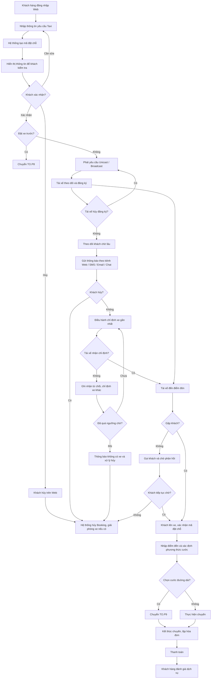

**Giới hạn:** Đây là lưu đồ tổng hợp. Các nhánh hủy, chỉ định, tài xế từ chối và khách không có mặt cần đối chiếu bảng bước KPMG và chính sách hiện hành. Lưu đồ không thay thế đặc tả trạng thái Booking/Dispatch.

### 8.4. Diễn giải các bước TO.P7.1–TO.P7.31 theo KPMG

| Mã bước | Hoạt động | Vai trò theo nguồn | Nội dung được mô tả trong KPMG |
|---|---|---|---|
| TO.P7.1 | Yêu cầu dịch vụ taxi qua tài khoản Web | Khách hàng | Khách đăng nhập web và nhập điểm đón (địa chỉ cụ thể hoặc địa danh), loại xe 7 chỗ/4 chỗ, hiệu xe, số lượng xe theo loại, thời gian đón (không nhập thì hiểu là đón ngay), số điện thoại liên lạc, điểm đến tùy chọn và ghi chú thêm. Đăng ký thành công thì hệ thống tạo mã đặt chỗ để khách theo dõi |
| TO.P7.2 | Hiển thị mã và thông tin đặt chỗ trên tài khoản | Tổng đài Điều hành / Hệ thống | Hệ thống tạo mã đặt chỗ và hiển thị/gửi thông tin trên tài khoản khách hàng để theo dõi |
| TO.P7.3 | Khách hàng xác nhận thông tin đặt chỗ? | Tổng đài Điều hành / Hệ thống | Hệ thống sinh bản thông tin yêu cầu xe để khách kiểm tra và xác nhận. Cần sửa thì quay lại P7.1; muốn hủy thì sang P7.5 |
| TO.P7.4 | Đặt chỗ trước? | Tổng đài Điều hành / Hệ thống | Nếu đặt trước thì chuyển TO.P8; nếu yêu cầu xe đi ngay thì sang P7.6 |
| TO.P7.5 | Khách hàng hủy yêu cầu trên Web | Khách hàng | Khách thực hiện hủy trên web; ngay sau khi hủy, hệ thống chuyển trạng thái xe đã đăng ký đón (nếu có) sang xe trống |
| TO.P7.6 | Phát yêu cầu Unicast/Broadcast | Tổng đài Điều hành / Hệ thống | Unicast mặc định phát đến xe trống trong bán kính [xx km], tham số có thể điều chỉnh. Broadcast phát đến tất cả xe trống toàn hệ thống, do Tổng đài kiểm soát trong tình huống đặc biệt như cao điểm/thiếu xe cục bộ. Hệ thống hiển thị danh sách khách chờ lâu, gồm khách đã/chưa có xe đăng ký |
| TO.P7.7 | Theo dõi điểm đón được phát | Tài xế | Tài xế theo dõi yêu cầu Unicast/Broadcast và quyết định nhận yêu cầu Unicast hoặc chạy theo Broadcast ở khu vực cao điểm |
| TO.P7.8 | Đăng ký đón khách | Tài xế / Hệ thống | Tài xế nhấn đăng ký trên ứng dụng. Mỗi thời điểm chỉ đăng ký một yêu cầu; sau đăng ký vẫn thấy các yêu cầu khác và xe ở trạng thái “đón khách”. Ứng dụng hiển thị 10 yêu cầu chưa đăng ký gần nhất theo lộ trình giao thông thực; ngoài bán kính [xxx] km có thể thấy nhưng không đăng ký được |
| TO.P7.9 | Hủy đăng ký đón khách | Tài xế / Hệ thống | Tài xế nhấn hủy; yêu cầu trở về “chưa có xe đăng ký”, được hiển thị lại cho xe trong bán kính phát; xe trở về trạng thái trống và có thể nhận yêu cầu khác. Hệ thống ghi nhận lịch sử hủy để truy vấn báo cáo định kỳ. Nếu không hủy, tài xế đến điểm đón (P7.21) |
| TO.P7.10 | Gửi tin nhắn cập nhật tình hình xe | Tổng đài Điều hành / Hệ thống | Dựa vào báo cáo khách chờ lâu chưa có xe, hệ thống gửi thông báo cập nhật. Báo cáo có trường phương thức yêu cầu (SMS, email, chat, web…) để chọn kênh gửi phù hợp. Ví dụ nguồn: thông báo chưa có xe ở khu vực, nêu mã đặt chỗ, đề nghị khách chờ thêm [xxx] phút và hướng dẫn hủy |
| TO.P7.11 | Hủy yêu cầu qua Web hoặc tin nhắn? | Khách hàng | Nếu khách không đồng ý chờ, nguồn mô tả khách gửi tin nhắn hủy theo cú pháp “HUY [Mã số đặt xe]”. Nếu khách không chờ nhưng không gửi tin nhắn hủy thì hệ thống vẫn tiếp tục chỉ định xe. Tên bước có nhắc Web hoặc tin nhắn, nhưng mô tả chi tiết tập trung vào SMS |
| TO.P7.12 | Hủy yêu cầu đặt xe | Tổng đài Điều hành / Hệ thống | Hệ thống tự động hủy mã đặt chỗ nếu nhận được tin nhắn hoặc lệnh hủy từ web |
| TO.P7.13 | Chỉ định xe rước khách | Tổng đài Điều hành / Hệ thống | Nếu không có tin nhắn/lệnh hủy từ web, Tổng đài có quyền chỉ định xe cho khách trong danh sách chờ lâu. Hệ thống lựa chọn xe gần nhất theo lộ trình giao thông thực |
| TO.P7.14 | Tài xế từ chối chỉ định? | Tài xế / Hệ thống | Tài xế nhấn từ chối hoặc không nhấn chấp nhận sau [xxx] phút thì được xem là từ chối; Tổng đài chỉ định xe khác và hệ thống lập báo cáo tài xế từ chối. Nếu chấp nhận, nguồn dẫn sang TO.P5.18 |
| TO.P7.15 | Cần thông báo khách hàng không có xe? | Tổng đài viên | Nếu đã chỉ định nhiều xe trong [xxx] phút mà vẫn không có xe đăng ký thì thông báo khách (P7.16). Nếu chưa hết thời hạn thì tiếp tục chỉ định xe gần nhất theo lộ trình thực; hệ thống ghi nhận từ chối và dừng chỉ định khi Tổng đài nhập hủy |
| TO.P7.16 | Thông báo khách hàng không có xe | Tổng đài viên | Khi đã chỉ định nhiều xe trong [xxx] phút mà vẫn không có xe, Tổng đài viên dựa vào danh sách chờ lâu và thời gian [xxx] phút kể từ lần gọi khách cuối cùng để thông báo; sau đó tiến hành hủy theo P7.17 |
| TO.P7.17 | Hủy yêu cầu đặt xe | Tổng đài viên / Hệ thống | Nếu khách không chờ, Tổng đài viên nhập hủy; yêu cầu biến khỏi danh sách chờ lâu, bản đồ và danh sách trên ứng dụng tài xế. Xe đã đăng ký được trả về trạng thái trống |
| TO.P7.18 | Khách hàng gọi nhắc | Khách hàng | Khách chờ lâu có thể gọi Tổng đài viên để nhắc xe |
| TO.P7.19 | Ghi nhận số lần nhắc | Tổng đài viên / Hệ thống | Tra cứu theo số điện thoại; nếu khách dùng số khác thì tra theo mã đặt chỗ. Tổng đài viên chọn yêu cầu và nhập số lần nhắc; xem xe đã đăng ký hay chưa và ETA để thông báo khách |
| TO.P7.20 | Nhận chỉ định đón khách | Tài xế / Hệ thống | Tài xế thấy yêu cầu được chỉ định và nhấn đồng ý. Nguồn ghi nhận tài xế vẫn thấy yêu cầu khác và có thể hủy nhận chỉ định. Hệ thống ghi nhận xe đã nhận; chính sách ưu đãi/khuyến khích cần Mai Linh thảo luận |
| TO.P7.21 | Đến điểm đón khách | Tài xế | Tài xế đến điểm đón |
| TO.P7.22 | Thấy khách? | Tài xế | Nếu thấy khách thì sang TO.P7.25; nếu không thấy thì sang TO.P7.23. Bản nguồn lại dẫn chiếu TO.P5.24/TO.P5.23, cần xác nhận là lỗi tham chiếu |
| TO.P7.23 | Tài xế gọi khách báo xe đến | Tài xế | Gọi khách báo xe đến; nếu không liên lạc được có thể báo cáo để nhận cuốc khác. Thời gian chờ khách cần quy định, có thể khác nhau theo vị trí |
| TO.P7.24 | Khách hàng phản hồi | Khách hàng / Tổng đài viên | Khách hủy thì Tổng đài viên nhập hủy để xe nhận yêu cầu khác; khách vẫn chờ thì yêu cầu nhanh chóng ra xe. Nếu khách không bắt máy, cần quy định số lần gọi lại và thời gian. Nguồn dẫn chiếu nhầm sang P5.17/P5.25 |
| TO.P7.25 | Khách lên xe, thông báo điểm đến | Tài xế / Khách hàng | Khách lên xe, thông báo điểm đến và tài xế xác nhận mã đặt chỗ. Nếu khách không có mã/chưa gọi Tổng đài thì tài xế báo hủy đăng ký do đón nhầm để Booking trở về chưa có xe đăng ký. Nếu mã khách cung cấp khác mã tài xế đã đăng ký, tài xế hủy mã cũ và báo Tổng đài mã đặt chỗ hoặc số điện thoại khách đã dùng |
| TO.P7.26 | Bấm đồng hồ, nhập điểm đến | Tài xế / Hệ thống | Tài xế bấm đồng hồ, nhập điểm đến để ứng dụng hướng dẫn đường; thông báo lộ trình với khách. Nếu khách yêu cầu, tài xế có thể hiển thị cước ước tính |
| TO.P7.27 | Có thể áp dụng cước phí đường dài? | Tài xế / Hệ thống | Nếu đủ điều kiện, hệ thống hiển thị cước đường dài để khách chọn cước cố định hoặc cước đồng hồ. Chọn cước đường dài chuyển TO.P9; chọn cước đồng hồ sang P7.28 |
| TO.P7.28 | Thực hiện dịch vụ chở khách | Tài xế / Hệ thống | Tài xế chở khách đến nơi; hành trình được lưu vết bởi hệ thống quản lý hành trình trên xe |
| TO.P7.29 | Kết thúc hành trình và xuất hóa đơn | Tài xế / Hệ thống | Hóa đơn gồm cước đồng hồ, cước cố định/phụ thu vượt lộ trình đường dài, phí cầu đường, tiền tip, số tài/MSNV, điểm đầu/cuối và ngày giờ |
| TO.P7.30 | Thanh toán | Khách hàng / Tài xế | Khách kiểm tra hóa đơn và thanh toán. KPMG 2015 liệt kê tiền mặt, MCC, thẻ tín dụng/thẻ ATM và voucher; tài xế kẹp chứng từ tương ứng vào hóa đơn |
| TO.P7.31 | Khách hàng phản hồi chất lượng dịch vụ | Khách hàng | Chấm điểm dịch vụ là bắt buộc theo nguồn; góp ý/phàn nàn chi tiết là tùy chọn. Kênh phản hồi được nguồn nêu gồm ứng dụng Mai Linh Taxi, khách gọi Tổng đài hoặc Tổng đài gọi khách ngẫu nhiên |

### 8.5. Swimlane theo vai trò

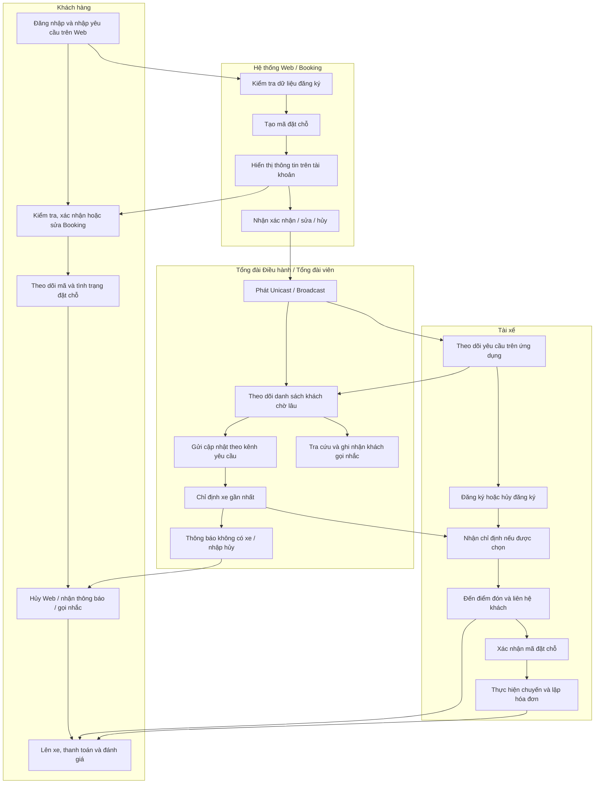

Swimlane thể hiện trách nhiệm ở mức tổng quát. Chi tiết trạng thái và sự kiện giữa Booking, Dispatch, Web và ứng dụng tài xế sẽ được chuẩn hóa trong tài liệu State Machine sau khi hoàn thành TO.P1–TO.P9.

### 8.6. Dữ liệu đầu vào và đầu ra

| Nhóm | Dữ liệu theo tài liệu nguồn |
|---|---|
| Tài khoản Web | Tài khoản khách hàng đăng nhập; thông tin liên hệ |
| Đầu vào Booking | Điểm đón (địa chỉ/địa danh), loại xe, hiệu xe, số lượng xe theo loại, thời gian đón, số điện thoại, điểm đến tùy chọn, ghi chú |
| Xác nhận | Mã đặt chỗ, bản thông tin yêu cầu, trạng thái xác nhận/sửa/hủy |
| Theo dõi | Tình trạng yêu cầu trên tài khoản Web |
| Điều phối | Xe trống, Unicast/Broadcast, bán kính phát, đăng ký/hủy đăng ký, chỉ định và kết quả nhận/từ chối |
| Thông báo | Kênh nguồn yêu cầu (SMS, email, Chat, Web), nội dung cập nhật, mã đặt chỗ, phản hồi hủy |
| Theo dõi chờ | Thời gian chờ, số lần nhắc, lần liên hệ gần nhất, tình trạng xe và ETA |
| Đón khách | Điểm đón, thời điểm xe đến, liên hệ khách, mã đặt chỗ khách cung cấp |
| Trip/hóa đơn | Điểm đến, dữ liệu đồng hồ, hành trình, cước, phụ thu, phí cầu đường, tip, số tài/MSNV, ngày giờ |
| Kết quả | Thanh toán, điểm đánh giá bắt buộc và ý kiến tùy chọn |

### 8.7. Điểm bàn giao Module theo kiến trúc đề xuất

| Hoạt động nghiệp vụ | Module sở hữu/đảm nhiệm | Bàn giao |
|---|---|---|
| Đăng nhập và quản lý tài khoản khách hàng | M08 — Identity & Access phối hợp M01 — Booking | Danh tính và quyền truy cập khách |
| Tạo/sửa/hủy Booking, mã đặt chỗ, trạng thái xác nhận | M01 — Booking | Booking hợp lệ, có kênh nguồn Web |
| Hồ sơ, trạng thái và vị trí xe/tài xế | M02 — Fleet/Driver | Nguồn lực đủ điều kiện cung cấp cho điều phối |
| Phát yêu cầu, đăng ký/hủy, chỉ định và hàng đợi | M03 — Dispatch & Queue | Offer/Assignment và lịch sử điều phối |
| Đến đón, bắt đầu/kết thúc Trip, hành trình | M04 — Trip | Sự kiện Trip |
| Biểu giá, tính cước, hóa đơn và thanh toán | M05 — Fare & Payment | Kết quả tính cước và giao dịch |
| Doanh thu, công nợ và đối soát | M06 — Finance | Dữ liệu tài chính phân tách DIRECT/PARTNER |
| Màn hình giám sát, can thiệp và CSKH | M07 — Control Center | Lệnh điều hành đến Module sở hữu dữ liệu |
| Người dùng, vai trò, quyền và nhật ký | M08 — Identity & Access | Quyền truy cập và dấu vết kiểm toán |
| Gửi thông báo đa kênh và trạng thái nhà cung cấp | M09 — Integration | Thông điệp, trạng thái gửi/nhận và mã giao dịch |
| Báo cáo khách chờ, nhắc, hủy đăng ký, từ chối | M10 — Reporting | Báo cáo từ dữ liệu Module nguồn |

### 8.8. Các điểm cần Mai Linh xác nhận

| Mã quyết định | Nội dung chưa được chốt | Căn cứ |
|---|---|---|
| P7-DEC-01 | Cơ chế đăng ký, xác thực, khôi phục mật khẩu và khóa tài khoản Web | TO.P7.1; phần tổng quan yêu cầu tài khoản |
| P7-DEC-02 | Bộ trường bắt buộc, danh mục loại/hiệu xe và số lượng xe tối đa trong một Booking | TO.P7.1 |
| P7-DEC-03 | Chuẩn hóa địa chỉ/địa danh, định vị điểm đón và xử lý địa chỉ không tìm thấy | TO.P7.1 |
| P7-DEC-04 | Quy tắc thời gian đón: mặc định đi ngay, múi giờ, giờ quá khứ và giới hạn thời gian đặt trước | TO.P7.1, P7.4 |
| P7-DEC-05 | Có bắt buộc điểm đến; điều kiện và cách hiển thị lộ trình/cước ước tính | TO.P7.1 |
| P7-DEC-06 | Thời điểm tạo mã đặt chỗ: trước hay sau khi khách xác nhận; mã có hết hạn không | TO.P7.1–P7.3 |
| P7-DEC-07 | Quy tắc sửa Booking sau khi đã có xe đăng ký/chỉ định; cách xác nhận tài xế đã nhận thay đổi | TO.P7.3 |
| P7-DEC-08 | Hủy Web có hiệu lực ngay hay cần xác nhận; xử lý khi xe đang nhận/chạy đến điểm đón | TO.P7.5, P7.12 |
| P7-DEC-09 | Bán kính Unicast, điều kiện Broadcast và quyền bật/tắt | TO.P7.6 |
| P7-DEC-10 | Bán kính đăng ký, danh sách 10 yêu cầu và giới hạn một yêu cầu/tài xế | TO.P7.8 |
| P7-DEC-11 | Ngưỡng khách chờ lâu và mẫu thông báo theo từng kênh SMS/Email/Chat/Web | TO.P7.10 |
| P7-DEC-12 | Kênh hủy chính thức: Web, SMS hay cả hai; xác thực lệnh hủy và chống hủy nhầm | TO.P7.11–P7.12 |
| P7-DEC-13 | Thời hạn phản hồi chỉ định [xxx], số lần chỉ định và tổng thời gian chờ trước khi báo không có xe | TO.P7.13–P7.16 |
| P7-DEC-14 | Quy tắc khách gọi nhắc, tra cứu bằng số điện thoại/mã đặt chỗ và giới hạn số lần nhắc | TO.P7.18–P7.19 |
| P7-DEC-15 | Tài xế có được hủy nhận chỉ định sau khi đã đồng ý; thời điểm khóa nguồn lực | TO.P7.20 |
| P7-DEC-16 | Thời gian chờ khách tại điểm đón, số lần gọi lại và điều kiện giải phóng xe | TO.P7.22–P7.24 |
| P7-DEC-17 | Quy tắc xác minh mã đặt chỗ khi lên xe; xử lý không có mã, sai mã hoặc đón nhầm | TO.P7.25 |
| P7-DEC-18 | Điều kiện/cước đường dài, phương thức thanh toán và thang điểm phản hồi hiện hành | TO.P7.27–P7.31 |

### 8.9. Diễn giải thiết kế hệ thống — tách biệt với yêu cầu nguồn

Các nội dung sau là đề xuất thiết kế, không phải nguyên văn yêu cầu KPMG:

- Tài khoản Web phải gắn với định danh khách hàng; cần xác thực email/số điện thoại theo chính sách được phê duyệt. Không coi việc đăng nhập thành công là bằng chứng số điện thoại liên hệ đã được xác minh nếu chưa có bước xác thực.
- Tách tài khoản khách hàng, phiên đăng nhập, Booking và lịch sử thao tác. Một khách có thể tạo nhiều Booking; một Booking có thể được sửa nhiều lần.
- Lưu bản chụp thông tin Booking tại thời điểm khách xác nhận; mọi lần sửa sau đó phải có lịch sử trước/sau, người sửa và thời điểm.
- Mã đặt chỗ phải duy nhất, khó đoán; thao tác sửa/hủy phải kiểm tra quyền sở hữu Booking và trạng thái hiện tại.
- Hủy Web phải phát sự kiện cho M03 để thu hồi Offer/Assignment và giải phóng xe theo cơ chế chống xung đột. Không để trạng thái Web báo hủy trong khi xe vẫn tiếp tục đến đón.
- Trạng thái thông báo phải tách khỏi trạng thái Booking. Email/SMS/Chat gửi lỗi không được tự động hủy Booking.
- Trường “phương thức yêu cầu” cần được lưu thành kênh nguồn bất biến của Booking để chọn kênh thông báo; trường này không nên bị thay đổi chỉ vì khách gọi nhắc hoặc nhận thêm thông báo ở kênh khác.
- Nếu khách cung cấp điểm đến, chỉ hiển thị cước ước tính với nhãn ước tính, điều kiện và thời điểm tính rõ ràng; không xem đó là giá cuối cùng nếu chính sách chưa xác nhận.
- DIRECT/PARTNER dùng chung nền tảng Web/Dispatch nhưng Booking, hợp đồng, doanh thu, công nợ và đối soát phải gắn đúng đơn vị sở hữu.
- Các tham số [xxx]/[xx km], phương thức thanh toán và chính sách năm 2015 phải được cấu hình, phê duyệt; không hard-code.

### 8.10. Điểm chưa nhất quán / cần đối chiếu trong tài liệu nguồn

1. TO.P7.11 có tên “Hủy yêu cầu qua web hoặc tin nhắn?” nhưng mô tả khách gửi SMS theo cú pháp “HUY [Mã số đặt xe]”; TO.P7.12 mới ghi hệ thống nhận tin nhắn hoặc lệnh hủy từ Web. Cần xác nhận các kênh hủy được hỗ trợ thực tế.
2. TO.P7.14 dẫn chiếu quay lại TO.P5.11 và khi chấp nhận chuyển TO.P5.18; đây là tham chiếu sang quy trình SMS, có khả năng là lỗi sao chép. Không tự sửa mã nguồn trong tài liệu.
3. TO.P7.22 dẫn sang TO.P5.24/TO.P5.23 thay vì các bước TO.P7.25/TO.P7.23 tương ứng trong quy trình Web.
4. TO.P7.24 dẫn hủy về TO.P5.17 và khách tiếp tục chờ sang TO.P5.25; các tham chiếu này thuộc quy trình SMS và cần xác nhận.
5. TO.P7.10 mô tả chọn kênh thông báo dựa vào phương thức yêu cầu SMS, email, Chat, Web; cần làm rõ khách Web nhận thông báo trong tài khoản, qua email, SMS hay nhiều kênh.
6. TO.P7.15–P7.16 có hai bước quyết định/thông báo liên tiếp; ngưỡng chỉ định [xxx] và thời gian [xxx] kể từ lần gọi cuối cần xác định rõ cách tính.
7. TO.P7.20 ghi tài xế có thể hủy nhận chỉ định sau khi đồng ý; cần làm rõ trạng thái Assignment và thời điểm khóa tài xế.
8. TO.P7.25 có nhánh mã đặt chỗ không khớp/đón nhầm; cần phân biệt hủy đăng ký xe, hủy Assignment và hủy Booking.
9. KPMG 2015 liệt kê các phương thức thanh toán và cách xuất chứng từ lịch sử; không mặc định là phương thức đang áp dụng.

### 8.11. Tiêu chí hoàn thành TO.P7

1. Chốt tài khoản Web, xác thực, đăng nhập và quyền xem Booking.
2. Chốt trường dữ liệu, định vị điểm đón/điểm đến và quy tắc thời gian đón.
3. Chốt thời điểm sinh mã đặt chỗ, xác nhận, sửa và hủy Booking.
4. Chốt cơ chế theo dõi trạng thái Booking trên tài khoản khách.
5. Chốt kênh thông báo đa kênh và cách chọn kênh theo nguồn yêu cầu.
6. Chốt Unicast/Broadcast, bán kính, đăng ký, chỉ định, từ chối và giải phóng xe.
7. Chốt quy tắc khách chờ lâu, gọi nhắc, khách không có mặt và xác minh mã đặt chỗ.
8. Chốt biểu giá, thanh toán, đánh giá và phân tách DIRECT/PARTNER.
9. Có test case cho đăng ký Web, xác thực tài khoản, dữ liệu sai, định vị lỗi, xác nhận/sửa/hủy, đặt trước, thông báo đa kênh, SMS hủy, tài xế từ chối/hủy đăng ký, khách gọi nhắc, sai mã, đón nhầm, Trip, hóa đơn và thanh toán.

## 9. Tiêu chí hoàn thành một quy trình

Một quy trình chỉ được xem là đủ điều kiện chuyển sang đặc tả tính năng khi:
1. Có chủ quy trình và các vai trò tham gia được xác nhận.
2. Có lưu đồ chính và swimlane theo vai trò.
3. Có đủ bước, điều kiện rẽ nhánh, luồng thay thế và ngoại lệ.
4. Có dữ liệu đầu vào/đầu ra và điểm bàn giao Module.
5. Có danh sách tham số, chính sách còn TBD và người có thẩm quyền quyết định.
6. Có truy vết về yêu cầu nguồn KPMG và quyết định hiện hành.
7. Có kịch bản kiểm thử và tiêu chí nghiệm thu.

## 10. Trình tự tiếp tục

- Hoàn thiện TO.P1 sau khi kiểm tra lưu đồ gốc và xác nhận chính sách hiện tại.
- Rà soát TO.P1–TO.P5 với nghiệp vụ hiện hành.
- Đặc tả TO.P8 — đặt xe trước.
- Đặc tả TO.P8 — đặt xe trước.
- Đặc tả TO.P9 — cước phí đường dài.
- Sau khi hoàn tất 9 quy trình, xây dựng bộ State Machine và ERD tổng thể dựa trên luồng đã xác nhận.

## 11. Lịch sử phiên bản

| Phiên bản | Ngày | Nội dung | Trạng thái |
|---|---|---|---|
| 0.1 | 2026-11-14 | Tạo danh mục TO.P1–TO.P9; đặc tả bản đầu TO.P1 từ tài liệu KPMG | Đang rà soát |
| 0.2 | 2026-11-14 | Bổ sung đặc tả bản đầu TO.P2 — khách hàng sử dụng ứng dụng | Đang rà soát |
| 0.3 | 2026-11-14 | Bổ sung đặc tả bản đầu TO.P3 — khách yêu cầu tại Điểm tiếp thị | Đang rà soát |
| 0.4 | 2026-11-14 | Bổ sung đặc tả bản đầu TO.P4 — khách yêu cầu tại Khu vực sắp tài không có nhân viên điều hành điểm | Đang rà soát |
| 0.5 | 2026-11-14 | Bổ sung đặc tả bản đầu TO.P5 — khách hàng yêu cầu Taxi qua SMS | Đang rà soát |\n| 0.6 | 2026-11-14 | Bổ sung đặc tả bản đầu TO.P6 — khách hàng yêu cầu Taxi qua Chat | Đang rà soát |\n| 0.7 | 2026-11-14 | Bổ sung đặc tả bản đầu TO.P7 — khách hàng yêu cầu Taxi qua Web | Đang rà soát |