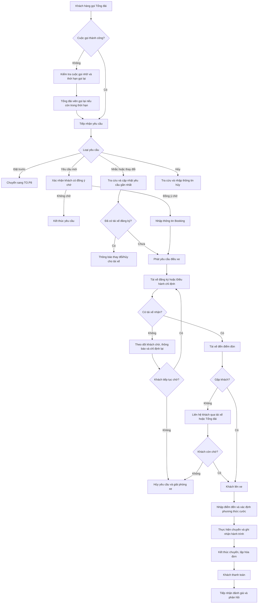
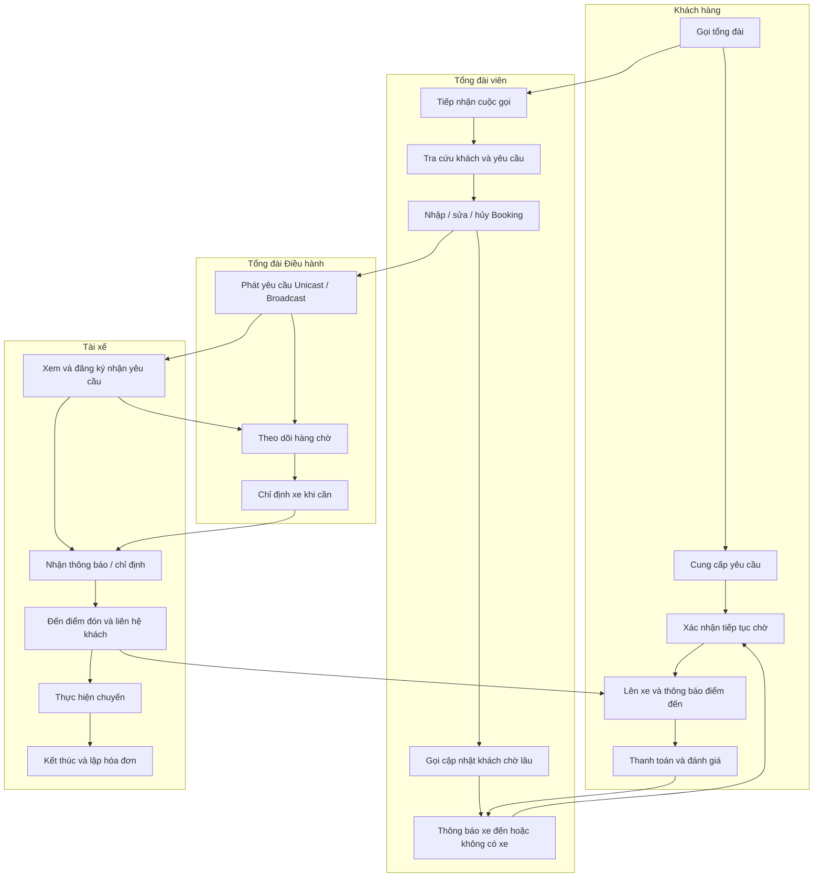

# 04 — QUY TRÌNH NGHIỆP VỤ ĐẦU CUỐI VÀ SWIMLANE TO.P1–TO.P9

**Mã tài liệu:** TAXI-BIZ-004  
**Phiên bản:** 0.1  
**Trạng thái:** ĐANG XÂY DỰNG — TO.P1 ĐÃ ĐẶC TẢ BẢN ĐẦU; TO.P2–TO.P9 CHƯA ĐẶC TẢ  
**Nguồn nghiệp vụ:** *MLG_Luu do va mo ta quy trinh & Yeu cau _Dieu hanh taxi_v3.docx*, KPMG, 2015.

> Tài liệu này bám theo mã bước, vai trò và mô tả trong tài liệu KPMG. Không xem quy trình năm 2015 là chính sách hiện hành. Những nội dung KPMG để [xxx], yêu cầu Mai Linh tự quy định hoặc chưa đủ dữ liệu đều được giữ ở trạng thái cần xác nhận. Phần diễn giải thiết kế hệ thống được tách riêng khỏi nội dung nguồn.

## 1. Danh mục quy trình

| Mã | Quy trình | Trạng thái đặc tả |
|---|---|---|
| TO.P1 | Khách hàng yêu cầu Taxi qua Tổng đài | Đã dựng luồng và swimlane bản đầu |
| TO.P2 | Khách hàng sử dụng Ứng dụng | Chưa đặc tả |
| TO.P3 | Khách yêu cầu tại Điểm tiếp thị có nhân viên điều hành điểm | Chưa đặc tả |
| TO.P4 | Khách yêu cầu tại Khu vực sắp tài không có nhân viên điều hành điểm | Chưa đặc tả |
| TO.P5 | Khách hàng yêu cầu Taxi qua SMS | Chưa đặc tả |
| TO.P6 | Khách hàng yêu cầu Taxi qua Chat | Chưa đặc tả |
| TO.P7 | Khách hàng yêu cầu Taxi qua Web | Chưa đặc tả |
| TO.P8 | Khách hàng đặt xe trước | Chưa đặc tả |
| TO.P9 | Cước phí đường dài | Chưa đặc tả |

## 2. TO.P1 — Khách hàng yêu cầu Taxi qua Tổng đài

### 2.1. Mục tiêu và phạm vi theo KPMG

Quy trình mô tả việc điều hành Taxi khi khách hàng yêu cầu qua cuộc gọi tổng đài, từ lúc bắt đầu đến khi khách hàng thanh toán dịch vụ. Chủ quy trình được nêu gồm Tổng đài viên, Tổng đài Điều hành và Tài xế.

Khách hàng có thể gọi bằng điện thoại bàn hoặc di động để:
- Yêu cầu/nhắc xe.
- Thay đổi yêu cầu dịch vụ.
- Hủy yêu cầu dịch vụ.
- Đặt chỗ trước; trường hợp này chuyển sang TO.P8.

### 2.2. Vai trò tham gia

| Vai trò | Trách nhiệm được mô tả trong nguồn |
|---|---|
| Khách hàng | Gọi tổng đài, cung cấp yêu cầu, xác nhận chờ, thay đổi/hủy, lên xe, thanh toán và phản hồi |
| Tổng đài viên | Tiếp nhận cuộc gọi, nhập/cập nhật/hủy yêu cầu, gọi lại/thông báo khách, cập nhật tình trạng chờ |
| Tổng đài Điều hành | Phát yêu cầu đến tài xế, theo dõi khách chờ lâu, chỉ định xe và xử lý tình huống thiếu xe |
| Tài xế | Đăng ký nhận khách, hủy đăng ký, nhận chỉ định, đến điểm đón, liên hệ khách, thực hiện chuyến và thu tiền |
| Hệ thống | Hiển thị dữ liệu, phát yêu cầu, cập nhật trạng thái, ghi nhận đăng ký/hủy và hỗ trợ báo cáo |

### 2.3. Luồng tổng thể

**Giới hạn:** Đây là lưu đồ tổng hợp để đọc nhanh. Các nhánh chi tiết phải đối chiếu bảng bước ở mục 2.4 và các chính sách hiện hành trước khi dùng làm căn cứ phát triển.

### 2.4. Diễn giải các bước theo mã KPMG

| Mã bước | Hoạt động | Vai trò theo nguồn | Nội dung được mô tả trong KPMG |
|---|---|---|---|
| TO.P1.1 | Gọi tổng đài | Khách hàng | Gọi bằng điện thoại bàn/di động để yêu cầu, nhắc, thay đổi hoặc hủy dịch vụ |
| TO.P1.2 | Đặt chỗ trước | Khách hàng | Nếu đặt trước thì chuyển sang TO.P8 |
| TO.P1.3 | Cuộc gọi thành công | Tổng đài viên | Xác định cuộc gọi có thành công hay không |
| TO.P1.4 | Gọi lại khách hàng | Tổng đài viên | Với cuộc gọi nhỡ từ di động, gọi lại trong thời hạn do Mai Linh quy định theo khu vực và thời điểm; nguồn để [xxx] phút |
| TO.P1.5 | Phân loại yêu cầu | Khách hàng | Yêu cầu mới đi TO.P1.6; nhắc/thay đổi đi TO.P1.8; hủy đi TO.P1.10 |
| TO.P1.6 | Khách hàng đồng ý chờ? | Tổng đài viên | Nếu đồng ý chờ thì lấy thông tin; nếu không đồng ý thì quy trình kết thúc |
| TO.P1.7 | Nhập dữ liệu vào hệ thống | Tổng đài viên | Nhập số nhà, đường, phường, quận, loại/hiệu xe, đặc điểm, số điện thoại nếu cần, số lượng xe theo loại. Hệ thống hiển thị địa chỉ gắn với số điện thoại bàn hoặc ba địa chỉ yêu cầu gần nhất của số di động. Nếu tài xế gọi yêu cầu xe thì để trống số điện thoại khách |
| TO.P1.8 | Nhập dữ liệu yêu cầu thay đổi/nhắc xe | Tổng đài viên | Tra cứu theo số điện thoại; nếu dùng số khác thì dựa vào điểm đón. Chọn yêu cầu gần nhất để chỉnh sửa. Nếu đã có xe đăng ký thì cập nhật cho xe; nếu chưa có xe đăng ký thì xử lý như yêu cầu mới |
| TO.P1.9 | Lái xe đã đăng ký? | Tổng đài viên | Có xe đăng ký thì sang TO.P1.16; chưa có xe thì sang TO.P1.12 |
| TO.P1.10 | Nhập dữ liệu hủy yêu cầu xe | Tổng đài viên | Tra cứu yêu cầu gần nhất theo số điện thoại hoặc điểm đón và chọn yêu cầu để hủy |
| TO.P1.11 | Lái xe đã đăng ký? | Tổng đài viên | Nếu có xe đăng ký thì sang TO.P1.16; nếu chưa có xe thì quy trình kết thúc |
| TO.P1.12 | Phát yêu cầu xe theo Unicast/Broadcast | Tổng đài Điều hành | Unicast là mặc định, phát đến xe trống trong bán kính cấu hình [xxx] km. Broadcast phát đến xe trống toàn hệ thống, do Tổng đài Điều hành kiểm soát trong tình huống đặc biệt như cao điểm/thiếu xe cục bộ. Có cảnh báo nhu cầu tăng đột biến và danh sách khách chờ lâu |
| TO.P1.13 | Hiển thị yêu cầu trên ứng dụng tài xế | Hệ thống | Hiển thị yêu cầu để tài xế xem và đăng ký; chi tiết bước cần rà soát thêm trong bản lưu đồ nguồn |
| TO.P1.14 | Đăng ký đón khách | Tài xế | Tài xế bấm đăng ký; tại một thời điểm chỉ đăng ký một yêu cầu. Ứng dụng hiển thị 10 yêu cầu chưa đăng ký gần nhất theo lộ trình giao thông thực. Ngoài bán kính phát sóng [xxx] km thì có thể thấy nhưng không đăng ký được |
| TO.P1.15 | Hủy đăng ký đón khách? | Tài xế | Nếu hủy thì yêu cầu trở về chưa có xe đăng ký, xe trở về trống; hệ thống ghi nhận lịch sử hủy. Nếu không hủy thì tài xế đi đến điểm đón |
| TO.P1.16 | Tài xế nhận thông báo hủy/thay đổi | Tài xế | Khi Tổng đài viên hủy/thay đổi, ứng dụng tài xế hiển thị thông báo kèm âm báo. Hủy thì kết thúc; thay đổi thì tài xế có thể hủy đăng ký theo luồng được mô tả |
| TO.P1.17 | Trường hợp giờ cao điểm | Tổng đài Điều hành | Khi chưa có tài xế nhận hoặc tài xế đã đăng ký rồi hủy, Tổng đài cần thông báo tình hình cho khách để khách chọn tiếp tục chờ hay hủy |
| TO.P1.18 | Hiển thị thông tin sang hỗ trợ viên | Tổng đài Điều hành | Trong giờ cao điểm, cho phép hiển thị thông tin khách chờ lâu sang hỗ trợ viên để thông báo tình hình xe |
| TO.P1.19 | Gọi khách cập nhật tình hình xe | Tổng đài viên | Gọi khách từ danh sách chờ lâu; yêu cầu được tạm khóa trong lúc cập nhật. Lưu thông tin cập nhật gần nhất. Nếu không có số điện thoại và không thấy khách thì coi như hủy, ghi nhận để xử lý khiếu nại |
| TO.P1.20 | Khách hàng đồng ý chờ? | Tổng đài viên | Nếu khách chờ thì cập nhật danh sách chờ lâu để Điều hành chỉ định xe; nếu không chờ thì đi bước hủy |
| TO.P1.21 | Hủy yêu cầu đặt xe | Tổng đài viên | Nhập thông tin hủy; yêu cầu biến khỏi danh sách chờ, bản đồ và danh sách yêu cầu trên xe; xe đã đăng ký được trả về trạng thái trống |
| TO.P1.22 | Chỉ định xe đón khách | Tổng đài Điều hành | Điều hành có quyền chỉ định xe cho khách chờ lâu; xe gần nhất theo lộ trình thực được hệ thống hỗ trợ lựa chọn. Có thể cung cấp số điện thoại khách cho tài xế nếu được phép |
| TO.P1.23 | Từ chối/hủy nhận chỉ định? | Tài xế | Tài xế từ chối, không chấp nhận trong [xxx] giây hoặc hủy sau khi đã nhận thì được xem là không nhận chỉ định; chấp nhận thì sang TO.P1.26 |
| TO.P1.24 | Cần thông báo khách không có xe? | Tổng đài viên | Nguồn nêu nếu chỉ định hai lần vẫn không có xe chấp nhận thì cần thông báo khách; hệ thống lập báo cáo tài xế từ chối |
| TO.P1.25 | Thông báo khách hàng không có xe | Tổng đài viên | Dựa trên danh sách chờ và thời gian từ lần gọi khách cuối cùng [xxx] phút, gọi thông báo và tiến hành hủy |
| TO.P1.26 | Nhận chỉ định đón khách | Tài xế | Ứng dụng hiển thị yêu cầu được chỉ định. Hệ thống ghi nhận xe nhận chỉ định; chính sách khuyến khích tài xế được Mai Linh quy định cụ thể |
| TO.P1.27 | Đến điểm đón khách | Tài xế | Tài xế đến điểm đón; hành trình chở khách được ghi nhận bởi hệ thống quản lý hành trình trên xe |
| TO.P1.28 | Thấy khách? | Tài xế | Có khách thì sang TO.P1.34; không thấy khách thì sang TO.P1.29 |
| TO.P1.29 | Xin số điện thoại khách? | Tổng đài Điều hành | Khi không thấy khách, tài xế gọi Tổng đài; trong giờ cao điểm có thể cần chuyển số điện thoại khách cho tài xế |
| TO.P1.30 | Chuyển số điện thoại khách cho tài xế | Tổng đài Điều hành | Nếu cao điểm và tổng đài viên bận, Điều hành chuyển số điện thoại để tài xế tự liên lạc |
| TO.P1.31 | Tài xế gọi khách báo xe đến | Tài xế | Nếu không liên lạc được, tài xế có thể báo cáo để nhận cuốc khác. Thời gian chờ khách cần Mai Linh quy định |
| TO.P1.32 | Gọi khách báo xe đến | Tổng đài viên | Nếu thấp điểm hoặc không thể chuyển số điện thoại cho tài xế, tổng đài viên gọi khách |
| TO.P1.33 | Khách hàng phản hồi | Tổng đài viên | Khách hủy thì nhập hủy để xe nhận yêu cầu khác; khách vẫn chờ thì yêu cầu khách ra xe |
| TO.P1.34 | Khách lên xe, thông báo điểm đến | Tài xế | Khách thông báo điểm đến. Nếu khách không phải người đã gọi tổng đài, tài xế báo hủy đăng ký đón nhầm và yêu cầu xe khác đến |
| TO.P1.35 | Bấm đồng hồ, nhập điểm đến | Tài xế | Tài xế bấm đồng hồ, nhập điểm đến vào ứng dụng để dẫn đường; có thể hiển thị cước ước tính |
| TO.P1.36 | Có thể áp dụng cước đường dài? | Tài xế/Hệ thống | Nếu đủ điều kiện, hệ thống hiển thị cước đường dài để khách chọn cước cố định hay cước đồng hồ; chọn cước đường dài thì chuyển TO.P9 |
| TO.P1.37 | Yêu cầu cấp mã đi đường dài | Tài xế | Gửi điểm đầu/cuối, cự ly và đăng ký một chiều/hai chiều để yêu cầu cấp mã |
| TO.P1.38 | Xử lý và cấp mã đường dài | Tổng đài Điều hành | Cấp mã theo khung giá cố định đã định nghĩa và cự ly đăng ký |
| TO.P1.39 | Thực hiện dịch vụ chở khách | Tài xế | Chở khách đến nơi; hành trình được lưu trong hệ thống quản lý hành trình |
| TO.P1.40 | Kết thúc hành trình và xuất hóa đơn | Tài xế | Hóa đơn gồm doanh thu đồng hồ, cước cố định đường dài/phụ thu vượt lộ trình, phí cầu đường, tiền tip, số tài/MSNV, điểm đầu/cuối, ngày giờ |
| TO.P1.41 | Thanh toán | Khách hàng | Kiểm tra hóa đơn và thanh toán; nguồn nêu tiền mặt, thẻ trả sau MCC, thẻ tín dụng/thẻ ATM và voucher |
| TO.P1.42 | Khách hàng phản hồi chất lượng dịch vụ | Khách hàng | Chấm điểm chất lượng là thông tin bắt buộc theo nguồn; ý kiến góp ý/phàn nàn là tùy chọn. Kênh gồm ứng dụng, gọi tổng đài hoặc tổng đài gọi ngẫu nhiên |

**Lưu ý truy vết:** Bước TO.P1.13 trong bản diễn giải trích xuất chưa có đủ nội dung mô tả; cần kiểm tra trực tiếp trang lưu đồ/bản gốc khi hoàn thiện. Một số bước trong KPMG dẫn chiếu chéo chưa rõ hoặc có lỗi đánh số; tài liệu này không tự ý sửa mã nguồn.

### 2.5. Swimlane theo vai trò

Swimlane trên là sơ đồ trách nhiệm khái quát. Các nhánh từ chối, hủy, khách không đến và lỗi kết nối cần được kiểm thử riêng; không dùng sơ đồ này thay cho bảng mã bước.

### 2.6. Dữ liệu đầu vào và đầu ra

| Nhóm | Dữ liệu theo tài liệu nguồn |
|---|---|
| Đầu vào Booking | Số nhà, đường, phường, quận, loại xe, hiệu xe, đặc điểm, số điện thoại nếu cần, số lượng xe theo loại |
| Dữ liệu hỗ trợ tra cứu | Địa chỉ gắn số điện thoại bàn hoặc ba địa chỉ yêu cầu gần nhất của số di động |
| Điều phối | Điểm đón, danh sách xe trống, bán kính phát, phương thức Unicast/Broadcast, đăng ký và chỉ định |
| Thực hiện chuyến | Điểm đến, thời điểm đến đón, hành trình, dữ liệu đồng hồ và mã đường dài nếu có |
| Hóa đơn | Cước đồng hồ, cước cố định/phụ thu đường dài, phí cầu đường, tiền tip, số tài/MSNV, điểm đầu/cuối, ngày giờ |
| Thanh toán | Tiền mặt, MCC, thẻ tín dụng/thẻ ATM, voucher |
| Phản hồi | Điểm đánh giá bắt buộc; ý kiến chi tiết tùy chọn |

### 2.7. Điểm bàn giao Module theo kiến trúc đề xuất

| Hoạt động nghiệp vụ | Module sở hữu/đảm nhiệm | Bàn giao |
|---|---|---|
| Tiếp nhận và quản lý Booking qua điện thoại | M01 | Booking sẵn sàng điều phối gửi M03 |
| Hồ sơ và trạng thái nguồn lực | M02 | Nguồn lực đủ điều kiện cung cấp cho M03 |
| Phát yêu cầu, Offer, đăng ký, chỉ định, hàng đợi | M03 | Assignment hiệu lực chuyển M04 |
| Đến đón, bắt đầu/kết thúc Trip, hành trình | M04 | Sự kiện Trip chuyển M05 |
| Biểu giá, tính cước, giao dịch thanh toán | M05 | Kết quả tài chính chuyển M06 |
| Ghi nhận doanh thu, công nợ, đối soát | M06 | Dữ liệu tài chính đã xác minh chuyển M10 |
| Màn hình tổng đài, giám sát, can thiệp và CSKH | M07 | Gọi lệnh đến Module sở hữu dữ liệu |
| Người dùng, quyền, nhật ký và chính sách | M08 | Cung cấp năng lực dùng chung |
| Tích hợp thoại/tổng đài và thông báo | M09 | Chuyển sự kiện/kết quả giao tiếp |
| Báo cáo nhu cầu, doanh thu, vận hành | M10 | Chỉ đọc dữ liệu nguồn đã được phân quyền |

### 2.8. Các điểm cần Mai Linh xác nhận

| Mã quyết định | Nội dung chưa được chốt | Căn cứ |
|---|---|---|
| P1-DEC-01 | Thời hạn gọi lại cuộc gọi nhỡ theo khu vực và giờ cao/thấp điểm | TO.P1.4 ghi [xxx] phút |
| P1-DEC-02 | Bán kính Unicast và bán kính tài xế được phép đăng ký | TO.P1.12, TO.P1.14 ghi [xxx] km |
| P1-DEC-03 | Thời gian chờ phản hồi nhận chỉ định của tài xế | TO.P1.23 ghi [xxx] giây |
| P1-DEC-04 | Số lần chỉ định tối đa và thời hạn chờ trước khi thông báo không có xe | TO.P1.24–P1.25 |
| P1-DEC-05 | Thời gian tài xế chờ khách tại điểm đón và số lần gọi khách | TO.P1.31 yêu cầu quy định |
| P1-DEC-06 | Quyền chuyển số điện thoại khách cho tài xế, điều kiện bảo vệ dữ liệu | TO.P1.29–P1.32 |
| P1-DEC-07 | Chính sách thưởng/khuyến khích tài xế nhận chỉ định | TO.P1.26 |
| P1-DEC-08 | Biểu giá, điều kiện đường dài, mã xác nhận và phụ thu | TO.P1.35–P1.40; chuyển TO.P9 |
| P1-DEC-09 | Phương thức thanh toán còn được Mai Linh sử dụng hiện nay | TO.P1.41 |
| P1-DEC-10 | Kênh, thời điểm và nội dung bắt buộc của đánh giá chất lượng | TO.P1.42 |

### 2.9. Các diễn giải thiết kế cần tách khỏi chính sách nguồn

Các nội dung sau là đề xuất kỹ thuật để thiết kế hệ thống mới, không phải câu chữ hoặc kết luận trực tiếp của KPMG:
- Mỗi lần tiếp nhận tạo một Booking có mã định danh duy nhất và lưu lịch sử thay đổi.
- Hủy Booking, hủy đăng ký và giải phóng xe cần được xử lý nhất quán, tránh giải phóng nhầm xe đã nhận yêu cầu khác.
- Chấp nhận Offer/chỉ định phải có kiểm soát đồng thời để không phát sinh hai Assignment hiệu lực.
- Mọi thay đổi sau khi tài xế đã đăng ký cần có phiên bản thông tin mà tài xế đã nhận và xác nhận đã xem.
- Việc chuyển số điện thoại phải qua phân quyền, ghi nhật ký và chính sách bảo vệ dữ liệu.
- Trip, FareResult, PaymentTransaction và LedgerEntry phải là các bản ghi riêng có liên kết truy vết.
- Các trạng thái và thời hạn phải cấu hình theo chính sách được phê duyệt, không mã hóa cứng các giá trị [xxx].

## 3. Tiêu chí hoàn thành một quy trình

Một quy trình chỉ được xem là đủ điều kiện chuyển sang đặc tả tính năng khi:
1. Có chủ quy trình và các vai trò tham gia được xác nhận.
2. Có lưu đồ chính và swimlane theo vai trò.
3. Có đủ bước, điều kiện rẽ nhánh, luồng thay thế và ngoại lệ.
4. Có dữ liệu đầu vào/đầu ra và điểm bàn giao Module.
5. Có danh sách tham số, chính sách còn TBD và người có thẩm quyền quyết định.
6. Có truy vết về yêu cầu nguồn KPMG và quyết định hiện hành.
7. Có kịch bản kiểm thử và tiêu chí nghiệm thu.

## 4. Trình tự tiếp tục

- Hoàn thiện TO.P1 sau khi kiểm tra lưu đồ gốc và xác nhận chính sách hiện tại.
- Đặc tả TO.P2 — khách hàng đặt xe qua Ứng dụng.
- Đặc tả TO.P3 và TO.P4 — hai mô hình điểm tiếp thị/khu vực sắp tài.
- Đặc tả TO.P5, TO.P6, TO.P7 — SMS, Chat, Web.
- Đặc tả TO.P8 — đặt xe trước.
- Đặc tả TO.P9 — cước phí đường dài.
- Sau khi hoàn tất 9 quy trình, xây dựng bộ State Machine và ERD tổng thể dựa trên luồng đã xác nhận.

## 5. Lịch sử phiên bản

| Phiên bản | Ngày | Nội dung | Trạng thái |
|---|---|---|---|
| 0.1 | 2026-11-14 | Tạo danh mục TO.P1–TO.P9; đặc tả bản đầu TO.P1 từ tài liệu KPMG | Đang rà soát |
