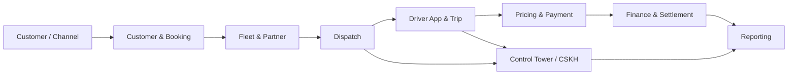

# TAXI MANAGEMENT SYSTEM

> **ĐIỂM TRUY CẬP DUY NHẤT — PROJECT OVERVIEW**  
> Trang này là mục lục trung tâm. Từ đây có thể xem tổng thể, mở từng Module, đọc đặc tả Feature và quay lại trang này.

**Repository:** [Taxi-Management-System](https://github.com/daoaigiangnam/Taxi-Management-System)  
**Branch:** `main` · **Documentation baseline:** 0.1 · **Status:** DRAFT — cần Business/Architecture review.

## 1. Đọc từ đây
- **[00 — OVERVIEW: Tổng quan hệ thống](./00-OVERVIEW.md)**
- [Danh mục 10 Module](#2-module-catalog)
- [Thiết kế xuyên Module](#3-thiet-ke-xuyen-module)
- [Feature Specifications](./docs/05-FEATURE-SPECS/README.md)
- [Sơ đồ hệ thống](#4-so-do-he-thong)

## 2. Module Catalog

| Module | Phạm vi | Tài liệu chi tiết |
|---|---|---|
| M01 — Customer & Booking | Khách hàng, tiếp nhận yêu cầu, đặt/sửa/hủy xe | [M01](./02-DOMAIN-MODULES/01-customer-and-booking/README.md) |
| M02 — Fleet & Partner | Tài xế, xe, đội xe, đối tác, hợp đồng | [M02](./02-DOMAIN-MODULES/02-fleet-and-partner/README.md) |
| M03 — Dispatch | Eligibility, Candidate, Ranking, Offer, Assignment | [M03](./02-DOMAIN-MODULES/03-dispatch/README.md) |
| M04 — Driver App & Trip | Ứng dụng tài xế, GPS, hành trình, sự cố | [M04](./02-DOMAIN-MODULES/04-driver-app-and-trip/README.md) |
| M05 — Pricing & Payment | Biểu giá, tính cước, thu/hoàn tiền | [M05](./02-DOMAIN-MODULES/05-pricing-and-payment/README.md) |
| M06 — Finance & Settlement | Ledger, công nợ, đối soát, thanh toán đối tác | [M06](./02-DOMAIN-MODULES/06-finance-and-settlement/README.md) |
| M07 — Control Tower & CSKH | Điều hành, giám sát, khiếu nại, SLA | [M07](./02-DOMAIN-MODULES/07-control-tower-and-customer-service/README.md) |
| M08 — Platform, IAM & Audit | Người dùng, phân quyền, cấu hình, nhật ký | [M08](./02-DOMAIN-MODULES/08-platform-iam-audit/README.md) |
| M09 — Integration & Notification | Maps, SMS, Voice, Payment, Partner API | [M09](./02-DOMAIN-MODULES/09-integration-and-notification/README.md) |
| M10 — Reporting & Analytics | KPI, Dashboard, báo cáo | [M10](./02-DOMAIN-MODULES/10-reporting-and-analytics/README.md) |

## 3. Thiết kế xuyên Module
- [State Machines & Transition Rules](./03-CROSS-CUTTING/01-state-machines-and-transition-rules.md)
- [Data Architecture & ERD](./03-CROSS-CUTTING/02-data-architecture-and-erd.md)
- [API & Event Contracts](./03-CROSS-CUTTING/03-api-and-event-contracts.md)
- Security, NFR, Delivery Governance: sẽ bổ sung và liên kết tại đây sau khi xác nhận cấu trúc.

## 4. Sơ đồ hệ thống
Quy trình nghiệp vụ chuẩn:

## 5. Nguyên tắc kiến trúc nền tảng
1. DIRECT và PARTNER dùng chung nền tảng vận hành/điều phối; hợp đồng, doanh thu, công nợ, khấu trừ và settlement phải tách bạch.
2. `booking_channel` độc lập `fleet_type`.
3. Booking, DispatchRun, Offer, Assignment và Trip là các đối tượng/vòng đời riêng.
4. Eligibility filter trước Candidate ranking.
5. Một Booking tối đa một Assignment hiệu lực tại một thời điểm.
6. Module sở hữu dữ liệu của mình; không ghi trực tiếp vào dữ liệu nguồn của Module khác.
7. Lệnh ghi quan trọng cần authorization, validation, idempotency, concurrency control và audit.
8. Ledger và dữ liệu tài chính đã ghi sổ không bị sửa/xóa tùy tiện; điều chỉnh phải truy vết.
9. Chính sách chưa được phê duyệt phải ghi TBD, không biến giả định thành quy tắc chính thức.

## 6. Trình tự triển khai
Foundation & E2E → Domain/Module boundaries → State/Data/API/Security/NFR → Feature Specs → Implementation → Test/UAT → Release.
**Lát cắt ưu tiên:** Booking → Dispatch → Trip. Chưa bắt đầu code khi Feature chưa đạt Definition of Ready.

## 7. Trạng thái và quản trị tài liệu
Tất cả nội dung hiện là DRAFT baseline. Mỗi quyết định cần owner/approver; mỗi Feature cần business flow, UI/UX states, validation, rules, API/event, DB, permissions, errors, tests và acceptance evidence.

---
**Quay lại đầu trang:** [Taxi Management System — README](./README.md)
