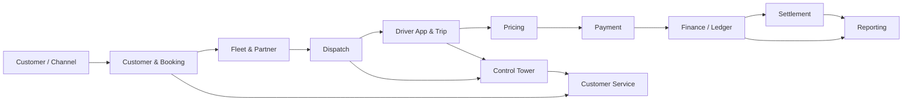

# TAXI MANAGEMENT SYSTEM — TÀI LIỆU TỔNG THỂ

> **Điểm vào duy nhất của dự án.** Trang này là Overview, bản đồ kiến trúc, mục lục và đường dẫn đến toàn bộ đặc tả chi tiết.

| Thuộc tính | Giá trị |
|---|---|
| Repository | [Taxi-Management-System](https://github.com/daoaigiangnam/Taxi-Management-System) |
| Nhánh chuẩn | `main` |
| Phiên bản tài liệu | 0.1 — Foundation Draft |
| Trạng thái | Khởi tạo lại từ đầu — chưa phê duyệt nghiệp vụ/kiến trúc |
| Mô hình khai thác | DIRECT + PARTNER trên một nền tảng vận hành/điều phối thống nhất |
| Phương pháp | Tổng thể → Quy trình → Domain/Module → Feature Spec → Phát triển → Kiểm thử → Nghiệm thu |

## 1. Bắt đầu từ đây
- **[00 — OVERVIEW: Tổng quan hệ thống và bản đồ điều hướng](./docs/00-OVERVIEW.md)** — đọc đầu tiên.
- [Feature Specs — Danh mục đặc tả tính năng](./docs/05-FEATURE-SPECS/README.md).
- [Decision Register — Sổ quyết định](./docs/04-DELIVERY-GOVERNANCE/04-decision-register.md).
- [Diagrams — Sơ đồ hệ thống](./docs/06-DIAGRAMS/README.md).

## 2. Foundation — thiết kế nền
| Mã | Tài liệu | Mục đích |
|---|---|---|
| FND-01 | [Bối cảnh nghiệp vụ và phạm vi](./docs/01-FOUNDATION/01-business-context-and-scope.md) | Mục tiêu, stakeholder, phạm vi |
| FND-02 | [Mô hình vận hành DIRECT/PARTNER](./docs/01-FOUNDATION/02-operating-model-direct-partner.md) | Vai trò, nguồn lực, thương mại |
| FND-03 | [Quy trình nghiệp vụ đầu-cuối](./docs/01-FOUNDATION/03-end-to-end-business-processes.md) | Booking → Dispatch → Trip → Finance |
| FND-04 | [Domain và kiến trúc Module](./docs/01-FOUNDATION/04-domain-and-module-architecture.md) | Ownership, boundary, phụ thuộc |
| FND-05 | [Thuật ngữ và từ vựng chuẩn](./docs/01-FOUNDATION/05-glossary-and-canonical-vocabulary.md) | Canonical names |

## 3. Đặc tả theo Module
| Module | Phạm vi | Tài liệu |
|---|---|---|
| M01 — Customer & Booking | Khách hàng, đặt xe, điểm dừng, sửa/hủy | [M01](./docs/02-DOMAIN-MODULES/01-customer-and-booking/README.md) |
| M02 — Fleet & Partner | Tài xế, xe, đối tác, hợp đồng, eligibility | [M02](./docs/02-DOMAIN-MODULES/02-fleet-and-partner/README.md) |
| M03 — Dispatch | Candidate, ranking, Offer, Assignment | [M03](./docs/02-DOMAIN-MODULES/03-dispatch/README.md) |
| M04 — Driver App & Trip | Ứng dụng tài xế, hành trình, GPS, offline, SOS | [M04](./docs/02-DOMAIN-MODULES/04-driver-app-and-trip/README.md) |
| M05 — Pricing & Payment | Biểu giá, Fare, Payment, Refund | [M05](./docs/02-DOMAIN-MODULES/05-pricing-and-payment/README.md) |
| M06 — Finance & Settlement | Ledger, công nợ, đối soát, chi trả | [M06](./docs/02-DOMAIN-MODULES/06-finance-and-settlement/README.md) |
| M07 — Control Tower & Customer Service | Giám sát, can thiệp, case, SLA | [M07](./docs/02-DOMAIN-MODULES/07-control-tower-and-customer-service/README.md) |
| M08 — Platform, IAM & Audit | User, quyền, scope, audit, config | [M08](./docs/02-DOMAIN-MODULES/08-platform-iam-audit/README.md) |
| M09 — Integration & Notification | API đối tác, bản đồ, payment, SMS/voice/push | [M09](./docs/02-DOMAIN-MODULES/09-integration-and-notification/README.md) |
| M10 — Reporting & Analytics | KPI, dashboard, báo cáo | [M10](./docs/02-DOMAIN-MODULES/10-reporting-and-analytics/README.md) |

## 4. Tài liệu xuyên Module
- [State Machines và quy tắc chuyển trạng thái](./docs/03-CROSS-CUTTING/01-state-machines-and-transition-rules.md)
- [Kiến trúc dữ liệu và ERD](./docs/03-CROSS-CUTTING/02-data-architecture-and-erd.md)
- [API và Event Contracts](./docs/03-CROSS-CUTTING/03-api-and-event-contracts.md)
- [Bảo mật, quyền riêng tư và kiểm toán](./docs/03-CROSS-CUTTING/04-security-privacy-and-audit.md)
- [NFR, năng lực tải và DR](./docs/03-CROSS-CUTTING/05-nfr-capacity-and-disaster-recovery.md)

## 5. Quản trị và triển khai
- [Yêu cầu và Traceability](./docs/04-DELIVERY-GOVERNANCE/01-requirements-and-traceability.md)
- [Kiểm thử và nghiệm thu](./docs/04-DELIVERY-GOVERNANCE/02-testing-and-acceptance.md)
- [Phát hành, Migration và Cutover](./docs/04-DELIVERY-GOVERNANCE/03-release-migration-and-cutover.md)
- [Sổ quyết định](./docs/04-DELIVERY-GOVERNANCE/04-decision-register.md)
- [Rủi ro, giả định và phụ thuộc](./docs/04-DELIVERY-GOVERNANCE/05-risk-assumptions-and-dependencies.md)
- [Feature Specs](./docs/05-FEATURE-SPECS/README.md) · [Diagrams](./docs/06-DIAGRAMS/README.md)

## 6. Quy trình đầu-cuối cấp cao

Sơ đồ năng lực logic, không phải deployment topology.

## 7. Nguyên tắc kiến trúc bất biến
1. Một nền tảng tiếp nhận và điều phối dùng chung DIRECT/PARTNER.
2. `booking_channel` độc lập `fleet_type`; không suy ra nguồn xe từ kênh đặt.
3. Booking, DispatchRun, Offer, Assignment, Trip, Fare, Payment, Ledger và Settlement là đối tượng/vòng đời riêng.
4. Mỗi dữ liệu nghiệp vụ có một Module sở hữu; không Module khác tự cập nhật bảng nguồn.
5. Một Booking tối đa một Assignment hiệu lực; tài xế/xe không phân công xung đột.
6. Eligibility filter trước Candidate ranking.
7. DIRECT/PARTNER dùng chung vận hành nhưng tách hợp đồng, doanh thu, công nợ, khấu trừ và settlement.
8. Ledger/audit có truy vết; điều chỉnh bằng bản ghi mới.
9. API ghi có authorization, validation, idempotency, concurrency control và audit.
10. Chính sách chưa duyệt ghi TBD có owner; không đưa giả định vào production.

## 8. Lộ trình và cổng kiểm soát
| Gate | Đầu ra | Điều kiện qua cổng |
|---|---|---|
| G0 Foundation | Scope, operating model, E2E, domain/module, glossary | Business thống nhất |
| G1 Architecture | State, data, API/event, security, NFR | Owner dữ liệu/kiến trúc duyệt |
| G2 Feature Design | Feature Specs, UI states, validation, acceptance | Definition of Ready |
| G3 Implementation | Code, migration, API, observability | Review + CI |
| G4 Verification | Unit/integration/E2E/security/performance/UAT | Evidence + sign-off |
| G5 Release | Migration, cutover, rollback, runbook | Go-live approval |

Ưu tiên lát cắt đầu tiên: **Booking → Dispatch → Trip**; quyết định phụ thuộc phải hoàn tất trước khi code.

## 9. Definition of Ready cho Feature
Mục tiêu/actor/owner; business flow; pre/postconditions; UI loading/empty/error/denied/conflict/offline; validation; business rules; state transitions; API/event; data ownership/schema/index/migration; permission/audit; NFR; retry/idempotency/concurrency; tests; acceptance; traceability; dependencies; decision references; approval.

## 10. Trạng thái tài liệu
DRAFT → IN_REVIEW → APPROVED → BASELINED → SUPERSEDED. Mọi tài liệu ghi version, status, owner, reviewer, date và decision references. Thay đổi sau baseline cần change request/impact analysis.

## 11. Các vấn đề chưa kết luận
Biểu giá/phụ phí, phí hủy/no-show, vùng phục vụ, ưu tiên DIRECT/PARTNER, scoring/timeout/retry, SLA/KPI, partner share/deductions, payment provider, maps/telephony/SMS, tải thiết kế, RTO/RPO, data retention và pháp lý đều TBD.

> **Cách sử dụng:** README là một link Overview duy nhất để mọi vai trò bắt đầu. Từ đây đi đến Foundation, Module và Feature Spec. Tài liệu chi tiết phải liên kết ngược về README.
