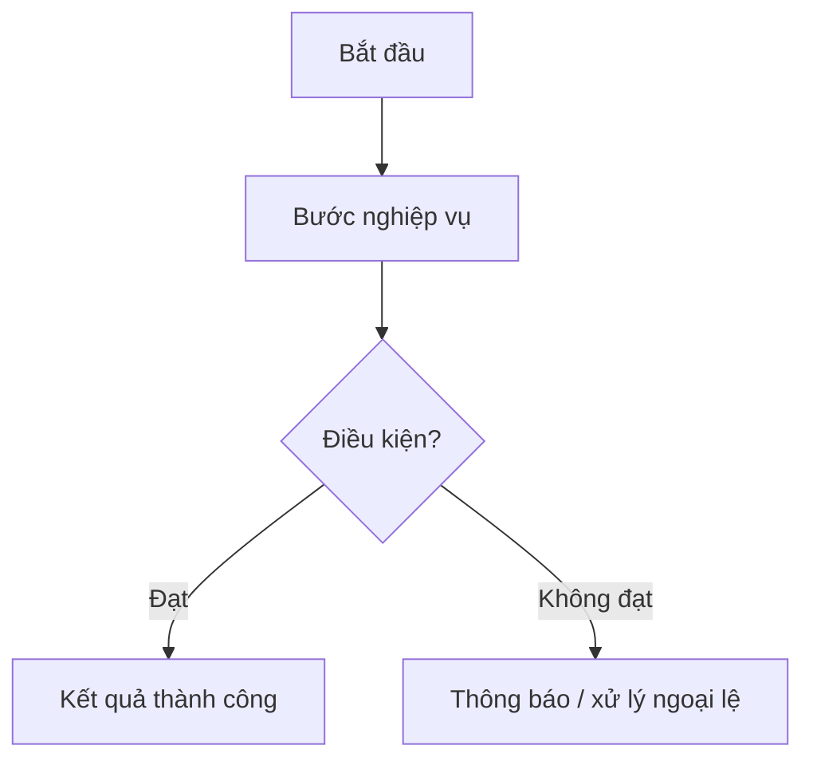

# MẪU ĐẶC TẢ FEATURE — FEATURE SPECIFICATION

**Mã tài liệu:** TAXI-FEATURE-TEMPLATE  
**Phiên bản:** 1.0  
**Trạng thái:** MẪU CHUẨN — CẦN PHÊ DUYỆT TRƯỚC KHI ÁP DỤNG CHÍNH THỨC  
**Áp dụng:** Tất cả Feature thuộc 10 Module Taxi Management System

> **Cách sử dụng:** Sao chép mẫu này thành một file riêng cho từng Feature. Xóa hướng dẫn trong ngoặc vuông sau khi hoàn thiện. Không tự suy diễn chính sách còn thiếu; ghi TBD kèm người quyết định và hạn chốt. Nội dung lấy từ KPMG 2015 phải ghi rõ mã quy trình/bước và phân biệt với đề xuất thiết kế mới.

---

## 0. Quản lý tài liệu

| Thuộc tính | Giá trị |
|---|---|
| Feature ID | [Ví dụ: BKG-001] |
| Tên Feature | [Tên tiếng Việt] |
| Module sở hữu | [M01–M10] |
| Epic | [Epic ID/Tên] |
| Phiên bản | [0.1] |
| Trạng thái | DRAFT / IN_REVIEW / READY / IN_DEV / IN_QA / UAT / ACCEPTED / DEPRECATED |
| Business Owner | [Tên/Vai trò] |
| Product Owner | [Tên/Vai trò] |
| Technical Owner | [Tên/Vai trò] |
| BA | [Tên] |
| UX/UI | [Tên] |
| DEV Lead | [Tên] |
| QA Owner | [Tên] |
| Ngày tạo/cập nhật | [Ngày] |
| Tài liệu liên quan | [Link] |

### 0.1. Lịch sử thay đổi

| Phiên bản | Ngày | Người thay đổi | Nội dung | Người duyệt |
|---|---|---|---|---|
| 0.1 | [Ngày] | [Tên] | Khởi tạo | [TBD] |

### 0.2. Trạng thái phê duyệt

| Vai trò | Người duyệt | Trạng thái | Ngày | Ghi chú |
|---|---|---|---|---|
| Business Owner | [TBD] | Pending | | |
| Product Owner | [TBD] | Pending | | |
| Technical Owner | [TBD] | Pending | | |
| QA Lead | [TBD] | Pending | | |
| Security/Data/Operations (nếu liên quan) | [TBD] | Pending | | |

---

## 1. Bối cảnh và mục tiêu nghiệp vụ

### 1.1. Vấn đề cần giải quyết
[Mô tả vấn đề hiện tại, không mô tả giải pháp trước khi hiểu vấn đề.]

### 1.2. Mục tiêu
[Kết quả nghiệp vụ có thể quan sát/đo lường.]

### 1.3. Giá trị mang lại
[Khách hàng, vận hành, tài chính, quản trị, tuân thủ.]

### 1.4. Nguồn yêu cầu và truy vết
| Nguồn | Mã tham chiếu | Nội dung được hỗ trợ | Trạng thái |
|---|---|---|---|
| Quy trình KPMG 2015 | [TO.Px / bước] | [Tóm tắt đúng nguồn] | Historical / cần xác nhận |
| Quyết định nghiệp vụ Mai Linh | [DEC-ID] | [Nội dung đã phê duyệt] | Approved / Pending |
| System Blueprint | [Mục] | [Nội dung] | Draft / Approved |
| Yêu cầu mới | [REQ-ID] | [Nội dung] | [Trạng thái] |

**Quy tắc nguồn:** Không ghi một quy tắc là “đã thống nhất” nếu chỉ xuất hiện trong tài liệu lịch sử hoặc đề xuất kỹ thuật.

---

## 2. Phạm vi

### 2.1. Trong phạm vi (In Scope)
- [Nội dung 1]
- [Nội dung 2]

### 2.2. Ngoài phạm vi (Out of Scope)
- [Nội dung 1]
- [Nội dung 2]

### 2.3. Giả định và ràng buộc
| ID | Giả định/ràng buộc | Cơ sở | Owner xác nhận | Trạng thái |
|---|---|---|---|---|
| ASM-01 | [Nội dung] | [Cơ sở] | [TBD] | TBD |

### 2.4. Phụ thuộc
| Dependency | Module/Hệ thống | Nội dung phụ thuộc | Cách xử lý khi lỗi |
|---|---|---|---|
| [Tên] | [Mxx/External] | [Mô tả] | [TBD] |

---

## 3. Actor, vai trò và phân quyền

| Actor/Role | Mục tiêu sử dụng | Permission | Data Scope | Điều kiện bổ sung |
|---|---|---|---|---|
| [Actor] | [Mục tiêu] | [permission.code] | [SELF/ASSIGNED/BRANCH/...] | [Guard] |

### 3.1. Quy tắc phân quyền
- Authorization phải được kiểm tra ở server.
- Kiểm tra quyền trên chính đối tượng dữ liệu, không chỉ trên endpoint.
- DIRECT/PARTNER và phạm vi tổ chức phải được áp dụng theo X-04.
- Quyền đặc biệt hoặc can thiệp phải có reason/audit/approval nếu policy yêu cầu.

### 3.2. Phân tách nhiệm vụ
[Maker–Checker, hạn mức, phê duyệt độc lập; ghi N/A nếu không áp dụng và nêu lý do.]

---

## 4. Thuật ngữ và dữ liệu nghiệp vụ

| Thuật ngữ | Định nghĩa trong Feature | Nguồn/Owner |
|---|---|---|
| [Thuật ngữ] | [Định nghĩa] | [Nguồn] |

### 4.1. Dữ liệu đầu vào
| Trường | Bắt buộc? | Kiểu/định dạng | Quy tắc kiểm tra | Nguồn dữ liệu | PII? |
|---|---|---|---|---|---|
| [field] | [Có/Không/Điều kiện] | [TBD] | [Rule ID] | [Actor/System] | [Có/Không] |

### 4.2. Dữ liệu đầu ra
| Dữ liệu | Mô tả | Nơi sử dụng | Điều kiện hiển thị |
|---|---|---|---|
| [Output] | [Mô tả] | [Module/Actor] | [Permission/State] |

### 4.3. Data ownership
- Aggregate/entity sở hữu: [Module]
- Entity chỉ tham chiếu: [Module]
- Dữ liệu được tạo/cập nhật: [Liệt kê]
- Dữ liệu không được phép cập nhật trực tiếp: [Liệt kê]
- Quy tắc audit/version/history: [Mô tả]

---

## 5. Quy tắc nghiệp vụ (Business Rules)

| Rule ID | Quy tắc | Nguồn | Mức độ | Owner | Trạng thái |
|---|---|---|---|---|---|
| [BKG-R-001] | [Mô tả rõ điều kiện và kết quả] | [TO.Px/DEC] | Must/Should/Optional | [Vai trò] | Draft/Approved/TBD |

Mỗi Rule cần xác định:
- Điều kiện kích hoạt.
- Điều kiện hợp lệ/không hợp lệ.
- Kết quả nghiệp vụ.
- Thứ tự ưu tiên khi có nhiều Rule.
- Ngoại lệ và quyền override.
- Mã quyết định liên quan.

---

## 6. Luồng nghiệp vụ

### 6.1. Tiền điều kiện (Preconditions)
- [Điều kiện trước khi thực hiện]

### 6.2. Luồng chính (Happy Path)
| Bước | Actor | Hành động | Hệ thống xử lý | Kết quả |
|---|---|---|---|---|
| 1 | [Actor] | [Action] | [System behavior] | [Outcome] |

### 6.3. Luồng thay thế (Alternate Flows)
| Mã | Điều kiện | Luồng xử lý | Kết quả |
|---|---|---|---|
| ALT-01 | [Điều kiện] | [Các bước] | [Outcome] |

### 6.4. Luồng ngoại lệ và phục hồi (Exception/Recovery)
| Mã | Tình huống | Hệ thống phản hồi | Dữ liệu/trạng thái | Hướng phục hồi |
|---|---|---|---|---|
| EX-01 | [Lỗi] | [Message/Action] | [Không đổi/đã ghi nhận] | [Retry/Manual/Stop] |

### 6.5. Hậu điều kiện (Postconditions)
- Thành công: [Kết quả]
- Thất bại: [Kết quả]
- Tác động phụ: [Event/Notification/Audit]

### 6.6. Sơ đồ luồng

---

## 7. Trạng thái và chuyển trạng thái

| Đối tượng | State hiện tại | Command/Event | Guard | State tiếp theo | Side effect |
|---|---|---|---|---|---|
| [Aggregate] | [State] | [Command/Event] | [Điều kiện] | [State] | [Event/Notification/Audit] |

- Đối chiếu X-01; không tự tạo enum khác với State Machine chuẩn.
- Chỉ Aggregate sở hữu mới được thay đổi trạng thái nguồn.
- Nêu rõ transition bị cấm và phản hồi khi lệnh không hợp lệ.
- Nêu rõ optimistic locking/version nếu có cạnh tranh cập nhật.

---

## 8. Đặc tả UI/UX

### 8.1. Màn hình và điểm truy cập
| Screen ID | Tên màn hình | Actor | Entry point | Permission |
|---|---|---|---|---|
| [SCR-01] | [Tên] | [Actor] | [Menu/Action] | [Permission] |

### 8.2. Thành phần giao diện
| Thành phần | Loại | Bắt buộc | Default | Validation | Hành vi |
|---|---|---|---|---|---|
| [Field/Button] | [Input/Select/Action] | [Có/Không] | [Giá trị] | [Rule] | [Behavior] |

### 8.3. UI States bắt buộc xem xét
- Initial / Empty.
- Loading / Submitting.
- Success.
- Validation error.
- Business rule rejection.
- Permission denied.
- Network timeout / Offline / Reconnecting.
- Conflict / Stale data.
- Partial failure / Retry.
- Disabled / Read-only.

### 8.4. Nội dung thông báo
| Code | Khi nào hiển thị | Nội dung tiếng Việt | Hành động tiếp theo |
|---|---|---|---|
| [MSG-001] | [Điều kiện] | [Thông báo] | [Action] |

---

## 9. API, Command và Event Contract

### 9.1. API/Command
| Trường | Đặc tả |
|---|---|
| Method/Command | [TBD] |
| Endpoint | [TBD] |
| Authentication | [X-04 policy] |
| Permission | [permission.code] |
| Idempotency | [Key/Scope/TTL theo policy] |
| Concurrency | [Version/ETag/Lock] |
| Request | [Schema/link] |
| Response | [Schema/link] |
| Error codes | [Danh sách] |

### 9.2. Event phát ra
| Event | Producer | Consumer | Trigger | Payload reference |
|---|---|---|---|---|
| [event.name] | [Module] | [Module] | [Điều kiện] | [Schema] |

### 9.3. Quy tắc tích hợp
- Tuân thủ X-03 và versioning policy.
- Retry chỉ với lỗi retryable và có idempotency phù hợp.
- Có correlation_id, causation_id và trace context.
- Xác định ordering, duplicate, replay, dead-letter và reconciliation.
- Không gửi PII/secret vượt mục đích và quyền cần thiết.

---

## 10. Xử lý lỗi và mã lỗi

| Error Code | HTTP/Protocol | Điều kiện | Nội dung trả về | Retry? | Hành động |
|---|---|---|---|---|---|
| [ERROR_CODE] | [TBD] | [Điều kiện] | [Message] | [Có/Không/Điều kiện] | [Action] |

Phân biệt:
- Validation error.
- Business rule rejection.
- Authentication/Authorization error.
- Not found / Scope-hidden resource.
- Conflict / Stale version.
- Rate limit / Quota.
- Dependency timeout/unavailable.
- Internal error.

---

## 11. Bảo mật, dữ liệu cá nhân và Audit

- Phân loại dữ liệu: [PUBLIC/INTERNAL/CONFIDENTIAL/RESTRICTED].
- PII/nhạy cảm: [Danh sách].
- Masking: [Quy tắc].
- Encryption: [Theo policy].
- Data Scope: [Scope].
- Audit events: [Event/action].
- Reason code: [Khi nào bắt buộc].
- Retention: [Theo chính sách đã phê duyệt].
- Threat/risk: [ID và biện pháp].
- Maker–Checker: [Có/Không; căn cứ].

Đối chiếu X-04. Không tự đặt thời hạn lưu trữ hoặc chính sách bảo mật khi chưa có phê duyệt.

---

## 12. NFR và vận hành

| NFR ID | Yêu cầu | Mục tiêu đã duyệt | Cách đo | Test Evidence |
|---|---|---|---|---|
| [NFR-ID] | [Mô tả] | [TBD/Target] | [Method] | [Link] |

Cần xem xét:
- Latency/throughput/capacity.
- Availability/dependency failure.
- Retry/timeout/back-pressure.
- Offline/degraded mode.
- Metrics/logs/traces/alerts.
- Backup/recovery và data retention.
- Runbook và người hỗ trợ.

Đối chiếu X-05. Không ghi số mục tiêu chưa được phê duyệt.

---

## 13. Kiểm thử

### 13.1. Phạm vi test
- Unit.
- Component/Integration.
- API/Event Contract.
- End-to-End.
- Regression.
- Negative/Boundary.
- Security/Authorization/Data Scope.
- Concurrency/Idempotency.
- Performance/Resilience (nếu liên quan).
- UAT.

### 13.2. Test Cases

| Test ID | Loại | Tiền điều kiện | Steps/Input | Expected Result | Priority |
|---|---|---|---|---|---|
| [TC-001] | [Type] | [Precondition] | [Steps] | [Expected] | [P0/P1/P2] |

### 13.3. Given/When/Then Acceptance Criteria

**AC-01 — [Tên tiêu chí]**
- Given [bối cảnh/tiền điều kiện]
- When [hành động]
- Then [kết quả mong đợi]
- And [tác động dữ liệu/trạng thái/audit nếu có]

Mỗi Acceptance Criteria phải kiểm thử được, không dùng từ mơ hồ như “nhanh”, “dễ dùng”, “đúng” nếu chưa có tiêu chí đo.

---

## 14. Migration, cấu hình và triển khai

- DB migration: [Không/Có; mô tả].
- Backward compatibility: [Mô tả].
- Configuration: [Tên, kiểu, default, effective date, owner].
- Feature flag: [Có/Không].
- Deployment dependency: [Mô tả].
- Rollback/forward-fix: [Mô tả].
- Smoke test: [Danh sách].
- Monitoring/alert: [Danh sách].
- Runbook: [Link].

---

## 15. Rủi ro, quyết định và TBD

| ID | Nội dung | Ảnh hưởng | Owner quyết định | Approver | Hạn chốt | Trạng thái |
|---|---|---|---|---|---|---|
| DEC-01 | [TBD] | [Impact] | [Role] | [Role] | [Date] | OPEN |

Không đưa Feature vào READY nếu TBD ảnh hưởng tính đúng đắn nghiệp vụ, tài chính, an toàn, quyền truy cập, dữ liệu hoặc hợp đồng tích hợp.

---

## 16. Tiêu chí nghiệm thu Feature

- [ ] Business Owner xác nhận đúng nghiệp vụ và phạm vi.
- [ ] Luồng chính, luồng thay thế và ngoại lệ đã được kiểm thử.
- [ ] Business Rules và State Transition đúng baseline.
- [ ] UI/UX và thông báo đạt yêu cầu.
- [ ] API/Event/Data contract đạt và tương thích.
- [ ] Authorization/Data Scope/PII/Audit đạt.
- [ ] NFR liên quan đạt hoặc có chấp thuận ngoại lệ.
- [ ] Không còn defect Blocker/Critical chưa xử lý.
- [ ] UAT được ký nghiệm thu.
- [ ] Monitoring, Runbook và Release plan sẵn sàng.
- [ ] Requirement → Feature → Test → Release traceability hoàn chỉnh.

### 16.1. Kết luận

| Kết quả | Chọn |
|---|---|
| ACCEPTED | [ ] |
| ACCEPTED WITH CONDITIONS | [ ] |
| REJECTED / REWORK | [ ] |

**Điều kiện còn lại:** [TBD]  
**Business Owner:** [Tên/Ngày]  
**Technical Owner:** [Tên/Ngày]  
**QA Lead:** [Tên/Ngày]

---
**Tài liệu nền tảng:** X-01 State Machine · X-02 Data Architecture & ERD · X-03 API & Event Contracts · X-04 Security/IAM/Audit · X-05 NFR · X-06 Delivery Governance.
