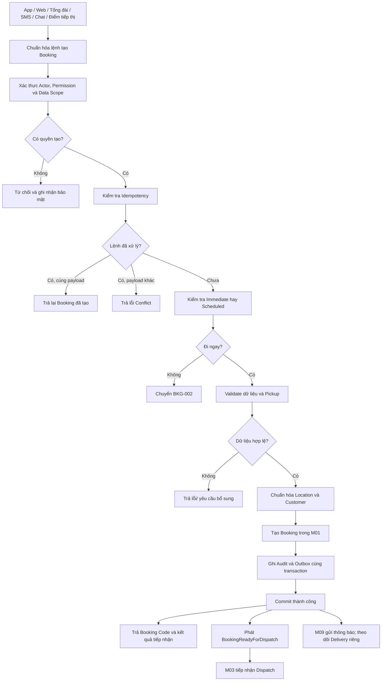

# BKG-001 — TẠO BOOKING TỨC THỜI

**Mã tài liệu:** TAXI-BKG-001  
**Module sở hữu:** M01 — Khách hàng và Đặt xe  
**Epic:** Tiếp nhận và quản lý Booking đa kênh  
**Phiên bản:** 0.1  
**Trạng thái:** DRAFT — CHỜ NGHIỆP VỤ VÀ KIẾN TRÚC REVIEW  
**Priority theo Feature Catalog:** P0  
**Business Owner:** TBD  
**Technical Owner:** M01 Owner — TBD  
**Tài liệu liên quan:** [M01 Feature Catalog](../../../02-DOMAIN-MODULES/01-customer-and-booking/README.md) · [X-01 State Machine](../../../03-CROSS-CUTTING/01-state-machines-and-transition-rules.md) · [X-02 Data Architecture](../../../03-CROSS-CUTTING/02-data-architecture-and-erd.md) · [X-03 API/Event](../../../03-CROSS-CUTTING/03-api-and-event-contracts.md) · [X-04 Security/IAM/Audit](../../../03-CROSS-CUTTING/04-security-iam-and-audit.md) · [X-05 NFR](../../../03-CROSS-CUTTING/05-non-functional-requirements.md) · [X-06 Delivery Governance](../../../03-CROSS-CUTTING/06-delivery-governance.md)

> **Quy ước nguồn:** KPMG 2015 là nguồn lịch sử cho các bước TO.P1–TO.P7; không mặc nhiên là chính sách hiện hành. Nội dung gắn nhãn **[KPMG 2015]** là mô tả nguồn. Nội dung **[Đề xuất thiết kế]** là cách hệ thống mới dự kiến thực hiện. Nội dung **[TBD Mai Linh]** cần Business Owner xác nhận trước Gate 1/DoR nếu ảnh hưởng đến tính đúng đắn nghiệp vụ.

---

## 0. Quản lý phiên bản và phê duyệt

| Vai trò | Người duyệt | Trạng thái |
|---|---|---|
| Business Owner — Booking/Điều hành | TBD | Pending |
| Product Owner M01 | TBD | Pending |
| Technical Owner M01 | TBD | Pending |
| Chủ Module M03 — Dispatch | TBD | Pending |
| QA Lead | TBD | Pending |
| Security/Data Owner (nếu cần) | TBD | Pending |

| Phiên bản | Nội dung |
|---|---|
| 0.1 | Đặc tả bản đầu dựa trên Feature Catalog M01, KPMG 2015 và các tài liệu kiến trúc X-01 đến X-06 |

---

## 1. Bối cảnh và mục tiêu

### 1.1. Vấn đề nghiệp vụ

Mai Linh tiếp nhận nhu cầu gọi xe từ nhiều kênh. Dữ liệu đầu vào có thể được khách hàng tự nhập, tổng đài viên nhập thay, hoặc nhân viên/đối tác gửi qua kênh tích hợp. Nếu mỗi kênh tự tạo cấu trúc Booking và quy tắc riêng, dữ liệu sẽ không đồng nhất, khó tra cứu, khó kiểm soát trùng lặp và khó bàn giao sang điều phối.

### 1.2. Mục tiêu

BKG-001 cung cấp một nghiệp vụ tạo Booking tức thời thống nhất:
- Tiếp nhận yêu cầu đi ngay từ các kênh được phê duyệt.
- Chuẩn hóa dữ liệu khách hàng, liên hệ, điểm đón, loại xe và ghi chú.
- Kiểm tra dữ liệu bắt buộc và điều kiện tiếp nhận ở mức M01.
- Ghi nhận Booking có mã định danh và mã tham chiếu nghiệp vụ.
- Lưu nguồn kênh, người tạo và lịch sử tiếp nhận.
- Khi Booking hợp lệ và đủ điều kiện, bàn giao sự kiện cho M03 để bắt đầu điều phối.
- Không để lỗi gửi SMS/Chat/Push hoặc lỗi provider làm mất Booking đã ghi nhận thành công.

### 1.3. Giá trị

- Một nguồn dữ liệu Booking thống nhất cho App, Web, Tổng đài, SMS, Chat và kênh điểm tiếp thị được xác nhận.
- Giảm nhập liệu thiếu/sai và giảm Booking trùng.
- Có thể truy vết Booking từ lúc tiếp nhận đến Dispatch/Trip.
- Tách rõ kênh đặt xe với mô hình khai thác DIRECT/PARTNER.

### 1.4. Nguồn và truy vết

| Nguồn | Mã tham chiếu | Nội dung hỗ trợ |
|---|---|---|
| KPMG 2015 | TO.P1.1–P1.8 | Tiếp nhận qua Tổng đài; phân loại yêu cầu; nhập số nhà, đường, phường, quận, loại/hiệu xe, đặc điểm, số điện thoại nếu cần, số lượng xe; gợi ý địa chỉ từ số điện thoại; sửa/nhắc yêu cầu gần nhất |
| KPMG 2015 | TO.P2.1–P2.2 | App yêu cầu đăng nhập; điểm đón có thể là địa chỉ/địa danh; tự dò vị trí làm điểm đón mặc định; loại xe, hiệu xe, số lượng, thời gian đón tùy chọn (không nhập là đi ngay), số điện thoại lấy từ tài khoản, điểm đến tùy chọn, ghi chú |
| KPMG 2015 | TO.P3.1–P3.3 | Khách tại điểm tiếp thị yêu cầu nhân viên; điểm đón thường là điểm tiếp thị; loại xe 4/7 chỗ và thông tin thêm; nhân viên điểm gửi yêu cầu qua ứng dụng |
| KPMG 2015 | TO.P5.1–P5.3 | SMS theo cú pháp; kiểm tra cú pháp; tạo mã đặt chỗ và gửi SMS xác nhận; địa điểm được cập nhật lên bản đồ |
| KPMG 2015 | TO.P6 | Tiếp nhận qua Chat trực tiếp với tổng đài viên; nguồn nói khách có thể chat trên Web mà không cần tài khoản thành viên |
| KPMG 2015 | TO.P7.1–P7.4 | Web yêu cầu tài khoản; điểm đón địa chỉ/địa danh; loại xe 4/7 chỗ, hiệu xe, số lượng; thời gian đón tùy chọn, không nhập là đi ngay; số điện thoại, điểm đến tùy chọn, ghi chú; tạo mã đặt chỗ, khách xem/xác nhận; đặt trước chuyển TO.P8 |
| Kiến trúc hiện tại | X-01 đến X-06 | State Machine, data ownership, API/Event, IAM/Audit, NFR, DoR/DoD |

**Giới hạn nguồn:** TO.P4 là quy trình khu vực sắp tài, TO.P8 là đặt xe trước; hai luồng này không được tự động gộp vào BKG-001 nếu chưa xác nhận ranh giới Feature. Các trường/luồng Chat cần đối chiếu đầy đủ với chính sách kênh Chat hiện hành.

---

## 2. Phạm vi

### 2.1. Trong phạm vi

1. Tạo Booking đi ngay (immediate booking).
2. Tiếp nhận từ kênh được cấu hình và được cấp quyền.
3. Chuẩn hóa dữ liệu liên hệ và địa chỉ/địa danh.
4. Kiểm tra dữ liệu tối thiểu trước khi ghi nhận.
5. Sinh ID nội bộ và booking_code.
6. Ghi nhận booking_channel, created_by, source reference và timestamp.
7. Ghi lịch sử tạo Booking.
8. Trả kết quả tiếp nhận cho kênh gọi.
9. Phát domain event sau khi Booking được commit và đủ điều kiện bàn giao M03.
10. Ghi nhận trạng thái gửi thông báo riêng với trạng thái Booking.

### 2.2. Ngoài phạm vi

- Đặt xe trước theo lịch: BKG-002 và quy trình TO.P8.
- Kiểm tra vùng phục vụ chi tiết/chính sách khu vực: BKG-003 (BKG-001 gọi dịch vụ kiểm tra, không tự sở hữu danh mục vùng).
- Quản lý nhiều điểm dừng nâng cao: BKG-004.
- Sửa Booking sau khi tạo: BKG-005.
- Hủy Booking và chính sách hủy: BKG-006.
- Phát hiện/cảnh báo Booking trùng nâng cao: BKG-007; BKG-001 chỉ thực hiện kiểm tra chống gửi lặp kỹ thuật bắt buộc.
- Tra cứu/lịch sử chi tiết: BKG-008.
- Báo giá/cước ước tính: BKG-009 và M05.
- Tìm xe, ranking, Unicast/Broadcast, Offer, Assignment, hàng đợi: M03.
- Theo dõi hành trình, GPS, bắt đầu/kết thúc chuyến: M04.
- Gửi SMS/Chat/Email/Push và quản lý trạng thái provider: M09.
- Chính sách tài chính DIRECT/PARTNER: M06; BKG-001 chỉ lưu thuộc tính phân loại nếu được xác định từ nguồn hợp lệ.

### 2.3. Kênh tiếp nhận đề xuất

| Kênh | Actor gửi lệnh tạo | Căn cứ nguồn | Phạm vi BKG-001 |
|---|---|---|---|
| Call Center/Phone | Tổng đài viên | TO.P1 | Có |
| Customer App | Khách hàng đã xác thực | TO.P2 | Có |
| Web Booking | Khách hàng đã xác thực | TO.P7 | Có |
| SMS | Adapter M09 / hệ thống tiếp nhận | TO.P5 | Có, sau khi parse và xác thực cú pháp |
| Chat | Tổng đài viên hoặc Chat Adapter theo mô hình được duyệt | TO.P6 | Có, cần chốt actor ghi nhận |
| Marketing Point | Nhân viên điều hành điểm | TO.P3 | Có điều kiện; cần chốt Booking hay Queue Request là đối tượng nguồn |
| Staging Area | Theo luồng TO.P4 | TO.P4 | Không mặc định; cần phân ranh với M03 |
| Partner API | Hệ thống đối tác | Chưa có đặc tả kênh cụ thể trong nguồn này | TBD, không bật mặc định |

**Nguyên tắc:** Channel là nguồn tiếp nhận, không quyết định loại đội xe. `booking_channel` không được suy ra `fleet_type` DIRECT/PARTNER.

---

## 3. Actor, vai trò và quyền

| Actor | Hành động | Permission đề xuất | Data Scope |
|---|---|---|---|
| Khách hàng App/Web | Tạo Booking cho chính mình | `booking.create.self` | SELF |
| Tổng đài viên | Tạo Booking thay khách | `booking.create.on_behalf` | Theo tổ chức/đơn vị được cấp |
| Nhân viên điểm tiếp thị | Gửi yêu cầu tại điểm | `booking.create.marketing_point` | Điểm/ca được phân công |
| SMS Adapter | Gửi yêu cầu đã parse từ SMS | `booking.create.channel.sms` | Theo sender/channel mapping |
| Chat Agent/Adapter | Tạo Booking từ phiên Chat | `booking.create.channel.chat` | Theo phiên Chat và tổ chức |
| Partner API Client | Tạo Booking đối tác | `booking.create.partner` | Partner/contract scope được cấp |
| M01 Service | Kiểm tra, ghi Booking và phát event | Service permission nội bộ | Theo command context |

### 3.1. Kiểm soát bắt buộc

- Server xác thực actor và quyền; không tin `customer_id`, `branch_id`, `partner_id` do client tự khai.
- Khách App/Web chỉ tạo Booking gắn với Customer Identity đã xác thực, trừ khi có chính sách guest được phê duyệt.
- Tổng đài viên phải ghi nhận danh tính khách theo thông tin được cung cấp/tra cứu và actor thực hiện.
- SMS sender không mặc nhiên là Customer đã xác minh; số điện thoại là tín hiệu liên hệ, không phải bằng chứng danh tính tuyệt đối.
- Partner API (nếu bật) phải gắn partner scope từ credential/token server-side.
- Số điện thoại hiển thị theo masking và quyền của actor.
- Mọi tạo Booking thay khách, tạo từ kênh tích hợp và can thiệp thủ công phải có audit.

---

## 4. Thuật ngữ và mô hình dữ liệu

### 4.1. Phân biệt khái niệm

| Thuật ngữ | Ý nghĩa |
|---|---|
| Booking | Yêu cầu dịch vụ taxi được ghi nhận trong M01 |
| Immediate Booking | Booking có yêu cầu đón ngay, không phải đặt lịch tương lai |
| Booking Channel | Kênh khách/nhân viên gửi yêu cầu |
| Fleet Type | Mô hình khai thác DIRECT hoặc PARTNER; độc lập với Channel |
| Pickup Location | Vị trí đón khách |
| Destination | Điểm đến tùy chọn tại thời điểm tạo |
| Booking Code | Mã hiển thị/tra cứu cho khách hoặc nhân viên; không thay ID nội bộ |
| Source Reference | Mã cuộc gọi, SMS, Chat session, request ID từ App/Web/Partner |
| Idempotency Key | Khóa kỹ thuật ngăn tạo trùng khi gửi lại cùng một lệnh |

### 4.2. Dữ liệu đầu vào

| Field logic | Bắt buộc | Quy tắc ban đầu | Nguồn |
|---|---|---|---|
| booking_channel | Có | Giá trị từ adapter/actor đã xác thực; không nhận tùy ý | Hệ thống |
| service_time_type | Có | BKG-001 phải là IMMEDIATE | Hệ thống/actor |
| pickup_location | Có | Phải xác định được địa điểm theo quy tắc BKG-003 | Khách/nhân viên |
| pickup_address_text | Có điều kiện | Số nhà, đường, phường, quận, tỉnh/thành hoặc mô tả địa danh | TO.P1/P2/P7 |
| pickup_place_id / coordinates | TBD | Dùng khi dịch vụ địa chỉ/định vị trả về định danh/toạ độ tin cậy | Location Service |
| vehicle_type | Có | KPMG 2015 nêu 4 chỗ/7 chỗ; danh mục hiện hành TBD | Khách/nhân viên |
| vehicle_model_preference | Không | Hiệu xe/nhãn xe mong muốn; danh mục và khả năng đáp ứng TBD | TO.P1/P2/P7 |
| vehicle_quantity | TBD | KPMG có trường số lượng xe theo loại; giá trị mặc định/giới hạn TBD | TO.P1/P2/P7 |
| contact_phone | Có điều kiện | Số liên hệ khách; có thể để trống trong trường hợp tài xế gọi yêu cầu xe theo TO.P1.7 | Actor/Customer |
| customer_id | Có điều kiện | Lấy từ phiên đăng nhập hoặc kết quả tra cứu được phép; không tự tin client | IAM/M01 |
| destination | Không | Điểm đến tùy chọn trong TO.P2/P7; không bắt buộc để tiếp nhận theo nguồn | Khách/nhân viên |
| customer_note | Không | Ghi chú yêu cầu thêm | Khách/nhân viên |
| pickup_time | Có | Với BKG-001 phải là ngay; nếu là thời điểm tương lai thì chuyển BKG-002 | Hệ thống/actor |
| created_by | Có | Actor/service account thực hiện | IAM |
| source_reference | Có điều kiện | ID cuộc gọi/SMS/Chat/request; bắt buộc khi adapter có nguồn reference | Channel Adapter |
| fleet_type | Không tự nhập | Chỉ xác định bởi quy tắc phân tuyến/hợp đồng đã phê duyệt; không suy ra từ channel | M02/Policy |
| tenant/org scope | Có theo actor | Lấy từ identity/permission context server-side | IAM |
| idempotency_key | Có với lệnh API tạo | Dùng chống tạo trùng kỹ thuật | Client/Adapter |

**TBD:** Có cần một hay nhiều xe cho một Booking; cách biểu diễn số lượng; loại xe/danh mục hiện hành; trường contact phone bắt buộc theo từng kênh; chính sách khách chưa đăng ký; có cho phép tạo Booking không có Customer profile hay không.

### 4.3. Địa điểm

**[KPMG 2015]**
- TO.P1 nhập số nhà, đường, phường, quận.
- TO.P2/TO.P7 cho phép địa chỉ cụ thể hoặc địa danh cụ thể.
- TO.P2 cho phép ứng dụng dò vị trí hiện tại làm điểm đón mặc định và khách có thể thay đổi.
- TO.P1 cho phép hệ thống gợi ý địa chỉ gắn số điện thoại bàn hoặc ba địa chỉ yêu cầu gần nhất của số di động.

**[Đề xuất thiết kế]**
- Lưu đồng thời nội dung địa chỉ người dùng nhập và kết quả chuẩn hóa từ Location Service.
- Không tự thay đổi pickup bằng tọa độ GPS nếu khách chưa xác nhận.
- Ghi nhận nguồn vị trí: USER_ENTERED / GPS_SUGGESTED / SAVED_PLACE / AGENT_SELECTED / GEOCODED.
- Lưu snapshot địa điểm tại thời điểm tạo để tránh thay đổi khi danh mục địa chỉ được cập nhật.
- Khi địa chỉ mơ hồ, trả yêu cầu chọn/hiệu chỉnh thay vì tự đoán.

### 4.4. Entity và ownership

| Entity | Module sở hữu | Vai trò trong Feature |
|---|---|---|
| Customer | M01 | Khách hàng nếu đã định danh |
| ContactPoint | M01 | Số điện thoại/email liên hệ theo policy |
| Booking | M01 | Aggregate gốc |
| BookingStop | M01 | Điểm đón/điểm đến; cấu trúc chi tiết theo BKG-004 |
| BookingRevision | M01 | Lịch sử nội dung quan trọng |
| QuoteReference | M05 | Chỉ tham chiếu nếu có yêu cầu báo giá; không tính cước trong BKG-001 |
| AuditEvent | M08 | Audit tạo Booking |
| Notification/Delivery | M09 | Trạng thái gửi thông báo, tách khỏi Booking |

BKG-001 chỉ tạo/cập nhật entity thuộc M01 qua application service. Không ghi trực tiếp dữ liệu M05/M08/M09/M03.

---

## 5. Business Rules

| Rule ID | Quy tắc | Nguồn/trạng thái |
|---|---|---|
| BKG001-R01 | Booking tạo qua mọi kênh phải được chuẩn hóa về cùng một mô hình dữ liệu M01 | Đề xuất kiến trúc |
| BKG001-R02 | BKG-001 chỉ tiếp nhận yêu cầu đi ngay; yêu cầu đặt trước chuyển BKG-002/TO.P8 | KPMG TO.P1.2, P2/P5/P6/P7 và đề xuất phân ranh |
| BKG001-R03 | Pickup là dữ liệu bắt buộc để tạo Booking có thể tiếp nhận | KPMG TO.P1/P2/P3/P5/P7 |
| BKG001-R04 | Destination có thể để trống theo TO.P2/P7; không được tự đặt destination giả | KPMG TO.P2/P7 |
| BKG001-R05 | Vehicle type được chọn từ danh mục hiệu lực; KPMG 2015 nêu 4/7 chỗ, cần xác nhận danh mục hiện hành | KPMG + TBD |
| BKG001-R06 | booking_channel độc lập fleet_type DIRECT/PARTNER | X-02 |
| BKG001-R07 | Một lệnh CreateBooking retry với cùng idempotency key trong phạm vi hiệu lực không tạo thêm Booking | X-03 |
| BKG001-R08 | Booking chỉ được công nhận đã tiếp nhận sau khi M01 commit dữ liệu thành công | X-01/X-03 |
| BKG001-R09 | Booking hợp lệ và là immediate mới được chuyển READY_FOR_DISPATCH; M03 sở hữu DispatchRun/Offer/Assignment | X-01/X-02/X-03 |
| BKG001-R10 | Lỗi SMS/Chat/Push delivery không tự động làm Booking đã commit trở thành REJECTED | X-03 và đề xuất |
| BKG001-R11 | Mọi trường hợp tạo Booking thay khách phải lưu actor thực hiện và source reference nếu có | X-04 và đề xuất |
| BKG001-R12 | Không xác định DIRECT/PARTNER dựa trên App/Web/Call/SMS/Chat | X-02 |
| BKG001-R13 | Duplicate warning nghiệp vụ không đồng nghĩa duplicate request kỹ thuật; quy tắc phát hiện Booking trùng thuộc BKG-007 | Feature boundary |
| BKG001-R14 | Nếu thiếu trường có thể bổ sung, không được tạo Booking READY_FOR_DISPATCH với dữ liệu bắt buộc còn thiếu | Đề xuất; validation policy TBD |

---

## 6. Luồng nghiệp vụ

### 6.1. Tiền điều kiện

- Kênh gửi lệnh đã được tích hợp/cấu hình và được phép tạo Booking.
- Actor hoặc service account đã được xác thực.
- Có permission và Data Scope hợp lệ.
- Danh mục loại xe và cấu hình bắt buộc có hiệu lực.
- M01 và các dependency tối thiểu sẵn sàng; Location Service có thể được gọi theo policy.
- Request có idempotency key đối với API/adapter hỗ trợ retry.

### 6.2. Luồng chính

| Bước | Actor | Hành động | Xử lý hệ thống | Kết quả |
|---|---|---|---|---|
| 1 | Khách/nhân viên/adapter | Gửi yêu cầu đi ngay | Channel adapter chuẩn hóa envelope và actor context | Lệnh CreateBooking |
| 2 | M01 | Tiếp nhận lệnh | Xác thực identity, permission, channel và idempotency | Lệnh hợp lệ về mặt kỹ thuật |
| 3 | M01 | Kiểm tra loại yêu cầu | Xác định IMMEDIATE; nếu thời điểm tương lai chuyển BKG-002 | Đúng Feature |
| 4 | M01 | Kiểm tra dữ liệu | Kiểm tra pickup, vehicle type, contact và field theo channel policy | Dữ liệu hợp lệ hoặc lỗi validation |
| 5 | M01 + Location Service | Chuẩn hóa pickup/destination nếu có | Geocode/resolve; giữ nguyên text người dùng; không tự đoán địa chỉ mơ hồ | Location snapshot |
| 6 | M01 | Xác định Customer | Liên kết Customer đã xác thực/tra cứu; không tự gộp hai hồ sơ chỉ vì trùng số điện thoại | customer reference hoặc guest context theo policy |
| 7 | M01 | Tạo Booking | Sinh booking_id, booking_code, version; ghi channel, actor, scope, timestamps | Booking được lưu |
| 8 | M01 | Ghi lịch sử và Outbox | Ghi audit/revision và outbox trong transaction phù hợp | Có thể truy vết, event không phát trước commit |
| 9 | M01 | Trả kết quả | Trả booking_id, booking_code, trạng thái, thông tin tiếp nhận được phép hiển thị | Kênh nhận xác nhận |
| 10 | M01 → M03 | Bàn giao điều phối | Chỉ phát BookingReadyForDispatch khi state/guard đã thỏa | M03 tiếp nhận để tạo DispatchRun |
| 11 | M09 / Channel Adapter | Gửi thông báo xác nhận | Gửi theo kênh và policy; cập nhật delivery status riêng | Thông báo được theo dõi độc lập |

### 6.3. Luồng thay thế

| Mã | Điều kiện | Xử lý |
|---|---|---|
| ALT-01 | Khách App không nhập pickup thủ công nhưng cấp quyền vị trí | App có thể đề xuất GPS hiện tại theo TO.P2; khách được sửa/xác nhận trước submit |
| ALT-02 | Khách nhập địa danh thay địa chỉ | Location Service resolve; nếu nhiều kết quả thì yêu cầu chọn rõ |
| ALT-03 | Tổng đài viên tạo Booking | Ghi actor tổng đài viên, contact khách và source call reference; áp dụng permission on-behalf |
| ALT-04 | SMS đúng cú pháp | Adapter parse cú pháp đã cấu hình; tạo lệnh chuẩn; gửi xác nhận qua M09 |
| ALT-05 | SMS sai cú pháp | Không tạo Booking; trả lỗi cú pháp theo template đã duyệt |
| ALT-06 | Chat được nhân viên xử lý | Nhân viên tạo Booking từ dữ liệu đã xác nhận với khách; lưu chat session reference |
| ALT-07 | Kênh gửi pickup và destination | Destination được lưu nếu khách cung cấp; yêu cầu báo giá chuyển M05/BKG-009 |
| ALT-08 | Kênh gửi thời điểm tương lai | Không tạo immediate Booking; chuyển BKG-002 |
| ALT-09 | Khách không có tài khoản | Chỉ cho phép nếu guest policy được phê duyệt; nếu không, trả yêu cầu xác thực/định danh phù hợp với kênh |

### 6.4. Luồng ngoại lệ

| Mã | Tình huống | Kết quả | Trạng thái/khôi phục |
|---|---|---|---|
| EX-01 | Thiếu pickup | Từ chối validation, chỉ rõ field cần bổ sung | Không tạo Booking |
| EX-02 | Vehicle type không hợp lệ/không còn hiệu lực | Trả lỗi danh mục | Không tạo Booking |
| EX-03 | Pickup không resolve được hoặc mơ hồ | Yêu cầu người dùng/nhân viên chọn lại | Không chuyển READY_FOR_DISPATCH |
| EX-04 | Ngoài vùng phục vụ | Theo kết quả BKG-003; trả lý do theo policy | REJECTED hoặc trạng thái theo quyết định nghiệp vụ |
| EX-05 | Idempotency key đã dùng với cùng payload | Trả lại kết quả Booking đã tạo trước đó | Không tạo bản ghi mới |
| EX-06 | Idempotency key đã dùng với payload khác | Trả lỗi conflict | Không ghi Booking mới |
| EX-07 | M01 commit thành công nhưng phản hồi về client bị timeout | Client retry cùng key; M01 trả lại kết quả cũ | Không tạo trùng |
| EX-08 | M01 commit thành công nhưng SMS/Chat provider lỗi | Booking vẫn được ghi nhận; tạo trạng thái delivery failed/retry | Không rollback Booking |
| EX-09 | M03 tạm thời không sẵn sàng | Booking giữ trạng thái phù hợp; Outbox retry/reconcile | Không tự tạo DispatchRun giả |
| EX-10 | Customer lookup có nhiều hồ sơ trùng | Không tự động gộp; yêu cầu quy trình xác minh | Không mất dữ liệu |
| EX-11 | Kênh gửi lại cùng source_reference nhưng không có idempotency key | Áp dụng dedup policy của adapter; nếu chưa cấu hình thì cách xử lý TBD | Không tự suy luận |
| EX-12 | User không có quyền hoặc scope không hợp lệ | Từ chối; không tiết lộ dữ liệu ngoài scope | Audit security event |

### 6.5. Hậu điều kiện

**Thành công**
- Booking được tạo trong M01 với ID ổn định, booking_code, source channel, actor và dữ liệu đã xác thực.
- Booking State đi theo X-01.
- Có audit và lịch sử tạo.
- Có event/outbox để bàn giao M03 nếu đủ điều kiện.
- Kết quả gửi thông báo được theo dõi riêng.

**Thất bại**
- Không tạo Booking hoặc không thay đổi dữ liệu nguồn.
- Trả mã lỗi có thể xử lý.
- Không phát BookingReadyForDispatch.
- Ghi log/audit theo yêu cầu bảo mật và không lộ PII.

### 6.6. Sơ đồ luồng



---

## 7. State Machine và ranh giới Module

BKG-001 phải dùng đúng Booking State trong X-01, không tự tạo enum riêng.

| Trạng thái | Ý nghĩa trong BKG-001 |
|---|---|
| DRAFT | Có thể dùng ở UI khi người dùng đang nhập; việc persist draft hay không cần policy |
| SUBMITTED | Kênh gửi lệnh tạo |
| VALIDATING | M01 kiểm tra dữ liệu, địa điểm, điều kiện |
| ACCEPTED | Booking hợp lệ, được M01 tiếp nhận |
| READY_FOR_DISPATCH | Immediate Booking đủ điều kiện bàn giao M03 |
| REJECTED | Không đạt điều kiện tiếp nhận |
| ON_HOLD | Chỉ dùng khi có policy/actor được phép giữ xử lý; không tự động dùng cho mọi lỗi |

Các trạng thái SCHEDULED, FULFILLING, COMPLETED, CANCELLED, EXPIRED, UNFULFILLED thuộc vòng đời tổng thể Booking nhưng không phải kết quả thông thường của lệnh tạo immediate.

**Nguyên tắc quan trọng:** M01 không tạo Offer hoặc Assignment. M03 sở hữu DispatchRun, Candidate, Offer và Assignment. BKG-001 chỉ bàn giao Booking đã đủ điều kiện.

---

## 8. Đặc tả UI/UX

### 8.1. Màn hình theo kênh

| Screen ID | Màn hình | Actor | Ghi chú |
|---|---|---|---|
| BKG001-SCR-01 | Tạo Booking tại Tổng đài | Tổng đài viên | Nhập nhanh, hỗ trợ tra cứu khách/địa chỉ |
| BKG001-SCR-02 | Đặt xe ngay trên App | Khách hàng | GPS có thể đề xuất pickup theo TO.P2 |
| BKG001-SCR-03 | Tạo yêu cầu trên Web | Khách hàng | Theo tài khoản và thông tin đã xác thực |
| BKG001-SCR-04 | Tạo Booking từ Chat | Chat Agent | Dữ liệu lấy từ phiên trao đổi đã xác nhận |
| BKG001-SCR-05 | Tiếp nhận SMS | Adapter/nhân viên hỗ trợ | Không nhất thiết là UI; theo dõi parse/validation |
| BKG001-SCR-06 | Tiếp nhận tại điểm tiếp thị | Nhân viên điểm | Chờ xác nhận ranh giới M01/M03 |

### 8.2. Bố cục trường dùng chung đề xuất

1. Thông tin khách/liên hệ.
2. Điểm đón.
3. Loại xe và số lượng.
4. Hiệu xe/đặc điểm theo danh mục nếu còn áp dụng.
5. Điểm đến (không bắt buộc theo nguồn App/Web).
6. Ghi chú.
7. Xác nhận yêu cầu đi ngay.
8. Nút Gửi yêu cầu.

Không ép tất cả kênh hiển thị cùng một form. Adapter phải ánh xạ về cùng canonical Booking Command.

### 8.3. UI State

- Initial: form trống hoặc dữ liệu mặc định hợp lệ.
- Loading: đang resolve địa chỉ/tra cứu khách.
- Submitting: khóa nút gửi để tránh double-click; server vẫn phải idempotent.
- Success: hiển thị booking_code và trạng thái tiếp nhận.
- Validation error: hiển thị lỗi tại trường tương ứng.
- Location ambiguous: yêu cầu chọn địa chỉ.
- Outside service area: hiển thị lý do theo policy.
- Network timeout: hướng dẫn retry an toàn, không tạo yêu cầu mới với key khác.
- Permission denied: không hiển thị dữ liệu ngoài phạm vi.

### 8.4. Thông báo

| Code đề xuất | Điều kiện | Nội dung |
|---|---|---|
| BKG001-MSG-001 | Tạo thành công | Đã tiếp nhận yêu cầu. Mã đặt xe: {booking_code}. |
| BKG001-MSG-002 | Thiếu điểm đón | Vui lòng nhập hoặc chọn điểm đón. |
| BKG001-MSG-003 | Địa chỉ chưa rõ | Vui lòng chọn địa chỉ/địa danh chính xác. |
| BKG001-MSG-004 | Loại xe không hợp lệ | Loại xe đã chọn hiện không khả dụng. Vui lòng chọn lại. |
| BKG001-MSG-005 | Yêu cầu đặt trước | Yêu cầu có thời gian đón trong tương lai. Vui lòng chuyển sang chức năng đặt xe trước. |
| BKG001-MSG-006 | Ngoài vùng phục vụ | Khu vực đón hiện chưa được xác nhận phục vụ. Vui lòng liên hệ Tổng đài. |
| BKG001-MSG-007 | Kết quả chưa xác định do timeout | Chưa nhận được phản hồi xác nhận. Vui lòng kiểm tra trạng thái yêu cầu trước khi gửi lại. |

Nội dung cuối cùng cần UX/Business Owner phê duyệt; không hiển thị thông tin nội bộ hoặc PII không cần thiết.

---

## 9. API, Command và Event Contract

> Các endpoint/schema dưới đây là đề xuất logic để BA/DEV/QA thảo luận, chưa phải quyết định công nghệ hay hợp đồng production.

### 9.1. Command

**Tên Command:** `CreateImmediateBooking`

**Endpoint tham khảo:** `POST /api/v1/bookings`

Headers:
- `Authorization`: token/credential theo X-04.
- `Idempotency-Key`: bắt buộc với lệnh tạo qua API.
- `X-Correlation-Id`: truy vết xuyên hệ thống.

Request logic:
```json
{
  "booking_channel": "APP",
  "service_time_type": "IMMEDIATE",
  "customer_reference": "customer-id-from-auth-context",
  "contact": {
    "phone": "+84xxxxxxxxx"
  },
  "pickup": {
    "address_text": "Địa chỉ khách cung cấp",
    "place_reference": null,
    "latitude": null,
    "longitude": null,
    "source": "USER_ENTERED"
  },
  "vehicle_requirements": [
    {
      "vehicle_type_code": "FOUR_SEAT",
      "vehicle_model_preference": null,
      "quantity": 1
    }
  ],
  "destination": null,
  "customer_note": null,
  "source_reference": "channel-request-id"
}
```

Quy tắc payload:
- Ví dụ JSON chỉ minh họa cấu trúc; code danh mục và field bắt buộc phải chốt ở Data Dictionary.
- Không tin `customer_reference`, `booking_channel`, `fleet_type`, `org_id` hoặc `partner_id` do client tự khai nếu không được xác minh server-side.
- Với App, customer identity lấy từ token/session.
- Với SMS/Chat/Call Center, adapter/agent context phải xác định nguồn và actor.
- Không gửi trường không cần thiết hoặc PII dư thừa.

### 9.2. Response thành công

```json
{
  "booking_id": "internal-stable-id",
  "booking_code": "display-booking-code",
  "booking_state": "READY_FOR_DISPATCH",
  "service_time_type": "IMMEDIATE",
  "accepted_at": "server-generated-timestamp",
  "booking_version": 1,
  "dispatch_handoff": "PENDING"
}
```

Nếu state đang ACCEPTED nhưng chưa đủ điều kiện bàn giao M03, response phải thể hiện trạng thái thực tế; không giả định mọi create đều lập tức READY_FOR_DISPATCH.

### 9.3. Event đề xuất

**Event:** `BookingReadyForDispatch`

Producer: M01  
Consumer: M03  
Trigger: Booking đã commit và chuyển hợp lệ sang READY_FOR_DISPATCH.

Payload tối thiểu:
- event_id
- event_type
- occurred_at
- aggregate_id (booking_id)
- aggregate_version
- correlation_id
- booking_code (nếu consumer cần)
- booking_channel
- fleet_type (chỉ khi đã xác định từ nguồn policy hợp lệ)
- pickup snapshot/reference
- vehicle requirement summary
- tenant/org scope reference theo hợp đồng nội bộ

Không đưa contact phone/PII vào Event nếu M03 không thực sự cần; nếu cần phải xác định mục đích, quyền và masking.

### 9.4. Error code đề xuất

| Error Code | Ý nghĩa | Retry |
|---|---|---|
| BOOKING_VALIDATION_FAILED | Dữ liệu không hợp lệ | Không, cần sửa |
| PICKUP_REQUIRED | Thiếu điểm đón | Không |
| PICKUP_LOCATION_AMBIGUOUS | Điểm đón chưa rõ | Không, cần chọn |
| SERVICE_AREA_NOT_SUPPORTED | Ngoài vùng phục vụ theo BKG-003 | Không |
| VEHICLE_TYPE_INVALID | Loại xe không hợp lệ | Không |
| SCHEDULED_BOOKING_REQUIRED | Yêu cầu thuộc BKG-002 | Không |
| IDEMPOTENCY_CONFLICT | Cùng key nhưng payload khác | Không |
| BOOKING_SCOPE_FORBIDDEN | Actor không có quyền trong scope | Không |
| BOOKING_DEPENDENCY_UNAVAILABLE | Dependency tạm lỗi | Có điều kiện |
| BOOKING_CREATE_CONFLICT | Xung đột version/dữ liệu | Có điều kiện, sau khi đọc lại |

---

## 10. Xử lý lỗi, idempotency và nhất quán

1. Idempotency được lưu theo actor/client/channel và key; payload hash được so sánh.
2. Cùng key + cùng payload: trả lại kết quả cũ.
3. Cùng key + payload khác: trả conflict, không tạo Booking.
4. Booking record và Outbox phải commit theo transaction hoặc cơ chế tương đương.
5. Event consumer M03 phải idempotent; không giả định event chỉ được nhận một lần.
6. M09 quản lý trạng thái gửi SMS/Chat/Push riêng; không rollback Booking do provider lỗi.
7. Khi M03 không sẵn sàng, M01 giữ event trong Outbox và retry theo policy; Booking phải hiển thị rõ trạng thái bàn giao.
8. Cơ chế retry, retention idempotency key, backoff và dead-letter phải theo X-03 và quyết định hạ tầng.
9. Nếu client timeout sau khi M01 commit, client phải tra cứu/retry cùng Idempotency-Key, không tự sinh key mới cho cùng hành động.
10. Không được phát event trước khi Booking commit.

---

## 11. Bảo mật, PII và Audit

### 11.1. Phân loại dữ liệu

- Số điện thoại, thông tin liên hệ: dữ liệu cá nhân/PII.
- Pickup/destination: dữ liệu vị trí có thể nhạy cảm.
- Ghi chú khách: có thể chứa dữ liệu nhạy cảm ngoài dự kiến; cần giới hạn và kiểm soát.
- Customer ID, booking ID, booking code: định danh nghiệp vụ; không thay thế authorization.

### 11.2. Audit event

| Audit action | Khi nào |
|---|---|
| BOOKING_CREATE_REQUESTED | Nhận lệnh tạo từ actor/channel |
| BOOKING_CREATED | M01 commit Booking thành công |
| BOOKING_CREATE_REJECTED | Lệnh bị từ chối ở bước validation/authorization |
| BOOKING_LOCATION_RESOLVED | Địa điểm được chuẩn hóa nếu cần audit |
| BOOKING_DISPATCH_HANDOFF_REQUESTED | Ghi Outbox bàn giao M03 |
| BOOKING_NOTIFICATION_STATUS_CHANGED | Delivery status thay đổi; owner M09, tham chiếu Booking |

Audit ghi actor, channel, timestamp, correlation/source reference, kết quả và reason code phù hợp. Không ghi raw token, password hoặc PII đầy đủ vào log không được bảo vệ.

### 11.3. Retention

Thời hạn lưu Booking, địa chỉ, số điện thoại, source message/call reference và audit phải theo chính sách được Mai Linh/Pháp chế/ATTT phê duyệt; BKG-001 không tự đặt thời hạn.

---

## 12. NFR và vận hành

| NFR | Áp dụng | Mục tiêu |
|---|---|---|
| NFR-PERF | Create Booking API | TBD theo X-05 |
| NFR-CAP | Burst từ nhiều channel | TBD theo capacity model |
| NFR-REL | Idempotency, Outbox, event delivery | Không tạo Booking trùng do retry; không mất bàn giao sau commit |
| NFR-AVAIL | Booking intake | SLO TBD theo phân loại dịch vụ |
| NFR-OBS | End-to-end correlation | Theo dõi từ channel → M01 → M03 → M09 |
| NFR-SEC | Authorization/Data Scope/PII | Không truy cập chéo scope |
| NFR-RES | Location/provider/M03 lỗi | Suy giảm có kiểm soát; Booking không bị báo thành công giả |

Metrics tối thiểu:
- booking_create_requests_total theo channel/result.
- booking_create_latency theo p50/p95/p99.
- booking_validation_failures theo reason.
- idempotency_replay_total và idempotency_conflict_total.
- booking_outbox_backlog và oldest_event_age.
- dispatch_handoff_success/failure.
- notification_delivery_status theo provider/channel (M09 owner).

---

## 13. Kiểm thử và Acceptance Criteria

### 13.1. Test Cases

| Test ID | Tình huống | Kết quả mong đợi |
|---|---|---|
| BKG001-TC-001 | App tạo Booking đi ngay, dữ liệu hợp lệ | Tạo đúng một Booking, trả booking_code |
| BKG001-TC-002 | Web tạo Booking đi ngay | Dữ liệu chuẩn hóa vào cùng canonical model |
| BKG001-TC-003 | Tổng đài viên tạo Booking thay khách | Lưu đúng actor và nguồn cuộc gọi |
| BKG001-TC-004 | SMS đúng cú pháp đã cấu hình | Adapter tạo lệnh chuẩn và Booking được ghi nhận |
| BKG001-TC-005 | SMS sai cú pháp | Không tạo Booking; trả lỗi theo template |
| BKG001-TC-006 | Chat Agent tạo Booking | Có source chat reference và actor |
| BKG001-TC-007 | Thiếu pickup | Validation fail; không phát event |
| BKG001-TC-008 | Pickup mơ hồ | Yêu cầu chọn lại; không READY_FOR_DISPATCH |
| BKG001-TC-009 | Vehicle type không hợp lệ | Từ chối theo danh mục |
| BKG001-TC-010 | Có destination | Lưu destination; không tự tính cước trong M01 |
| BKG001-TC-011 | Không có destination | Vẫn có thể tạo nếu policy không yêu cầu |
| BKG001-TC-012 | pickup time là tương lai | Không tạo BKG-001; chuyển BKG-002 |
| BKG001-TC-013 | Retry cùng idempotency key và payload | Trả cùng Booking; không tạo trùng |
| BKG001-TC-014 | Retry cùng key nhưng payload khác | Conflict; không tạo Booking thứ hai |
| BKG001-TC-015 | Timeout response sau commit rồi retry | Trả lại Booking đã commit |
| BKG001-TC-016 | M03 unavailable sau commit | Booking vẫn tồn tại; Outbox retry; không báo handoff thành công giả |
| BKG001-TC-017 | SMS provider fail sau commit | Booking vẫn tồn tại; delivery status fail/retry riêng |
| BKG001-TC-018 | User cố truyền customer_id của người khác | Server bỏ qua/từ chối theo policy; không tạo gắn sai Customer |
| BKG001-TC-019 | Agent ngoài branch scope tạo Booking trong branch khác | Từ chối |
| BKG001-TC-020 | Channel APP nhưng client tự truyền fleet_type PARTNER | Không tin dữ liệu client; áp dụng policy server-side |
| BKG001-TC-021 | Cùng SMS source reference gửi lại | Áp dụng dedup policy đã cấu hình; không âm thầm tạo trùng |
| BKG001-TC-022 | Event phát lại nhiều lần đến M03 | Consumer idempotent; không tạo DispatchRun/Offer trùng do duplicate event |
| BKG001-TC-023 | Hai lệnh tạo đồng thời khác key | Tạo hai Booking độc lập trừ khi BKG-007 phát hiện cảnh báo trùng; không tự gộp |
| BKG001-TC-024 | Khách App không cấp quyền GPS | Cho nhập/chọn pickup thủ công; không chặn nếu policy cho phép |

### 13.2. Acceptance Criteria

**AC-01 — Tạo Booking tức thời hợp lệ**
- Given một actor/kênh có quyền tạo Booking
- And dữ liệu bắt buộc hợp lệ và pickup được xác định
- When actor gửi CreateImmediateBooking
- Then M01 tạo một Booking với booking_id và booking_code duy nhất
- And Booking được ghi đúng booking_channel, actor, scope và timestamp
- And Booking chuyển theo State Machine X-01

**AC-02 — Không nhầm Booking đặt trước**
- Given yêu cầu có pickup_time trong tương lai
- When gửi vào BKG-001
- Then hệ thống không tạo immediate Booking
- And hướng dẫn chuyển sang BKG-002/TO.P8

**AC-03 — Idempotency**
- Given một CreateImmediateBooking đã được commit
- When cùng Idempotency-Key và cùng payload được gửi lại
- Then hệ thống trả kết quả Booking đã tạo
- And không tạo Booking thứ hai

**AC-04 — Không phát Dispatch trước commit**
- Given M01 đang xử lý lệnh tạo
- When Booking chưa commit thành công
- Then không phát BookingReadyForDispatch
- And M03 không được phép điều phối Booking chưa hợp lệ

**AC-05 — Tách lỗi thông báo**
- Given Booking đã commit
- When SMS/Chat/Push provider lỗi
- Then Booking vẫn giữ trạng thái đã tiếp nhận
- And delivery status được M09 theo dõi/retry riêng

**AC-06 — Bảo vệ Data Scope**
- Given actor không có quyền trong scope của đối tượng
- When actor gửi lệnh tạo gắn với scope không được phép
- Then server từ chối
- And không ghi Booking vào scope trái phép
- And có audit phù hợp

**AC-07 — Tách Channel và Fleet Type**
- Given một Booking đến từ bất kỳ channel nào
- When M01 ghi nhận Booking
- Then channel được lưu độc lập với DIRECT/PARTNER
- And fleet_type chỉ lấy từ policy/hợp đồng hợp lệ, không suy ra từ channel

**AC-08 — Location mơ hồ**
- Given pickup text có nhiều kết quả hoặc không đủ chính xác
- When Location Service trả kết quả mơ hồ
- Then hệ thống yêu cầu người dùng/nhân viên chọn lại
- And không tự chọn địa chỉ không được xác nhận

### 13.3. Definition of Done riêng

- [ ] Business Rules BKG001-R01–R14 đã được xác nhận hoặc các TBD có owner/decision.
- [ ] State transition khớp X-01.
- [ ] Data ownership khớp X-02.
- [ ] API/Event contract được duyệt theo X-03.
- [ ] Permission, Data Scope, PII và Audit được review theo X-04.
- [ ] NFR/test evidence theo X-05.
- [ ] DoR/DoD và release checklist theo X-06.
- [ ] QA hoàn tất test case; Business Owner ký UAT.

---

## 14. Rủi ro, quyết định và TBD

| ID | Nội dung cần Mai Linh quyết định | Ảnh hưởng | Owner đề xuất |
|---|---|---|---|
| BKG001-DEC-01 | Danh sách channel chính thức trong giai đoạn 1 | API, UX, tích hợp | Business/Operations |
| BKG001-DEC-02 | Có cho phép Guest Booking không? | Identity, CRM, chống spam | Business/Customer |
| BKG001-DEC-03 | Số điện thoại bắt buộc theo từng channel/actor? | Validation, liên hệ khách | Business/Call Center |
| BKG001-DEC-04 | Có hỗ trợ Booking nhiều xe trong một yêu cầu? | Data model, Dispatch | Business/Dispatch |
| BKG001-DEC-05 | Danh mục loại xe/hiệu xe hiện hành | Catalog, UI, Dispatch | Fleet/Operations |
| BKG001-DEC-06 | Quy tắc pickup bắt buộc: địa chỉ, landmark, GPS, pin map | Location/UX | Operations |
| BKG001-DEC-07 | Có bắt buộc xác nhận lại địa chỉ GPS tự động không? | App UX, trách nhiệm vị trí | Product/Operations |
| BKG001-DEC-08 | Cơ chế nhận diện Customer từ số điện thoại và xử lý trùng hồ sơ | CRM/PII | Customer/Data Owner |
| BKG001-DEC-09 | SMS syntax hiện hành, sender whitelist, mã hóa tiếng Việt | SMS Adapter | Operations/M09 |
| BKG001-DEC-10 | Chat Agent hay Chat Adapter là actor tạo Booking? | IAM, traceability | Customer Service |
| BKG001-DEC-11 | Điểm tiếp thị tạo Booking M01 hay Queue Request M03? | Module ownership | Operations/Architect |
| BKG001-DEC-12 | Quy tắc vùng phục vụ và từ chối ngoài vùng | BKG-003 dependency | Operations |
| BKG001-DEC-13 | Quy tắc xác định DIRECT/PARTNER và thời điểm gán | Contract/Fleet/Finance | Business/M02 |
| BKG001-DEC-14 | Booking code: format, uniqueness, phạm vi chi nhánh, bảo mật | UX/lookup/security | Product/Architect |
| BKG001-DEC-15 | Có cần báo giá trước khi tiếp nhận hay sau khi tạo? | M05/BKG-009 | Business/Pricing |
| BKG001-DEC-16 | Duplicate warning theo số điện thoại, pickup, thời gian và vehicle | BKG-007 | Operations |
| BKG001-DEC-17 | Draft có được lưu server-side hay chỉ lưu local/client? | Data/UX | Product/Architect |
| BKG001-DEC-18 | Giới hạn quantity và quy tắc nhiều loại xe trong một Booking | Data/Dispatch | Operations |
| BKG001-DEC-19 | Trạng thái phản hồi cho khách khi Booking ACCEPTED nhưng chưa READY_FOR_DISPATCH | UX/State | Business/Dispatch |
| BKG001-DEC-20 | Kênh xác nhận Booking và retry khi gửi thất bại | M09/Customer | Customer Service |

---

## 15. Tiêu chí nghiệm thu Feature

- [ ] Phạm vi immediate và scheduled được phân biệt rõ.
- [ ] Channel list và actor mapping được Business Owner phê duyệt.
- [ ] Field dictionary theo từng channel được xác nhận.
- [ ] Customer resolution, guest policy và contact phone policy được chốt.
- [ ] Pickup validation và vùng phục vụ có hợp đồng với BKG-003.
- [ ] Vehicle catalog/quantity policy được chốt.
- [ ] State Machine, Booking Code và versioning khớp X-01/X-02.
- [ ] API/Event khớp X-03; idempotency và Outbox được kiểm thử.
- [ ] DIRECT/PARTNER không bị suy ra từ channel và có scope đúng.
- [ ] Audit/PII theo X-04.
- [ ] NFR/Monitoring theo X-05.
- [ ] Test Cases và AC đạt; UAT được Business Owner ký.
- [ ] M03 xác nhận hợp đồng tiếp nhận BookingReadyForDispatch.
- [ ] M09 xác nhận hợp đồng gửi thông báo và delivery status.
- [ ] Runbook, alert và release plan hoàn tất theo X-06.

### 15.1. Kết luận hiện tại

**Trạng thái:** DRAFT — Chưa đạt READY/DoR.  
**Lý do:** Còn 20 quyết định nghiệp vụ/kênh cần owner và phê duyệt; một số policy liên quan BKG-003, BKG-007, BKG-009, M03 và M09 chưa được xác nhận.

**Không chuyển DEV chỉ dựa trên bản đặc tả 0.1.**

---
**Quay lại:** [Feature Specifications](../README.md) · [M01 — Customer & Booking](../../../02-DOMAIN-MODULES/01-customer-and-booking/README.md)
