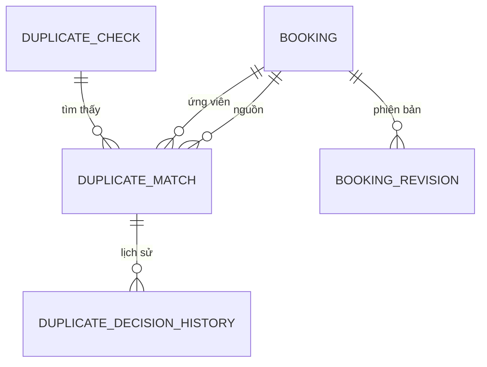

# BKG-007 — PHÁT HIỆN VÀ CẢNH BÁO BOOKING TRÙNG

**Mã tài liệu:** TAXI-BKG-007  
**Module sở hữu:** M01 — Khách hàng và Đặt xe  
**Epic:** Tiếp nhận và quản lý Booking đa kênh  
**Phiên bản:** 0.1  
**Trạng thái:** DRAFT — CHỜ NGHIỆP VỤ, M02, M03, M08, M09 VÀ KIẾN TRÚC REVIEW  
**Priority theo Feature Catalog:** P2  
**Business Owner:** TBD  
**Technical Owner:** M01 Owner — TBD  
**Tài liệu liên quan:** [BKG-001 — Tạo Booking tức thời](./BKG-001-create-immediate-booking.md) · [BKG-003 — Kiểm tra hợp lệ và vùng phục vụ](./BKG-003-validation-and-serviceability.md) · [BKG-004 — Điểm đón/điểm đến/điểm dừng](./BKG-004-pickup-destination-and-ordered-stops.md) · [BKG-005 — Sửa đổi Booking](./BKG-005-booking-amendment-and-change-request.md) · [BKG-006 — Hủy Booking](./BKG-006-cancel-booking-and-cancellation-policy.md) · [X-01 — State Machine](../../../03-CROSS-CUTTING/01-state-machines-and-transition-rules.md) · [X-02 — Data Architecture](../../../03-CROSS-CUTTING/02-data-architecture-and-erd.md) · [X-03 — API/Event](../../../03-CROSS-CUTTING/03-api-and-event-contracts.md)

> **Nguyên tắc nguồn:** KPMG 2015 không đưa ra một thuật toán phát hiện trùng Booking tổng quát. Nguồn có nêu tra cứu yêu cầu gần nhất theo số điện thoại/điểm đón khi nhắc, sửa hoặc hủy; SMS cần chống gửi lặp để tránh tạo Booking lặp; mỗi tài xế chỉ đăng ký một yêu cầu tại một thời điểm; App/Web/Call Center/SMS/Chat là các kênh tiếp nhận khác nhau. Các quy tắc phát hiện trùng đa kênh, mức độ tương đồng, cửa sổ thời gian và quyết định của người dùng trong tài liệu này là **đề xuất thiết kế mới**, cần Mai Linh phê duyệt, không phải kết luận của KPMG.

---

## 0. Quản lý phiên bản và phê duyệt

| Vai trò | Người duyệt | Trạng thái |
|---|---|---|
| Business Owner — Vận hành Taxi | TBD | Pending |
| Product Owner M01 | TBD | Pending |
| Chủ Module M02 — Đội xe và Đối tác | TBD | Pending |
| Chủ Module M03 — Điều phối | TBD | Pending |
| Chủ Module M08 — Phân quyền và Kiểm toán | TBD | Pending |
| Chủ Module M09 — Thông báo và Tích hợp | TBD | Pending |
| Data Architect | TBD | Pending |
| QA Lead | TBD | Pending |

| Phiên bản | Nội dung |
|---|---|
| 0.1 | Đặc tả phát hiện Booking có khả năng trùng, cảnh báo đa kênh, xử lý xác nhận và phân biệt với Idempotency |

---

## 1. Bối cảnh và mục tiêu

### 1.1. Bài toán nghiệp vụ

Một khách hàng có thể tạo yêu cầu taxi qua nhiều kênh hoặc liên hệ nhiều lần:
- Gọi Tổng đài để yêu cầu xe, sau đó tiếp tục đặt qua App.
- Đặt trên Web rồi gửi SMS xác nhận cùng nhu cầu.
- Gửi SMS nhưng không nhận được phản hồi và gửi lại.
- Chat với Tổng đài trong lúc App vẫn đang gửi yêu cầu.
- Tổng đài viên tạo Booking mới trong khi Booking cũ đã tồn tại.
- Khách thay đổi điểm đón/giờ đón nhưng yêu cầu cũ vẫn còn.
- Một người đặt nhiều xe hoặc đặt nhiều chuyến thực sự khác nhau trong cùng khoảng thời gian.

Nếu không phát hiện được các yêu cầu có khả năng trùng, hệ thống có thể tạo nhiều Booking cho cùng một nhu cầu. Hậu quả:
- Hai hoặc nhiều tài xế cùng đi đón một khách.
- Dispatch phân bổ nhiều xe không cần thiết.
- Khách bị gọi nhiều lần hoặc nhận nhiều xác nhận.
- Tỷ lệ chuyển đổi, số Booking, nhu cầu khu vực và báo cáo bị sai.
- Tài xế/đối tác có thể phát sinh chi phí vận hành không cần thiết.
- Khó xác định Booking nào là yêu cầu gốc khi khách sửa/hủy.

Tuy nhiên, hai Booking có thông tin gần giống nhau chưa chắc là trùng. Ví dụ: một khách đặt hai xe cho hai nhóm người, đặt chuyến đi và chuyến về, hoặc hai thành viên gia đình dùng cùng số điện thoại.

### 1.2. Mục tiêu

1. Phát hiện các Booking có khả năng mô tả cùng một nhu cầu.
2. So sánh dữ liệu giữa App, Web, Call Center, SMS, Chat và API đối tác.
3. Sử dụng các thuộc tính có giá trị: khách/số liên hệ, điểm đón, thời điểm đón, điểm đến, loại xe, số lượng xe, trạng thái và thời điểm tạo.
4. Trả kết quả phát hiện có giải thích được vì sao hai Booking được xem là có khả năng trùng.
5. Cảnh báo người tạo Booking trước khi tạo mới hoặc trước khi đưa vào Dispatch, tùy chính sách được duyệt.
6. Cho phép người dùng xác nhận đây là Booking mới hợp lệ hoặc chọn tiếp tục Booking hiện có.
7. Không tự động hủy, gộp, sửa hoặc xóa Booking chỉ vì có cảnh báo trùng.
8. Phân biệt phát hiện trùng nghiệp vụ với chống gửi lặp kỹ thuật.
9. Bảo đảm không cản trở khách đặt nhiều xe/nhiều chuyến hợp lệ.
10. Ghi nhận kết quả cảnh báo, xác nhận, bỏ qua và xử lý sau đó để cải thiện quy tắc.
11. Giữ nguyên ownership của M01, M03, M08, M09 và tách biệt DIRECT/PARTNER.

### 1.3. Hai lớp kiểm soát bắt buộc

| Lớp | Tên | Mục đích | Ví dụ |
|---|---|---|---|
| Lớp 1 | Idempotency / Chống gửi lặp | Cùng một command/message bị retry không tạo thêm Booking | SMS Gateway gửi lại cùng message ID |
| Lớp 2 | Duplicate Detection / Phát hiện trùng nghiệp vụ | Hai command khác nhau có thể mô tả cùng nhu cầu | Khách gọi Tổng đài và đồng thời đặt App |

Hai lớp có thể chạy cùng lúc nhưng không thay thế nhau.

### 1.4. Nguyên tắc thiết kế

- Không tự động gộp Booking.
- Không tự động hủy Booking cũ hoặc mới.
- Không xem cùng số điện thoại là đủ để kết luận trùng.
- Không xem cùng điểm đón là đủ để kết luận trùng.
- Không dùng khoảng cách thời gian cố định khi chưa có chính sách.
- Không so sánh nhầm DIRECT và PARTNER nếu hai nguồn thuộc hợp đồng/đơn vị khai thác khác nhau.
- Không hiển thị dữ liệu cá nhân của Booking khác vượt quá quyền truy cập.
- Mọi cảnh báo phải có lý do và có thể truy vết.
- Quyết định bỏ qua cảnh báo phải được ghi nhận.
- Thuật toán là công cụ hỗ trợ; quyết định nghiệp vụ cuối cùng thuộc actor có quyền theo policy.

---

## 2. Nguồn nghiệp vụ và căn cứ

### 2.1. Các điểm KPMG 2015 có liên quan

| Nguồn | Nội dung được mô tả | Ý nghĩa đối với BKG-007 |
|---|---|---|
| TO.P1.7 | Nhập số điện thoại nếu cần; hệ thống hiển thị địa chỉ gắn với số điện thoại bàn hoặc ba địa chỉ yêu cầu gần nhất của số di động | Số điện thoại và lịch sử điểm đón là dữ liệu hỗ trợ tra cứu |
| TO.P1.8 | Tra cứu theo số điện thoại; nếu dùng số khác thì dựa vào điểm đón; chọn yêu cầu gần nhất để chỉnh sửa | Cần tra cứu yêu cầu hiện có trước khi tạo một yêu cầu thay đổi |
| TO.P1.10 | Tra cứu yêu cầu gần nhất theo số điện thoại hoặc điểm đón để chọn hủy | Cần tránh chọn nhầm Booking khi có nhiều kết quả |
| TO.P2 | Khách tạo yêu cầu từ App; có điểm đón, điểm đến và thông tin xe | App là nguồn tạo Booking độc lập |
| TO.P5.1–P5.3 | Khách gửi SMS; hệ thống kiểm tra cú pháp, sinh mã đặt chỗ và gửi xác nhận | SMS có nguy cơ gửi lại; cần phân biệt retry với yêu cầu mới |
| TO.P5.7 | Tài xế mỗi thời điểm chỉ đăng ký một yêu cầu | Đây là giới hạn đăng ký của tài xế, không phải quy tắc chống trùng Booking của khách |
| TO.P6.1–P6.3 | Khách yêu cầu qua Chat; Tổng đài viên nhập yêu cầu và gửi mã đặt chỗ | Chat có thể tạo Booking cùng thời điểm với kênh khác |
| TO.P7.1–P7.3 | Khách tạo Booking qua Web và xác nhận thông tin | Web là một nguồn tiếp nhận khác cần so khớp |
| TO.P8 | Đặt chỗ trước qua nhiều kênh | Cần phân biệt hai Booking đặt trước có giờ đón khác nhau hoặc cùng khách đặt nhiều chuyến |

### 2.2. Phần nguồn không quy định

KPMG 2015 không xác định:
- Cửa sổ thời gian dùng để tìm Booking trùng.
- Bán kính so sánh điểm đón.
- Mức độ giống nhau của địa chỉ/điểm đến.
- Trọng số số điện thoại, thời gian, địa chỉ, loại xe.
- Ngưỡng điểm cảnh báo.
- Quy tắc tự động chặn hay chỉ cảnh báo.
- Cách xử lý hai Booking trùng thuộc hai khách hàng khác nhau.
- Cách xử lý Booking có nhiều xe.
- Cách xử lý khách đặt nhiều chuyến hợp lệ.
- Cách xử lý DIRECT/PARTNER khi hai nguồn cùng một nhu cầu.
- Thời gian giữ lịch sử chống trùng.
- Cách xác nhận hai Booking thực sự trùng.

Các thông số và thuật toán ở các phần sau là đề xuất kỹ thuật để Mai Linh xem xét.

---

## 3. Phạm vi

### 3.1. Trong phạm vi

1. Kiểm tra Booking đang tồn tại trước khi tạo Booking mới.
2. Tìm các Booking ứng viên có khả năng trùng.
3. So sánh thông tin khách/điện thoại, điểm đón, giờ đón, điểm đến, loại xe, số lượng xe, channel, fleet_type và trạng thái.
4. Phân loại cảnh báo theo mức độ rủi ro.
5. Hiển thị danh sách Booking ứng viên cho người có quyền.
6. Cho phép chọn Booking hiện có, xác nhận tiếp tục tạo mới hoặc yêu cầu nhân viên kiểm tra.
7. Ghi nhận kết quả xử lý cảnh báo.
8. Tái đánh giá khi Booking được sửa đổi qua BKG-005.
9. Phân biệt Booking trùng với Booking được khách chủ động đặt nhiều xe/nhiều chuyến.
10. Chống gửi lặp kỹ thuật qua Idempotency.
11. Theo dõi cảnh báo, tỷ lệ xác nhận trùng và cảnh báo sai.
12. Cung cấp API nội bộ để các channel gọi thống nhất.

### 3.2. Ngoài phạm vi

- Tạo Booking: BKG-001.
- Sửa Booking: BKG-005.
- Hủy Booking: BKG-006.
- Đánh giá vùng phục vụ: BKG-003.
- Quản lý nhiều điểm dừng: BKG-004.
- Tìm tài xế/điều phối xe: M03.
- Tự động gộp hai Booking và hợp nhất Revision: chưa hỗ trợ.
- Tự động hủy Booking trùng: chưa hỗ trợ.
- Phát hiện gian lận danh tính nâng cao: cần feature/risk policy riêng.
- Phân tích hành vi khách hàng ngoài mục đích phát hiện trùng: không thuộc BKG-007.
- Xử lý giao dịch tài chính do Booking trùng: M05/M06 phối hợp theo quyết định nghiệp vụ.

---

## 4. Actor và quyền

| Actor | Hành động | Permission đề xuất |
|---|---|---|
| Khách hàng | Xem cảnh báo liên quan Booking của mình và chọn tiếp tục/đã có Booking | `booking.duplicate.review.self` |
| Tổng đài viên | Xem ứng viên trùng trong phạm vi phục vụ | `booking.duplicate.review` |
| Điều hành | Xem cảnh báo ảnh hưởng đến Dispatch | `booking.duplicate.operational.read` |
| Quản lý vận hành | Xử lý ngoại lệ/cho phép tạo mới theo policy | `booking.duplicate.override` |
| Partner API | Gửi command có idempotency và nhận cảnh báo theo contract | `booking.duplicate.partner.check` |
| M01 Service | Tạo candidate, so khớp, lưu quyết định | Internal permission |
| M03 Service | Đọc Dispatch context theo API; không sửa kết quả phát hiện | Internal permission |
| M08 Service | Kiểm tra quyền và lưu audit | Internal permission |
| M09 Service | Gửi cảnh báo theo channel | Internal permission |
| Auditor | Đọc lịch sử phát hiện và quyết định | `booking.duplicate.audit.read` |

Quy tắc:
- Khách chỉ được xem thông tin Booking thuộc quyền của mình; không tiết lộ tên/số điện thoại của khách khác.
- Nhân viên chỉ xem Booking theo data scope.
- Partner chỉ xem Booking trong partner tenant/contract scope.
- Quyền bỏ qua cảnh báo không đồng nghĩa quyền hủy Booking.
- Quyền override phải ghi nhận actor, lý do và thời điểm.
- M01 không cấp quyền sửa dữ liệu M03/M05/M06.

---

## 5. Định nghĩa dữ liệu và khái niệm

### 5.1. Booking Candidate

Booking Candidate là Booking đã tồn tại được thuật toán chọn vào tập so sánh với Booking mới. Candidate chưa phải kết luận trùng.

### 5.2. Duplicate Match

Duplicate Match là quan hệ được ghi nhận giữa một Booking mới/đang tạo và một Booking Candidate có dấu hiệu tương đồng. Kết quả có thể:
- POSSIBLE_DUPLICATE: có khả năng trùng.
- LIKELY_DUPLICATE: nhiều thuộc tính tương đồng.
- CONFIRMED_DUPLICATE: người có quyền xác nhận trùng.
- NOT_DUPLICATE: đã xác định là hai nhu cầu riêng biệt.
- IGNORED: cảnh báo được bỏ qua theo quyền/policy.
- EXPIRED: cảnh báo hết thời hạn xử lý.

Các giá trị trên là trạng thái của bản ghi Duplicate Review/Match, không phải Booking State trong X-01.

### 5.3. Các thuộc tính so sánh

| Nhóm | Thuộc tính | Cách dùng |
|---|---|---|
| Customer identity | customer_id | So khớp mạnh khi cùng customer account |
| Contact | normalized phone | So khớp số điện thoại sau chuẩn hóa; không dùng độc lập |
| Pickup | place_id/coordinates/address normalized | So khớp điểm đón |
| Pickup time | requested pickup datetime | So sánh khoảng cách thời gian; cửa sổ TBD |
| Destination | destination place/coordinates | Bằng chứng bổ sung |
| Service | vehicle_type/model/features | Bằng chứng bổ sung |
| Quantity | requested vehicle quantity | Phân biệt đặt nhiều xe |
| Stops | ordered stops | So sánh danh sách điểm theo BKG-004 |
| Channel | booking_channel | Nhận diện khác kênh; không tự kết luận trùng |
| Fleet context | DIRECT/PARTNER | Phân tách phạm vi hợp đồng/khai thác |
| Booking status | Booking State | Loại trừ hoặc giảm ưu tiên Booking không còn hiệu lực |
| Dispatch context | Offer/Assignment/Trip refs | Tăng mức độ cần xử lý; chỉ đọc từ M03/M04 |
| Created time | created_at | Dùng để xác định thứ tự và retry |
| Revision | booking_revision/version | Dùng so sánh dữ liệu tại thời điểm tạo cảnh báo |

Không dùng tên khách hàng đơn lẻ để kết luận trùng. Địa chỉ phải được chuẩn hóa và có nguồn gốc rõ ràng; không tự coi hai chuỗi địa chỉ gần giống là cùng một vị trí.

### 5.4. Phân biệt các loại trùng

| Loại | Mô tả | Xử lý |
|---|---|---|
| TECHNICAL_REPLAY | Cùng command/message được gửi lại | Idempotency trả kết quả gốc |
| CROSS_CHANNEL_DUPLICATE | Cùng nhu cầu qua nhiều channel | Cảnh báo nghiệp vụ |
| SAME_CHANNEL_DUPLICATE | Khách gửi hai yêu cầu tương tự trên cùng channel | Cảnh báo nghiệp vụ |
| CUSTOMER_INTENTIONAL_MULTIPLE | Khách chủ động đặt nhiều xe/chuyến | Không coi là trùng sau khi xác nhận |
| CONTACT_SHARED | Nhiều người dùng chung số điện thoại | Cần thêm thuộc tính xác minh |
| LOCATION_TIME_COLLISION | Cùng điểm đón/giờ nhưng khách khác nhau | Chỉ là candidate, không tự chặn |
| REBOOK_AFTER_CANCEL | Booking mới thay thế Booking đã hủy | Liên kết tham chiếu, không tự coi là trùng đang hoạt động |
| RESCHEDULED_BOOKING | Booking được sửa qua BKG-005 | Cập nhật/re-evaluate match theo revision |
| PARTNER_DUPLICATE | Partner retry hoặc gửi nhu cầu trùng | Xác thực tenant/contract và idempotency |

---

## 6. Business Rules

| Rule ID | Quy tắc | Căn cứ | Trạng thái |
|---|---|---|---|
| BKG007-R01 | Mọi Booking mới phải qua kiểm tra Idempotency kỹ thuật | X-03/BKG-001 | Draft |
| BKG007-R02 | Duplicate Detection là kiểm tra nghiệp vụ độc lập với Idempotency | Thiết kế đề xuất | Draft |
| BKG007-R03 | M01 tìm candidate trước khi Booking được phát vào Dispatch theo policy | Thiết kế đề xuất | Draft |
| BKG007-R04 | Candidate phải thuộc phạm vi tenant/contract/data scope cho phép | IAM | Draft |
| BKG007-R05 | Chỉ so sánh Booking có thuộc tính thời gian/địa điểm đủ để đánh giá | Thiết kế đề xuất | Draft |
| BKG007-R06 | Số điện thoại phải được chuẩn hóa trước khi so khớp | Data quality | Draft |
| BKG007-R07 | Số điện thoại trùng không đủ để kết luận Booking trùng | Tránh false positive | Draft |
| BKG007-R08 | Điểm đón trùng không đủ để kết luận Booking trùng | Tránh false positive | Draft |
| BKG007-R09 | Cùng thời điểm/địa điểm nhưng khác customer/contact vẫn phải xem là candidate, không tự chặn | Tránh false positive | Draft |
| BKG007-R10 | So sánh thời gian phải dựa trên timezone và pickup datetime đã chuẩn hóa | Data integrity | Draft |
| BKG007-R11 | Cửa sổ thời gian và bán kính địa lý là configuration, chưa có giá trị mặc định | TBD | Draft |
| BKG007-R12 | Booking CANCELLED/EXPIRED/REJECTED/COMPLETED không được coi như Booking đang chờ phục vụ; vẫn có thể dùng làm lịch sử | X-01 | Draft |
| BKG007-R13 | Booking UNFULFILLED phải được phân loại riêng; không mặc định là Booking đang hoạt động | X-01 | Draft |
| BKG007-R14 | Booking SCHEDULED/READY_FOR_DISPATCH/FULFILLING cần mức ưu tiên đánh giá phù hợp trạng thái | X-01 | Draft |
| BKG007-R15 | Hai Booking cùng khách nhưng khác thời gian đáng kể không tự coi là trùng | Business intent | Draft |
| BKG007-R16 | Một Booking có quantity lớn không được tự gộp với Booking khác | BKG-001 | Draft |
| BKG007-R17 | Khách có thể chủ động đặt nhiều xe; hệ thống phải cho phép xác nhận nhu cầu hợp lệ | Business intent | Draft |
| BKG007-R18 | Không tự động hủy Booking cũ hoặc mới do Duplicate Match | Safety | Draft |
| BKG007-R19 | Không tự động gộp hai Booking, Revision, Assignment hoặc Payment | Ownership | Draft |
| BKG007-R20 | Khi khách chọn Booking hiện có, hệ thống phải hiển thị Booking thuộc quyền khách | Privacy | Draft |
| BKG007-R21 | Khi nhân viên chọn Booking hiện có, phải kiểm tra quyền và data scope | IAM | Draft |
| BKG007-R22 | Bỏ qua cảnh báo phải lưu actor, reason và timestamp | Audit | Draft |
| BKG007-R23 | Xác nhận NOT_DUPLICATE phải lưu lý do/intent khi policy yêu cầu | Audit | Draft |
| BKG007-R24 | Booking được sửa qua BKG-005 phải kích hoạt re-evaluation nếu thuộc tính so khớp thay đổi | BKG-005 | Draft |
| BKG007-R25 | Mỗi Match phải lưu version/revision của hai Booking tại thời điểm đánh giá | Traceability | Draft |
| BKG007-R26 | Match cũ không được âm thầm thay đổi khi Booking thay đổi; tạo đánh giá mới hoặc version mới | Audit | Draft |
| BKG007-R27 | DIRECT và PARTNER phải được so sánh theo contract/tenant policy; không cross-tenant tùy tiện | X-02 | Draft |
| BKG007-R28 | Partner retry cùng external reference phải xử lý bằng idempotency theo partner scope | X-03 | Draft |
| BKG007-R29 | SMS retry cùng provider message ID phải trả kết quả trước, không tạo Booking mới | TO.P5/ X-03 | Draft |
| BKG007-R30 | Hai message khác ID nhưng cùng nội dung/thời gian có thể là candidate trùng nghiệp vụ | TO.P5 design | Draft |
| BKG007-R31 | Khi Duplicate Detection service không khả dụng, hệ thống phải theo fallback policy đã duyệt; không tự giả định không trùng | Resilience | Draft |
| BKG007-R32 | Cảnh báo phải nêu lý do/thuộc tính tương đồng ở mức được phép | UX/Explainability | Draft |
| BKG007-R33 | Không hiển thị PII của Booking khác cho người không có quyền | Security | Draft |
| BKG007-R34 | Không gửi thông báo cho khách khác chỉ vì phát hiện candidate | Privacy | Draft |
| BKG007-R35 | Match không tạo/thu hồi Dispatch Offer hoặc Assignment trực tiếp | M03 ownership | Draft |
| BKG007-R36 | Nếu cả hai Booking đã có Assignment/Trip, tạo cảnh báo vận hành ưu tiên cao để M03/M04 review; không tự sửa | Operational safety | Draft |
| BKG007-R37 | Match đã CONFIRMED_DUPLICATE không tự động biến một Booking thành CANCELLED | BKG-006/ownership | Draft |
| BKG007-R38 | Việc kết thúc Booking dư thừa phải thông qua BKG-006 và quyền hủy phù hợp | BKG-006 | Draft |
| BKG007-R39 | Duplicate Match phải có unique identity và idempotency để tránh tạo cảnh báo trùng lặp | X-03 | Draft |
| BKG007-R40 | Mọi thao tác override/confirm phải có audit event | X-04 | Draft |

---

## 7. Thuật toán phát hiện — thiết kế đề xuất

### 7.1. Kiến trúc hai bước

**Bước A — Candidate Retrieval**

Tìm tập Booking có khả năng trùng bằng điều kiện lọc rộng:
- Cùng customer_id nếu có.
- Cùng số điện thoại sau chuẩn hóa nếu được phép.
- Pickup place/địa chỉ/coordinates gần nhau theo cấu hình.
- Pickup datetime nằm trong cửa sổ cấu hình.
- Booking chưa ở trạng thái loại trừ theo policy.
- Cùng tenant/contract hoặc phạm vi được phép so sánh.

Không cần tất cả thuộc tính đều phải giống nhau. Candidate Retrieval ưu tiên không bỏ sót trường hợp đáng xem xét.

**Bước B — Match Evaluation**

So sánh sâu hơn:
- Danh tính khách/contact.
- Khoảng cách địa lý điểm đón.
- Khoảng cách thời gian đón.
- Điểm đến và danh sách điểm dừng.
- Loại xe, đặc điểm và số lượng xe.
- Channel và thời điểm tạo.
- Booking State và Dispatch/Trip context.
- Revision/version.

Kết quả là mức độ cảnh báo và danh sách lý do. Thuật toán, điểm số và threshold phải được kiểm thử bằng dữ liệu thật đã ẩn danh và phê duyệt trước khi bật.

### 7.2. Không hard-code trọng số

Có thể thiết kế cấu hình scoring với các thành phần:
- `customer_match`
- `phone_match`
- `pickup_similarity`
- `pickup_time_similarity`
- `destination_similarity`
- `vehicle_request_similarity`
- `booking_status_factor`
- `channel_context`
- `dispatch_context`

Không gán trọng số, threshold hoặc bán kính mặc định trong đặc tả này. Data/Business Owner phải thống nhất cách tính, ngưỡng cảnh báo và đánh giá precision/recall.

### 7.3. Mức cảnh báo đề xuất

| Level | Tên | Ý nghĩa | Hành động đề xuất |
|---|---|---|---|
| NONE | Không phát hiện | Không tìm thấy candidate đáng chú ý | Tiếp tục quy trình |
| INFO | Có thông tin tương đồng | Có một vài thuộc tính giống nhau nhưng bằng chứng yếu | Hiển thị tùy chọn, không cản trở |
| WARNING | Có khả năng trùng | Nhiều thuộc tính tương đồng | Yêu cầu người tạo xem xét/xác nhận theo policy |
| HIGH | Khả năng trùng cao | Candidate có nhiều yếu tố tương đồng và còn hiệu lực | Yêu cầu review có kiểm soát trước khi Dispatch |
| REVIEW_REQUIRED | Cần người có quyền quyết định | Có xung đột Assignment/Trip hoặc dữ liệu mơ hồ | Chuyển Tổng đài/Điều hành |

Các Level là đề xuất UX/decision policy, không phải Booking State. Cần Business Owner duyệt hành vi bắt buộc của từng Level.

### 7.4. Ví dụ minh họa

| Trường hợp | Dấu hiệu | Kết quả đề xuất |
|---|---|---|
| Cùng khách, cùng điểm đón, giờ đón gần nhau, hai channel | Nhiều thuộc tính khớp | WARNING/HIGH tùy policy |
| Cùng số điện thoại nhưng điểm đón và giờ khác | Chỉ contact khớp | INFO hoặc không cảnh báo |
| Cùng điểm đón, cùng giờ nhưng hai khách khác nhau | Trùng địa điểm/thời gian | Candidate; không tự chặn |
| Cùng khách, cùng giờ, yêu cầu hai xe | Có thể là nhu cầu có chủ đích | Hỏi xác nhận số lượng xe |
| Cùng message ID gửi lại | Cùng command/message | Idempotency trả kết quả cũ; không phải duplicate review mới |
| Hai SMS khác message ID nhưng cùng nội dung | Có thể gửi lại hoặc khách tạo yêu cầu mới | Candidate; kiểm tra nội dung, thời gian, sender |
| Booking cũ đã CANCELLED, khách đặt lại | Có quan hệ lịch sử | REBOOK_AFTER_CANCEL; không chặn tự động |
| Booking cũ đã có Assignment, Booking mới giống thông tin | Rủi ro hai xe cùng đi đón | HIGH/REVIEW_REQUIRED |
| Booking mới là chuyến về của khách | Điểm đến/giờ khác | Không kết luận trùng nếu intent khác |
| Khách đặt hai Booking cho hai người dùng chung số | Contact giống, customer/intent khác | Cần xác minh; không tự gộp |

---

## 8. Ma trận trạng thái Booking tham gia phát hiện

> Các quy tắc loại trừ dưới đây là đề xuất; phải được xác nhận cùng X-01 và policy nghiệp vụ.

| Booking State hiện có | Đưa vào Candidate Search? | Lý do |
|---|---|---|
| DRAFT | Theo policy | Có thể là phiên tạo chưa hoàn tất; cần tránh cảnh báo từ draft cũ |
| SUBMITTED | Có | Yêu cầu đã gửi |
| VALIDATING | Có | Đang kiểm tra |
| ACCEPTED | Có | Đã tiếp nhận |
| SCHEDULED | Có | Booking đặt trước có thể trùng lịch |
| READY_FOR_DISPATCH | Có, ưu tiên đánh giá | Có thể sắp được phát xe |
| FULFILLING | Có, cảnh báo vận hành | Có thể đã có xe/Trip |
| COMPLETED | Lịch sử tùy cửa sổ | Tránh tạo Booking trùng ngay sau chuyến đã xong; không tự chặn |
| CANCELLED | Lịch sử tùy cửa sổ | Có thể là khách đặt lại hoặc hủy rồi gửi lại |
| EXPIRED | Lịch sử tùy policy | Không xem là Booking đang hoạt động |
| REJECTED | Lịch sử tùy policy | Không xem là Booking đang hoạt động |
| UNFULFILLED | Lịch sử ưu tiên kiểm tra | Khách có thể gửi yêu cầu mới sau khi không tìm được xe |
| ON_HOLD | Có, cần review | Booking đang chờ xác minh |

Không thay đổi Booking State để thể hiện Duplicate Match.

---

## 9. Luồng nghiệp vụ

### 9.1. Tiền điều kiện

- Kênh gửi yêu cầu gọi BKG-001 hoặc API tiếp nhận Booking.
- Request có idempotency key hoặc channel reference theo X-03.
- Có dữ liệu tối thiểu để tìm candidate theo policy.
- M01 có quyền truy vấn Booking trong phạm vi.
- Booking hiện có được đọc qua M01 repository/API, không truy cập DB Module khác.

### 9.2. Luồng chính — Phát hiện trước khi tạo Booking mới

| Bước | Actor | Hành động | Hệ thống xử lý | Kết quả |
|---|---|---|---|---|
| 1 | Khách/kênh | Gửi yêu cầu tạo Booking | Nhận command | Request |
| 2 | M01 | Kiểm tra Idempotency | Tìm request đã xử lý theo key/scope | Replay hoặc tiếp tục |
| 3 | M01 | Validate dữ liệu cơ bản | Kiểm tra trường bắt buộc, chuẩn hóa contact/location/time | Validated input |
| 4 | M01 | Tìm candidate | Truy vấn Booking trong phạm vi policy | Candidate list |
| 5 | M01 | So khớp | Tính match result theo rule/config | Match result |
| 6 | M01 | Phân loại cảnh báo | NONE/INFO/WARNING/HIGH/REVIEW_REQUIRED | Decision |
| 7 | Channel | Hiển thị cảnh báo | Hiển thị lý do và Booking có thể đã tồn tại | User review |
| 8 | Khách/nhân viên | Chọn hành động | Continue existing / confirm new / request review | Decision |
| 9 | M01 | Ghi Duplicate Review | Lưu match, version, actor, reason | Audit record |
| 10 | M01 | Tiếp tục hoặc dừng tạo | Theo policy và quyết định hợp lệ | Booking command |
| 11 | M01 | Commit Booking nếu được phép | Gọi quy trình BKG-001, phát event | Booking result |
| 12 | M09 | Gửi thông báo nếu cần | Không tiết lộ Booking khác | Notification |

### 9.3. Luồng không có candidate

1. M01 kiểm tra Idempotency.
2. M01 chuẩn hóa dữ liệu.
3. Candidate Retrieval không tìm thấy Booking phù hợp.
4. M01 ghi kết quả NONE nếu policy yêu cầu audit.
5. Tiếp tục BKG-001.
6. Booking được tạo và phát event theo X-03.

### 9.4. Luồng có cảnh báo và khách chọn Booking hiện có

1. Hệ thống tìm thấy candidate.
2. Hiển thị Booking thuộc quyền khách; không hiển thị PII của người khác.
3. Khách chọn “Tôi đã có Booking này”.
4. M01 xác minh ownership và trạng thái Booking.
5. M01 ghi nhận Duplicate Review với quyết định USE_EXISTING_BOOKING.
6. Không tạo Booking mới.
7. Trả Booking Code/chi tiết được phép xem.
8. Nếu khách cần sửa/hủy, chuyển BKG-005/BKG-006.

### 9.5. Luồng có cảnh báo nhưng khách xác nhận Booking mới

1. Hệ thống hiển thị cảnh báo và lý do.
2. Khách/nhân viên xác nhận đây là nhu cầu khác hoặc đặt nhiều xe.
3. Nếu policy cho phép, M01 yêu cầu reason/intent.
4. Ghi quyết định NOT_DUPLICATE/CONFIRMED_NEW_BOOKING.
5. Tiếp tục BKG-001.
6. Booking mới được tạo độc lập.
7. Không sửa/hủy Booking candidate cũ.

### 9.6. Luồng Tổng đài viên xử lý

1. Tổng đài viên nhập thông tin khách.
2. M01 tìm candidate theo contact, pickup, pickup time và các trường có sẵn.
3. Màn hình hiển thị candidate theo mức độ cảnh báo.
4. Nhân viên xác minh khách và xem Booking trong quyền.
5. Nhân viên chọn:
   - Tiếp tục Booking hiện có.
   - Xác nhận tạo Booking mới.
   - Chuyển Điều hành review.
6. M01 lưu actor, reason và kết quả.
7. Nếu tạo mới, tiếp tục BKG-001.

### 9.7. Luồng SMS gửi lại

1. SMS Gateway nhận message.
2. M01 kiểm tra provider message ID/idempotency key.
3. Nếu cùng key đã xử lý: trả kết quả cũ; không tạo Duplicate Match mới.
4. Nếu message ID khác nhưng nội dung/sender/time có dấu hiệu tương đồng: chạy Duplicate Detection.
5. Nếu có candidate, xử lý cảnh báo theo policy SMS.
6. Không tự hủy Booking trước.
7. Trả SMS response theo mẫu đã duyệt; tách trạng thái gửi SMS khỏi Booking State.

### 9.8. Luồng sửa Booking qua BKG-005

1. Khách gửi Change Request.
2. BKG-005 kiểm tra tác động.
3. Nếu pickup, pickup time, destination, contact hoặc vehicle request thay đổi, M01 kích hoạt re-evaluation.
4. Match cũ được giữ lịch sử với revision cũ.
5. Tạo kết quả match mới theo revision mới.
6. Nếu có candidate mới, hiển thị cảnh báo phù hợp.
7. Không tự hủy/đổi Assignment; M03 xử lý theo BKG-005.

### 9.9. Luồng hai Booking đều đã được Dispatch

1. M01 phát hiện hai Booking có khả năng trùng.
2. Nếu cả hai có Offer/Assignment/Trip, tạo cảnh báo HIGH/REVIEW_REQUIRED.
3. M01 gửi thông tin tham chiếu qua API/event cho M03 và M04.
4. M03 kiểm tra xe/Assignment; M04 kiểm tra Trip nếu có.
5. Điều hành xem xét nhu cầu thực tế và xác nhận Booking nào cần tiếp tục.
6. Nếu cần hủy Booking dư, thực hiện qua BKG-006.
7. Không tự động thu hồi xe/Assignment hoặc chuyển Booking State từ Duplicate Detection.

### 9.10. Luồng thay thế

| Mã | Tình huống | Xử lý |
|---|---|---|
| ALT-01 | Khách dùng cùng account, cùng yêu cầu | Hiển thị Booking hiện có |
| ALT-02 | Khách dùng số điện thoại khác | So khớp theo customer_id/location/time nếu được phép |
| ALT-03 | Khách dùng chung số điện thoại gia đình | Candidate; yêu cầu xác minh thêm |
| ALT-04 | Khách đặt hai xe cùng điểm/giờ | Xác nhận quantity/intent |
| ALT-05 | Khách đặt chuyến khác trong cùng ngày | Không tự chặn nếu khác intent/time |
| ALT-06 | Booking cũ đã hủy, khách đặt lại | Liên kết lịch sử; tiếp tục nếu policy cho phép |
| ALT-07 | Booking đặt trước | So sánh theo pickup datetime tương lai |
| ALT-08 | Partner gửi lại external reference | Idempotency theo tenant/partner |
| ALT-09 | Hai channel tạo cùng thời điểm | Concurrency-safe candidate check |
| ALT-10 | Candidate nằm ngoài quyền xem | Không tiết lộ dữ liệu; áp dụng policy riêng |
| ALT-11 | Không đủ dữ liệu địa chỉ/điện thoại | Không kết luận; ghi INSUFFICIENT_DATA |
| ALT-12 | Booking đã được sửa | So sánh revision hiện hành và lịch sử |

### 9.11. Luồng ngoại lệ

| Mã | Tình huống | Xử lý |
|---|---|---|
| EX-01 | Idempotency key đã xử lý | Trả kết quả gốc |
| EX-02 | Idempotency key bị dùng cho payload khác | IDEMPOTENCY_KEY_CONFLICT |
| EX-03 | Không tìm thấy candidate do thiếu dữ liệu | Tiếp tục theo fallback policy; ghi lý do |
| EX-04 | Candidate service/query lỗi | DUPLICATE_CHECK_UNAVAILABLE |
| EX-05 | Booking candidate thay đổi version trong lúc review | MATCH_CONTEXT_CHANGED; re-evaluate |
| EX-06 | Candidate đã CANCELLED trong lúc review | Cập nhật kết quả và hiển thị trạng thái mới |
| EX-07 | Candidate đã COMPLETED | Không tự chặn; xử lý theo policy lịch sử |
| EX-08 | Hai request cùng lúc không thấy nhau | Concurrency/recheck trước commit hoặc post-commit detection |
| EX-09 | Cả hai request cùng tạo Booking | Tạo Duplicate Match sau commit và cảnh báo; không xóa dữ liệu |
| EX-10 | Khách không có quyền xem candidate | Không hiển thị thông tin; yêu cầu hỗ trợ nhân viên nếu policy |
| EX-11 | Cùng số điện thoại nhưng khác khách | Không tự kết luận |
| EX-12 | Cùng điểm đón nhưng khác thời điểm | Không tự kết luận |
| EX-13 | Hai Booking có quantity khác nhau | Review nhu cầu nhiều xe |
| EX-14 | Booking DIRECT và PARTNER | Kiểm tra tenant/contract policy |
| EX-15 | Partner external reference trùng tenant khác | Không dùng key cross-tenant |
| EX-16 | Không chuẩn hóa được số điện thoại | Match dựa trường khác; giảm độ tin cậy |
| EX-17 | Không geocode được pickup | Không dùng khoảng cách địa lý giả định |
| EX-18 | Timezone không xác định | Không so sánh thời gian cho tới khi chuẩn hóa |
| EX-19 | Duplicate Review ghi thất bại | Không mất Booking; retry/audit theo policy |
| EX-20 | M09 gửi cảnh báo thất bại | Retry; không rollback Booking |
| EX-21 | Hai nhân viên xử lý cùng cảnh báo | Optimistic locking/claim/review version |
| EX-22 | Nhân viên override không có quyền | PERMISSION_DENIED |
| EX-23 | Không có reason khi policy bắt buộc | DUPLICATE_DECISION_REASON_REQUIRED |
| EX-24 | Cả hai Booking đã có Assignment | REVIEW_REQUIRED; chuyển M03 |
| EX-25 | Một hoặc cả hai Trip đã IN_PROGRESS | Chuyển M04/Điều hành; không tự hủy |
| EX-26 | Match cũ thuộc revision cũ | Không dùng làm kết luận hiện hành |
| EX-27 | Dữ liệu PII bị masking | So khớp bằng token/normalized protected data theo policy |
| EX-28 | Candidate search quá nhiều kết quả | Giới hạn/phân trang; không bỏ qua candidate ưu tiên cao |
| EX-29 | Duplicate Detection bị timeout | Fallback theo policy, không giả vờ đã kiểm tra |
| EX-30 | Booking đã được xác nhận NOT_DUPLICATE trước đó | Không lặp cảnh báo vô hạn; re-evaluate khi dữ liệu thay đổi |

### 9.12. Hậu điều kiện

**Không phát hiện trùng**
- BKG-001 tiếp tục tạo Booking.
- Idempotency record được giữ theo policy.
- Có thể lưu kết quả kiểm tra NONE.

**Có cảnh báo, khách chọn Booking hiện có**
- Không tạo Booking mới.
- Ghi Duplicate Review.
- Trả Booking hiện có trong phạm vi quyền.

**Có cảnh báo, khách xác nhận tạo mới**
- Ghi decision và reason.
- BKG-001 tiếp tục tạo Booking độc lập.
- Không tự sửa/hủy candidate.

**Cần review**
- Không đưa Booking vào Dispatch nếu policy yêu cầu chặn trước Dispatch.
- Nếu đã tạo Booking, dùng trạng thái Booking hiện có và review record; không tự thêm Booking State.
- Chuyển nhân viên có quyền xử lý.

---

## 10. UI/UX

### 10.1. Cảnh báo ở App/Web

Nội dung đề xuất:
- “Có một yêu cầu đặt xe có thể trùng với yêu cầu hiện tại.”
- Hiển thị thời điểm đón và điểm đón ở mức đủ để khách nhận biết.
- Nếu Booking thuộc khách, có thể hiển thị Booking Code và trạng thái.
- Hai hành động rõ ràng:
  1. “Xem Booking hiện có”.
  2. “Đây là yêu cầu khác — tiếp tục đặt xe”.

Không hiển thị số điện thoại, tên, địa chỉ chi tiết hoặc dữ liệu của khách khác.

### 10.2. Màn hình Tổng đài

| Thành phần | Nội dung |
|---|---|
| Candidate list | Booking Code, thời điểm tạo, pickup time, pickup summary, channel, state |
| Match reasons | Cùng khách/số liên hệ, điểm đón gần, thời gian gần, điểm đến tương đồng |
| Dispatch context | Có Offer/Assignment/Trip hay chưa; theo quyền |
| Action | Mở Booking, dùng Booking hiện có, xác nhận Booking mới, chuyển Điều hành |
| Audit | Nhân viên, thời điểm, reason, decision |

Màn hình phải phân biệt:
- “Có thể trùng” — không phải “đã trùng”.
- “Đã xác nhận trùng” — cần quyết định xử lý tiếp theo.
- “Đã xác nhận không trùng” — hai nhu cầu riêng biệt.

### 10.3. Cảnh báo Điều hành

Nếu hai Booking cùng có Assignment hoặc Trip:
- Hiển thị cảnh báo ưu tiên cao.
- Cho phép mở chi tiết hai Booking theo quyền.
- Hiển thị tài xế/xe/Trip context theo quyền.
- Không cung cấp nút “Tự động hủy cả hai”.
- Nếu hủy một Booking, phải gọi quy trình BKG-006.

### 10.4. UI state

- CHECKING: Đang kiểm tra yêu cầu tương tự.
- NO_MATCH: Không phát hiện Booking tương tự.
- MATCH_FOUND: Có Booking có khả năng trùng.
- REVIEW_REQUIRED: Cần nhân viên xem xét.
- CHECK_UNAVAILABLE: Không thể kiểm tra; hiển thị hành vi fallback đã duyệt.
- DECISION_RECORDED: Đã lưu quyết định.

Đây là trạng thái giao diện/quy trình kiểm tra, không phải Booking State.

---

## 11. API và Event Contract

> Tên endpoint/payload dưới đây là đề xuất; phải đồng bộ với X-03 và BKG-001 trước triển khai.

### 11.1. Kiểm tra Booking có khả năng trùng

**Command:** `CheckDuplicateBooking`  
**Endpoint tham khảo:** `POST /api/v1/bookings/duplicate-checks`

Request:
```json
{
  "booking_draft": {
    "customer_id": "customer-id",
    "contact_phone": "+84xxxxxxxxx",
    "pickup": {
      "place_id": "place-id",
      "latitude": 10.0,
      "longitude": 106.0
    },
    "pickup_at": "2026-11-14T14:00:00+07:00",
    "destination_place_id": "destination-id",
    "vehicle_type": "SEDAN_4",
    "vehicle_quantity": 1,
    "booking_channel": "APP"
  },
  "fleet_type": "DIRECT",
  "tenant_scope": "tenant-id",
  "idempotency_key": "client-key"
}
```

Dữ liệu địa lý/thời gian chỉ là ví dụ định dạng, không phải giá trị chính sách.

### 11.2. Response minh họa

```json
{
  "duplicate_check_id": "duplicate-check-id",
  "result": "MATCH_FOUND",
  "alert_level": "WARNING",
  "candidates": [
    {
      "booking_id": "candidate-booking-id",
      "booking_code": "masked-or-authorized-code",
      "booking_state": "ACCEPTED",
      "match_reasons": [
        "SAME_CUSTOMER",
        "SIMILAR_PICKUP",
        "SIMILAR_PICKUP_TIME"
      ],
      "match_score": null,
      "can_view_detail": true
    }
  ],
  "decision_required": true,
  "policy_version": "policy-version"
}
```

`match_score` để null trong ví dụ vì chưa có thuật toán/trọng số được phê duyệt. Không được tự tạo score giả.

### 11.3. Ghi nhận quyết định

**Command:** `RecordDuplicateBookingDecision`  
**Endpoint tham khảo:** `POST /api/v1/bookings/duplicate-checks/{check_id}/decision`

Request:
```json
{
  "decision": "CONFIRMED_NEW_BOOKING",
  "reason_code": "INTENTIONAL_MULTIPLE_VEHICLES",
  "reason_text": "Khách xác nhận đặt hai xe riêng",
  "expected_version": 1
}
```

Các quyết định đề xuất:
- `USE_EXISTING_BOOKING`
- `CONFIRMED_NEW_BOOKING`
- `NOT_DUPLICATE`
- `ESCALATE_TO_OPERATOR`
- `CONFIRMED_DUPLICATE` — chỉ actor có quyền review xác nhận.

### 11.4. Tra cứu Match

- `GET /api/v1/bookings/{booking_id}/duplicate-matches`
- `GET /api/v1/duplicate-checks/{check_id}`
- `POST /api/v1/duplicate-matches/{match_id}/re-evaluate`

### 11.5. Event đề xuất

- `BookingDuplicateCheckRequested`
- `BookingDuplicateCheckCompleted`
- `BookingDuplicateCandidateFound`
- `BookingDuplicateReviewRequired`
- `BookingDuplicateDecisionRecorded`
- `BookingDuplicateConfirmed`
- `BookingDuplicateDismissed`
- `BookingDuplicateMatchReevaluated`

Event phải có:
- event_id, event_type, event_version, occurred_at.
- duplicate_check_id / duplicate_match_id.
- booking_id và candidate_booking_id.
- booking_version và candidate_booking_version.
- match reasons, alert level, policy version.
- actor/decision nếu có.
- correlation_id/causation_id.

Không đưa PII thô vào event nếu consumer không cần. Dùng reference hoặc dữ liệu đã bảo vệ.

### 11.6. Error Codes đề xuất

| Code | Ý nghĩa |
|---|---|
| DUPLICATE_CHECK_UNAVAILABLE | Dịch vụ kiểm tra không khả dụng |
| DUPLICATE_CHECK_INSUFFICIENT_DATA | Không đủ dữ liệu |
| DUPLICATE_CANDIDATE_NOT_FOUND | Không tìm thấy candidate |
| DUPLICATE_REVIEW_NOT_FOUND | Không tìm thấy review |
| DUPLICATE_DECISION_CONFLICT | Quyết định bị xung đột |
| DUPLICATE_DECISION_REASON_REQUIRED | Thiếu lý do |
| DUPLICATE_OVERRIDE_NOT_ALLOWED | Không có quyền override |
| DUPLICATE_MATCH_CONTEXT_CHANGED | Candidate đã đổi dữ liệu/version |
| IDEMPOTENCY_KEY_CONFLICT | Key trùng nhưng payload khác |
| PARTNER_SCOPE_MISMATCH | Tenant/partner scope không hợp lệ |
| BOOKING_NOT_VISIBLE | Booking không nằm trong phạm vi xem |
| BOOKING_ALREADY_DISPATCHED | Booking đã được Dispatch; cần review vận hành |

---

## 12. Mô hình dữ liệu đề xuất

### 12.1. DuplicateCheck

| Field | Ý nghĩa |
|---|---|
| duplicate_check_id | Định danh lần kiểm tra |
| source_command_id | Command tạo Booking liên quan |
| source_channel | Channel gửi yêu cầu |
| requester_id | Actor khởi tạo |
| tenant_id | Tenant/partner scope |
| fleet_type | DIRECT/PARTNER context |
| idempotency_key_ref | Tham chiếu chống gửi lặp |
| input_fingerprint | Fingerprint dữ liệu đã chuẩn hóa/bảo vệ |
| policy_version | Phiên bản policy |
| result | NONE/MATCH_FOUND/REVIEW_REQUIRED/CHECK_UNAVAILABLE |
| alert_level | NONE/INFO/WARNING/HIGH/REVIEW_REQUIRED |
| checked_at | Thời điểm kiểm tra |
| status | Trạng thái kiểm tra |
| correlation_id | Truy vết |

### 12.2. DuplicateMatch

| Field | Ý nghĩa |
|---|---|
| duplicate_match_id | Định danh quan hệ candidate |
| duplicate_check_id | Lần kiểm tra |
| booking_id | Booking mới/nguồn |
| candidate_booking_id | Booking candidate |
| booking_version | Version nguồn |
| candidate_booking_version | Version candidate |
| match_reasons | Các thuộc tính tương đồng |
| match_score | Điểm nếu thuật toán được phê duyệt |
| alert_level | Mức cảnh báo |
| status | Trạng thái review |
| decision | Quyết định |
| decision_by | Actor quyết định |
| decision_at | Thời điểm quyết định |
| decision_reason | Lý do |
| created_at | Thời điểm tạo |
| updated_at | Thời điểm cập nhật |

### 12.3. DuplicateDecisionHistory

Lưu lịch sử quyết định append-only:
- decision_history_id.
- duplicate_match_id.
- previous_decision.
- new_decision.
- actor_id/actor_type.
- reason_code/reason_text.
- timestamp.
- source_channel.
- correlation_id.

### 12.4. Quan hệ logic



Sơ đồ là mô hình logic đề xuất. Data Architect cần quyết định tên bảng, khóa, index, retention, PII protection và việc có đưa các entity này vào X-02 hay không. Không cho M01 ghi trực tiếp dữ liệu thuộc M03/M04/M05.

### 12.5. Index và hiệu năng

Các hướng cần đánh giá:
- Index theo normalized contact token/hash phù hợp chính sách bảo vệ dữ liệu.
- Index theo pickup geospatial/place reference.
- Index theo pickup datetime.
- Index theo Booking State.
- Index theo tenant/fleet_type.
- Index theo customer_id.
- Composite query có giới hạn cửa sổ và số candidate.
- Không scan toàn bộ lịch sử Booking cho mỗi lần tạo mới.
- Partition/retention theo thời gian khi quy mô dữ liệu yêu cầu.

Không lưu fingerprint có thể đảo ngược thành PII nếu không có kiểm soát bảo mật.

---

## 13. Bảo mật, Audit và dữ liệu cá nhân

### 13.1. Nguyên tắc PII

- Số điện thoại là dữ liệu cá nhân; chuẩn hóa và bảo vệ khi lưu/index.
- Không hiển thị số điện thoại của candidate khác cho khách.
- Không gửi tên/địa chỉ/điện thoại của khách khác qua App/Web.
- Nhân viên chỉ xem chi tiết candidate theo quyền và mục đích vận hành.
- Partner không được tìm candidate ngoài tenant/contract scope nếu chưa có căn cứ.
- Fingerprint/hash phải có thiết kế chống dò ngược phù hợp.
- Log chỉ lưu reference/masked data; không log payload PII thô.

### 13.2. Audit bắt buộc

| Action | Khi nào |
|---|---|
| BOOKING_DUPLICATE_CHECK_REQUESTED | Bắt đầu kiểm tra |
| BOOKING_DUPLICATE_CHECK_COMPLETED | Có kết quả |
| BOOKING_DUPLICATE_CANDIDATE_FOUND | Tìm thấy candidate |
| BOOKING_DUPLICATE_WARNING_SHOWN | Hiển thị cảnh báo |
| BOOKING_DUPLICATE_USE_EXISTING | Chọn Booking hiện có |
| BOOKING_DUPLICATE_CONFIRMED_NEW | Xác nhận tạo mới |
| BOOKING_DUPLICATE_CONFIRMED | Xác nhận trùng |
| BOOKING_DUPLICATE_DISMISSED | Xác nhận không trùng/bỏ qua |
| BOOKING_DUPLICATE_ESCALATED | Chuyển Điều hành |
| BOOKING_DUPLICATE_OVERRIDE | Override |
| BOOKING_DUPLICATE_REEVALUATED | Đánh giá lại |
| BOOKING_DUPLICATE_CHECK_FAILED | Kiểm tra lỗi |

Audit lưu actor, time, channel, Booking references, versions, match reasons, policy version, decision, reason và correlation ID.

---

## 14. NFR và vận hành

| NFR | Yêu cầu |
|---|---|
| Accuracy | Đo precision/recall trên dữ liệu đã gán nhãn; không tuyên bố chính xác tuyệt đối |
| Explainability | Hiển thị lý do cảnh báo |
| Performance | Candidate Retrieval không làm chậm luồng tạo Booking vượt SLA X-05 |
| Availability | Có fallback policy khi kiểm tra không khả dụng |
| Consistency | Match gắn với Booking version/revision |
| Concurrency | Hai request đồng thời phải được kiểm tra lại/đánh giá hậu tạo |
| Security | PII masking, tenant scope, RBAC |
| Auditability | Lưu lịch sử quyết định |
| Scalability | Không quét full Booking history |
| Resilience | Retry, timeout, circuit breaker theo X-05 |
| Observability | Correlation ID và metric |
| Privacy | Retention và mục đích xử lý rõ ràng |

### 14.1. Metrics

- `duplicate_check_total` theo channel.
- `duplicate_candidate_found_total`.
- `duplicate_alert_total` theo level.
- `duplicate_confirmed_total`.
- `duplicate_dismissed_total`.
- `duplicate_false_positive_rate`.
- `duplicate_missed_case_rate` nếu có dữ liệu đo.
- `duplicate_check_latency`.
- `duplicate_check_unavailable_total`.
- `duplicate_override_total`.
- `duplicate_cross_channel_total`.
- `idempotency_replay_total` (metric riêng, không gộp duplicate detection).
- `booking_created_after_warning_total`.
- `duplicate_dispatch_conflict_total`.

### 14.2. Đánh giá chất lượng thuật toán

Trước khi bật auto-block:
1. Thu thập tập dữ liệu lịch sử đã ẩn danh và được phép sử dụng.
2. Gán nhãn true duplicate / not duplicate bởi nghiệp vụ.
3. Chạy chế độ shadow mode, chỉ ghi kết quả, chưa tác động UX/Dispatch.
4. Đo precision, recall và false positive theo channel/loại dịch vụ.
5. Review các trường hợp khách đặt nhiều xe, dùng chung số, đặt lại sau hủy.
6. Điều chỉnh cấu hình/thuật toán và Business sign-off.
7. Chỉ bật cảnh báo hoặc chặn theo từng policy đã duyệt.

---

## 15. Kiểm thử và Acceptance Criteria

### 15.1. Test Cases

| Test ID | Tình huống | Kết quả mong đợi |
|---|---|---|
| BKG007-TC-001 | Cùng Idempotency key, cùng payload | Trả kết quả cũ; không tạo Booking mới |
| BKG007-TC-002 | Cùng Idempotency key, payload khác | IDEMPOTENCY_KEY_CONFLICT |
| BKG007-TC-003 | Hai channel tạo yêu cầu cùng khách/điểm/giờ | Tìm candidate và cảnh báo theo policy |
| BKG007-TC-004 | Cùng số điện thoại nhưng điểm đón khác | Không tự kết luận trùng |
| BKG007-TC-005 | Cùng điểm đón nhưng khách khác | Candidate, không tự chặn |
| BKG007-TC-006 | Cùng khách nhưng pickup time khác xa cửa sổ | Không cảnh báo theo cấu hình |
| BKG007-TC-007 | Cùng khách, cùng giờ, đặt hai xe | Yêu cầu xác nhận multiple vehicle |
| BKG007-TC-008 | Khách dùng chung số điện thoại gia đình | Không tự gộp |
| BKG007-TC-009 | Booking cũ CANCELLED, khách đặt lại | Phân loại rebook; không tự chặn |
| BKG007-TC-010 | Booking cũ COMPLETED | Không tự chặn |
| BKG007-TC-011 | Booking cũ SCHEDULED | Candidate theo pickup datetime |
| BKG007-TC-012 | Booking cũ READY_FOR_DISPATCH | Cảnh báo theo policy |
| BKG007-TC-013 | Booking cũ FULFILLING | Cảnh báo vận hành |
| BKG007-TC-014 | Hai Booking đều có Assignment | REVIEW_REQUIRED; chuyển M03 |
| BKG007-TC-015 | Một Trip đã IN_PROGRESS | Chuyển M04/Điều hành |
| BKG007-TC-016 | Candidate ngoài quyền xem | Không lộ PII |
| BKG007-TC-017 | Tổng đài viên có data scope | Hiển thị candidate phù hợp |
| BKG007-TC-018 | Nhân viên không có data scope | PERMISSION_DENIED |
| BKG007-TC-019 | Partner tìm candidate ngoài tenant | Không truy cập |
| BKG007-TC-020 | Partner gửi cùng external reference | Idempotency theo partner scope |
| BKG007-TC-021 | SMS cùng provider message ID gửi lại | Trả kết quả gốc |
| BKG007-TC-022 | SMS khác message ID nhưng nội dung tương đồng | Candidate detection |
| BKG007-TC-023 | SMS có cùng sender nhưng giờ đón khác | Không tự kết luận |
| BKG007-TC-024 | Không chuẩn hóa được phone | Dùng thuộc tính khác; giảm confidence |
| BKG007-TC-025 | Pickup không geocode được | Không dùng khoảng cách giả định |
| BKG007-TC-026 | Timezone không xác định | Không so sánh pickup time sai |
| BKG007-TC-027 | BKG-005 thay đổi điểm đón | Re-evaluate theo revision mới |
| BKG007-TC-028 | BKG-005 thay đổi giờ đón | Re-evaluate theo revision mới |
| BKG007-TC-029 | Candidate version thay đổi trong lúc review | MATCH_CONTEXT_CHANGED |
| BKG007-TC-030 | Khách chọn Booking hiện có | Không tạo Booking mới |
| BKG007-TC-031 | Khách xác nhận tạo Booking mới | Ghi decision và tiếp tục BKG-001 |
| BKG007-TC-032 | Khách xác nhận đặt nhiều xe | Không tự gộp |
| BKG007-TC-033 | Nhân viên override không quyền | PERMISSION_DENIED |
| BKG007-TC-034 | Override có quyền nhưng thiếu reason | DUPLICATE_DECISION_REASON_REQUIRED |
| BKG007-TC-035 | Duplicate Check service timeout | Fallback đúng policy; không giả báo đã kiểm tra |
| BKG007-TC-036 | M09 gửi cảnh báo thất bại | Retry; Booking không rollback |
| BKG007-TC-037 | Hai request đồng thời không nhìn thấy nhau | Recheck hoặc phát hiện hậu tạo |
| BKG007-TC-038 | Hai request cùng tạo Booking | Không xóa dữ liệu; tạo Match và cảnh báo sau commit |
| BKG007-TC-039 | Match cũ thuộc revision trước | Không dùng làm kết luận hiện hành |
| BKG007-TC-040 | Người dùng xác nhận NOT_DUPLICATE | Lưu lý do/actor |
| BKG007-TC-041 | Hai Booking DIRECT/PARTNER | Tuân thủ contract/tenant scope |
| BKG007-TC-042 | Booking có nhiều điểm dừng | So sánh theo ordered stops nếu dữ liệu đủ |
| BKG007-TC-043 | Destination một Booking trống | Không coi là không trùng chỉ vì thiếu destination |
| BKG007-TC-044 | Quantity khác nhau | Cảnh báo/đánh giá nhu cầu nhiều xe |
| BKG007-TC-045 | Booking UNFULFILLED, khách đặt lại | Không tự chặn yêu cầu mới |
| BKG007-TC-046 | Cảnh báo trùng lặp được gửi nhiều lần | Một Duplicate Match theo identity/idempotency |
| BKG007-TC-047 | Candidate quá nhiều | Phân trang/giới hạn theo policy, ưu tiên đúng |
| BKG007-TC-048 | PII trong log | Không ghi dữ liệu thô ngoài policy |
| BKG007-TC-049 | Cảnh báo HIGH nhưng khách có quyền tiếp tục | Hành vi theo policy được duyệt và có audit |
| BKG007-TC-050 | Đánh giá shadow mode | Không chặn/không thay đổi luồng Booking |
| BKG007-TC-051 | Cảnh báo được xác nhận trùng | Không tự động chuyển Booking sang CANCELLED |
| BKG007-TC-052 | Booking dư cần hủy | Chuyển BKG-006 theo quyền |
| BKG007-TC-053 | Candidate Search service phục hồi sau outage | Reconcile các yêu cầu cần đánh giá lại |
| BKG007-TC-054 | Thay đổi policy version | Match mới ghi policy version; không sửa lịch sử cũ |

### 15.2. Acceptance Criteria

**AC-01 — Phân biệt Idempotency và Duplicate Detection**
- Given cùng command/message được retry
- When Idempotency key đã được xử lý
- Then hệ thống trả kết quả cũ, không tạo Booking mới.
- And Duplicate Detection vẫn là lớp kiểm tra nghiệp vụ độc lập.

**AC-02 — Phát hiện đa kênh**
- Given hai yêu cầu có nhiều thuộc tính tương đồng từ hai channel
- When M01 kiểm tra
- Then tìm candidate và tạo cảnh báo theo policy.

**AC-03 — Không kết luận chỉ bằng một thuộc tính**
- Given cùng số điện thoại hoặc cùng điểm đón
- When các thuộc tính khác khác biệt
- Then không tự kết luận trùng.

**AC-04 — Cho phép nhiều xe/nhiều chuyến hợp lệ**
- Given khách xác nhận có nhu cầu đặt nhiều xe/chuyến
- When người dùng có quyền xác nhận
- Then hệ thống cho phép tạo Booking độc lập theo policy.

**AC-05 — Không tự động hủy/gộp**
- Given Match được xác nhận trùng
- When lưu kết quả
- Then không tự động hủy/gộp Booking; nếu cần hủy thì đi qua BKG-006.

**AC-06 — Bảo vệ PII**
- Given candidate không thuộc quyền xem của khách
- When cảnh báo được hiển thị
- Then không tiết lộ dữ liệu cá nhân/chi tiết Booking khác.

**AC-07 — Revision-aware**
- Given Booking thay đổi pickup/time/contact
- When BKG-005 áp dụng revision
- Then Duplicate Detection đánh giá lại và giữ lịch sử kết quả cũ.

**AC-08 — Dispatch conflict**
- Given hai Booking candidate đều có Assignment/Trip
- When phát hiện
- Then cảnh báo M03/M04/Điều hành; không tự giải phóng nguồn lực.

**AC-09 — Explainability**
- Given hệ thống tạo cảnh báo
- When người dùng xem
- Then hiển thị lý do và mức cảnh báo, không chỉ đưa ra nhãn “trùng”.

**AC-10 — Audit**
- Given người dùng chọn existing/new/ignore/override
- When quyết định được lưu
- Then có actor, timestamp, reason, Booking versions và policy version.

**AC-11 — Fallback**
- Given Duplicate Detection service không khả dụng
- When có yêu cầu tạo Booking
- Then hệ thống áp dụng fallback đã duyệt và không giả vờ đã kiểm tra thành công.

**AC-12 — DIRECT/PARTNER**
- Given hai yêu cầu thuộc DIRECT/PARTNER
- When so khớp
- Then chỉ so sánh trong phạm vi được phép theo tenant/contract policy.

### 15.3. Definition of Done

- [ ] Business Owner duyệt định nghĩa duplicate và false positive.
- [ ] Duyệt danh sách thuộc tính so sánh.
- [ ] Duyệt cửa sổ thời gian/bán kính/threshold; không hard-code.
- [ ] Duyệt hành vi cảnh báo theo NONE/INFO/WARNING/HIGH/REVIEW_REQUIRED.
- [ ] Duyệt chính sách khách đặt nhiều xe/nhiều chuyến.
- [ ] Duyệt phạm vi so sánh DIRECT/PARTNER.
- [ ] Duyệt fallback khi service không khả dụng.
- [ ] Data Architect duyệt DuplicateCheck/Match/Decision model.
- [ ] M08 duyệt PII/RBAC/Audit/retention.
- [ ] M09 duyệt thông báo theo channel.
- [ ] M03/M04 duyệt xử lý khi hai Booking cùng được Dispatch/Trip.
- [ ] X-03 duyệt API/Event/Idempotency/Concurrency.
- [ ] QA hoàn tất test matrix và đánh giá false positive.
- [ ] Shadow mode đạt tiêu chí do Business Owner duyệt.
- [ ] Business UAT ký nghiệm thu.

---

## 16. Cấu hình và triển khai

### 16.1. Configuration cần có

| Configuration | Ý nghĩa | Owner | Trạng thái |
|---|---|---|---|
| DUPLICATE_CHECK_ENABLED | Bật/tắt kiểm tra | Product/M01 | TBD |
| DUPLICATE_CHECK_CHANNELS | Channel áp dụng | Product | TBD |
| DUPLICATE_LOOKBACK_WINDOW | Khoảng thời gian tìm lịch sử | Operations/Data | TBD |
| DUPLICATE_PICKUP_TIME_WINDOW | Cửa sổ so sánh giờ đón | Operations | TBD |
| DUPLICATE_PICKUP_RADIUS | Bán kính so sánh điểm đón | Operations/Data | TBD |
| DUPLICATE_MATCH_WEIGHTS | Trọng số thuộc tính | Data/Product | TBD |
| DUPLICATE_ALERT_THRESHOLDS | Ngưỡng cảnh báo | Product/Operations | TBD |
| DUPLICATE_ACTIVE_BOOKING_STATES | State được ưu tiên | M01/Operations | TBD |
| DUPLICATE_HISTORY_STATES | State lịch sử được xem xét | M01 | TBD |
| DUPLICATE_OVERRIDE_ROLES | Role được bỏ qua/override | IAM/Operations | TBD |
| DUPLICATE_REVIEW_SLA | SLA review | Operations | TBD |
| DUPLICATE_FALLBACK_POLICY | Hành vi khi service lỗi | Architecture/Product | TBD |
| DUPLICATE_TENANT_SCOPE | Phạm vi tenant/contract | M02/M01 | TBD |
| DUPLICATE_PII_RETENTION | Thời gian lưu dữ liệu | ATTT/Data | TBD |
| DUPLICATE_SHADOW_MODE | Chỉ ghi nhận, chưa chặn | Product/Data | TBD |

### 16.2. Lộ trình triển khai

**Giai đoạn 1 — Idempotency nền tảng**
- Chuẩn hóa idempotency theo channel/provider/partner.
- Chống SMS/API retry tạo Booking lặp.
- Không thay đổi hành vi phát hiện nghiệp vụ.

**Giai đoạn 2 — Candidate Search và Shadow Mode**
- Tìm Booking ứng viên.
- Ghi Match/Reasons/versions.
- Chưa hiển thị cảnh báo chặn người dùng.
- Thu thập dữ liệu đo false positive.

**Giai đoạn 3 — Cảnh báo App/Web/Call Center**
- Hiển thị candidate trong phạm vi quyền.
- Cho phép chọn Booking hiện có hoặc xác nhận tạo mới.
- Audit đầy đủ.

**Giai đoạn 4 — Tích hợp Chat/SMS/Partner**
- Cấu hình channel-specific.
- Tenant/contract isolation.
- Xử lý retry và message ordering.

**Giai đoạn 5 — Cảnh báo vận hành**
- Phát hiện hai Booking có Assignment/Trip.
- Tích hợp M03/M04.
- Điều hành xử lý theo BKG-006 khi cần hủy.

Không bật auto-block hoặc auto-cancel ở bất kỳ giai đoạn nào nếu chưa có quyết định riêng được phê duyệt.

---

## 17. Rủi ro, quyết định và TBD

| ID | Nội dung cần quyết định | Ảnh hưởng | Owner đề xuất |
|---|---|---|---|
| BKG007-DEC-01 | Định nghĩa nghiệp vụ thế nào là Booking trùng? | Business rule | Operations/Product |
| BKG007-DEC-02 | Có kiểm tra trước khi tạo hay sau khi commit? | Architecture/UX | M01/Architecture |
| BKG007-DEC-03 | Cửa sổ lịch sử tìm candidate là bao lâu? | Data/performance | Operations/Data |
| BKG007-DEC-04 | Cửa sổ thời gian đón được xem là gần nhau? | Match accuracy | Operations |
| BKG007-DEC-05 | Bán kính điểm đón được xem là cùng vị trí? | Geo matching | Operations/Data |
| BKG007-DEC-06 | Có dùng customer_id làm tín hiệu mạnh không? | Identity | Product/ATTT |
| BKG007-DEC-07 | Quy tắc chuẩn hóa số điện thoại quốc tế/nội địa? | Data quality | Product |
| BKG007-DEC-08 | Số điện thoại dùng chung được xử lý ra sao? | False positive | CSKH |
| BKG007-DEC-09 | Điểm đến có bắt buộc để so khớp không? | Data completeness | Product |
| BKG007-DEC-10 | Loại xe/đặc điểm/quantity có trọng số ra sao? | Match scoring | Operations |
| BKG007-DEC-11 | Khách có được đặt nhiều Booking cùng lúc không? | Customer policy | COO |
| BKG007-DEC-12 | Khách có thể đặt nhiều xe trong một Booking hay nhiều Booking? | Data model | Product/M01 |
| BKG007-DEC-13 | Có phân biệt chuyến đi và chuyến về để tránh cảnh báo nhầm không? | Business intent | Operations |
| BKG007-DEC-14 | Booking CANCELLED có nằm trong lookback không? | Rebooking | Operations |
| BKG007-DEC-15 | Booking COMPLETED có nằm trong lookback không? | Repeat booking | Operations |
| BKG007-DEC-16 | UNFULFILLED/REJECTED/EXPIRED được xử lý thế nào? | Lifecycle | M01 |
| BKG007-DEC-17 | Mức NONE/INFO/WARNING/HIGH nào phải chặn thao tác? | UX/Operations | Product/COO |
| BKG007-DEC-18 | Ai được override cảnh báo HIGH? | Governance | Operations/IAM |
| BKG007-DEC-19 | Có bắt buộc nhập reason khi xác nhận tạo mới? | Audit | Operations |
| BKG007-DEC-20 | DIRECT/PARTNER có được so sánh chéo không? | Contract/Privacy | M02/Legal |
| BKG007-DEC-21 | Partner external reference và idempotency scope? | Integration | M02/M09 |
| BKG007-DEC-22 | Cú pháp SMS và message ID provider nào được tin cậy? | Channel | M09 |
| BKG007-DEC-23 | Dữ liệu candidate nào khách được nhìn thấy? | Privacy | ATTT/Product |
| BKG007-DEC-24 | Nếu duplicate service lỗi, cho tạo Booking hay yêu cầu chờ? | Availability | Product/Architecture |
| BKG007-DEC-25 | Nếu hai request đồng thời cùng tạo Booking thì xử lý sau commit thế nào? | Concurrency | Architecture |
| BKG007-DEC-26 | Match có cần lưu score hay chỉ reason codes? | Explainability | Data/Product |
| BKG007-DEC-27 | Thuật toán scoring và threshold được phê duyệt theo tiêu chí nào? | Accuracy | Data/Operations |
| BKG007-DEC-28 | Bộ dữ liệu gán nhãn và quy trình đánh giá false positive? | ML/Data governance | Data/Operations |
| BKG007-DEC-29 | SLA review cho cảnh báo HIGH? | Operations | COO |
| BKG007-DEC-30 | Có cần re-evaluate sau mỗi Booking Revision? | Lifecycle | M01 |
| BKG007-DEC-31 | Thời gian lưu DuplicateCheck/Match/Decision? | Compliance | Data/ATTT |
| BKG007-DEC-32 | Khi cả hai Booking đã Dispatch, ai quyết định Booking nào tiếp tục? | Operations | M03/COO |

---

## 18. Tiêu chí nghiệm thu Feature

- [ ] Idempotency và Duplicate Detection được thiết kế, triển khai riêng.
- [ ] Tìm candidate qua các channel được duyệt.
- [ ] So khớp nhiều thuộc tính; không dựa vào một trường duy nhất.
- [ ] Candidate/Match có lý do giải thích được.
- [ ] Không tự động gộp/hủy Booking.
- [ ] Cho phép khách đặt nhiều xe/chuyến hợp lệ.
- [ ] Revision mới kích hoạt đánh giá lại khi cần.
- [ ] Bảo vệ PII và tenant scope.
- [ ] DIRECT/PARTNER tuân thủ contract policy.
- [ ] M03/M04 nhận cảnh báo khi có xung đột Dispatch/Trip.
- [ ] BKG-006 là quy trình xử lý hủy Booking dư thừa.
- [ ] API/Event/Idempotency/Concurrency được X-03 phê duyệt.
- [ ] Shadow mode và đánh giá false positive hoàn tất.
- [ ] Audit/Retention/RBAC được X-04 phê duyệt.
- [ ] SLA/Monitoring/Runbook được X-05 phê duyệt.
- [ ] QA và Business UAT ký nghiệm thu.

### 18.1. Kết luận hiện tại

**Trạng thái:** DRAFT — Chưa đạt READY/DoR.

**Blocker chính:**
1. Chưa có định nghĩa chính thức về Booking trùng.
2. Chưa chốt cửa sổ thời gian, bán kính địa lý và thuộc tính so khớp.
3. Chưa chốt ngưỡng cảnh báo và hành vi chặn/không chặn.
4. Chưa chốt quy tắc khách đặt nhiều xe/nhiều chuyến.
5. Chưa chốt tenant/contract scope cho DIRECT/PARTNER.
6. Chưa có dữ liệu gán nhãn để đánh giá false positive.
7. Chưa chốt concurrency/fallback khi hai channel tạo đồng thời.

**Khuyến nghị triển khai:** bắt đầu bằng Idempotency và Duplicate Detection ở chế độ Shadow Mode; sau khi có dữ liệu đánh giá và phê duyệt mới bật cảnh báo cho người dùng. Không tự động hủy hoặc gộp Booking.

---

**Quay lại:** [Feature Specifications](../README.md) · [M01 — Customer & Booking](../../../02-DOMAIN-MODULES/01-customer-and-booking/README.md)
