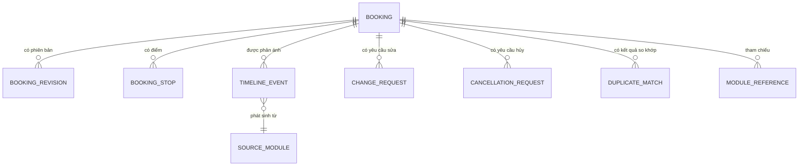

# BKG-008 — TRA CỨU, CHI TIẾT VÀ DÒNG THỜI GIAN BOOKING

**Mã tài liệu:** TAXI-BKG-008  
**Module sở hữu:** M01 — Khách hàng và Đặt xe  
**Epic:** Tra cứu và quản lý Booking  
**Phiên bản:** 0.1  
**Trạng thái:** DRAFT — CHỜ REVIEW NGHIỆP VỤ, UX, M01, M03, M04, M08, M09 VÀ DATA  
**Priority theo Feature Catalog:** P0  
**Business Owner:** TBD  
**Technical Owner:** M01 Owner — TBD  
**Tài liệu liên quan:** [BKG-001 — Tạo Booking tức thời](./BKG-001-create-immediate-booking.md) · [BKG-003 — Kiểm tra hợp lệ và vùng phục vụ](./BKG-003-validation-and-serviceability.md) · [BKG-004 — Điểm đón/điểm đến/điểm dừng](./BKG-004-pickup-destination-and-ordered-stops.md) · [BKG-005 — Sửa đổi Booking](./BKG-005-booking-amendment-and-change-request.md) · [BKG-006 — Hủy Booking](./BKG-006-cancel-booking-and-cancellation-policy.md) · [BKG-007 — Phát hiện Booking trùng](./BKG-007-duplicate-booking-detection-and-warning.md) · [X-01 — State Machine](../../../03-CROSS-CUTTING/01-state-machines-and-transition-rules.md) · [X-02 — Data Architecture](../../../03-CROSS-CUTTING/02-data-architecture-and-erd.md) · [X-03 — API/Event](../../../03-CROSS-CUTTING/03-api-and-event-contracts.md)

> **Nguyên tắc nguồn:** KPMG 2015 có mô tả tra cứu yêu cầu gần nhất theo số điện thoại/điểm đón để nhắc, thay đổi hoặc hủy (TO.P1.8, TO.P1.10); App/Web/SMS/Chat có mã đặt chỗ hoặc thông tin xác nhận theo từng quy trình; dữ liệu kết thúc chuyến/hóa đơn ở TO.P1.40 và TO.P9.16. KPMG không mô tả một màn hình tìm kiếm tổng hợp, bộ lọc quản trị, API tra cứu thống nhất, quyền truy cập hiện đại hay một timeline đa Module. Các nội dung đó trong tài liệu này là **đề xuất thiết kế mới**, cần Mai Linh xác nhận. Không diễn giải ví dụ lịch sử thành chính sách đang áp dụng.

---

## 0. Quản lý tài liệu và phê duyệt

| Vai trò | Người duyệt | Trạng thái |
|---|---|---|
| Business Owner — Vận hành Taxi | TBD | Pending |
| Product Owner M01 | TBD | Pending |
| Tổng đài/CSKH | TBD | Pending |
| Điều hành | TBD | Pending |
| Chủ Module M03 — Dispatch | TBD | Pending |
| Chủ Module M04 — Driver App & Trip | TBD | Pending |
| Chủ Module M08 — IAM/Audit | TBD | Pending |
| Chủ Module M09 — Integration/Notification | TBD | Pending |
| Data Architect | TBD | Pending |
| UX Lead | TBD | Pending |
| QA Lead | TBD | Pending |

### 0.1. Lịch sử thay đổi

| Phiên bản | Nội dung |
|---|---|
| 0.1 | Đặc tả tra cứu, danh sách, chi tiết và timeline Booking đa nguồn |

---

## 1. Bối cảnh và mục tiêu nghiệp vụ

### 1.1. Vấn đề cần giải quyết

Booking được tạo qua nhiều kênh: App, Web, Call Center, SMS, Chat và tích hợp đối tác. Sau khi tiếp nhận, Booking có thể được xác thực, sửa đổi, hủy, đưa vào Dispatch, gắn với tài xế/xe, phát sinh Trip, giá cước, thanh toán, hoàn tiền và quyết toán.

Các vai trò cần tra cứu cùng một Booking nhưng có mục đích và quyền khác nhau:
- Tổng đài cần tìm nhanh Booking khi khách gọi đến, nhắc xe, đổi điểm đón hoặc hủy.
- Điều hành cần xem trạng thái tiếp nhận và thông tin liên quan Dispatch.
- CSKH cần tái dựng diễn biến để giải quyết khiếu nại.
- Quản lý cần theo dõi số lượng, trạng thái, thời gian xử lý và chất lượng phục vụ.
- Kiểm toán cần xem ai đã làm gì, khi nào, dựa trên dữ liệu/version nào.
- Partner cần xem Booking thuộc tenant/contract của mình theo quyền được cấp.

Nếu mỗi Module tự tạo màn hình tra cứu riêng hoặc đọc trực tiếp database của Module khác, sẽ dẫn đến:
- Thông tin Booking không thống nhất.
- Trạng thái hiển thị sai hoặc cập nhật chậm không được giải thích.
- Nhân viên không biết thao tác nào đã xảy ra trước đó.
- Lộ dữ liệu cá nhân hoặc dữ liệu hợp đồng khác.
- Khó xác định nguồn dữ liệu chính xác khi có tranh chấp.
- Khó đối soát Booking với Dispatch, Trip và tài chính.

### 1.2. Mục tiêu

1. Cung cấp một điểm tra cứu Booking thống nhất theo quyền.
2. Hỗ trợ tìm theo Booking Code/ID, contact, customer, thời gian, địa điểm, channel, state và phạm vi DIRECT/PARTNER.
3. Hiển thị danh sách kết quả có phân trang, sắp xếp và bộ lọc.
4. Cung cấp trang chi tiết Booking với thông tin thuộc M01.
5. Cung cấp timeline nghiệp vụ, ghi rõ nguồn Module và thời điểm sự kiện.
6. Phân biệt dữ liệu Booking với dữ liệu Dispatch, Assignment, Trip, Fare, Payment và Settlement.
7. Hiển thị lịch sử Revision, Change Request, Cancellation và Duplicate Review theo quyền.
8. Cho phép điều hướng đến chức năng tương ứng; không cho phép màn hình tra cứu tự ghi dữ liệu của Module khác.
9. Áp dụng RBAC/ABAC, tenant scope, branch/operation scope và bảo vệ PII.
10. Hỗ trợ tra cứu lịch sử khi xử lý khiếu nại/kiểm toán.
11. Có thể truy vết dữ liệu trễ, thiếu hoặc lỗi tích hợp mà không tạo cảm giác mọi dữ liệu đều realtime.
12. Không làm thay đổi Booking State chỉ vì người dùng xem hoặc tra cứu.

### 1.3. Giá trị

| Nhóm | Giá trị |
|---|---|
| Khách hàng | Nhân viên hỗ trợ nhanh, giảm hỏi lại |
| Tổng đài | Tìm Booking theo thông tin khách cung cấp |
| Điều hành | Nắm Booking và liên kết Dispatch |
| CSKH | Có bằng chứng diễn biến và lịch sử |
| Quản lý | Có góc nhìn nhất quán theo scope |
| Kiểm toán | Truy vết actor, event, version |
| Đối tác | Tra cứu đúng dữ liệu hợp đồng được cấp |

### 1.4. Nguồn và truy vết

| Nguồn | Tham chiếu | Nội dung được hỗ trợ | Phân loại |
|---|---|---|---|
| KPMG 2015 | TO.P1.7 | Số điện thoại, số lượng xe, loại/hiệu xe; hiển thị địa chỉ gắn với số bàn hoặc ba địa chỉ yêu cầu gần nhất của số di động | Historical |
| KPMG 2015 | TO.P1.8 | Tra cứu theo số điện thoại; nếu số khác thì dựa vào điểm đón; chọn yêu cầu gần nhất để sửa/nhắc | Historical |
| KPMG 2015 | TO.P1.10–P1.11 | Tra cứu yêu cầu gần nhất theo số điện thoại hoặc điểm đón để hủy | Historical |
| KPMG 2015 | TO.P1.40 | Thông tin hóa đơn gồm cước, phụ thu, toll, tip, taxi/employee ID, điểm đầu/cuối, ngày giờ | Historical |
| KPMG 2015 | TO.P2 | App tạo yêu cầu với pickup, destination tùy chọn và thông tin xe | Historical |
| KPMG 2015 | TO.P5 | SMS tạo mã đặt chỗ và các thông báo theo luồng SMS | Historical |
| KPMG 2015 | TO.P6 | Chat trao đổi với Tổng đài, gửi mã đặt chỗ | Historical |
| KPMG 2015 | TO.P7 | Web tạo yêu cầu, hiển thị thông tin xác nhận và mã đặt chỗ | Historical |
| KPMG 2015 | TO.P8 | Booking đặt trước qua nhiều kênh | Historical |
| KPMG 2015 | TO.P9.16 | Thông tin kết thúc hành trình/hóa đơn đường dài | Historical |
| System Blueprint | M01 ownership | M01 sở hữu Booking/Revision/Customer/BookingStop | Kiến trúc dự thảo |
| X-01 | Booking lifecycle | Booking State và transition chuẩn | Kiến trúc dự thảo |
| X-02 | Data ownership | Quyền sở hữu entity và liên Module | Kiến trúc dự thảo |
| X-03 | API/Event | Contract truy vấn, event và lỗi | Kiến trúc dự thảo |
| Yêu cầu thiết kế mới | BKG-008 | Search, detail, timeline, filtering, UI, API, permissions | Đề xuất |

**Giới hạn nguồn:** KPMG không xác định danh sách bộ lọc, thứ tự ưu tiên tìm kiếm, thời gian lưu lịch sử, SLA query, mức độ realtime hoặc quyền của từng role. Tất cả đều cần xác nhận.

---

## 2. Phạm vi

### 2.1. Trong phạm vi

- Danh sách Booking theo data scope.
- Tra cứu bằng Booking Code/ID.
- Tra cứu theo customer/contact theo quyền.
- Tra cứu theo pickup/destination và khoảng thời gian.
- Bộ lọc Booking State, channel, fleet_type, tenant/branch/zone nếu được cấp quyền.
- Chi tiết Booking thuộc M01.
- Danh sách Booking Revision.
- Lịch sử Change Request và Cancellation.
- Duplicate Check/Match summary.
- Timeline hợp nhất các sự kiện liên quan từ Module khác.
- Link tham chiếu DispatchRun/Offer/Assignment, Trip, Fare/Payment/Settlement theo quyền.
- Audit truy cập nhạy cảm và thao tác điều hướng.
- Export dữ liệu nếu được cấp quyền và theo policy.
- API search/detail/timeline.

### 2.2. Ngoài phạm vi

- Tạo Booking: BKG-001.
- Validate và serviceability: BKG-003.
- Pickup/destination/stops: BKG-004.
- Sửa Booking: BKG-005.
- Hủy Booking: BKG-006.
- Phát hiện trùng: BKG-007.
- Đặt trước: BKG-002.
- Báo giá: BKG-009.
- Điều phối, Offer, Assignment: M03.
- Quản lý Driver/Vehicle: M02/M04 theo ownership.
- Trip lifecycle/actual route: M04.
- Fare/Payment/Refund: M05.
- Finance/Settlement: M06.
- Control Tower: M07.
- IAM/Audit platform: M08.
- Notification delivery: M09.
- Reporting warehouse: M10.

### 2.3. Nguyên tắc hiển thị

- M01 là nguồn dữ liệu chuẩn cho Booking và BookingRevision.
- Các Module khác là nguồn chuẩn cho entity thuộc ownership của mình.
- Trang chi tiết có thể hợp nhất dữ liệu qua API/read model, nhưng không được tạo bản sao có quyền ghi tùy tiện.
- Mỗi vùng thông tin phải chỉ rõ nguồn và thời điểm cập nhật nếu dữ liệu có độ trễ.
- Không hiển thị dữ liệu mà actor không có quyền chỉ vì nó nằm trong timeline.
- Tra cứu không thay đổi Booking State.
- Timeline là lịch sử sự kiện, không phải bảng trạng thái thay thế State Machine.

### 2.4. Phụ thuộc

| Dependency | Module | Nội dung | Khi lỗi |
|---|---|---|---|
| Booking Search/Detail API | M01 | Booking, customer reference, revision, stops | Báo lỗi phần Booking; không giả dữ liệu |
| Customer profile | M01/CUS-001 | Customer/contact display | Mask hoặc hiển thị reference |
| Dispatch query | M03 | DispatchRun, Offer, Assignment, queue reference | Hiển thị phần Dispatch unavailable/stale |
| Trip query | M04 | Trip status, timestamps, route references | Hiển thị phần Trip chưa tải |
| Fare/Payment query | M05 | Quote/Fare/Payment/Refund references | Ẩn theo quyền; lỗi riêng |
| Settlement query | M06 | Settlement reference | Không làm hỏng trang Booking |
| Duplicate review | M01/BKG-007 | Match/decision summary | Hiển thị chưa tải |
| Audit | M08 | Access audit, actor display | Theo policy; không cho phép vượt quyền |
| Notification | M09 | Message delivery reference | Chỉ hiển thị delivery status nếu có |
| Reporting | M10 | Aggregate/report link | Không dùng báo cáo thay dữ liệu nguồn |

---

## 3. Actor, vai trò và phân quyền

| Actor | Mục tiêu | Permission đề xuất | Data scope |
|---|---|---|---|
| Khách hàng | Xem Booking của mình | `booking.read.self` | SELF |
| Tổng đài viên | Tra cứu hỗ trợ khách | `booking.search`, `booking.read` | Assigned queue/branch theo policy |
| Điều hành | Tra cứu phục vụ Dispatch | `booking.read.operational` | Operation area/shift |
| CSKH | Tra cứu khiếu nại | `booking.read.support` | Case/customer scope |
| Quản lý vận hành | Tra cứu Booking theo đơn vị | `booking.read.manage` | Branch/region |
| Partner user | Tra cứu Booking hợp đồng | `partner.booking.read` | Tenant/contract |
| Auditor | Xem lịch sử theo quyền | `booking.read.audit` | Assigned audit scope |
| System integration | Truy vấn máy-máy | Service permission | Tenant/client scope |

### 3.1. Permission chi tiết đề xuất

- `booking.search`
- `booking.read`
- `booking.read.self`
- `booking.read.contact`
- `booking.read.location`
- `booking.read.revisions`
- `booking.read.change_requests`
- `booking.read.cancellation`
- `booking.read.duplicate_review`
- `booking.read.dispatch_summary`
- `booking.read.trip_summary`
- `booking.read.fare_summary`
- `booking.read.payment_summary`
- `booking.read.settlement_summary`
- `booking.read.timeline`
- `booking.timeline.export`
- `booking.search.advanced`
- `booking.read.pii`
- `booking.read.audit`

Danh sách permission là đề xuất. M08 phải chuẩn hóa tên, role mapping, data scope và ABAC trong X-04.

### 3.2. Quy tắc phân quyền

1. Kiểm tra quyền ở server trên từng Booking và từng section.
2. Không dựa vào việc ẩn nút ở UI để bảo vệ dữ liệu.
3. Customer chỉ xem Booking có quan hệ ownership/authorization hợp lệ.
4. Partner chỉ xem Booking trong tenant/contract của mình.
5. DIRECT/PARTNER không được trộn dữ liệu tài chính hoặc thông tin nội bộ không liên quan.
6. Số điện thoại, địa chỉ chi tiết, ghi chú và dữ liệu nhạy cảm cần permission riêng.
7. Timeline không được làm lộ sự kiện/actor thuộc scope khác.
8. Export phải có permission riêng, giới hạn trường và audit.
9. Truy cập chi tiết PII hoặc export có thể yêu cầu reason theo policy.
10. Quyền xem không đồng nghĩa quyền sửa/hủy/điều phối.

### 3.3. Phân tách nhiệm vụ

BKG-008 chỉ đọc. Các hành động sửa/hủy/điều phối phải điều hướng đến feature/Module sở hữu. Không thêm quyền ghi vào BKG-008 để tiện thao tác.

---

## 4. Thuật ngữ và dữ liệu

### 4.1. Thuật ngữ

| Thuật ngữ | Định nghĩa |
|---|---|
| Booking Code | Mã hiển thị để khách/nhân viên tham chiếu |
| Booking ID | Định danh kỹ thuật duy nhất |
| Booking State | Trạng thái Aggregate Booking theo X-01 |
| Booking Revision | Phiên bản bất biến ghi nhận thay đổi Booking |
| Timeline Event | Sự kiện mô tả việc đã xảy ra tại một thời điểm |
| Source Module | Module sở hữu sự kiện/dữ liệu gốc |
| Read Model | Dữ liệu tối ưu cho truy vấn, không thay nguồn sở hữu |
| Freshness | Mức độ mới của dữ liệu so với nguồn |
| Data Scope | Phạm vi dữ liệu actor được phép xem |
| Correlation ID | Mã liên kết các request/event trong một luồng |

### 4.2. Bộ lọc tìm kiếm

| Trường | Kiểu | Bắt buộc | Quy tắc |
|---|---|---|---|
| booking_code | String | Không | Exact/prefix theo policy; exact ưu tiên |
| booking_id | UUID/ID | Không | Exact match |
| customer_id | ID | Không | Chỉ khi có quyền |
| contact_phone | String | Không | Chuẩn hóa; masking; quyền PII |
| pickup_keyword | String | Không | Tìm địa danh/địa chỉ theo index |
| pickup_place_id | ID | Không | Exact/nearby theo policy |
| destination_keyword | String | Không | Nếu Booking có destination |
| pickup_from | Datetime | Không | Cùng timezone chuẩn |
| pickup_to | Datetime | Không | Phải lớn hơn from |
| created_from | Datetime | Không | Theo created_at |
| created_to | Datetime | Không | Phải lớn hơn from |
| booking_state | Enum | Không | Theo X-01, không tự thêm enum |
| booking_channel | Enum/string | Không | Theo danh mục channel được duyệt |
| fleet_type | DIRECT/PARTNER | Không | Không cho client vượt data scope |
| tenant_id | ID | Không | Server kiểm tra tenant scope |
| branch/zone | ID | Không | Theo quyền tổ chức |
| vehicle_type | ID/enum | Không | Danh mục M02 |
| created_by | Actor ID | Không | Theo quyền |
| has_assignment | Boolean | Không | Query M03 hoặc read model |
| has_trip | Boolean | Không | Query M04 hoặc read model |

Không bắt buộc tất cả bộ lọc phải xuất hiện ở phiên bản đầu. Product Owner/UX xác định bộ lọc P0; API phải bảo đảm authorization và hiệu năng.

### 4.3. Quy tắc đầu vào tìm kiếm

- Tối thiểu một tiêu chí tìm kiếm hoặc bộ lọc có ý nghĩa.
- Không cho phép query rỗng gây full table scan.
- Khoảng thời gian phải hợp lệ và có giới hạn tối đa theo cấu hình.
- Chuẩn hóa số điện thoại trước khi tìm; không log số thô.
- Keyword địa chỉ phải giới hạn độ dài và sanitize.
- Exact Booking Code/ID nên ưu tiên hơn tìm kiếm mờ.
- Kết quả phải giới hạn theo data scope phía server.
- Không tiết lộ sự tồn tại của Booking ngoài scope qua khác biệt error message.
- Sort field phải nằm trong allowlist.
- Pagination dùng cursor/offset theo lựa chọn kiến trúc và X-05.

### 4.4. Dữ liệu chi tiết Booking

| Nhóm | Dữ liệu | Nguồn sở hữu | Hiển thị |
|---|---|---|---|
| Identity | Booking ID, Code, State | M01 | Theo quyền |
| Customer | Customer reference, contact summary | M01/CUS | Theo quyền |
| Channel | booking_channel, source reference | M01 | Theo quyền |
| Fleet | DIRECT/PARTNER | M01 contract context/M02 | Theo scope |
| Pickup | Requested pickup | M01 BookingStop | Theo quyền |
| Destination | Requested destination | M01 BookingStop | Theo quyền |
| Stops | Ordered requested stops | M01 | Theo quyền |
| Service | Vehicle type/model/features/quantity | M01 reference, catalog M02 | Theo quyền |
| Schedule | requested pickup datetime | M01 | Theo quyền |
| Note | Customer note/internal note phân loại | M01 | Permission riêng |
| Revision | Revision number/time/actor/summary | M01 | Permission riêng |
| Change Request | Status/decision/reference | M01 | Permission riêng |
| Cancellation | Status/reason/actor/time | M01/M08 | Permission riêng |
| Duplicate | Match/decision summary | M01/BKG-007 | Permission riêng |
| Dispatch | DispatchRun/Offer/Assignment reference | M03 | Permission riêng |
| Trip | Trip reference/status | M04 | Permission riêng |
| Fare | Quote/Fare reference/summary | M05 | Permission riêng |
| Payment | Payment/Refund summary | M05 | Permission riêng |
| Settlement | Settlement reference/status | M06 | Permission riêng |
| Notification | Message/delivery references | M09 | Permission riêng |
| Audit | Actor/event/access references | M08 | Permission riêng |

### 4.5. Timeline Event schema logic

| Field | Ý nghĩa |
|---|---|
| timeline_event_id | ID duy nhất của event/read model |
| aggregate_type | BOOKING/DISPATCH/TRIP/FARE/PAYMENT/... |
| aggregate_id | ID entity nguồn |
| booking_id | Booking liên quan |
| event_type | Loại event gốc |
| event_version | Version event |
| occurred_at | Thời điểm nghiệp vụ xảy ra |
| recorded_at | Thời điểm hệ thống ghi nhận |
| source_module | Module phát event |
| actor_type/actor_id | Actor thực hiện nếu có |
| summary_code | Mã nội dung chuẩn hóa |
| safe_summary | Nội dung hiển thị đã lọc quyền |
| source_reference | ID tham chiếu nguồn |
| correlation_id | Liên kết luồng |
| causation_id | Event/command gây ra |
| source_version | Version Aggregate tại nguồn |
| visibility_scope | Phân loại quyền hiển thị |
| payload_ref | Tham chiếu payload chi tiết, không nhúng PII không cần thiết |

Timeline Event là read model tổng hợp. Event gốc và dữ liệu chuẩn vẫn thuộc Module phát sinh.

---

## 5. Business Rules

| Rule ID | Quy tắc | Nguồn | Trạng thái |
|---|---|---|---|
| BKG008-R01 | M01 là nguồn chuẩn cho Booking và BookingRevision | X-02 | Draft |
| BKG008-R02 | Tất cả kết quả search phải áp dụng data scope phía server | X-04 | Draft |
| BKG008-R03 | Exact Booking Code/ID được ưu tiên trong tìm kiếm | Đề xuất UX | Draft |
| BKG008-R04 | Không cho phép truy vấn rỗng/full scan | NFR/Security | Draft |
| BKG008-R05 | Search phải hỗ trợ tra cứu theo số điện thoại khi actor có permission | TO.P1.8/P1.10 | Draft |
| BKG008-R06 | Khi số điện thoại khác, tra cứu theo điểm đón là căn cứ lịch sử KPMG; kết quả hiện đại cần thêm filter và quyền | TO.P1.8 | Draft |
| BKG008-R07 | “Yêu cầu gần nhất” trong KPMG không được tự diễn giải thành quy tắc sort duy nhất cho mọi màn hình | KPMG source | Draft |
| BKG008-R08 | Search result phải hiển thị Booking Code, pickup time, state và thông tin tóm tắt theo quyền | Đề xuất | Draft |
| BKG008-R09 | Search result không được hiển thị PII nếu thiếu permission | X-04 | Draft |
| BKG008-R10 | Chi tiết Booking lấy dữ liệu chuẩn từ M01 | X-02 | Draft |
| BKG008-R11 | Dispatch/Trip/Fare/Payment/Settlement chỉ đọc qua API/read model của Module sở hữu | X-02 | Draft |
| BKG008-R12 | Mỗi section phải có freshness/source timestamp nếu dữ liệu không đồng bộ tức thời | Đề xuất | Draft |
| BKG008-R13 | Timeline sắp xếp theo occurred_at; tie-breaker phải xác định ổn định | Đề xuất | Draft |
| BKG008-R14 | Phải phân biệt occurred_at và recorded_at để giải thích event đến trễ | Event design | Draft |
| BKG008-R15 | Timeline không được tự suy diễn state hiện tại từ event list | X-01 | Draft |
| BKG008-R16 | Booking State hiển thị theo X-01, không tự thêm trạng thái hiển thị thành State nguồn | X-01 | Draft |
| BKG008-R17 | Revision phải hiển thị đúng version và actor/time theo quyền | BKG-005 | Draft |
| BKG008-R18 | Change Request là aggregate riêng, không nhầm với Booking State | BKG-005 | Draft |
| BKG008-R19 | Cancellation request/history phải tách khỏi trạng thái Booking theo BKG-006 | BKG-006 | Draft |
| BKG008-R20 | Duplicate Match không được hiển thị như kết luận trùng nếu chưa có decision | BKG-007 | Draft |
| BKG008-R21 | Timeline hiển thị sự kiện Dispatch theo dữ liệu M03, không tự tạo Offer/Assignment | X-02 | Draft |
| BKG008-R22 | Timeline hiển thị Trip theo dữ liệu M04, không thay thế Trip detail | X-02 | Draft |
| BKG008-R23 | Fare/Payment/Refund/Settlement phải giữ ownership M05/M06 | X-02 | Draft |
| BKG008-R24 | DIRECT/PARTNER phải được filter và enforce theo tenant/contract scope | X-02/X-04 | Draft |
| BKG008-R25 | Không cho phép cross-tenant enumeration qua search, pagination hoặc error | Security | Draft |
| BKG008-R26 | Customer chỉ xem Booking thuộc ownership/authorization hợp lệ | Security | Draft |
| BKG008-R27 | Partner chỉ xem Booking thuộc tenant/contract được cấp | Security | Draft |
| BKG008-R28 | Export cần permission riêng, audit và field allowlist | Security | Draft |
| BKG008-R29 | Truy cập PII nhạy cảm phải được audit theo policy | X-04 | Draft |
| BKG008-R30 | Màn hình detail chỉ đọc; action sửa/hủy phải gọi BKG-005/BKG-006 | Ownership | Draft |
| BKG008-R31 | Search result không được hiển thị thông tin stale như realtime | NFR | Draft |
| BKG008-R32 | Nếu một Module downstream lỗi, chỉ section đó thể hiện unavailable; không giả dữ liệu | Resilience | Draft |
| BKG008-R33 | Timeline event trùng event_id phải được deduplicate ở read model | Event design | Draft |
| BKG008-R34 | Event đến sai thứ tự phải sắp xếp theo timestamp và giữ recorded_at | Event design | Draft |
| BKG008-R35 | Event không có occurred_at hợp lệ phải được đánh dấu dữ liệu lỗi, không âm thầm đặt giờ giả | Data quality | Draft |
| BKG008-R36 | Không được xóa/sửa lịch sử audit từ màn hình Booking | M08 | Draft |
| BKG008-R37 | Note khách hàng và internal note phải tách quyền hiển thị | Privacy | Draft |
| BKG008-R38 | Mọi link điều hướng phải kiểm tra lại quyền ở endpoint đích | Security | Draft |
| BKG008-R39 | Search filter/sort phải nằm trong allowlist để chống injection và query abuse | Security | Draft |
| BKG008-R40 | Kết quả search phải có pagination và giới hạn số dòng theo NFR | NFR | Draft |
| BKG008-R41 | Khi Booking ID không tồn tại và khi không có quyền xem, phản hồi không được làm lộ dữ liệu ngoài scope | Security | Draft |
| BKG008-R42 | Mọi timeline event phải có source_module và source_reference để truy vết | Traceability | Draft |
| BKG008-R43 | Nếu read model chưa cập nhật, phải thể hiện freshness/last synced hoặc trạng thái pending | Eventual consistency | Draft |
| BKG008-R44 | Timeline phải phân biệt sự kiện nghiệp vụ với sự kiện gửi/nhận thông báo | M09 | Draft |
| BKG008-R45 | Sự kiện khách xem Booking không được đưa vào timeline nghiệp vụ trừ khi audit policy yêu cầu | Audit design | Draft |
| BKG008-R46 | Không cho phép chỉnh sửa thông tin Booking trực tiếp trong màn hình lịch sử/timeline | M01 ownership | Draft |
| BKG008-R47 | Tìm kiếm theo địa chỉ phải tuân theo giới hạn địa lý và quyền xem vị trí | Privacy | Draft |
| BKG008-R48 | Tất cả datetime phải hiển thị theo timezone được cấu hình; lưu trữ theo chuẩn hệ thống | X-02/X-05 | Draft |
| BKG008-R49 | Khi có nhiều xe/BookingStops, phải thể hiện rõ quantity và thứ tự điểm, không làm mất cấu trúc | BKG-001/BKG-004 | Draft |
| BKG008-R50 | Booking có nhiều Trip/return leg phải hiển thị quan hệ tham chiếu, không gộp thành một Trip giả | TO.P9 / M04 | Draft |
| BKG008-R51 | Search by contact phải có rate limit và chống dò số điện thoại | Security | Draft |
| BKG008-R52 | Tìm kiếm nâng cao/export phải có audit và giới hạn kết quả | Governance | Draft |

---

## 6. Luồng nghiệp vụ

### 6.1. Tiền điều kiện

- Actor đã xác thực.
- Có permission search/read tương ứng.
- Data scope/tenant/contract được xác định.
- M01 Search API khả dụng.
- Các Module downstream được gọi theo nhu cầu và quyền.
- Query đáp ứng tối thiểu điều kiện tìm kiếm.

### 6.2. Luồng chính — Tìm Booking

| Bước | Actor | Hành động | Hệ thống | Kết quả |
|---|---|---|---|---|
| 1 | Actor | Mở màn hình tra cứu | Kiểm tra permission | Search UI |
| 2 | Actor | Nhập mã Booking hoặc filter | Validate format/range | Search criteria |
| 3 | UI | Gửi request | Gắn correlation ID | Search request |
| 4 | M01 | Xác thực actor/data scope | Enforce tenant/branch/contract | Authorized scope |
| 5 | M01 | Chuẩn hóa query | Normalize phone/time/location | Query model |
| 6 | M01 | Thực hiện search | Query index/read model | Candidate results |
| 7 | M01 | Áp dụng filter/sort/page | Không vượt data scope | Result page |
| 8 | UI | Hiển thị kết quả | Mask PII theo permission | Booking list |
| 9 | Actor | Chọn Booking | Gọi detail API | Detail page |
| 10 | M01 | Trả Booking detail | M01 source of truth | Booking detail |

### 6.3. Luồng chính — Xem chi tiết và timeline

1. Actor chọn Booking từ kết quả hoặc mở bằng Booking Code.
2. M01 kiểm tra quyền xem đối tượng cụ thể.
3. M01 trả Booking, Stops, Customer summary và Revision theo permission.
4. UI yêu cầu timeline theo Booking ID.
5. Timeline service/read model trả event references.
6. Các section cần thiết gọi M03/M04/M05/M06/M09 qua API/read model.
7. Mỗi section trả source/freshness/status.
8. UI hợp nhất theo occurred_at và tie-breaker.
9. Actor xem chi tiết sự kiện; quyền được kiểm tra lại.
10. Khi actor chọn hành động sửa/hủy, UI điều hướng sang BKG-005/BKG-006; không ghi trực tiếp.

### 6.4. Luồng Tổng đài tra cứu khi khách gọi

1. Nhân viên xác thực khách theo quy trình CSKH.
2. Nhập Booking Code hoặc số điện thoại/điểm đón theo quyền.
3. M01 trả các kết quả trong scope.
4. Nhân viên xác định đúng Booking bằng thời điểm đón/địa điểm/mã.
5. Mở detail.
6. Xem trạng thái và timeline.
7. Nếu khách muốn đổi, chuyển BKG-005.
8. Nếu khách muốn hủy, chuyển BKG-006.
9. Nếu có vấn đề xe/Trip, điều hướng M03/M04 theo quyền.
10. Ghi nhận case/customer interaction ở Module sở hữu nếu có.

### 6.5. Luồng CSKH xử lý khiếu nại

1. CSKH mở case/ticket liên quan.
2. Tìm Booking bằng Booking Code/reference.
3. Xem Booking detail và Revision.
4. Xem timeline theo nguồn Module.
5. Mở event detail để xem source reference, actor/time và correlation ID theo quyền.
6. Đối chiếu Dispatch/Trip/Notification/Payment theo API nguồn.
7. Ghi nhận kết luận vào case/ticket; không sửa lịch sử Booking.
8. Nếu phát hiện sai dữ liệu nguồn, chuyển đúng Module owner để xử lý.

### 6.6. Luồng Partner tra cứu

1. Partner user đăng nhập.
2. Hệ thống lấy tenant/contract scope từ token/session phía server.
3. Partner nhập Booking Code hoặc filter được cấp.
4. M01 kiểm tra tenant/contract ownership.
5. Trả kết quả thuộc scope.
6. Mask thông tin nội bộ/PII không được phép.
7. Không cho phép partner dùng filter để dò Booking tenant khác.

### 6.7. Luồng lịch sử đến trễ

1. Timeline read model nhận event từ Module nguồn.
2. Event có occurred_at và recorded_at.
3. Nếu event đến trễ, read model lưu cả hai timestamp.
4. Timeline sắp xếp theo occurred_at theo policy, nhưng UI thể hiện event được ghi nhận trễ nếu cần.
5. Nếu event chưa đến, section hiển thị freshness/pending.
6. Khi event được đồng bộ, timeline cập nhật không tạo event trùng.
7. Không sửa Booking State chỉ vì event timeline được đồng bộ.

### 6.8. Luồng thay thế

| Mã | Tình huống | Xử lý |
|---|---|---|
| ALT-01 | Tìm exact Booking Code | Trả đúng Booking nếu có quyền |
| ALT-02 | Tìm theo số điện thoại | Trả danh sách giới hạn theo quyền |
| ALT-03 | Tìm theo điểm đón | Trả candidate phù hợp filter |
| ALT-04 | Nhiều Booking cùng contact | Hiển thị pickup time/state để phân biệt |
| ALT-05 | Booking đặt trước | Tìm theo pickup datetime tương lai |
| ALT-06 | Booking đã hủy | Hiển thị lịch sử nếu actor có quyền |
| ALT-07 | Booking đã hoàn tất | Hiển thị dữ liệu lịch sử theo retention |
| ALT-08 | Booking PARTNER | Enforce tenant/contract scope |
| ALT-09 | Booking có nhiều xe | Hiển thị quantity/vehicle request rõ ràng |
| ALT-10 | Booking có nhiều điểm dừng | Hiển thị ordered stops |
| ALT-11 | Booking đường dài/return leg | Hiển thị các reference liên quan, không gộp Trip |
| ALT-12 | Actor không có quyền PII | Hiển thị dữ liệu masked |
| ALT-13 | Downstream module chậm | Hiển thị section stale/loading riêng |
| ALT-14 | Event đến sai thứ tự | Sắp xếp theo event time, giữ recorded time |
| ALT-15 | Event duplicate | Deduplicate theo event ID |
| ALT-16 | Search query không có kết quả | Empty state, không báo lỗi hệ thống |

### 6.9. Luồng ngoại lệ

| Mã | Tình huống | Hệ thống phản hồi | Phục hồi |
|---|---|---|---|
| EX-01 | Thiếu tiêu chí tìm kiếm | VALIDATION_ERROR | Bổ sung tiêu chí |
| EX-02 | Khoảng thời gian không hợp lệ | INVALID_DATE_RANGE | Nhập lại |
| EX-03 | Khoảng thời gian vượt giới hạn | SEARCH_RANGE_EXCEEDED | Thu hẹp filter |
| EX-04 | Booking Code sai định dạng | INVALID_BOOKING_CODE | Kiểm tra mã |
| EX-05 | Booking không tồn tại/ngoài scope | Không tiết lộ dữ liệu ngoài scope | Kiểm tra mã/quyền |
| EX-06 | Không có permission search | PERMISSION_DENIED | Yêu cầu cấp quyền |
| EX-07 | Không có permission xem PII | Trả dữ liệu masked | Không có |
| EX-08 | Search service timeout | SEARCH_TIMEOUT | Retry có kiểm soát |
| EX-09 | M01 source unavailable | BOOKING_DATA_UNAVAILABLE | Retry/incident |
| EX-10 | Read model stale | Trả freshness/stale indicator | Đồng bộ/reconcile |
| EX-11 | M03 query unavailable | Dispatch section unavailable | Retry section |
| EX-12 | M04 query unavailable | Trip section unavailable | Retry section |
| EX-13 | M05/M06 query unavailable | Financial section unavailable/hidden | Retry section |
| EX-14 | M09 notification query unavailable | Notification section unavailable | Retry section |
| EX-15 | Event thiếu source reference | Đánh dấu dữ liệu không đầy đủ | Data quality queue |
| EX-16 | Event thiếu occurred_at | Không giả timestamp | Quarantine/reconcile |
| EX-17 | Event duplicate | Bỏ bản trùng theo event ID | Không tạo bản mới |
| EX-18 | Event sai thứ tự | Giữ occurred_at/recorded_at | Rebuild projection |
| EX-19 | Booking Revision thay đổi khi đang xem | Stale version warning | Refresh |
| EX-20 | Pagination cursor không hợp lệ | INVALID_CURSOR | Tải lại trang đầu |
| EX-21 | Sort field không allowlist | INVALID_SORT_FIELD | Chọn sort hợp lệ |
| EX-22 | Search rate limit | RATE_LIMITED | Chờ theo policy |
| EX-23 | Partner tenant mismatch | Không tiết lộ Booking | Kiểm tra contract |
| EX-24 | Export vượt hạn mức | EXPORT_LIMIT_EXCEEDED | Thu hẹp dữ liệu |
| EX-25 | Export thiếu permission | PERMISSION_DENIED | Yêu cầu quyền |
| EX-26 | Audit service lỗi khi truy cập nhạy cảm | Theo fail-closed policy được duyệt | Retry/incident |
| EX-27 | PII masking service lỗi | Không trả PII thô | Retry/incident |
| EX-28 | Timeline event payload không đọc được | Hiển thị summary safe và lỗi chi tiết | Mở source module |
| EX-29 | Một Module trả dữ liệu khác version | Hiển thị version/freshness; không tự hợp nhất sai | Reconcile |
| EX-30 | Correlation ID không tìm thấy ở source | Hiển thị reference hiện có | Chuyển Module owner |

### 6.10. Hậu điều kiện

**Search thành công**
- Trả kết quả trong data scope.
- Không thay đổi Booking.
- Có pagination/freshness nếu cần.

**Detail thành công**
- Trả Booking source từ M01.
- Các section liên Module hiển thị đúng source/permission.
- Timeline giữ thứ tự và nguồn.

**Search/detail thất bại**
- Không trả dữ liệu vượt quyền.
- Không tạo thay đổi nghiệp vụ.
- Có correlation ID/error code để hỗ trợ.

---

## 7. State và transition

BKG-008 là Feature đọc dữ liệu, không sở hữu transition của Booking.

| Đối tượng | Hành vi | Quy tắc |
|---|---|---|
| Booking | Read | State theo X-01 |
| BookingRevision | Read | Append-only/version theo BKG-005 |
| Change Request | Read | Lifecycle riêng theo BKG-005 |
| Cancellation Request | Read | Lifecycle theo BKG-006 |
| Duplicate Match | Read | Status theo BKG-007 |
| DispatchRun/Offer/Assignment | Read reference | M03 sở hữu |
| Trip | Read reference | M04 sở hữu |
| Fare/Payment/Refund | Read reference | M05 sở hữu |
| Settlement | Read reference | M06 sở hữu |
| Timeline Projection | Build/update | Read model, không phải Booking State |

Không thêm Booking State hoặc chuyển Booking State khi mở màn hình, tìm kiếm, tải timeline hay export.

---

## 8. Đặc tả UI/UX

### 8.1. Màn hình

| Screen ID | Tên | Actor | Permission |
|---|---|---|---|
| BKG008-SCR-01 | Danh sách/tra cứu Booking | Tổng đài/Điều hành/CSKH/Quản lý | booking.search |
| BKG008-SCR-02 | Chi tiết Booking | Các role được cấp | booking.read |
| BKG008-SCR-03 | Timeline Booking | Các role được cấp | booking.read.timeline |
| BKG008-SCR-04 | Chi tiết sự kiện | Role hỗ trợ/kiểm toán | Event-specific permission |
| BKG008-SCR-05 | Lịch sử Revision | Tổng đài/CSKH/Quản lý | booking.read.revisions |
| BKG008-SCR-06 | Export kết quả | Role được cấp | booking.timeline.export |

### 8.2. Danh sách Booking

Các vùng giao diện đề xuất:
1. Thanh tìm kiếm nhanh Booking Code/ID.
2. Bộ lọc nâng cao.
3. Bộ lọc trạng thái.
4. Bộ lọc thời gian.
5. Bộ lọc channel và fleet type.
6. Kết quả dạng bảng.
7. Phân trang và tổng số kết quả nếu API cung cấp an toàn.
8. Lưu bộ lọc cá nhân nếu sản phẩm cho phép.
9. Empty/loading/error states.

Cột kết quả đề xuất:
- Booking Code.
- Pickup time.
- Pickup summary.
- Customer/contact masked.
- Vehicle type/quantity.
- Booking channel.
- DIRECT/PARTNER.
- Booking State.
- Created at.
- Assignment/Trip indicator nếu có quyền và dữ liệu sẵn.
- Action mở chi tiết.

Không đưa giá trị rating, giờ mở cửa hoặc thông tin không liên quan vào danh sách.

### 8.3. Chi tiết Booking

**Header**
- Booking Code.
- Booking State.
- Booking channel.
- DIRECT/PARTNER.
- Created at.
- Last updated.
- Action theo quyền: sửa, hủy, không có action nếu không đủ quyền.

**Thông tin khách**
- Customer reference/name theo quyền.
- Contact phone masked/full theo permission.
- Customer account/guest context.
- Source channel.

**Yêu cầu chuyến**
- Pickup.
- Destination.
- Ordered stops.
- Requested pickup datetime.
- Vehicle type/model/features.
- Quantity.
- Customer note.
- Booking reference.

**Trạng thái và liên kết**
- Booking State hiện tại.
- Revision hiện tại.
- Change Request summary.
- Cancellation summary.
- Duplicate review summary.
- Dispatch summary.
- Trip summary.
- Fare/Payment summary theo quyền.

### 8.4. Timeline

Timeline nhóm theo:
- Tiếp nhận Booking.
- Xác thực/đánh giá hợp lệ.
- Sửa đổi/Revision.
- Duplicate review.
- Dispatch/Offer/Assignment.
- Tài xế đến điểm đón/liên hệ khách nếu event nguồn hỗ trợ.
- Trip start/end.
- Fare/Payment/Refund.
- Cancellation/exception.
- Notification delivery (nhóm riêng, không trộn với sự kiện nghiệp vụ).

Mỗi event hiển thị:
- Thời điểm nghiệp vụ.
- Tên sự kiện dễ hiểu.
- Module nguồn.
- Actor/role nếu được phép.
- Summary.
- Trạng thái đồng bộ/freshness nếu cần.
- Link chi tiết nguồn nếu có quyền.

### 8.5. Ví dụ minh họa timeline

Đây là dữ liệu minh họa cấu trúc, không phải trình tự bắt buộc hay chính sách vận hành:

| Thời điểm | Sự kiện | Nguồn | Ý nghĩa |
|---|---|---|---|
| T0 | BookingSubmitted | M01 | Khách gửi yêu cầu |
| T1 | BookingValidated | M01 | Kiểm tra dữ liệu |
| T2 | BookingReadyForDispatch | M01 | Booking sẵn sàng bàn giao |
| T3 | DispatchRunStarted | M03 | Bắt đầu tìm xe |
| T4 | OfferAccepted | M03 | Tài xế nhận Offer |
| T5 | TripStarted | M04 | Chuyến bắt đầu |
| T6 | TripCompleted | M04 | Chuyến kết thúc |
| T7 | FareFinalized | M05 | Chốt cước |
| T8 | PaymentRecorded | M05 | Ghi nhận thanh toán |

Không giả định mọi Booking đều có đủ các event trên; Booking có thể hủy, không có xe, nhiều Trip hoặc có luồng riêng.

### 8.6. UI states

- INITIAL: Chưa tìm kiếm.
- LOADING: Đang tìm.
- RESULTS: Có kết quả.
- EMPTY: Không có kết quả.
- PARTIAL_RESULTS: Một số section không tải được.
- DETAIL_LOADING: Đang tải detail.
- TIMELINE_LOADING: Đang tải timeline.
- STALE: Dữ liệu read model cũ.
- PERMISSION_RESTRICTED: Một số trường/section không có quyền.
- ERROR: Không tải được nguồn chính.
- EXPORT_PROCESSING: Đang tạo file.
- EXPORT_FAILED: Export lỗi.

### 8.7. Nội dung thông báo

| Code | Nội dung gợi ý |
|---|---|
| SEARCH_EMPTY | Không tìm thấy Booking phù hợp với điều kiện tra cứu |
| SEARCH_RANGE_REQUIRED | Vui lòng nhập ít nhất một tiêu chí tìm kiếm |
| SEARCH_RANGE_EXCEEDED | Khoảng thời gian tìm kiếm vượt giới hạn cho phép |
| BOOKING_NOT_AVAILABLE | Không thể truy cập Booking này |
| SECTION_UNAVAILABLE | Dữ liệu của phân hệ này hiện chưa tải được |
| DATA_STALE | Dữ liệu có thể chưa được cập nhật mới nhất |
| PII_MASKED | Một số thông tin đã được ẩn theo quyền truy cập |
| TIMELINE_PARTIAL | Timeline đang thiếu dữ liệu từ một hoặc nhiều phân hệ |
| EXPORT_PERMISSION_REQUIRED | Bạn không có quyền xuất dữ liệu này |

---

## 9. API và Event Contract

> Endpoint là đề xuất; cần đồng bộ X-03. Search API không được trả field chỉ vì client yêu cầu; server quyết định field theo permission.

### 9.1. Search Booking

**Endpoint:** `GET /api/v1/bookings`

Query parameters đề xuất:
- `booking_code`
- `customer_id`
- `contact_phone`
- `pickup_keyword`
- `pickup_from`
- `pickup_to`
- `created_from`
- `created_to`
- `booking_state`
- `booking_channel`
- `fleet_type`
- `tenant_id` — chỉ được chấp nhận trong scope do server xác định
- `vehicle_type`
- `cursor`
- `limit`
- `sort`

Response minh họa:
```json
{
  "items": [
    {
      "booking_id": "booking-id",
      "booking_code": "ML-XXXXXX",
      "booking_state": "ACCEPTED",
      "booking_channel": "CALL_CENTER",
      "fleet_type": "DIRECT",
      "pickup_at": "2026-11-14T14:00:00+07:00",
      "pickup_summary": "Địa chỉ đã được rút gọn theo quyền",
      "contact_display": "******123",
      "vehicle_type": "SEDAN_4",
      "vehicle_quantity": 1,
      "created_at": "2026-11-14T13:45:00+07:00",
      "data_version": 3
    }
  ],
  "page": {
    "next_cursor": "opaque-cursor",
    "has_more": false
  },
  "query_context": {
    "correlation_id": "correlation-id",
    "generated_at": "2026-11-14T14:01:00+07:00"
  }
}
```

Giá trị trên chỉ minh họa schema; không phải Booking thật hoặc cam kết mã Booking/enum đã được phê duyệt.

### 9.2. Booking Detail

**Endpoint:** `GET /api/v1/bookings/{booking_id}`

Response nên bao gồm:
- Booking identity/state.
- Customer summary theo quyền.
- BookingStops.
- Service request/quantity.
- BookingRevision summary.
- created_at/updated_at.
- source/channel/fleet_type.
- references sang các Module khác.
- data version và source timestamp.

Không nhúng toàn bộ Payment/Trip/Assignment vào M01 response như dữ liệu sở hữu. Trả reference/summary được phép.

### 9.3. Timeline

**Endpoint:** `GET /api/v1/bookings/{booking_id}/timeline`

Query:
- `from`
- `to`
- `source_module`
- `event_type`
- `cursor`
- `limit`

Response:
```json
{
  "booking_id": "booking-id",
  "items": [
    {
      "timeline_event_id": "event-id",
      "event_type": "BookingSubmitted",
      "source_module": "M01",
      "occurred_at": "2026-11-14T13:45:00+07:00",
      "recorded_at": "2026-11-14T13:45:01+07:00",
      "actor": {
        "type": "CUSTOMER",
        "display": "Khách hàng"
      },
      "summary_code": "BOOKING_SUBMITTED",
      "safe_summary": "Yêu cầu đặt xe đã được gửi",
      "source_reference": "source-event-id",
      "correlation_id": "correlation-id",
      "source_version": 1,
      "freshness": "CURRENT"
    }
  ],
  "page": {
    "next_cursor": null,
    "has_more": false
  }
}
```

### 9.4. Event subscription/read model

Timeline projection có thể subscribe các event liên quan:
- M01: BookingSubmitted, BookingValidated, BookingReadyForDispatch, BookingAmended, BookingCancelled và event liên quan theo X-03.
- M03: DispatchRun/Offer/Assignment lifecycle event đã được công bố.
- M04: Trip lifecycle event đã được công bố.
- M05: Fare/Payment/Refund event đã được công bố.
- M06: Settlement event được phép hiển thị.
- M09: Notification delivery event được phép hiển thị.
- M08: Audit reference theo policy.

Tên event cụ thể phải lấy từ Event Catalog đã duyệt; không tự tạo event production chỉ từ tên minh họa trong tài liệu này.

### 9.5. Error codes

| Code | Ý nghĩa |
|---|---|
| SEARCH_CRITERIA_REQUIRED | Thiếu điều kiện tìm kiếm |
| SEARCH_RANGE_EXCEEDED | Khoảng tìm kiếm vượt giới hạn |
| INVALID_DATE_RANGE | Khoảng thời gian không hợp lệ |
| INVALID_SORT_FIELD | Sort field không được hỗ trợ |
| INVALID_CURSOR | Cursor không hợp lệ/hết hạn |
| BOOKING_NOT_AVAILABLE | Không thể truy cập Booking |
| BOOKING_DATA_UNAVAILABLE | Nguồn Booking không khả dụng |
| TIMELINE_PARTIAL_UNAVAILABLE | Timeline thiếu một phần dữ liệu |
| SECTION_SOURCE_UNAVAILABLE | Module nguồn không khả dụng |
| PII_ACCESS_DENIED | Không có quyền xem PII |
| EXPORT_PERMISSION_DENIED | Không có quyền export |
| EXPORT_LIMIT_EXCEEDED | Export vượt hạn mức |
| RATE_LIMITED | Vượt giới hạn truy vấn |
| TENANT_SCOPE_MISMATCH | Tenant/contract không hợp lệ |
| STALE_DATA_VERSION | Dữ liệu đã thay đổi version |

---

## 10. Data Model và Read Model

### 10.1. Ownership

| Entity | Owner | BKG-008 sử dụng |
|---|---|---|
| Booking | M01 | Đọc nguồn chuẩn |
| BookingRevision | M01 | Đọc lịch sử |
| BookingStop | M01 | Đọc điểm theo thứ tự |
| Customer/ContactPoint | M01/CUS | Đọc summary theo quyền |
| ChangeRequest | M01 | Đọc status/history |
| CancellationRequest | M01 | Đọc status/history |
| DuplicateCheck/Match | M01 | Đọc summary |
| DispatchRun/Offer/Assignment | M03 | Reference/summary qua API |
| Trip | M04 | Reference/summary qua API |
| Fare/Payment/Refund | M05 | Reference/summary qua API |
| Settlement | M06 | Reference/summary qua API |
| Notification delivery | M09 | Reference/summary qua API |
| AuditEvent | M08 | Reference/summary theo quyền |
| BookingTimelineProjection | Platform/read model owner TBD | Read model tổng hợp |

### 10.2. Read model đề xuất

Có thể xây dựng projection:
- `booking_search_projection`
- `booking_detail_projection` (chỉ khi cần và được Data Architect duyệt)
- `booking_timeline_projection`

Projection phải:
- Có source version/offset.
- Có idempotent event consumer.
- Có cơ chế rebuild/replay.
- Có dead-letter/quarantine cho event lỗi.
- Có freshness/lag monitoring.
- Không trở thành nguồn ghi nghiệp vụ.
- Không giữ PII nhiều hơn mục đích và retention được duyệt.

### 10.3. ERD logic



Sơ đồ logic không khẳng định các bảng vật lý. Data Architect quyết định storage, index, partition, projection và ownership chi tiết.

### 10.4. Retention và index

Cần quyết định:
- Thời gian giữ Booking search index.
- Thời gian giữ timeline projection.
- Retention event gốc.
- PII masking/anonymization sau thời hạn.
- Archive Booking cũ.
- Index Booking Code, contact token, customer_id, pickup datetime, state, tenant.
- Geospatial index cho pickup/destination nếu được phép.
- Index timeline theo booking_id + occurred_at.
- Cursor pagination và stable sort.

Không tự đặt số ngày/tháng/năm trong bản DRAFT này.

---

## 11. Security, Audit và Privacy

### 11.1. Bảo vệ dữ liệu

- Mọi query phải có tenant/data scope phía server.
- Phone/email/address được phân loại PII.
- Không trả PII đầy đủ mặc định.
- Không cho dò số điện thoại bằng hàng loạt request.
- Rate limit theo user, IP/client, tenant và query type.
- Không ghi PII thô vào log/trace.
- Không hiển thị internal note cho khách/partner.
- Không cho partner xem nội dung điều hành nội bộ.
- Financial data chỉ hiển thị khi permission và contract cho phép.
- Export phải giới hạn trường, số dòng và ghi audit.

### 11.2. Audit

Audit các hành động:
- SEARCH_BOOKING — khi policy yêu cầu.
- VIEW_BOOKING_DETAIL.
- VIEW_PII.
- VIEW_TIMELINE.
- VIEW_RESTRICTED_EVENT.
- EXPORT_BOOKING_LIST.
- EXPORT_BOOKING_TIMELINE.
- OPEN_CROSS_MODULE_REFERENCE.
- ACCESS_DENIED — theo security policy.

Audit lưu actor, time, target Booking, permission context, tenant/scope, purpose/reason nếu bắt buộc, correlation ID và client context phù hợp.

Không đưa thao tác xem thông thường vào timeline nghiệp vụ khách hàng nếu policy không yêu cầu; audit truy cập là lớp khác.

---

## 12. NFR và vận hành

| NFR | Yêu cầu |
|---|---|
| Search latency | Định nghĩa SLA theo loại query và tải thực tế; X-05 phê duyệt |
| Detail latency | M01 source không phụ thuộc hoàn toàn downstream |
| Timeline latency | Có thể tải phân đoạn/async; thể hiện freshness |
| Availability | Search Booking cốt lõi có mục tiêu riêng; downstream section lỗi độc lập |
| Consistency | M01 detail đọc source chuẩn; read model có version/lag |
| Security | Enforce scope/PII/RBAC/ABAC |
| Scalability | Index/pagination, không full scan |
| Observability | Correlation ID, source lag, API latency |
| Resilience | Timeout/circuit breaker/retry theo X-05 |
| Auditability | Ghi truy cập nhạy cảm và export |
| Accessibility | UX đáp ứng khả năng sử dụng của nhân viên |
| Localization | Tiếng Việt; datetime/currency theo cấu hình |
| Data quality | Event source/time/version rõ ràng |

### 12.1. Metrics

- `booking_search_requests_total` theo channel/role.
- `booking_search_latency_ms`.
- `booking_search_empty_rate`.
- `booking_search_error_total`.
- `booking_detail_latency_ms`.
- `booking_timeline_latency_ms`.
- `booking_timeline_event_lag_seconds`.
- `booking_timeline_duplicate_event_total`.
- `booking_timeline_missing_source_total`.
- `booking_search_rate_limited_total`.
- `booking_pii_access_total`.
- `booking_export_total`.
- `booking_cross_module_section_failure_total`.
- `booking_read_model_rebuild_total`.

### 12.2. Runbook cần có

1. Search API lỗi.
2. Booking detail không đồng bộ.
3. Timeline thiếu event từ Module nguồn.
4. Event bị duplicate/out-of-order.
5. Read model lag hoặc rebuild.
6. PII masking/access control lỗi.
7. Partner tenant scope sai.
8. Export dữ liệu bất thường.
9. Query chậm/full scan.
10. Reconcile timeline projection với event nguồn.

---

## 13. Kiểm thử

### 13.1. Test Cases

| Test ID | Tình huống | Kết quả mong đợi |
|---|---|---|
| BKG008-TC-001 | Search exact Booking Code hợp lệ | Trả đúng Booking trong scope |
| BKG008-TC-002 | Search Booking ID hợp lệ | Trả detail đúng |
| BKG008-TC-003 | Search Booking Code không tồn tại | Không có kết quả, không lộ dữ liệu |
| BKG008-TC-004 | Search không có tiêu chí | SEARCH_CRITERIA_REQUIRED |
| BKG008-TC-005 | Search theo phone có permission | Trả candidate được phép |
| BKG008-TC-006 | Search theo phone không có PII permission | Mask/deny theo policy |
| BKG008-TC-007 | Search theo pickup keyword | Trả kết quả phù hợp |
| BKG008-TC-008 | Search theo pickup time range | Lọc đúng timezone |
| BKG008-TC-009 | Date range đảo ngược | INVALID_DATE_RANGE |
| BKG008-TC-010 | Date range vượt giới hạn | SEARCH_RANGE_EXCEEDED |
| BKG008-TC-011 | Filter Booking State | Chỉ trả State theo X-01 |
| BKG008-TC-012 | Filter channel | Lọc đúng channel |
| BKG008-TC-013 | Filter DIRECT/PARTNER | Enforce scope, không cross-tenant |
| BKG008-TC-014 | User partner query tenant khác | Không tiết lộ Booking |
| BKG008-TC-015 | User branch query branch ngoài scope | Không trả dữ liệu |
| BKG008-TC-016 | Search không có kết quả | Empty state |
| BKG008-TC-017 | Pagination trang tiếp | Không trùng/mất kết quả theo cursor |
| BKG008-TC-018 | Cursor không hợp lệ | INVALID_CURSOR |
| BKG008-TC-019 | Sort field không allowlist | INVALID_SORT_FIELD |
| BKG008-TC-020 | Query injection trong keyword | Được sanitize/parameterize |
| BKG008-TC-021 | Rate limit search phone | RATE_LIMITED |
| BKG008-TC-022 | Mở detail không có quyền | Không truy cập |
| BKG008-TC-023 | Mở detail có quyền | Trả dữ liệu M01 |
| BKG008-TC-024 | Xem Booking nhiều stops | Đúng thứ tự điểm |
| BKG008-TC-025 | Xem Booking quantity > 1 | Hiển thị đúng số lượng |
| BKG008-TC-026 | Xem Booking Revision | Đúng version/actor/time |
| BKG008-TC-027 | Xem Change Request | Đúng lifecycle riêng |
| BKG008-TC-028 | Xem Cancellation history | Đúng thông tin theo BKG-006 |
| BKG008-TC-029 | Xem Duplicate Match chưa xác nhận | Hiển thị candidate, không gọi là confirmed |
| BKG008-TC-030 | Xem Dispatch section | Dữ liệu từ M03 |
| BKG008-TC-031 | M03 unavailable | Chỉ Dispatch section báo lỗi |
| BKG008-TC-032 | Xem Trip section | Dữ liệu từ M04 |
| BKG008-TC-033 | M04 unavailable | Chỉ Trip section báo lỗi |
| BKG008-TC-034 | Xem Fare/Payment | Dữ liệu từ M05 theo permission |
| BKG008-TC-035 | Xem Settlement | Dữ liệu từ M06 theo permission |
| BKG008-TC-036 | Xem Notification delivery | Phân biệt notification với business event |
| BKG008-TC-037 | Timeline event đến trễ | Giữ occurred_at/recorded_at |
| BKG008-TC-038 | Timeline event trùng event_id | Deduplicate |
| BKG008-TC-039 | Timeline event sai thứ tự | Sort ổn định theo policy |
| BKG008-TC-040 | Timeline event thiếu occurred_at | Đánh dấu dữ liệu lỗi, không tạo giờ giả |
| BKG008-TC-041 | Timeline event thiếu source reference | Đánh dấu thiếu truy vết |
| BKG008-TC-042 | Timeline thiếu event từ một Module | Partial timeline warning |
| BKG008-TC-043 | Read model stale | Hiển thị freshness |
| BKG008-TC-044 | Read model rebuild | Không nhân đôi event |
| BKG008-TC-045 | Booking revision thay đổi trong lúc xem | Stale version/refresh |
| BKG008-TC-046 | Customer xem Booking người khác | Deny |
| BKG008-TC-047 | Partner xem nội bộ Dispatch note | Không hiển thị |
| BKG008-TC-048 | User thiếu permission export | Deny |
| BKG008-TC-049 | Export có permission | Export đúng field allowlist và audit |
| BKG008-TC-050 | Export vượt limit | EXPORT_LIMIT_EXCEEDED |
| BKG008-TC-051 | PII masking service lỗi | Fail closed, không trả PII thô |
| BKG008-TC-052 | Audit service lỗi với truy cập nhạy cảm | Theo fail-closed policy |
| BKG008-TC-053 | Correlation ID dùng truy vết | Tìm đúng event/source khi có quyền |
| BKG008-TC-054 | Booking đường dài có return leg | Hiển thị đúng các reference Trip |
| BKG008-TC-055 | Booking đã hủy | Hiển thị lịch sử theo retention/quyền |
| BKG008-TC-056 | Booking đã hoàn tất | Hiển thị lịch sử theo retention/quyền |
| BKG008-TC-057 | Search exact code và advanced filter cùng lúc | Quy tắc ưu tiên rõ ràng |
| BKG008-TC-058 | Detail read-only | Không thể sửa/hủy qua BKG-008 |
| BKG008-TC-059 | Link sang BKG-005/BKG-006 | Endpoint đích kiểm tra quyền lại |
| BKG008-TC-060 | Search request không có scope hợp lệ | Deny, không fallback sang global |
| BKG008-TC-061 | Timeline actor không có permission | Mask/ẩn actor theo policy |
| BKG008-TC-062 | Customer note và internal note | Hiển thị đúng phân quyền |
| BKG008-TC-063 | Query quá rộng | Không full scan; yêu cầu thu hẹp |
| BKG008-TC-064 | Datetime hiển thị theo timezone | Đúng cấu hình |
| BKG008-TC-065 | Event source version lệch | Hiển thị stale/version warning |
| BKG008-TC-066 | Mọi thao tác view PII được audit | Audit đủ actor/time/target |
| BKG008-TC-067 | User truy cập Booking ID ngẫu nhiên ngoài scope | Không enumeration |
| BKG008-TC-068 | Search nhiều Booking cùng contact | Hiển thị đủ ngữ cảnh phân biệt |
| BKG008-TC-069 | Search Booking đặt trước | Dựa pickup datetime, không nhầm created_at |
| BKG008-TC-070 | Search theo created time | Lọc theo created_at, khác pickup time |

### 13.2. Acceptance Criteria

**AC-01 — Search thống nhất**
- Given actor có quyền và tiêu chí hợp lệ
- When tìm Booking
- Then trả danh sách trong data scope với pagination và thông tin tóm tắt.

**AC-02 — Exact lookup**
- Given Booking Code/ID hợp lệ
- When tìm exact
- Then trả đúng Booking nếu actor được phép xem.

**AC-03 — Search theo contact/location**
- Given actor có permission tương ứng
- When tìm theo số điện thoại/điểm đón
- Then kết quả được chuẩn hóa, giới hạn scope và masking.

**AC-04 — Booking detail**
- Given Booking tồn tại và actor có quyền
- When mở detail
- Then dữ liệu Booking lấy từ M01 source of truth.

**AC-05 — Timeline đa Module**
- Given có event hợp lệ từ các Module
- When xem timeline
- Then hiển thị event, source, occurred_at/recorded_at và reference.

**AC-06 — Ownership**
- Given detail có dữ liệu Dispatch/Trip/Finance
- When hiển thị
- Then mỗi section lấy dữ liệu từ Module sở hữu; M01 không ghi dữ liệu đó.

**AC-07 — Partial failure**
- Given một downstream Module không khả dụng
- When xem detail/timeline
- Then chỉ section tương ứng báo lỗi; không giả dữ liệu.

**AC-08 — State integrity**
- Given actor chỉ xem Booking
- When mở detail/timeline/export
- Then Booking State không thay đổi.

**AC-09 — Permission/PII**
- Given actor thiếu quyền
- When search/view/export
- Then không nhận dữ liệu vượt scope/PII.

**AC-10 — Revision and cancellation**
- Given Booking có lịch sử sửa/hủy
- When xem timeline
- Then hiển thị đúng revision/request history theo quyền, không nhầm với Booking State.

**AC-11 — DIRECT/PARTNER**
- Given Booking thuộc DIRECT/PARTNER
- When tra cứu
- Then enforce tenant/contract scope và không lộ dữ liệu chéo.

**AC-12 — Audit**
- Given actor xem PII/restricted event hoặc export
- When thao tác
- Then audit được ghi theo policy.

**AC-13 — Freshness**
- Given read model chưa đồng bộ
- When xem timeline
- Then hiển thị stale/pending và timestamp; không tuyên bố realtime.

**AC-14 — Performance**
- Given search/timeline theo tải mục tiêu đã duyệt
- When chạy kiểm thử tải
- Then đạt SLO/SLA được chốt trong X-05.

### 13.3. Definition of Done

- [ ] Business duyệt mục tiêu và nhóm actor.
- [ ] Product/UX duyệt search fields và cột danh sách.
- [ ] M01 xác nhận Booking detail schema.
- [ ] M03/M04/M05/M06/M09 xác nhận API/summary fields.
- [ ] M08 xác nhận permission, PII, audit và export.
- [ ] Data Architect xác nhận read model/event projection.
- [ ] X-03 xác nhận API/Event contract.
- [ ] X-05 xác nhận SLO, rate limit, retention và monitoring.
- [ ] QA hoàn tất test cases và security tests.
- [ ] UAT Tổng đài/Điều hành/CSKH/Partner theo role.
- [ ] Runbook và dashboard vận hành sẵn sàng.

---

## 14. Cấu hình và triển khai

### 14.1. Configuration cần có

| Configuration | Ý nghĩa | Owner | Trạng thái |
|---|---|---|---|
| BOOKING_SEARCH_ENABLED | Bật search | M01 | TBD |
| BOOKING_SEARCH_FIELDS | Danh sách field search | Product/M01 | TBD |
| BOOKING_SEARCH_MAX_RANGE | Giới hạn thời gian | Operations | TBD |
| BOOKING_SEARCH_PAGE_SIZE | Kích thước trang | Architecture | TBD |
| BOOKING_SEARCH_MAX_PAGE_SIZE | Giới hạn page size | Architecture | TBD |
| BOOKING_SEARCH_RATE_LIMIT | Rate limit | M08/Platform | TBD |
| BOOKING_SEARCH_PHONE_LOOKUP | Bật tra cứu contact | Product/ATTT | TBD |
| BOOKING_SEARCH_PII_MASKING | Mask PII | M08 | TBD |
| BOOKING_TIMELINE_SOURCES | Module/event sources | Architecture | TBD |
| BOOKING_TIMELINE_FRESHNESS_SLO | Mục tiêu độ mới | X-05 | TBD |
| BOOKING_TIMELINE_RETENTION | Thời gian lưu projection | Data/Legal | TBD |
| BOOKING_EXPORT_ENABLED | Bật export | Product/M08 | TBD |
| BOOKING_EXPORT_MAX_ROWS | Giới hạn export | Governance | TBD |
| BOOKING_DETAIL_SECTIONS | Các section được bật | Product | TBD |
| BOOKING_PARTNER_SEARCH_SCOPE | Phạm vi partner | M02/M08 | TBD |

### 14.2. Lộ trình

**Giai đoạn 1 — M01 Search và Detail**
- Search Booking Code/ID.
- Search theo các field đã được duyệt.
- Detail Booking từ M01.
- Revision/Stops/Customer summary.
- RBAC và data scope.

**Giai đoạn 2 — Timeline M01**
- Booking lifecycle events.
- Revision/Change Request/Cancellation/Duplicate Review.
- Timeline projection, event dedup và freshness.

**Giai đoạn 3 — Dispatch và Trip**
- Tích hợp M03 Dispatch summary.
- Tích hợp M04 Trip summary.
- Deep link theo permission.
- Partial failure handling.

**Giai đoạn 4 — Finance/Notification**
- Fare/Payment/Refund từ M05.
- Settlement từ M06.
- Notification delivery từ M09.
- Phân tách DIRECT/PARTNER.

**Giai đoạn 5 — CSKH/Partner/Export**
- Case workflow.
- Partner portal scope.
- Export/audit.
- Tối ưu search và operational monitoring.

Không triển khai timeline bằng cách query trực tiếp database của các Module khác.

---

## 15. Rủi ro, quyết định và TBD

| ID | Quyết định cần chốt | Ảnh hưởng | Owner đề xuất |
|---|---|---|---|
| BKG008-DEC-01 | Vai trò nào được dùng search tổng hợp? | RBAC | COO/M08 |
| BKG008-DEC-02 | Khách có được tự tra cứu Booking bằng mã và phone? | Customer UX/PII | Product |
| BKG008-DEC-03 | Bộ field search P0 là gì? | UX/API | Product/M01 |
| BKG008-DEC-04 | Có cho search exact phone hay chỉ masked/verified? | Privacy | ATTT |
| BKG008-DEC-05 | Quy tắc tìm theo địa chỉ/địa danh và geospatial? | Geo/Data | Product |
| BKG008-DEC-06 | Cửa sổ thời gian tối đa cho search? | Performance | Operations |
| BKG008-DEC-07 | Default sort theo created_at hay pickup_at? | UX | Operations |
| BKG008-DEC-08 | Có hỗ trợ tìm theo tên khách? | PII/UX | Product |
| BKG008-DEC-09 | Có hỗ trợ tìm theo tài xế/xe? | Cross-module | M03/M04 |
| BKG008-DEC-10 | Booking Code format/lookup normalization? | Identity | M01 |
| BKG008-DEC-11 | Bộ cột search list theo từng role? | UX/RBAC | Product |
| BKG008-DEC-12 | Detail sections nào là P0? | Scope | Product |
| BKG008-DEC-13 | Timeline có hiển thị notification delivery không? | UX/Privacy | Product/M09 |
| BKG008-DEC-14 | Timeline có hiển thị audit access event không? | Audit/Privacy | M08 |
| BKG008-DEC-15 | Event timeline nào được coi là business event chính thức? | Event Catalog | Architecture |
| BKG008-DEC-16 | Tie-breaker khi occurred_at bằng nhau? | Timeline consistency | Data |
| BKG008-DEC-17 | SLA/freshness cho từng Module source? | NFR | Module Owners |
| BKG008-DEC-18 | Khi source module unavailable, detail có cho xem partial không? | UX/Resilience | Product |
| BKG008-DEC-19 | Có cần read model riêng hay query API tổng hợp? | Architecture | Architect |
| BKG008-DEC-20 | Cơ chế rebuild/replay timeline projection? | Data/Operations | Architect |
| BKG008-DEC-21 | Retention Booking search index/timeline projection? | Legal/Data | Legal/ATTT |
| BKG008-DEC-22 | PII masking theo role/channel/contract? | Security | M08 |
| BKG008-DEC-23 | DIRECT/PARTNER được hiển thị những trường nào? | Contract | M02/Legal |
| BKG008-DEC-24 | Partner có xem Assignment/Trip summary không? | Partner policy | M02/M03 |
| BKG008-DEC-25 | Financial summary hiển thị cho role nào? | Finance/RBAC | M05/M06 |
| BKG008-DEC-26 | Export có được bật ở giai đoạn đầu không? | Governance | COO/M08 |
| BKG008-DEC-27 | Export max rows và approval? | Security | M08 |
| BKG008-DEC-28 | Có cần ghi audit mọi lần search theo phone? | Privacy | ATTT |
| BKG008-DEC-29 | Có lưu search history của nhân viên không? | Privacy/Product | M08 |
| BKG008-DEC-30 | Customer/Partner có được xem timeline đầy đủ hay timeline rút gọn? | Product/Privacy | Product |
| BKG008-DEC-31 | Booking đường dài/return leg hiển thị quan hệ ra sao? | Trip model | M04 |
| BKG008-DEC-32 | Multi-vehicle Booking hiển thị từng xe/Assignment ở detail hay trang con? | UX/M03 | M03 |
| BKG008-DEC-33 | SLA query và tải mục tiêu? | NFR | Architecture |
| BKG008-DEC-34 | Timezone mặc định theo user, branch hay pickup location? | Localization | Product |
| BKG008-DEC-35 | Có hỗ trợ lưu filter/favorite search? | UX | Product |
| BKG008-DEC-36 | Có hỗ trợ export theo background job không? | Architecture | Platform |

---

## 16. Tiêu chí nghiệm thu Feature

- [ ] Search theo Booking Code/ID hoạt động.
- [ ] Bộ lọc P0 được duyệt và triển khai.
- [ ] Search theo phone/location tuân thủ permission.
- [ ] Search không full scan và có pagination.
- [ ] Booking detail lấy dữ liệu chuẩn từ M01.
- [ ] Revision/Change Request/Cancellation/Duplicate Review được hiển thị đúng ownership.
- [ ] Timeline có source, timestamp, version và correlation reference.
- [ ] Dispatch/Trip/Fare/Payment/Settlement lấy qua API/read model của owner.
- [ ] Partial failure và freshness được thể hiện.
- [ ] DIRECT/PARTNER và tenant scope được kiểm thử.
- [ ] PII masking, RBAC/ABAC và audit đạt yêu cầu.
- [ ] Export có permission và audit nếu triển khai.
- [ ] Không có thao tác ghi nghiệp vụ ngoài scope BKG-008.
- [ ] QA/Performance/Security test đạt tiêu chí.
- [ ] Tổng đài, Điều hành, CSKH và Partner UAT theo scope.
- [ ] Runbook/monitoring sẵn sàng.

### 16.1. Kết luận hiện tại

**Trạng thái:** DRAFT — Chưa đạt READY/DoR.

**Blocker chính:**
1. Chưa chốt role/data scope và field PII.
2. Chưa chốt bộ lọc P0 và giới hạn khoảng thời gian.
3. Chưa chốt timeline event catalog và Module source.
4. Chưa chốt read model/freshness/retention.
5. Chưa chốt DIRECT/PARTNER/Partner visibility.
6. Chưa chốt export/audit.
7. Chưa chốt SLO search/timeline.

**Khuyến nghị:** triển khai trước Search + Detail từ M01, sau đó thêm timeline M01; chỉ tích hợp Dispatch/Trip/Finance khi API/read contract của Module owner đã được duyệt. Không dùng truy vấn chéo database.

---

**Quay lại:** [Feature Specifications](../README.md) · [M01 — Customer & Booking](../../../02-DOMAIN-MODULES/01-customer-and-booking/README.md)
